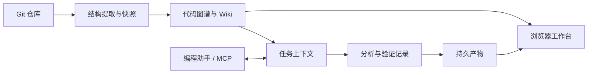

# Tomato · 代码理解与证据工作台

把陌生代码仓库整理成可浏览的关系图谱、可阅读的 Wiki，以及能回到源码核对的任务记录。

Tomato 是本仓库的名称，内部包名、CLI 和技能沿用 **Understand Code**。项目基于 Understand Anything 延续开发，围绕持久任务、证据工作台、知识检索与宿主集成持续完善。上游作者与许可见 [来源说明](NOTICE.md)。

[中文使用手册](README.zh-CN.md) · [CLI 与 MCP](packages/cli/README.md) · [Preview 安装](packages/preview/README.md) · [来源与许可](NOTICE.md)

## 能解决什么问题

- **接手陌生项目**：从目录、架构分层和导览进入源码，定位模块关系。
- **理解一项改动**：将任务目标、源码证据、分析结论和实际验证记录放在同一上下文。
- **维护项目知识**：生成和阅读 Markdown Wiki，在文档、图谱和源码之间跳转。
- **协作编程**：通过 MCP 提供仓库状态、上下文检索、持久任务与工作台入口。

## 功能与实现

| 能力 | 实现内容 | 源码入口 |
| --- | --- | --- |
| 结构分析 | 语言提取器、导入与调用关系、分层、图谱 | [core](packages/core) |
| 知识阅读 | Wiki、全文搜索、图谱下钻、源码引用 | [dashboard](packages/dashboard) |
| 持久任务 | 目标、分析、变更检查、验证记录与恢复 | [task-engine](packages/task-engine) |
| 产物一致性 | 仓库快照、事件日志、路径边界和持久化 | [repository-state](packages/repository-state)、[artifact-store](packages/artifact-store) |
| 宿主集成 | CLI、stdio MCP、Host 适配与安装诊断 | [cli](packages/cli)、[host-adapters](packages/host-adapters) |



静态关系不等于完整业务理解。工作台记录宿主实际执行的验证，自身不会替代测试执行。

## 从源码开始

本地持久任务运行时支持 **macOS / Linux**，需要 **Node.js 22+、pnpm 10、Git**。当前为开发中的 Preview；Windows 尚未纳入完整运行时支持范围。

```bash
git clone https://github.com/chifanjie/Tomato.git
cd Tomato
pnpm install --frozen-lockfile
pnpm --filter @understand-code/preview build
```

将 Preview 打包到事先创建的绝对路径：

```bash
pnpm --dir packages/preview pack --pack-destination /absolute/path/to/output
```

再按 [Preview 指南](packages/preview/README.md) 安装生成的本地 tarball、注册宿主并运行 Doctor。

在一个可公开的示例 Git 仓库中向宿主描述任务：

> 请解释这个示例项目的请求处理流程，创建持久任务，列出相关源码证据和不确定项，并返回任务 ID 与工作台链接。

宿主返回任务 ID 与工作台链接后，即可查看任务记录和源码证据。源码技能 `/understand`、`/understand-kb` 与 Preview MCP 是不同入口，技能安装见 [中文手册](README.zh-CN.md)。

## 值得阅读的工程设计

- **证据回溯**：结论关联快照与源码证据，保留未知项。
- **任务恢复**：持久化层管理版本、幂等写入和恢复。
- **检索性能**：全文搜索使用 Worker 处理解析与查询，并处理取消、迟到请求和降级。
- **分析边界**：解析器保留无法解析的调用，不用同名函数猜测真实绑定。

## 开发检查

根目录 `package.json` 定义 `build:all`、`typecheck`、`test`、`quality`。运行时测试有平台与本机工具要求，可以从小范围开始：

```bash
pnpm --filter @understand-code/dashboard test
pnpm --filter @understand-code/cli typecheck
```

完整运行验证尚未覆盖全部平台与宿主组合。性能取决于仓库规模、语言、机器配置和版本，建议使用目标项目评估。

## 当前边界

- 本地持久任务与 Provider 强隔离是不同模式，实验接口不等于生产能力已经开放。
- 动态导入、反射、代码生成及部分语言绑定可能无法完整解析。
- 模型分析由宿主配置决定，使用前应确认目标代码允许交给该宿主。
- 工作台链接含本地访问令牌，不是可随意分享的线上地址。
- 仓库中的示例采用通用场景，业务仓库与私有知识库由使用者自行提供。

维护者：[chifanjie](https://github.com/chifanjie)。反馈问题请附平台、版本、最小样例和期望行为，勿粘贴凭据或私人源码。
