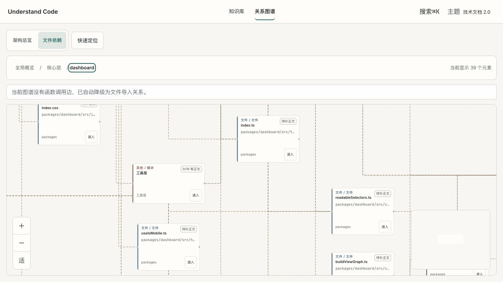
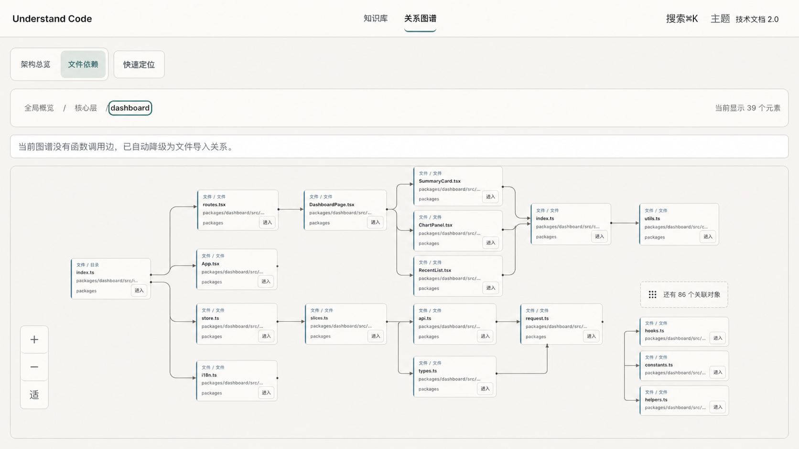
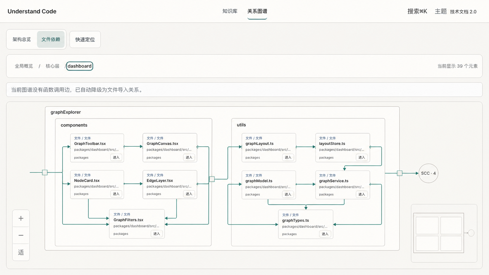
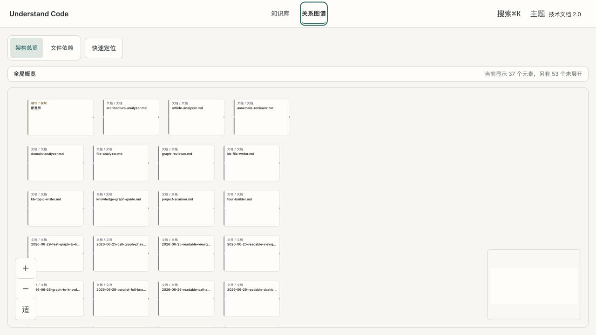
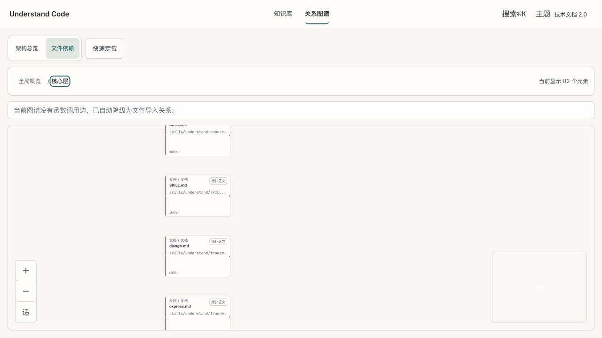

# 大规模代码图谱自动布局质量升级 PRD

产品：Understand Code / 关系图谱  
状态：Draft for Review  
版本：v1.0  
日期：2026-07-22  
负责人：Product / Frontend / Graph Analysis（待指定）  
布局对照图：[当前布局](assets/graph-layout/current-dashboard-cluster.png) · [Dagre 快修](assets/graph-layout/dagre-quick-fix-target.png) · [ELK 目标方案](assets/graph-layout/elk-layered-target.png)

> 决策摘要：采用“两阶段上线 + 一阶段目标验证”。P0 先修复展示集合与现有 Dagre，P1 在扫描产物中增加可选且版本化的 `topology.v1`，P2 仅在同一批基准数据上显著优于 Dagre 且性能达标后，以 ELK Layered 替换布局核心。React Flow、Worker、缓存、下钻与 fallback 保持不变。

## 1. 文档目的

本文定义 Understand Code 在扫描任意新代码仓库后，如何生成更清晰、稳定、可解释的关系图谱。PRD 同时覆盖产品体验、展示策略、布局算法、扫描端拓扑数据、兼容性、质量指标、测试矩阵、灰度发布与风险控制。

本次需求不是单纯调整 `nodesep` 或 `ranksep`。审计显示，当前视觉问题由三个层面共同造成：展示端一次放入了过多或不够重要的元素；扫描端没有把已经计算出的社区、中心性和方向信息写入稳定契约；布局端又破坏了 Dagre 的部分交叉优化，并缺少复合分组与端口路由。

## 2. 背景与基线证据

### 2.1 当前真实图谱规模

| 指标 | 当前审计值 | 说明 |
|---|---:|---|
| 节点总数 | 846 | 451 functions、277 files、76 docs、28 classes、13 configs、1 service |
| 边总数 | 985 | 479 contains、267 exports、187 imports、52 tested_by |
| calls 边 | 0 | 当前生成链路尚未稳定把调用关系写入最终图谱 |
| Overview 当前显示 | 37 | 元素集中在左上角，右侧留白明显 |
| Core scope 当前显示 | 82 | 首屏约只能看到 6 个节点，约 70 个文档/架构上下文形成长列 |
| Dashboard cluster 当前显示 | 39 | 交叉线、跨屏长边和遮挡明显 |



_图 1　当前布局基线：节点卡片、跨屏连线与视口利用率同时失控。_

### 2.2 已确认的产品问题

- 选择高扇出节点时，一跳邻居没有上限，测试甚至固化了 512 个 cluster、511 条边同时展开的行为。
- Scope 层的 architecture-context 节点没有数量上限；新仓库的架构说明越丰富，画布越容易形成“节点墙”。
- Overview 先由 Dagre 求出 rank 和交叉较少的次序，随后又按类型、度数和 ID 重新排列，破坏了原顺序。
- 宽屏使用 LR、窄屏使用 TB，但节点连接点始终为 Left/Right；TB 中的边会产生不必要折返。
- 卡片进入 minimal zoom 后只隐藏内容，几何尺寸并未同步收紧，出现大面积空白卡片。
- 自动适应视图只计算基础布局 bounds，不含临时展开节点。
- 边上限按权重截断时可能删掉某些节点的唯一连接，制造“假孤点”。
- `clusterId` 已进入 Worker 消息但没有被布局消费；边的业务权重也被简化为 `count`。
- 当前测试主要保证确定性、可达性和 fallback，没有度量重叠、边穿节点、交叉、紧凑度与真实截图质量。

### 2.3 根因判断

| 层面 | 当前缺口 | 直接后果 |
|---|---|---|
| 展示集合 | 节点/邻居无界或按 ID 截断 | 重要节点不一定出现，首屏密度不可控 |
| 语义数据 | 社区、层级、中心性、SCC、入口点未进入正式契约 | 布局只能依赖路径和静态类型权重 |
| 几何布局 | Dagre 后处理、固定端口、平面布局 | 交叉增加，TB 绕线，语义组分散 |
| 渲染契约 | `LayoutResult` 只返回节点坐标 | 无法消费 ELK 的 edge sections / bend points |
| 质量门禁 | Benchmark 失效、缺少几何与截图指标 | “更美观”无法客观验收 |

## 3. 产品目标与非目标

### 3.1 产品目标

1. 新扫描的中大型仓库进入图谱后，默认视图先呈现系统骨架，而不是平铺大量文件、文档和关系。
2. Overview、scope、cluster、file 四层分别采用符合任务的节点集合、关系集合、卡片密度与布局方式。
3. 相同输入产生确定、稳定的坐标和路由；数组顺序变化不得改变结果。
4. 少量增量扫描后，未变化的主要节点尽量保留相对位置，避免破坏空间记忆。
5. 所有被折叠或聚合的对象仍可通过搜索、Quick Jump、下钻或显式展开到达。
6. 老版本无 `topology` 的图谱继续可用，自动回退到现有推断逻辑。
7. Worker 布局失败时继续回退同步布局与稳定网格，不阻断 Wiki、搜索和详情阅读。

### 3.2 非目标

- P0/P1 不替换 React Flow，不重做已有节点卡片、下钻、选择、搜索与详情检查器。
- 不把绝对 `x/y` 坐标写入扫描产物；坐标是视口、节点尺寸和算法版本相关的派生结果。
- 不追求首屏同时展示所有节点与所有边。
- 不把批处理 `batchIndex` 当作业务社区或架构分组。
- 不在 P0 强制引入 ELK，也不移除 Dagre 与 grid fallback。
- 不在本期实现自由拖拽后的永久坐标保存、多人协同画图或手工拓扑编辑。
- 不将主图整体替换为纯 force-directed 或 Sigma；若未来需要数千节点鸟瞰，可作为独立视图评估。

## 4. 目标用户与核心场景

| 用户 | 核心任务 | 成功体验 |
|---|---|---|
| 首次接触仓库的开发者 | 快速建立系统心智模型 | 首屏看到主要 scope、服务、入口和主干依赖 |
| 模块维护者 | 理解包、目录、文件与符号关系 | 下钻路径清晰，同类对象成组，核心对象优先 |
| 故障排查者 | 追踪入口、调用、桥接和循环依赖 | 主路径明确，弱关系不淹没关键链路 |
| Monorepo 用户 | 区分 workspace、package、layer、directory、community | 多种分组轴被明确表达而非混成单树 |
| 持续维护者 | 增量扫描后继续工作 | 未变化区域少跳动，当前焦点尽量留在原屏幕位置 |

### 4.1 用户故事

- US-01：作为首次进入仓库的开发者，我希望首屏只展示主要架构范围和主干依赖，以便快速理解系统。
- US-02：作为模块维护者，我希望 scope 内优先看到包或目录聚类，再进入文件和符号。
- US-03：作为排查问题的开发者，我希望入口、高 fan-in 核心与跨社区桥接节点更容易被看到。
- US-04：作为调用链阅读者，我希望可靠 calls 优先；calls 稀疏时 imports 提供必要背景，而不是出现大片孤点。
- US-05：作为 Monorepo 用户，我希望物理目录、架构层和依赖社区分别可解释。
- US-06：作为持续维护者，我希望少量增量变化不会让无关区域整体翻转。
- US-07：作为已有项目用户，我希望旧图谱无需重新扫描也能正常打开。

## 5. 产品与设计原则

1. 先决定“展示什么”，再决定“放在哪里”。语义降噪优先于几何调参。
2. 层级越高，关系越聚合；层级越低，关系越真实、越细粒度。
3. 物理目录、架构层与依赖社区是三个不同 axis，不强行合并成一棵树。
4. `occurrences`、`confidence` 与 `layoutWeight` 必须分开表达。
5. 首屏选择依赖重要性与关系覆盖率，不允许纯字母序截断。
6. 隐藏不等于不可达；聚合节点必须显示 hidden count，并提供下一步。
7. 选择、悬停、主题、reduced motion 与详情面板开关不应触发全图重排。
8. 任何新引擎都必须保留确定性、Worker、缓存和 fallback。

## 6. 方案总览

| 阶段 | 定位 | 核心改动 | 是否要求重新扫描 | 上线条件 |
|---|---|---|---|---|
| P0 | Dagre 快修 | 有界展开、重要度排序、方向端口、卡片密度、完整 bounds、边骨架、Dagre 顺序 | 否 | 几何门禁通过，截图基线改善 |
| P1 | Topology v1 | 扫描端持久化分组、中心性、rank、SCC、入口与边指标；Dashboard 优先消费 | 新扫描获得增强；旧图可 fallback | Schema round-trip 与兼容测试通过 |
| P2 | ELK 目标方案 | Compound children、orthogonal routing、ports、edge sections、增量软约束 | 否，消费 P1 更佳 | 相对 P1 指标显著提升且性能达标 |

> 推荐实施顺序：P0 先落地并冻结基准；P1 再补正式语义契约；P2 只做同数据 A/B 原型，达到交叉、稳定性与性能门槛后再切默认。



_图 2　P0 目标态 mock：有限节点、主干优先、方向端口、紧凑卡片与 overflow 聚合。_



_图 3　P2 目标态 mock：复合分组、固定端口、正交路由与 SCC 折叠。_

## 7. P0 详细需求：展示集合与 Dagre 快修

### 7.1 有界选择展开

| 需求 ID | 需求 | 验收 |
|---|---|---|
| FR-P0-001 | 新增 `MAX_SELECTION_NEIGHBORS`，默认 16，可配置范围 12–20 | 高扇出夹具首屏不会出现超过阈值的 raw 邻居 |
| FR-P0-002 | 邻居按关系角色、layout weight、bundled count、节点 importance、入口性排序 | 相同输入排序稳定；核心对象优先 |
| FR-P0-003 | 超出上限生成“还有 N 个关联对象”聚合节点 | hidden count 正确；点击可继续过滤、展开或跳转 |
| FR-P0-004 | 聚合与临时邻居进入完整 fit bounds | “适应视图”覆盖当前全部可见元素 |
| FR-P0-005 | 选择展开仍不触发基础布局 Worker 重算 | 基础节点位移 0，Worker 请求数不增加 |

### 7.2 Scope architecture 限流与语义聚合

- Scope 默认最多展示 16 个 raw architecture-context 对象。
- 超出部分按 service、module、domain、document、config 等语义类型聚合。
- 文档对象在 Architecture 模式默认聚合；在 Coverage 模式可展开显示。
- 当前物化、搜索命中、Quick Jump 目标和 tour 目标不受 cap 隐藏。
- 聚合组显示数量、主要类型与进入动作，不允许只显示模糊的“更多”。

### 7.3 分层节点与关系策略

| 层级 | 默认节点 | 驱动布局的边 | 仅展示/弱约束边 |
|---|---|---|---|
| Overview | scope、关键架构对象、边界聚合 | 跨 scope imports/calls/depends_on 聚合 | contains、file 内 exports、tested_by |
| Scope | cluster/package/directory、代表性架构对象 | 跨 cluster imports/calls/dependencies | 文档、coverage、组内细边 |
| Cluster | file 与必要边界对象 | file 级 imports/calls/dependencies | 同文件 contains/exports、弱证据 |
| File | function/class/symbol | calls、contains、exports、inherits、implements | 文档与 coverage 依模式显示 |

- Call 模式：有足够 calls 时以 calls 为主；当前投影视图 calls 无法形成骨架时，用 imports 作为虚线背景。
- Architecture 模式：关系主干优先，文档与测试不挤占主要边预算。
- Coverage 模式：`tested_by`、document 与证据对象可见，但不反向改变 Architecture 的基础坐标。

### 7.4 Dagre 布局修正

| 需求 ID | 需求 |
|---|---|
| FR-P0-006 | Overview rank 内保留 Dagre cross-axis 顺序，不再按类型/度数/ID 覆盖 |
| FR-P0-007 | LR 使用 Left/Right handles，TB 使用 Top/Bottom handles |
| FR-P0-008 | 布局输入真实消费 `importance`、`clusterId/groupId`、edge role、edge weight 与 count |
| FR-P0-009 | 布局边与展示边分离；主干边参与 rank，弱边不主导坐标 |
| FR-P0-010 | 边预算先保留覆盖非孤立节点的骨架，再补高权重边，避免假孤点 |
| FR-P0-011 | 双向边与 SCC 内边折叠或设为非排名约束，避免 rank 拉扯 |
| FR-P0-012 | 连通主图使用 Dagre；isolates 使用 cluster-aware grid/masonry |
| FR-P0-013 | 同 source/target 的多关系边使用偏移或不同端口，避免完全重叠 |
| FR-P0-014 | `isValidLayoutResult` 增加矩形重叠与有限坐标验证 |

建议 P0 权重：

```text
layoutWeight = max(0.1, semanticWeight) × log(1 + occurrences)
```

### 7.5 卡片密度与视口

- Overview 固定使用 minimal 几何；scope/cluster 默认 compact；file 才使用 full。
- 几何尺寸与层级绑定，不能只通过 CSS 隐藏内容。
- Inspector 作为 viewport safe area 进入 fit padding；打开/关闭不触发坐标重算。
- 390/820 宽度默认 TB；1440 宽度默认 LR，最终仍由量化视口 bucket 决定。
- MiniMap 与 controls 不得覆盖聚焦节点；移动端可默认隐藏 MiniMap。

### 7.6 缓存与版本

- 提升 `GRAPH_LAYOUT_ALGORITHM_VERSION`，自动失效旧坐标缓存。
- `structureKey` 必须包含会影响坐标的 group、importance、rank/order、edge role、edge weight 与真实节点尺寸。
- selection、hover、inspector、theme、reduced motion 不进入 `structureKey`。
- 相同结构处于同一 viewport quantization bucket 时复用缓存，不因无关 graph revision 失效。

## 8. P1 详细需求：扫描端 topology.v1

### 8.1 生成时机

在 nodes/edges 合并、ID 归一化、悬空边清理与 calls 解析后执行统一 `analyzeTopology()`。可以复用现有 graphology/Louvain 实现，但必须基于最终图重新生成正式 topology，禁止直接持久化临时 batch 分组。

### 8.2 顶层契约

```ts
interface KnowledgeGraph {
  // existing fields
  topology?: TopologyV1;
}

interface TopologyV1 {
  schema: "topology.v1";
  sourceGraphVersion: string;
  completeness: {
    imports: "complete" | "partial" | "unavailable";
    calls: "complete" | "partial" | "unavailable";
    hierarchy: "complete" | "partial";
    communities: "complete" | "fallback" | "unavailable";
  };
  algorithms: {
    community?: AlgorithmDescriptor;
    ranking: AlgorithmDescriptor;
    centrality: AlgorithmDescriptor;
  };
  groups: TopologyGroup[];
  nodes: Record<string, TopologyNode>;
  edges: TopologyEdge[];
  groupEdges: TopologyGroupEdge[];
}
```

约束：

- topology 不保存绝对坐标。
- 所有数组稳定排序；算法名、版本和影响输出的参数必须记录。
- 同一 graph 输入不得因遍历顺序产生不同结果。
- topology 局部校验失败时整体忽略并回退 legacy，禁止错误 membership 部分进入布局。

### 8.3 Group 契约

```ts
type TopologyAxis = "physical" | "architectural" | "community";
type TopologyGroupKind =
  | "workspace"
  | "package"
  | "directory"
  | "layer"
  | "community";

interface TopologyGroup {
  id: string;
  axis: TopologyAxis;
  kind: TopologyGroupKind;
  label: string;
  parentId?: string;
  normalizedPath?: string;
  nodeIds: string[];
  rank?: number;
  order: number;
  cohesion?: number;
}
```

### 8.4 Node topology

```ts
interface TopologyNode {
  memberships: {
    workspaceId?: string;
    packageId?: string;
    directoryId?: string;
    layerId?: string;
    communityId?: string;
  };
  preferredScopeId?: string;
  containmentParentId?: string;
  depth?: number;
  dependencyRank?: number;
  metrics: {
    fanIn: number;
    fanOut: number;
    weightedFanIn: number;
    weightedFanOut: number;
    pageRank?: number;
    bridgeScore?: number;
  };
  entryPoint: {
    value: boolean;
    evidence: Array<"tag" | "tour" | "manifest" | "framework" | "dependency-root">;
  };
  orderKey: string;
}
```

- Function/class 优先通过 `contains` 继承 file 的物理与架构 membership。
- Entry point 必须携带证据，不允许只有不可解释的布尔值。
- PageRank、bridge score 必须有限并归一化；无法可靠计算时省略。

### 8.5 Edge topology

```ts
type TopologyEdgeRole =
  | "containment"
  | "dependency"
  | "execution"
  | "association"
  | "coverage"
  | "documentation";

interface TopologyEdge {
  key: string;
  source: string;
  target: string;
  type: GraphEdge["type"];
  direction: GraphEdge["direction"];
  occurrences: number;
  confidence?: number;
  layoutWeight: number;
  role: TopologyEdgeRole;
}
```

- `occurrences` 与 `confidence` 分离；无法得到真实次数时设为 1，并由 completeness 表达数据不足。
- `layoutWeight` 必须为正数，不再受旧 edge weight 的 0–1 范围限制。
- Raw graph edge 仍是业务事实，TopologyEdge 是可重新生成的分析派生数据。

### 8.6 Dashboard 消费规则

- 有合法 `topology.v1`：hierarchyIndex 优先使用 physical groups、layer 与 community；可见性排序使用 centrality；rank 使用 dependencyRank；布局权重使用 topology edge metrics。
- 无 topology、版本未知或校验失败：记录明确 warning，使用现有 path/layer 推断，图谱仍可打开。
- topology 变化进入 graph layout revision 与 `structureKey`。
- 旧图无需迁移；新扫描产物从可选双写开始。

## 9. P2 详细需求：ELK Layered 目标方案

### 9.1 采用方式

- 引入 `elkjs`，运行在现有 Worker 内。
- 默认算法 `layered`，宽屏 LR、窄屏 TB，边路由 `ORTHOGONAL`。
- Scope/package/directory/community 按当前视图转为 compound children 或 partition。
- 节点使用固定方向 ports；跨容器边从容器边界进出。
- 复用 React Flow 业务视图模型、节点组件、选择、Quick Jump、缓存与 stable-grid fallback。

### 9.2 LayoutResult 扩展

```ts
interface RoutedEdgeSection {
  edgeId: string;
  startPoint: Point;
  bendPoints: Point[];
  endPoint: Point;
}

interface LayoutResult {
  positions: Record<string, Point>;
  bounds: Rect;
  edgeSections?: RoutedEdgeSection[];
  engine: "dagre" | "elk" | "grid";
  algorithmVersion: string;
}
```

只消费 ELK 的节点坐标而丢弃 edge sections 不视为完成；正交路由与端口约束是升级收益的重要组成。

### 9.3 SCC 与断开组件

- 对 calls/dependency graph 先计算 SCC condensation DAG。
- SCC 之间使用 layered；SCC 内使用紧凑圆形、网格或局部 Dagre。
- Isolates 不通过虚假边连接；按 cluster 与视口比例打包到独立区域。
- 巨型目录递归切分，默认每个视觉组保持 8–16 个子项，并折叠单子目录链。

### 9.4 稳定性

- 输入节点、边与 ports 在送入 ELK 前按稳定 key 排序。
- 使用 model order 尽量保持 rank 内顺序。
- P2 可接收上一版坐标作为软约束；未变化的 group 和高优先级节点优先稳定。
- 新引擎失败时无刷新回退 Dagre，再回退 grid。

## 10. 模式与交互规范

### 10.1 模式切换

| 模式 | 主要对象 | 主要边 | 坐标策略 |
|---|---|---|---|
| Architecture | scope/package/directory/service/file | imports、depends_on、聚合 calls | 使用共享结构骨架 |
| Call / Dependency | entry、function/class/file | calls 为主，imports 为稀疏 fallback | 不因样式切换重排；必要时显式“重新布局” |
| Coverage | source、test、doc/evidence | tested_by、documents、coverage | 尽量复用共享骨架，弱关系仅改变可见性 |

### 10.2 聚合节点

- 必须显示精确 hidden count，例如“还有 86 个关联对象”。
- 必须说明聚合维度，例如“文档 70”“低权重邻居 86”“循环依赖 4”。
- 点击后提供单一明确动作：进入过滤视图、展开下一批或下钻聚合组。
- 聚合节点拥有可访问名称，不能只用省略号或图标。

### 10.3 焦点与详情面板

- Tab/Shift+Tab 到达可见节点和 controls；Space 选择，Enter 下钻，Escape 关闭 inspector。
- 焦点态与选中态视觉不同；焦点环至少 2px，对相邻颜色对比 ≥ 3:1。
- Inspector 打开后不重排基础图，只改变 safe-area padding 与 viewport 定位。
- 当前选中节点必须保持完整可见；若无法全图 fit，至少显示 `min(3, 一跳邻居数)` 个邻居的 80%。

## 11. 质量指标与发布门禁

### 11.1 几何质量

| 指标 | 计算方式 | 建议阈值 | 是否先校准 |
|---|---|---:|---|
| 节点重叠 | 任意两个非父子节点矩形相交 | 0 对 | 否 |
| 节点净距 | 非父子节点边界最短距离 | ≥16px；增量节点 ≥12px | 是 |
| 边穿节点 | 路径进入非端点节点外扩 4px 矩形 | 0 次 | 否 |
| 边标签压节点 | 可见标签与任意节点相交 | 0 次 | 否 |
| 相对交叉改善 | 与当前 Dagre 同 fixture 比较 | 高密 fixture 改善 ≥30%；任何状态不恶化 >10% | 是 |
| 视口利用率 | 初始 graph bounds / 可用画布面积 | 1440/820：45%–82%；390：35%–78% | 是 |
| 可读 zoom | 初始 zoom 下限 | overview ≥0.54、scope ≥0.62、cluster ≥0.70、file ≥0.78 | 否 |

交叉率绝对值高度依赖拓扑；先用当前真实仓库与 dense-cycle fixture 生成基线，再冻结正式阈值。节点重叠与边穿节点不因当前实现较差而放宽。

### 11.2 稳定性

| 场景 | 门禁 |
|---|---|
| 相同输入重复 20 次 | 每个节点最大位移 ≤0.1px；路由差异 ≤0.1px |
| nodes/edges 随机打乱 | 与标准排序结果一致，最大位移 ≤0.1px |
| 同一 viewport bucket 内 resize | `structureKey` 不变、位移 0、Worker 调用 0 |
| hover/selection/theme/inspector | 基础节点位移 0、viewport transform 不变、Worker 调用 0 |
| 增量变化 ≤5% | 共同节点归一化位移 median ≤0.08 graph diagonal、P95 ≤0.25；需先基线校准 |
| 选中节点经过增量扫描 | 归一化位移 ≤0.03，或恢复到相同屏幕锚点 |

### 11.3 性能预算

| 指标 | 建议阈值 | 备注 |
|---|---:|---|
| Worker 冷启动布局 P95 | ≤800ms | 固定 CI 机型后校准 |
| Worker 已加载且缓存未命中 P95 | ≤300ms | P1 门禁 |
| 单次布局最大耗时 | ≤1500ms | 不得触发当前 4s timeout |
| request 到图谱可见 P95 | ≤1000ms | 含渲染 |
| 缓存命中 P95 | ≤50ms | P1 门禁 |
| 普通选择到视觉更新 P95 | ≤100ms | Worker 调用 0 |
| 主线程 Long Task | 0 个 >50ms | 布局计算必须留在 Worker |
| 固定 fixture fallback 比率 | 0% | 真实采样目标 <0.1% |

### 11.4 可访问性

- 自动扫描无 critical/serious violations。
- 可见节点具有可区分 accessible name；同名对象包含类型或路径。
- 正文/标题对比度 ≥4.5:1；非文本控件与焦点环 ≥3:1。
- 交互控件产品标准 ≥44×44 CSS px；WCAG 2.2 AA 底线不低于 24×24。
- 200% 浏览器缩放无功能丢失与页面级横向滚动。
- `prefers-reduced-motion` 下无持续流动动画；方向可由文字或静态标记理解。
- 颜色不是选择、邻居、异常或方向的唯一表达。
- 关系可在详情检查器或文本结构中读取，不能只存在于视觉连线。

## 12. 测试与截图矩阵

### 12.1 固定 fixture

| Fixture | 覆盖目的 |
|---|---|
| `structured-golden` | 20–40 个节点，含主干、分支、isolates、bundled edges；截图主基线 |
| `dense-cycle-hub` | 接近 50 节点/100 边，含高出度、环、双向与平行关系 |
| `large-repository` | 当前 846 节点真实仓库，经 progressive caps 进入四层 |
| `incremental-before/after` | 新增、删除与改边约 5%，验证空间记忆 |
| `long-label-a11y` | 中英文长名称、重复名称、深路径与无路径对象 |
| `edge-less` | 全孤立节点，验证 grid/masonry 与 fit |
| `deep-monorepo` | 多 workspace/package、超大 src、深目录 |

### 12.2 截图回归

- 固定 Chromium、DPR=1、字体、数据与 reduced-motion。
- 标准 viewport：390×844、820×900、1440×900。
- 核心矩阵：3 viewport × 3 mode × 4 level = 36 张 `structured-golden`。
- 补充 15 张：选择+一跳邻居 9 张、reduced-motion 3 张、inspector/长名称/边标签 3 张。
- 建议总计 51 张稳定 golden；`large-repository` 仅跑 12 张 smoke。
- 初始 `maxDiffPixelRatio ≤0.005`，同一 CI 连跑 10 次稳定后收紧到 `≤0.002`。
- 更新 golden 必须同时附带 overlap、edge-node intersection、crossing、utilization 与 layout P95 报告。

### 12.3 P0 验收清单

1. 所有固定 fixture 节点重叠为 0，边穿非端点节点为 0。
2. 相同输入和逆序输入坐标一致。
3. Core scope 不再平铺全部文档节点。
4. 512 邻居夹具变为“有界邻居 + overflow 聚合”，不再全量渲染。
5. LR/TB handles 方向正确。
6. Overview 保留 Dagre rank 内顺序。
7. 边骨架覆盖非孤立节点，不产生因截断导致的假孤点。
8. fit bounds 含展开节点与 inspector safe area。
9. 选择、hover、主题与 inspector 不触发基础 Worker 布局。
10. Worker、同步 Dagre 与 stable-grid fallback 均可用。

### 12.4 P1 验收清单

1. 同一 graph 生成的 topology 内容完全一致。
2. save → load → validate 后 topology 字段不丢失。
3. 老 graph 无 topology 正常打开。
4. topology 版本未知或无效时自动 fallback 并给出诊断。
5. topology node、group nodeIds、parentId、group edge endpoints 全部合法，无 parent 环。
6. Function/class 可通过 contains 继承 file membership。
7. Community ID 不使用 batchIndex。
8. calls >0 时最终图谱出现 execution 关系；calls=0 时 completeness 明确为 unavailable/partial。
9. Dashboard 确实消费 rank、centrality、group 与 edge metrics。
10. topology 变化正确使 layout cache 失效。

### 12.5 P2 验收清单

1. Compound group 合法嵌套，节点与容器无重叠。
2. 跨容器边从正确边界/端口进出。
3. SCC 内局部布局不破坏 SCC 间主方向。
4. 相对 P1 Dagre，高密 fixture 加权交叉中位数再下降建议 ≥15%。
5. 单节点增删后，未变化节点归一化位移中位数建议不超过一个节点宽度。
6. ELK 失败时无刷新回退 Dagre，feature flag 关闭可立即恢复。

## 13. 诊断、隐私与可观测性

默认只记录本地、非内容型诊断，不上传仓库路径、标识符或源代码：

- Engine、algorithm version 与 fallback 原因。
- 输入/可见 node、edge、group 数量。
- Layout duration、cache hit、timeout。
- Overlap、edge-node intersection、crossing、bounds 与 viewport utilization。
- Topology completeness 与校验 warning 数量。
- Selection 是否触发 Worker（应为否）。

若未来需要远程遥测，必须另行完成隐私评审与字段白名单；本 PRD 不授权上传本地代码图谱结构。

## 14. 发布与回滚

### 14.1 P0

1. 冻结当前 Dagre baseline 与截图。
2. 新 algorithm version 在 feature flag 下运行新旧 A/B。
3. 固定 fixture 全量门禁通过后，默认切换 Dashboard 布局；用户无需重新扫描。
4. 保留旧 algorithm flag 至少一个完整版本周期。

### 14.2 P1

按“生产端双写、消费端优先读、无数据 fallback”发布：

1. Core types/schema 支持可选 topology。
2. Generator 双写 `topology.v1`。
3. Artifact verifier 校验 topology。
4. Dashboard 优先读 topology，保留 legacy hierarchy 推断。
5. 兼容稳定后再评估是否将 topology 设为新扫描的默认产物。

### 14.3 P2

- ELK 仅在 feature flag 与符合条件图谱上启用。
- Worker 内按需加载，观察 bundle 与冷启动。
- 未达到指标或出现性能回退时，立即回切 P1 Dagre；grid fallback 长期保留。

## 15. 风险与缓解

| 风险 | 影响 | 缓解 |
|---|---|---|
| Louvain 社区在小改动后变化 | 分组跳动 | 最终图计算、确定性排序、稳定 ID；P2 用软约束 |
| 中心性偏爱 util/logger | 首屏被通用模块占满 | 综合 entry、bridge、group role 与关系覆盖率，不只看度数 |
| calls 稀疏或不完整 | Call 模式大片孤点 | completeness 标记；imports hybrid fallback |
| 文档聚合后被误认为消失 | 可发现性下降 | Coverage、hidden count、Quick Jump 与搜索保持可达 |
| Zod 静默裁剪新字段 | topology 丢失 | 正式扩展 types/schema/save/load，增加 round-trip 测试 |
| 多轴 group 冲突 | 物理、架构、社区无法合成单树 | 显式 axis 与 memberships，不强行合并 |
| ELK 包体/冷启动过高 | 首屏变慢 | Worker 懒加载、按图谱条件选择、Dagre fallback |
| 为减少交叉拉长画布 | 导航成本上升 | 同时考核交叉、边长、bounds、zoom 与利用率 |
| 增量锚定过强 | 新结构无法正确重排 | 使用软约束，只优先稳定高价值 group |
| Topology 错误阻断图谱 | 白屏 | 整体校验失败时忽略 topology，回退 legacy |

## 16. 依赖与实施文件地图

| 区域 | 关键文件 | 预期改动 |
|---|---|---|
| 可见节点与 caps | `packages/dashboard/src/graphExplorer/hierarchicalGraph.ts` | 有界展开、scope architecture cap、重要性排序、边骨架 |
| Dagre 布局 | `packages/dashboard/src/utils/layoutAlgorithm.ts` | 保留 rank 顺序、edge role/weight、isolates、overlap 校验 |
| Canvas/handles | `packages/dashboard/src/components/graphExplorer/SemanticGraphCanvas.tsx` | LR/TB handles、完整 fit bounds、safe area |
| Expansion 几何 | `packages/dashboard/src/components/graphExplorer/semanticGraphCanvasModel.ts` | 有界 ring、structure key、完整 bounds |
| Edge 绘制 | `packages/dashboard/src/components/graphExplorer/FlowingSemanticEdge.tsx` | 多关系偏移；P2 消费 edge sections |
| Worker/client/cache | `packages/dashboard/src/graphExplorer/layoutClient.ts` | Engine version、ELK lazy load、fallback 诊断 |
| Core 类型 | `packages/core/src/types.ts` | `TopologyV1` 与扩展 edge/group 类型 |
| Schema | `packages/core/src/schema.ts` | 严格校验与兼容 fallback |
| Normalize/build | `packages/core/src/analyzer/normalize-graph.ts`、`graph-builder.ts` | 最终图 topology 阶段、calls metrics 保留 |
| 社区计算 | `skills/understand/compute-batches.mjs` | 复用 Louvain 实现但不持久化 batchIndex |
| Benchmark | `packages/dashboard/scripts/benchmark-layout.mjs` | 替换失效 ELK 假设，运行真实布局与几何指标 |

关键现状定位：

- `hierarchicalGraph.ts:1482`：scope `visibleArchitecture = architecture`。
- `hierarchicalGraph.ts:2102`：selection expansion 取消边上限。
- `layoutAlgorithm.ts:295`：Overview 在 Dagre 后重新排序。
- `layoutAlgorithm.ts:170`：布局主要只使用 count。
- `SemanticGraphCanvas.tsx:247`：固定 Left/Right handles。
- `SemanticGraphCanvas.tsx:921`：fit bounds 只含基础布局。
- `compute-batches.mjs:201`：已有 Louvain 但未写入最终图谱契约。

## 17. 里程碑与资源建议

| 里程碑 | 建议范围 | 退出条件 |
|---|---|---|
| M0 基线冻结 | Fixture、几何指标、36+ 截图核心矩阵 | 当前算法报告可重复 |
| M1 P0 展示集合 | caps、聚合、重要度、模式级关系 | 512 邻居与 Core scope 问题关闭 |
| M2 P0 Dagre | 顺序、handles、edge spine、bounds、cache version | P0 门禁全部通过 |
| M3 P1 Schema | topology types/schema/round-trip | 旧图与新图兼容 |
| M4 P1 消费 | Dashboard group/rank/metrics | topology on/off A/B 可验证 |
| M5 P2 原型 | ELK Worker、compound、ports、edge sections | 同数据质量/性能报告 |
| M6 P2 灰度 | 条件启用与回滚 | 指标显著优于 P1 |

建议角色：1 名前端主责布局与 React Flow 集成；1 名图分析/核心工程师主责 topology；产品/设计负责截图基线、交互与可达性验收；测试共同维护 fixture 与性能环境。

## 18. 开放问题

1. P0 的 `MAX_SELECTION_NEIGHBORS` 最终默认值采用 16，还是按视口在 12–20 内动态调整？
2. 聚合节点点击后默认“展开下一批”还是“进入过滤视图”？建议按聚合类型区分，但首版应保持单一动作。
3. Architecture / Call / Coverage 是否必须完全共享坐标骨架，还是允许用户显式触发一次模式专用重排？
4. Topology centrality 是否采用 PageRank + bridge score，还是增加 entry evidence 权重后的复合 score？
5. Community ID 在增量扫描中的稳定目标是“同输入稳定”还是进一步支持跨版本匹配？
6. ELK bundle 与 Worker 冷启动的正式预算需在固定 CI 和主流桌面设备上校准。
7. 详情面板的 safe area 是否只影响 viewport padding，还是在移动端切换为 bottom sheet？

## 19. 决策记录

| 日期 | 决策 | 理由 |
|---|---|---|
| 2026-07-22 | 保留 React Flow | 现有节点卡片、交互、可访问性和下钻资产可复用 |
| 2026-07-22 | 先做 Dagre 快修 | 低风险关闭多数高频问题，并建立可比较基线 |
| 2026-07-22 | topology 不保存坐标 | 坐标与视口、节点尺寸和算法版本耦合，应为前端派生 |
| 2026-07-22 | P2 首选 ELK Layered | 更适合 compound、ports、orthogonal routing 与层级依赖图 |
| 2026-07-22 | 不用纯 force 替换主图 | 调用/依赖图需要稳定方向、层级与可追踪路径 |

## 20. 参考资料

- React Flow 官方布局综述：https://reactflow.dev/learn/layouting/layouting
- ELK Layered 算法：https://eclipse.dev/elk/reference/algorithms/org-eclipse-elk-layered.html
- elkjs：https://github.com/kieler/elkjs
- ELK model order：https://eclipse.dev/elk/reference/options/org-eclipse-elk-layered-considerModelOrder-strategy.html
- WCAG 2.2：https://www.w3.org/TR/WCAG22/
- Playwright Screenshot Assertions：https://playwright.dev/docs/api/class-testconfig

## 附录 A：当前更多截图



_图 A-1　Overview：37 个元素集中在左上区域，视口利用率不足。_



_图 A-2　Core scope：架构上下文/文档无界进入，形成超长纵向布局。_

## 附录 B：当前测试缺口

相关 5 个测试文件共 95 个测试已通过，说明现有确定性、缓存、fallback 与部分可达性契约有效；但这些测试不等价于视觉质量通过。现有 large repository acceptance 没有运行真实布局；`benchmark-layout.mjs` 仍引用未安装的 elkjs，并把 500/3000 输入压缩到最多约 20 个容器，不能代表当前 Dagre 路径。

新增自动化必须覆盖：矩形 overlap、edge-node intersection、proper crossing、bounds/zoom、viewport utilization、输入打乱、增量位移、端口方向、截图差异和真实浏览器性能。
