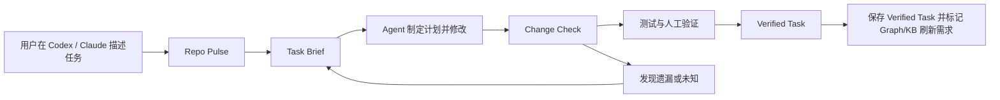
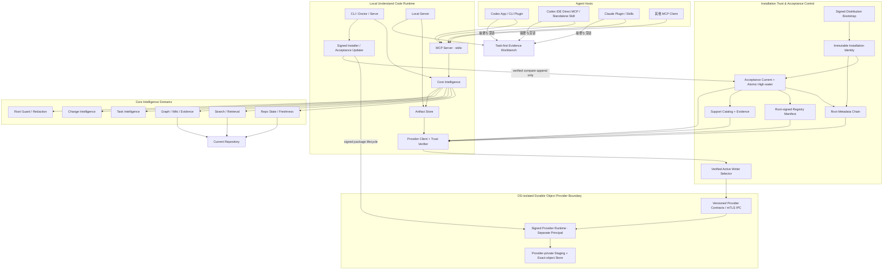
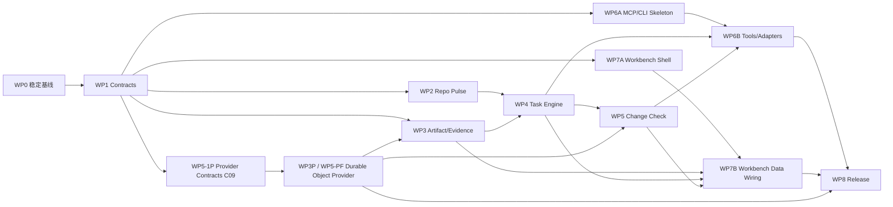

# Understand Code：Agent-native Code Change Intelligence 项目研制计划

> 文档状态：Approved / Contract Frozen v1.16（含 WP5 Decision Amendment D-24～D-36、C09-1K、CI stabilization 与 16-A-1 实施证据重校）
>
> 日期：2026-07-27
>
> Contract Freeze：2026-07-28，见 `docs/research/2026-07-28-g0-contract-freeze-record.md`
>
> WP4 Contract Amendment：2026-07-29；`build_task_brief` 的可恢复两阶段编排与可信 Operation Journal 见 D-22，Repo Pulse 不可变历史与原子切换见 D-23
>
> WP5 Contract Amendment：2026-07-30～2026-08-06；Evidence-backed Change Check、可重建 Task Baseline、Plan/Verification 语义、精确 Operation 协议、安全持久化、Durable Object Provider Gate、严格 Ed25519 host、不可变 Bootstrap Trust Bundle、签名 Target Discovery point closure、real-FS Conformance Result point closure、Provider Runtime Attestation point closure、QA/Release Provider Feasibility Evidence point closure与 Release Target Universe point closure见 D-24～D-36
>
> Implementation Rebaseline：2026-08-03；Evidence Refresh：2026-08-06；Contract Refresh：2026-08-06。重建并版本化 17 步执行基线，明确 `15/17` 是执行游标而非产品完成率；C09-1J、C09-1K 与 16-A-1 已形成各自边界内的候选证据；Provider aggregate、真实 Provider、生产 Change Intelligence、双 Agent、Task-first Workbench、strong-write、production 与 release gates 仍未关闭
>
> 适用范围：`understand-code` 产品、Core、Agent 插件、MCP、本地服务与 Dashboard
>
> 本文定位：覆盖产品重新定版、现状审计、目标架构、功能范围、分期实施、验收、测试、安全、发布、指标与风险的总研制计划

## 0. 执行摘要

Understand Code 的最终产品形态已经与最初设想发生实质变化。

最初项目解决的是：

> 如何把代码仓库生成知识图谱，并通过前端帮助用户浏览和理解。

现在项目应解决的是：

> 如何让 Codex、Claude Code 等开发 Agent 在修改前获得可信上下文，在修改中保持任务边界，在修改后用证据核对是否改对。

因此最终定位调整为：

> **Understand Code 是面向 Coding Agent 的本地优先代码变更智能与证据层。它不替代 Agent 写代码，而是让 Agent 的代码修改更准确、可解释、可核验。**

产品由两个入口组成：

1. **Agent 内主入口**：Codex、Claude Code 通过统一 MCP 服务调用仓库状态、任务理解、证据、影响和变更检查能力。
2. **本地 Workbench 辅助入口**：用于下钻完整 Task Brief、证据账本、影响链、计划与实际 Diff，以及任务历史。

所有能力围绕同一个持续对象组织：

> **Persistent Task Brief（持久任务理解包）**

P0 不追求一次性增加很多独立功能页，而是先打通一条完整纵向链路：

```text
任务输入
  → 仓库新鲜度检查
  → Task Brief
  → Agent 开发
  → Change Check
  → 验证记录
  → 持久保存 Verified Task，并标记知识刷新需求
```

截至 2026-08-05，仓库已经完成 Contracts、Repository State、Artifact Store、
Persistent Task Brief、一部分 Provider Contracts，以及第一个可仓外冷安装的
自包含 CLI/MCP 候选；它只公开 `get_repo_pulse`、`build_task_brief`、
`get_task_brief` 三个真实工具。生产 `checkChanges()`、OS 隔离的 Durable
Provider、Codex/Claude Host Adapter、Doctor、Task-first Workbench 与正式发行包
仍未完成。因此当前形态已从单纯的**可信内核与契约底座**推进为
**可信内核 + 首条可安装只读入口纵切**，但仍不是可交付用户的完整 Alpha/Beta。

推荐研制节奏：

- 7–14 周完成一个 Host 的可演示纵向 Alpha。
- 10–15 周完成 Codex/Claude 双 Agent Alpha。
- 20–24 周完成可供真实用户试用的生产级 P0 Beta；若压缩到 17–19 周，需额外
  增加约 1.5–2 名 Provider/Backend Security FTE，不能削减 provider、真实文件
  系统、崩溃恢复或签名门禁。
- 单人全职保持完整范围应按 72–92 周评估；42–52 周只适用于单 Host、桌面端和最小 Workbench 的缩减版。

---

## 1. 产品重新定版

### 1.1 产品形态的演进

| 维度 | 第一阶段 | 第二阶段 | 最终定版 |
|---|---|---|---|
| 产品中心 | 代码知识图谱 | Wiki-first Knowledge Console | Agent-native Change Intelligence |
| 首要问题 | “项目由什么组成？” | “应该怎样阅读项目？” | “任务改哪里、影响什么、最终改对了吗？” |
| 主要入口 | 独立 Graph Dashboard | Wiki + Graph 独立前端 | Codex/Claude 主入口，Workbench 辅助 |
| 核心对象 | Repository Graph | Wiki Page / Graph Node | Persistent Task Brief |
| 时间模型 | 一次性仓库快照 | 可反复阅读的仓库知识 | 围绕一次变更持续更新 |
| 用户价值 | 看见关系 | 理解项目 | 降低错改、漏改和不可解释风险 |
| 前端角色 | 产品本体 | 主要阅读界面 | 证据审阅与影响下钻工作台 |
| 最终产物 | Graph JSON | Wiki、Graph、Coverage | Task、Claim、Evidence、Impact、Change Check、Verification |
| 闭环终点 | 图谱生成完成 | 用户读完内容 | 变更得到核验并留下可复用记录 |

### 1.2 哪些内容发生了变化

以下决策需要覆盖早期产品规划：

1. **默认入口变化**
   - 原计划默认进入 Wiki。
   - 新计划默认在 Codex/Claude 中工作；打开前端时默认进入 Tasks。

2. **核心对象变化**
   - 原计划围绕 Repository、Wiki Page 和 Graph Node 组织。
   - 新计划围绕 Task Brief 组织，Repository/Wiki/Graph 成为任务上下文。

3. **MCP 优先级变化**
   - 原先 MCP 可被视为 P1 的外部接入能力。
   - 确认 Agent-native 定位后，MCP 是 P0 的产品分发和运行基础。

4. **前端职责变化**
   - 前端不继续演进成更复杂的“项目浏览网站”。
   - 前端成为 Task-first Evidence Workbench，不重复建设聊天、编辑器、终端和 Coding Agent。

5. **成功标准变化**
   - 不再以图谱节点数、Wiki 文档数或页面浏览量为核心成功标准。
   - 改为任务准备时间、候选修改准确性、证据闭环率和漏改降低程度。

### 1.3 哪些已有投资继续有效

本次不是推倒重来。以下资产应继续作为产品底座：

- Tree-sitter 多语言静态解析。
- 文件、符号、调用、依赖和测试关系图谱。
- 图谱分层、渐进下钻、Quick Jump 和大仓库可达性。
- Wiki V2、源码证据、Claim Trace、Coverage 和 Quality 契约。
- 搜索、语义检索、指纹、增量更新和持久化。
- Wiki 三栏阅读结构、Evidence Rail 和 Graph Details Rail。
- 本地 Token Gate、路径限制和源码预览保护。
- `/understand-*` Skills 作为兼容入口与工作流资产。

### 1.4 对历史规划的处理

早期设计文档继续保留为演进记录，但产品级优先级以本文为准：

- `Visual Guided Workbench`：保留“引导路径”和“证据侧栏”思想，不再以 Graph 为产品中心。
- `Wiki-First Graph Console`：保留 Wiki/Graph 双向链接，不再以 Wiki 为默认产品入口。
- `Wiki/Graph Experience`：保留三栏、搜索、响应式和可访问性能力。
- `Graph Layout Optimization PRD`：作为 Graph 子系统质量计划继续执行，但其目标是服务任务影响视图，而不是单独定义产品。
- 宣传站点 `site/` 不属于本次产品研制范围。

---

## 2. 当前项目基线与审计结论

### 2.1 初始代码与产物基线

截至 2026-07-27：

| 项目 | 当前状态 |
|---|---|
| Git HEAD | `1bd7705` |
| 当前分支 | `main` |
| 知识图谱分析 Commit | 与 HEAD 一致 |
| 知识图谱规模 | 1264 nodes / 2299 edges |
| calls 边 | 614 |
| analyzed files | 436 |
| Core 测试 | 50 files、910 tests 全部通过 |
| Dashboard 测试 | 48 files 中 47 通过；535 tests 中 534 通过 |
| 当前 Dashboard 失败项 | `largeRepositoryAcceptance` 的完整可达性用例超过 5 秒 |
| 当前工作区 | 存在未提交的 Graph/Layout 相关修改 |

以上表格保留 2026-07-27 的问题发现现场。M0 在 2026-07-28 已形成新的可复现 Closeout：

| 项目 | M0 Closeout |
|---|---|
| 基线 Commit | `34da354968a6071d914e4e4a4fca738e6c2d8a29` |
| Graph/Layout | 有界性、全对象可达性和生产 Dagre 输入链路已收口 |
| 大仓性能 | self-host 1,264 nodes / 2,299 edges 与 synthetic 10k / 18,188 edges 基线通过 |
| 根质量 | Root 94、Core 920、Dashboard 558 tests；build/typecheck/test 全绿 |
| 远端 CI | Run `30335147523`，Ubuntu / Node 22 / pnpm 9，成功 |
| Host Contract | Root Binding V1 与 Runtime Rendezvous V1 已冻结；所有发布 Surface 仍按独立 Gate 取证 |
| 当前工作区 | Tracked clean；用户未跟踪 QA/历史 PRD/site 文件明确排除在本分支之外 |
| G0 状态 | Contract Freeze `closed_for_implementation`；Surface Release Gate `open` |

当前图谱已经具备比较完整的代码结构与调用关系，说明底层不是原型级数据。

但当前知识库的 planning artifacts 仍指向旧项目基线：

- project：`understand-anything`
- commit：`a141e570...`
- graph：846 nodes / 985 edges
- calls：0

当前 `diff-overlay.json` 也仍基于 2026-06-29 的旧 Commit。由此可以确认：

> Graph、Knowledge Base、Diff Overlay 可以分别过期，而当前产品没有统一告诉用户哪些信息仍可信。

同时，当前 Knowledge Base 目录没有活动前端所期待的 `wiki-index.json`。Artifact 是否 ready 不能继续用“目录或部分文件存在”判断，必须由 Manifest 和 Schema Validation 决定。

这正是 Repo Pulse 必须成为 P0 的直接证据。

### 2.2 已有能力

#### Core

- 21 类节点、35 类边的统一图谱类型。
- 多语言 Tree-sitter Extractor。
- Calls 解析、Import 解析、Layer、Tour、搜索和 Embedding Search。
- Fingerprint、Staleness、Change Classifier 与增量合并。
- Wiki V2、Evidence、Trace、Coverage、Generation Report。
- Zod 校验与较完整的单元测试。

#### Dashboard

- `wiki | graph` 两个活动 Surface。
- Wiki 三栏结构：导航、正文、证据。
- Graph 三种模式：Architecture、Call、Coverage。
- Wiki 与 Graph 之间的双向跳转。
- 全局搜索、主题、响应式和可访问性基础。
- Token Gate、localhost 绑定、路径规范化、文件白名单、大小和二进制限制。

#### Agent Distribution

- 已有 `.claude-plugin/plugin.json`。
- 已有十个 `/understand-*` Skills。
- 已有 agents 与 hooks。
- 尚无 `.codex-plugin/plugin.json`。
- 已有 `packages/cli` 自包含 stdio MCP 候选，但尚无 Codex/Claude Host-specific
  `.mcp.json`、Plugin wrapper 或 Surface E2E。
- 根包仍没有对外稳定 bin/Installer；当前 CLI 只是尚未发布的独立 package
  candidate，可用于冷打包验证。
- 当前 Dashboard Skill 仍会在用户环境中执行依赖安装、Core 构建并启动 Vite Dev Server，不是成品运行方式。

### 2.3 必须先修的正确性问题

#### G0-01：新鲜度不包含工作区状态

当前 `getChangedFiles()` 只执行：

```text
git diff <lastCommit>..HEAD --name-only
```

因此无法完整识别：

- staged
- unstaged
- untracked
- rename
- delete
- Git 命令失败和真正“无变化”的区别

当前仓库刚好展示了这个问题：Graph 的 Commit 与 HEAD 相同，但工作区有多处修改；旧实现仍可能认为图谱是最新的。

#### G0-02：内部逻辑变化被归类为 COSMETIC

当前 Fingerprint 将“内容变化但函数/类签名不变”归类为 `COSMETIC`，并写出：

```text
internal logic changed (no structural impact)
```

Change Classifier 对全部 `NONE | COSMETIC` 的变化返回 `SKIP`。

这对“代码变更智能”是不可接受的：函数体行为变化可能是最重要的变化，不能因为签名未变而跳过。

#### G0-03：调用边丢失 Provenance

Call Resolver 已计算：

- confidence
- lineNumber

但 Graph Builder 写入 `calls` 边时只保留 source、target、type、direction、weight。

Evidence Ledger 与影响路径需要知道：

- 关系来自哪个文件和行号。
- 是 exact、same-file 还是 imported-package。
- 是否由静态分析、配置、测试或人确认。

#### G0-04：持久化缺少原子写与并发锁

当前多数 Artifact 通过 `writeFileSync` 直接覆盖：

- 中途失败可能产生截断文件。
- MCP、Watcher 和 Workbench 并发读写时可能互相覆盖。
- 尚无 per-repo / per-task lock。

#### G0-05：敏感文件缺少硬拒绝规则

当前 Ignore 默认规则没有覆盖所有常见敏感类型，例如：

- `.env*`
- `*.pem`
- `*.key`
- credentials
- token/secret 命名文件

且用户 Ignore 规则允许 negation。MCP 对外返回源码 excerpt 前必须增加不可被用户 negation 取消的 hard deny 与内容脱敏。

#### G0-06：旧 Diff Overlay 已形成断链

`understand-diff` Skill 承诺生成 `diff-overlay.json`，但当前活动 Dashboard 没有生产代码消费该 Artifact。新 Change Check 不得继续沿用“写出文件即认为功能完成”的方式，必须通过 Contract、Local API、Workbench View 和 E2E 验证整条链路。

#### G0-07：现有 Worktree 重定向不适合 Agent 任务

现有 Skill 会尝试将临时 Worktree 的分析输出重定向到主 Checkout。它可以避免临时目录结束后产物丢失，却可能造成：

- 当前 Agent 修改的是 Worktree A。
- Graph/Task 被写到主 Checkout B。
- Change Check 最后比较了错误工作区。

新模型必须共享 Repository Cache，但以 `worktreeId + HEAD + worktreeDigest` 隔离 Task 和 Diff。

#### G0-08：发布与质量入口尚未成品化

- 根 `pnpm test` 目前只是输出提示，没有运行 Core/Dashboard 全套测试。
- 仓库没有正式 CI。
- Root/Claude Plugin 使用 `2.7.5`，Core/Dashboard 使用 `0.1.0`。
- 没有 CLI `bin`、发布文件白名单、engines 和统一兼容策略。

这些都必须进入 P0 Release Hardening，而不是发布前临时补齐。

### 2.4 当前前端需要收口而不是继续扩张

当前 `DashboardSurface` 只有 `wiki | graph`，现有组件已经形成可复用的三栏与图谱体系。正确方向不是增加 Incident、Guardrail、Diff、Runtime 等多个顶层菜单，而是：

```text
Tasks（默认） | Knowledge | Graph
```

Incident、Impact、Change Check 和 Verification 都应成为 Task 的章节或视图。

### 2.5 2026-08-06 最新实施快照

2026-07-27 的基线表保留为问题发现现场；以下快照才是继续实施时使用的当前事实：

| 项目 | 当前事实 |
|---|---|
| 分支 / 实现 HEAD | `feature/agent-native-change-intelligence` / `0c6474df66ce28e4a7caf4006233100194a6e493`（C09-1K code slice `3e6f516d089aaacaf67984f46ca972d8687a5772` + CI stabilization） |
| Workspace 包 | 8 个：Contracts、Repository State、Artifact Store、Core、Task Engine、CLI、Dashboard、Durable Object Provider Contracts |
| 根质量门禁 | 本地 macOS `CI=true pnpm quality`：194 个测试文件、2,367 passed、1 个既有 skip、0 failed；build/typecheck/Dashboard production build 全绿；Linux clean-checkout same-SHA CI run `31079755984` / job `92545638787` on `0c6474df66ce28e4a7caf4006233100194a6e493`：194 个测试文件、2,368 passed、0 skipped、0 failed，19m39s，success |
| 修改前能力 | Repo Pulse、Persistent Task Brief、候选排序、影响路径、Evidence/Unknown、Task Lifecycle 已有正式实现 |
| Provider Contracts | Strict Ed25519、Bootstrap Trust Bundle、Root/Registry History、signed real-FS Corpus→Suite、signed Target Discovery、unsigned real-FS Result、root-signed Runtime Attestation、QA/Release Provider Feasibility Evidence 与 Release Target Universe supplied-point 已闭环到各自候选边界。C09-1J 历史切片仍固定为 253 份 Schema、19 个显式 public module、122+105=227 个 ordered executable case 与成功路径 3/11；不得用后继数字回写该历史事实。C09-1K 最新切片为 268 份 Schema、21 个显式 public module + 3 个 wildcard resource export、4 个 positive vector、116 个 inherited + 169 个 point-specific = 285 个 ordered executable case；internal diagnostic schema 固定 16 个 stage / 11 个 reason，fixture 另含 2 个 locator-builder stage 与 3 个无 stage/reason 的 snapshot-stability success；成功路径固定 1 次 point admission / 7 次 signature verification，authority 严格为 `none_release_target_universe_structure_only`。独立复审 P0/P1/P2=0；C09 aggregate 及全部 strong-write/production/release gate 仍 open |
| 修改后能力 | Change Check/Verification 有严格 Contract 和 Store 基础，但没有生产 `checkChanges()` / `recordVerification()` 执行服务 |
| Agent Surface | 已有 `packages/cli` 自包含 stdio MCP 候选和 3 个真实 Tool；仍无 `.codex-plugin/plugin.json`、Codex/Claude Adapter 或双 Agent Task E2E |
| 前端 | 活跃 Surface 仍为 `wiki | graph`；尚无 Tasks、Brief、Check、Verification 与 Repo Pulse 产品页面 |
| 安装发布 | CLI tarball 已可在单仓外安装运行，但尚未正式发布；没有 Host Installer、Doctor、升级/卸载与签名 RC |
| 工作区保护 | 用户未跟踪的 QA、历史 Graph/Layout PRD、builder/assets 与 `site/` 继续排除，不纳入本主线提交 |

当前完成度必须分维度解释，不能再用一个数字代替：

| 维度 | 工程判断 | 含义 |
|---|---|---|
| 确定性基础设施 | 约 70–80% | Contracts、Repo、Store、Task 与 Provider 信任合同较扎实 |
| 修改前 Task 理解 | 较高 | 已能经独立 CLI/MCP 形成和读取持久化 Brief，但尚未接入真实 Codex/Claude Host |
| 修改后 Change Check | 未完成 | Contract 已冻结，生产 Delta/Hunk/Matching/Verification 链路尚未闭环 |
| 用户可运行纵向产品 | 未闭环（pre-change slice 可执行） | 受限 3-Tool 已可安装运行，但缺少 Change Check/Verification、Host Adapter 与真实任务闭环，不给出误导性的整体百分比 |
| Beta 发布准备度 | 低于 15% | 没有 clean-install 双 Agent、Doctor、发布物与 Release Gate 证据 |

### 2.6 2026-08-03 重建后的 17 步执行基线

仓库只保留了旧记录中的 `15/17`，没有版本化保存当时 UI 的完整步骤名。本次依据
提交历史、WP0～WP8 和现有实现重建下面的新执行基线；它从本版本起成为权威，
但不声称逐字还原当时 UI 中未保存的步骤名。**15/17 表示当前执行到第 15 步，
不表示产品完成 88%**；第 15～17 步恰好承载最重的运行时、集成、前端和发布工作。

| 步骤 | 状态 | 交付边界 |
|---:|---|---|
| 1. 产品重新定版 | Completed | Agent-native Change Intelligence 主旨、P0 与非目标冻结 |
| 2. 质量基线 | Completed | Graph/Layout、根质量命令、CI 与受保护工作区收口 |
| 3. Host/Root 合同 | Completed | Workspace Binding 与 Runtime Rendezvous 冻结 |
| 4. Artifact Contracts | Completed | Envelope、Schema、Error 与兼容边界 |
| 5. Repository Snapshot | Completed | Git 状态、语义分类与可复现 Snapshot |
| 6. Repo Pulse | Completed | 新鲜度、不可变历史与原子 canonical 切换 |
| 7. Artifact Store | Completed | 事务、CAS、锁、Manifest、恢复与审计 |
| 8. Claim/Evidence 基础 | Completed | Evidence Ledger、引用完整性与安全投影 |
| 9. Task Lifecycle | Completed | 状态机、Event、并发与 revision 语义 |
| 10. Task Brief Engine | Completed | 候选、影响、风险、Unknown 与 Markdown |
| 11. Journal/Recovery | Completed | 两阶段编排、幂等回放与故障恢复 |
| 12. Change Intelligence 合同 | Completed | Strong Profile、Baseline、Matching、Verification 与强写决策冻结 |
| 13. Provider Crypto/Public Error | Completed | JCS、密码学原语、稳定失败语义与分发约束 |
| 14. Bootstrap 与 Trust History | Completed | Strict Ed25519、Bootstrap Bundle、Root/Registry Manifest History |
| 15. Provider Gate + WP5 生产闭环 | **In progress** | 补齐 C09 aggregate、真实 Provider Gate、Baseline→Delta→Check→Verification |
| 16. 双 Agent 可安装 Alpha | Pending（16-A-1 candidate closed） | MCP/CLI 首条纵切已完成；Codex/Claude Adapter、Product Design Workbench 与真实任务 E2E 仍缺 |
| 17. 成品发行 | Pending | Doctor、安装升级卸载、RC、安全/性能门禁与 mandatory Surface Release Gate |

第 15～17 步采用下面的产品纵切顺序，避免继续完成大量底层合同后才首次验证安装：

| 子门 | 最终可见成果 | 关闭条件摘要 |
|---|---|---|
| 15-A Provider aggregate | 完整 C09 Contract、Catalog/Discovery/Universe/Acceptance/Migration closure | C09 aggregate Gate、negative corpus、distribution 与独立安全复审关闭 |
| 15-B Real Provider | 一个明确 macOS/Linux × filesystem profile 上的真实 Durable Provider | 隔离 principal、exact-object、crash/ABA/path-race、安装生命周期通过；其他环境只读 |
| 15-C Change Intelligence | 可执行 `checkChanges()` 与 `recordVerification()` | baseline→actual Delta、hunk→symbol、planned/unplanned/omission/unknown、恢复与安全用例通过 |
| 16-A MCP/CLI（16-A-1 candidate closed） | 已形成预编译 `understand-code mcp --stdio` 0.1.0 候选，严格只公开 Pulse/Brief 三工具 | `0a07e33` 已通过仓外冷 tarball、initialize/list/call、Root fail-closed、`.git/index`/源码只读与错误脱敏；完整 16-A 仍需 refresh/其余 Tool 与 Host 包装 |
| 16-B Host Adapter | Codex CLI Plugin 与 Claude Code CLI Plugin | 两端独立空白环境安装、Root fail-closed、同任务 Artifact 一致、升级/移除无残留 |
| 16-C Single-Host Alpha | 一个 mandatory CLI Surface 跑通 12 个固定 Gold Task | 完成 Pulse→Brief→修改→Check→Verification，可中断恢复且无错误“安全”结论，关闭 G2 |
| 16-D Workbench | Product Design 驱动的 Task-first Evidence Workbench | Tasks/Brief/Check/Evidence/Graph Deep Link 和 desktop/tablet/mobile 状态流验收 |
| 16-E Dual-Agent Alpha | Codex CLI 与 Claude Code CLI 均跑完全部 24 个 Gold Task | 两端 Artifact/Task/revision 一致，Workbench Deep Link 与跨 Agent 续接通过，关闭 G3 |
| 17 Release | 可验证安装包与 RC | Doctor、checksum、SBOM、provenance、签名、24 Gold Task 和 mandatory Surface 生命周期通过 |

---

## 3. 最终产品定义

### 3.1 产品使命

让任何 Coding Agent 在一次代码变更中做到：

1. 动手前知道应该读什么、为什么。
2. 明确目标、非目标、假设、未知和验收条件。
3. 能看到直接影响、推断影响和静态分析盲区。
4. 修改后对照原计划检查计划外改动和可能遗漏。
5. 用源码、配置、Git 和测试证据解释结论。
6. 仓库变化后自动识别旧结论是否失效。

### 3.2 核心产品承诺

- **Local-first**：默认在用户机器和当前 Workspace 内运行。
- **Evidence-backed**：重要结论必须可追溯或明确标记为推断/未知。
- **Agent-agnostic**：Codex、Claude 共用同一分析引擎和 Artifact。
- **Task-centered**：结果围绕当前开发任务，而不是一次性展示整个仓库。
- **Unknown-aware**：不能静态证明的内容不得包装成确定事实。
- **Deterministic core**：Git 状态、图路径、Artifact 校验和门禁必须由确定性逻辑负责。

### 3.3 目标用户

#### 第一目标用户

使用 Codex、Claude Code 等开发 Agent，并在陌生、中大型或持续变化仓库中工作的工程师。

#### 第二目标用户

- Code Reviewer 和仓库维护者。
- 新加入项目的工程师。
- 事故排查与高风险变更负责人。
- 需要跨会话交接任务的团队。

产品和运营人员仍可消费业务知识文档，但不是 P0 的核心购买与使用人群。

### 3.4 核心 Jobs To Be Done

1. 当我收到陌生需求时，告诉我先读哪里以及依据是什么。
2. 当 Agent 准备修改时，告诉我哪些文件是候选、哪些只是相关。
3. 当我准备改公共接口时，展示完整影响路径和无法判断的边界。
4. 当修改完成时，对照原计划找出计划外改动和漏改。
5. 当知识产物过期时，明确告诉我哪些结论失效，而不是继续展示为“已验证”。
6. 当任务中断或切换 Agent 时，让另一个 Agent 能继续使用同一份任务状态。

### 3.4.1 Task Eligibility 与 Quick Path

不是每个拼写修改都需要完整 Task Brief。

默认建议完整闭环的 Eligible Task：

- 用户显式要求理解、影响分析或变更检查。
- 陌生模块。
- 跨文件或跨 Package。
- 公共 API、Schema、配置、权限、数据或依赖变化。
- 中高风险 Bug。
- Incident、PR Review 或大规模重构。
- Agent 的首轮检索出现多个合理修改候选或 Unknown。

允许 Quick Path：

- 文案、注释和拼写。
- 可明确定位的单文件叶子改动。
- 用户熟悉且风险很低的机械修改。

Quick Path 至少执行轻量 Repo Pulse；用户可以显式升级为完整 Task。高风险条件命中时 Agent 应提示完整 Brief，用户仍可跳过，但必须在结果中保留“未完成完整检查”的说明。

北极星指标的分母使用 **Eligible Tasks**，不强迫所有微小修改承担完整流程成本。

### 3.5 明确非目标

- 不开发另一个 Codex 或 Claude。
- 不建设内置代码编辑器、终端或通用聊天界面。
- 不为不同 Agent 复制多套分析逻辑。
- 不把全量关系图作为首页。
- 不默认把用户源码上传到云端。
- 不自动提交、推送或部署用户代码。
- 不把静态分析结论描述为运行时事实。
- P0 不做 Jira/Kanban、Issue 管理或通用文档协作。
- P0 不依赖任何 Agent 客户端支持复杂内嵌 UI。

---

## 4. 核心闭环与核心对象

### 4.1 产品闭环



### 4.2 Persistent Task Brief

Task Brief 不是一段临时回答，而是 Agent、MCP、Workbench 和人之间共享的任务契约。

P0 状态机已在 D-21 / G0 冻结：

```text
created
  → context_ready
  → planned
  → in_progress
  → check_required
  → verification_required
  → verified

created 至 verification_required 的正常状态可进入：
  blocked / stale / superseded

blocked 只能：
  → resumeStatus / stale / superseded

stale 只能：
  → context_ready / superseded
```

其中：

- `verified` 与 `superseded` 是终态；后续工作必须创建新 Task 并建立 parent/replacement link。
- `blocked` 必须保存 `resumeStatus`；只有依赖解除且上下文仍 fresh 时才能恢复，否则进入 `stale`。
- `stale` 只能通过强类型 `refresh_task_context` 或 `rebase_task` 回到 `context_ready`，不能直接恢复旧 Plan/Check/Verification。
- 每次 Mutation 使用 revision/CAS、idempotency key 和 append-only Event；失败、冲突与重放不产生重复 revision/Event。
- 完整 Guard、幂等与恢复规则以 `docs/research/2026-07-28-g0-contract-freeze-record.md` 第 5 节为准，WP1/WP4 不得自行增加状态或跨阶段跳转。

#### 4.2.1 `build_task_brief` 可恢复两阶段编排

`build_task_brief` 是一个对 Host 暴露的编排操作，不等同于一次底层 Mutation。
公开输入仍使用 `expectedRevision=0`，并由
`(worktreeId, createScope, idempotencyKey)` 稳定映射到同一个 Task ID；内部必须
按以下两阶段持久化：

1. `created@1`：先保存非空 intent、repo/worktree identity、baseline、唯一
   `task_created` Genesis Event，以及对应的 Idempotency Record/Operation
   Receipt。此阶段不伪造 Brief、Claim、Evidence、Impact、Check 或
   Verification。
2. `context_ready@2`：仅在 Repo Pulse 可用、Context 构建成功且所有引用通过
   校验后，原子发布 Brief、Claim、Evidence、Impact 和第二条 Event，并保存
   `build_task_brief` 的完整 Operation Receipt。

每个阶段都严格满足 `revision = previousRevision + 1`，并且恰好追加一条
Event；两阶段编排不能被实现成一次从 revision 0 直接写入 `context_ready@1`
的跨状态捷径。若进程在第一阶段后中断，重试原 idempotency key 必须读取
`created@1` 的可信事实并继续第二阶段，而不是创建第二个 Task；若 Context 仍
不可用，则保留可恢复的 `created@1` 并返回明确 Gate 失败。

`context_ready@2` 是没有中间 Lifecycle 操作时的标准结果。若 Stage 1 后 Agent
合法执行了 `block_task → resume_task`，Task 会恢复为较高 revision 的
`created@N`；此时 Stage 2 必须以当前 revision 做 CAS，并提交
`context_ready@(N+1)`，不得把 revision 硬编码为 2、倒退历史或创建第二个
Task。处于 `blocked`、`stale` 或 `superseded` 时不得直接发布 Context。

该修订解决了“Genesis 必须是 `created@1`”“`created → context_ready` 必须是
独立合法转移”和“每次成功 Mutation 只能 `+1 revision/+1 Event`”与公开
`build_task_brief(expectedRevision=0)` 之间的组合歧义，不改变 Lifecycle V1
的状态集合、允许转移或 Guard。完整修订与验收规则见 D-22 和
`docs/research/2026-07-29-wp4-task-intelligence-matrix.md`。

### 4.3 Task Brief 必备内容

- Task ID、标题、创建时间、更新时间和状态。
- 用户原始意图。
- 目标与非目标。
- 验收条件。
- 当前仓库、分支、基线 Commit、HEAD 和 Worktree Fingerprint。
- Graph、Wiki、Evidence、Diff Artifact 新鲜度。
- 建议阅读文件、符号和调用路径。
- 修改候选、推荐原因和候选级别。
- 上游、下游、跨层和测试影响。
- 假设、风险和未知项。
- 计划修改。
- 实际修改。
- 计划与实际差异。
- 验证计划、执行结果和未执行项。
- 人工确认记录。
- 最终结论和遗留问题。

### 4.4 证据的两个正交状态

证据的“我们如何知道”与“它现在是否仍有效”必须分开。

认知状态 `epistemicStatus`：

| 状态 | 含义 | 允许的表达 |
|---|---|---|
| `observed` | 源码、配置、Git 或测试直接证明 | “代码显示……” |
| `inferred` | 根据结构、调用或命名推断 | “可能影响……” |
| `unknown` | 当前材料不足 | “当前无法确认……” |
| `human_confirmed` | 用户或 Reviewer 明确确认 | “由用户确认……” |

新鲜度 `freshness`：

| 状态 | 含义 |
|---|---|
| `current` | 对当前 Snapshot 仍成立 |
| `changed` | 证据来源按计划发生变化，需要 Change Check |
| `stale` | 依赖基线变化，当前推荐不可继续信任 |
| `invalid` | 文件、行号、Hash 或来源无法再验证 |

基线 Evidence 保持不可变并记录 `observedAtSnapshotId`；后续 Snapshot 通过新鲜度描述变化，不覆盖历史事实。

不得用一个总置信度百分比替代以上状态。

### 4.5 候选修改级别

为了避免 Agent 把“相关”误认为“必须修改”，统一使用：

- `must_inspect`
- `likely_change`
- `possible_change`
- `test_or_verify`
- `context_only`

每个候选都必须带：

- 原因。
- Evidence ID。
- 传播路径。
- 新鲜度。
- 是否存在反证或未知。

---

## 5. 最终系统形态

### 5.1 总体架构



### 5.2 目标包结构

跨 Agent 产品需要稳定、无运行时依赖的共享契约，因此 Contracts、Repository State、Task Engine 和 Artifact Store 应从 P0 起形成清晰包边界；现有解析和知识生产能力继续留在 Core：

```text
understand-code/
├── .claude-plugin/
├── .codex-plugin/
├── skills/
├── packages/
│   ├── contracts/
│   ├── core/
│   ├── repository-state/
│   ├── task-engine/
│   ├── artifact-store/
│   ├── change-intelligence/
│   ├── durable-object-provider-contracts/
│   ├── durable-object-provider-client/
│   ├── mcp-server/
│   ├── local-server/
│   ├── cli/
│   └── dashboard/
├── provider/
│   ├── runtime/
│   │   ├── darwin/
│   │   └── linux/
│   ├── installer/
│   ├── registry/
│   └── conformance/
├── integrations/
│   ├── claude/
│   │   ├── mcp-config.template.json
│   │   └── install-fixture/
│   └── codex/
│       ├── plugin/
│       │   ├── mcp-config.template.json
│       │   └── install-fixture/
│       └── ide/
│           ├── config.template.toml
│           ├── standalone-skills/
│           └── install-fixture/
└── dist/
    ├── server/
    ├── dashboard/
    ├── adapters/
    │   └── codex-ide/
    ├── provider/
    │   ├── darwin/
    │   ├── linux/
    │   ├── installers/
    │   └── signed-registry/
    └── plugins/
        ├── claude/
        │   ├── .claude-plugin/
        │   └── .mcp.json
        └── codex/
            ├── .codex-plugin/
            └── .mcp.json
```

说明：

- `contracts` 只包含 Zod Schema、DTO、版本和迁移描述，不依赖 fs/git/React。
- `repository-state` 负责 Git Snapshot、Worktree、Diff Hunk、Freshness 和 Ignore。
- `task-engine` 组合现有 Graph、Search、Wiki、Evidence 和 Diff 能力。
- `change-intelligence` 负责 Delta/Hunk→Symbol、Planned-vs-Actual、
  Completeness、Finding与 Verification coverage，不在 Host adapter复制。
- `durable-object-provider-contracts` 冻结 immutable Identity、
  Acceptance/high-water、Root/Registry/Catalog、target selector、migration、
  runtime attestation、exact-object publish/delete、external CAS、Store Manifest
  compare-append与 journal wire。
- `durable-object-provider-client`独立读取并验证
  Identity→Acceptance→Root→Registry/Catalog/Evidence完整 trust closure，只在
  本机完整 target profile唯一命中 active writer后建立 versioned mutual-auth
  IPC；不得接受 runtime自报 Registry、Catalog、Evidence、active key或 selector。
- `provider/runtime` 是签名的独立 OS service/principal，持有 provider-private
  key/staging/storage；不得作为 Artifact Store进程内 helper或 same-UID pathname
  writer运行，也无权改写 Installation Identity、Acceptance、Root、Registry或
  Catalog。`provider/installer`负责签名验证、权限、升级、回滚、Doctor与卸载
  guard，只能经 atomic compare-append推进 Acceptance，不能覆盖 identity或降低
  high-water。
- `artifact-store` 负责 Manifest、锁、迁移、备份与 Event Log；所有 strong
  publish/delete只能经 Provider Client；每次启动及首个 strong mutation前重验
  current Acceptance与 runtime attestation，中途变化必须在副作用前失败。
  legacy/Fixture rename不能伪装同等级能力。
- MCP Server 只负责 Tool Schema、Root 绑定、分页、预算和 Handler，不复制分析逻辑。
- Local Server 负责静态前端、只读数据 API，以及严格受限的 Task Mutation API、Token、SSE/轮询和深链。
- CLI 提供 `analyze`、`mcp`、`serve`、`doctor`，用于安装检查、CI 和不支持 MCP 的降级场景。
- 生产包必须包含预编译 Core、MCP 和 Dashboard，不在用户项目中运行 `pnpm install` 或 Vite Dev Server。
- Codex 与 Claude 共享的是 MCP Server 二进制、Tool Schema、Artifact 和 Skills 内容模型，不是假定共用一个 Manifest 或 `.mcp.json`。
- Codex App/CLI 使用 `.codex-plugin/plugin.json` + bundled `.mcp.json`；Codex IDE 当前不支持 Plugin，P0 只使用 trusted project-scoped `.codex/config.toml` 直连同版本 MCP，并把 standalone Skill 安装到该仓库的 `.agents/skills/**`。
- Codex Plugin、Codex IDE Direct MCP、Claude Plugin 三条安装路径都必须有完全空白环境 Fixture，禁止只在源码仓库根目录中验证。

上述依赖边界是 P0 强约束，但不要求第一天就发布七个独立 npm 包：

- `contracts`、`mcp-server`、`local-server/cli` 必须有清晰物理分发边界。
- `repository-state`、`task-engine`、`artifact-store` 可先作为 Core 内的独立模块落地。
- 当 API 和并发模型稳定后再拆包，避免物理重构拖慢纵向 Alpha。

依赖方向必须固定为：

```text
contracts
├──→ core + repository-state + change-intelligence
├──→ durable-object-provider-contracts
└──→ dashboard

durable-object-provider-contracts
  ├──→ signed provider runtime + installer/conformance
  └──→ durable-object-provider-client

durable-object-provider-client
  └──→ artifact-store

core + repository-state + artifact-store + change-intelligence
  └──→ task-engine

task-engine + artifact-store
  └──→ mcp-server

dashboard build + task-engine + artifact-store
  └──→ local-server

mcp-server + local-server
  └──→ cli/runtime-manager

cli/runtime-manager
  ├──→ signed provider installer / Doctor
  └──→ Codex App/CLI Plugin + Codex IDE Direct MCP + Claude adapters
```

Agent Plugin 不得自行解析 Graph JSON、执行 Git 或写 Task 文件。

### 5.3 模型职责边界

P0 默认不在 MCP Server 内再嵌入一个独立 LLM。

- Core 负责确定性 Git、图谱、搜索、路径、分类、证据和 Artifact 校验。
- Host Agent 负责自然语言意图理解、计划表达和最终编码决策。
- `build_task_brief` 返回结构化 Draft；Skill 允许 Host Agent 补充目标、假设和验收条件。
- Agent 补充的 Claim 必须绑定 Evidence，或标记为 `inferred/unknown/human_confirmed`。

这样可以避免：

- 双模型成本。
- 对某个模型厂商锁定。
- 同一个任务在不同 Agent 中生成互不兼容的底层事实。

### 5.4 项目内 Artifact

```text
<canonical-worktree-root>/.understand-code/
├── repository.json
├── manifests/
│   └── artifact/
│       └── <encoded-artifact-manifest-generation-id>.json
├── artifact-manifest.json        # legacy/read-only projection only
├── pulses/
│   └── <encoded-version-key>.json
├── repo-pulse.json              # legacy/read-only projection only
├── private/
│   └── store-manifests/
│       └── <encoded-store-manifest-generation-id>.json
├── snapshots/
│   └── <snapshot-id>.json
├── knowledge-graph.json
├── fingerprints.json
├── knowledge-base/
└── tasks/
    └── <task-ulid>/
        ├── task.json
        ├── task-brief.json
        ├── task-brief.md
        ├── claims.json
        ├── evidence.json
        ├── impact.json
        ├── operation-journal.json
        ├── change-check.json
        ├── verification.json
        └── events.jsonl
```

每个物理 Worktree 有独立 `.understand-code` 状态目录：

- `worktreeId` 由 canonical worktree identity 生成，不包含 HEAD。
- HEAD、Index 和 Worktree Digest 只属于不可变 Snapshot。
- Task 与 Diff 永远按 Worktree 隔离。
- 大型、不可变 Graph Cache 可放到平台用户缓存目录，以 `repositoryId + sourceSnapshotId` 共享。
- 不再把临时 Worktree 的 Task 状态重定向到主 Checkout。
- 跨 Worktree 继续任务必须执行显式 migrate/rebase。

所有新 V1 事实 Artifact JSON：

- 必须有 `schemaVersion`。
- 必须记录 repositoryId、worktreeId、snapshotId、producerVersion。
- 必须支持原子写。
- 必须有校验和。
- 必须可识别 stale/superseded。
- 必须有向前迁移和不兼容时的清晰错误。

例外边界已经在 WP1 冻结并由 D-23/D-30收紧：`ArtifactManifestV1`仍是严格的
Worktree控制 payload，不伪装成第十种事实 Artifact；strong writer只把它包入
provider no-replace的 `ArtifactManifestGenerationV1`，再由唯一 maximal
`StoreManifestGenerationV1` exact pin为 commit point。
`.understand-code/artifact-manifest.json`只供 legacy reader、迁移和开发
Fixture使用，不是 strong current pointer、授权来源或 commit point。
`events.jsonl` 的每一行验证为 `TaskEventV1`，文件本身由
`task_event_log` Descriptor 管理。Task目录内的 `TaskManifestV1`是第三种不同
对象，只描述单 Task；实现不得混用 Artifact Manifest payload、Artifact
Manifest generation、Store Manifest generation或 Task Manifest。现有
Graph/Meta/Fingerprint/Wiki/Diff 保持显式 `legacy_raw` 格式，不能在没有迁移
决策的情况下静默套入 V1 Envelope。

---

## 6. 功能总清单与重新排序

### 6.1 P0：可用的 Agent 变更闭环

| 能力 | 重要性 | 当前基础 | P0 目标 |
|---|---:|---|---|
| Correctness Foundation | 必须先做 | 有 staleness/fingerprint/classifier | 工作区完整、逻辑变化不跳过、Artifact 一致 |
| Versioned Task Contracts | 极高 | 无 Task 实体 | Task/Claim/Evidence/Impact/Check/Verification V1 |
| Repo Pulse | 极高 | 仅 commit..HEAD staleness | Commit + staged + unstaged + untracked + Artifact freshness |
| Evidence Ledger | 极高 | Wiki Evidence/Trace 已有 | 认知状态与新鲜度双轴、失效传播、人工确认 |
| Task Brief | 极高 | Chat/Explain/Search 可复用 | 任务目标、路径、候选、影响、未知和验证 |
| Change Check | 极高 | Diff Analyzer/Overlay 可复用 | 计划内、计划外、遗漏、未知和验证状态 |
| MCP Server | 极高 | 无 | 统一跨 Agent 工具层 |
| Host Surface Adapter | 极高 | Claude Plugin + Skills | Codex App/CLI Plugin、Codex IDE Direct MCP、Claude Plugin；共享 MCP/Artifact、薄 Skill |
| Artifact Store | 极高 | `.understand-code` 持久化 | 原子写、锁、迁移、事件日志 |
| Local Server | 高 | Vite middleware | 成品静态服务、Token、Deep Link |
| Task-first Workbench | 高 | Wiki/Graph 双 Surface | Tasks 默认页、Brief、Evidence、Check、Overlay |
| Packaging/Doctor | 高 | 无稳定 CLI/bin | 一次安装、离线启动、健康检查、升级 |

### 6.2 P1：提升任务完成率

- 变更前 What-if Impact Simulation。
- 受控命令执行、自动测试选择与任务级 Runtime Trace；P0 只记录由 Agent 或用户提交的验证结果，不负责执行命令。
- Incident Navigator：日志、堆栈、错误码到代码路径。
- 高级 Task History：跨版本对比、搜索、恢复、跨 Worktree 迁移和正式交接；P0 已包含基础列表、事件历史和跨 Agent 续接。
- 增量 Watcher 与任务完成后知识刷新。
- Hybrid Retrieval：词法、图谱、符号和可选 Embedding。
- Agent Hooks：在高风险修改前后建议调用。
- PR/Review 报告导出。
- 证据冲突检测。
- 可选 Streamable HTTP MCP。
- 客户端支持时的轻量 MCP UI；不得作为通用体验前提。

### 6.3 P2：团队与平台

- 团队共享的已确认 Task Knowledge。
- 多仓库、跨服务影响分析。
- CI/PR Status Check。
- 确定性 Architecture Guardrails。
- 跨仓库 Runtime Trace、日志和 Metrics 与静态图谱的组织级关联。
- 权限、审计、加密和保留策略。
- 企业自托管远程 MCP。
- 更多 Agent/IDE Adapter。
- 组织级架构漂移与风险趋势。

### 6.4 优先级变化说明

相比早期讨论，以下能力发生调整：

- **MCP：P1 → P0 平台基础。**
- **Task Brief：P0 核心对象，不再只是一个页面。**
- **Repo Pulse：P0 前置门禁，而不是状态角标。**
- **Evidence Ledger：P0 横向基础设施，而不是右侧栏装饰。**
- **Change Check：P0 闭环终点，与 Task Brief 同等重要。**
- **Impact Simulation：保留为 P1；P0 先提供基于现有图的直接影响摘要。**
- **Incident：P1；它复用 Task/Evidence/Impact，不单独搭平台。**
- **Guardrails：P2；Runtime 在 P1 只做任务级受控执行与结果采集，P2 再做跨仓库关联和强门禁。**
- **Graph Layout：只作为 G0 时间盒内的遗留稳定任务，不属于 Agent-native 新产品 P0 功能。**
- **任务知识沉淀：P0 持久保存 Verified Task 并标记 Graph/KB 刷新需求；P1 才自动增量刷新和提炼仓库级知识。**

---

## 7. P0 详细功能要求

### 7.1 Correctness Foundation

#### FR-CF-001：Git 状态全覆盖

Repo State 必须区分：

- baseline..HEAD committed changes
- staged
- unstaged
- untracked
- renamed
- deleted
- conflicted
- submodule/worktree 状态
- Git unavailable/error

验收：

- Fixture 覆盖以上全部状态。
- Git 命令失败不得返回“无变化”。
- 路径统一为 repo-relative POSIX 格式。
- rename 同时保存 oldPath/newPath。
- untracked 文件必须进入 Pulse，但只有通过安全过滤后才能进入分析。

#### FR-CF-002：语义变化重新分类

建议替换现有三态：

```text
NONE | COSMETIC | STRUCTURAL
```

改为：

```text
NONE
FORMATTING_OR_COMMENT
BODY_LOGIC
SIGNATURE
DEPENDENCY
TOPOLOGY
UNKNOWN
```

约束：

- `BODY_LOGIC` 不能触发 `SKIP`。
- 没有 Parser 支持时使用 `UNKNOWN`，不得伪装为 cosmetic。
- Change 分类结果必须记录 detector 和依据。
- 同一输入输出必须确定。

#### FR-CF-003：关系 Provenance

Graph Edge VNext 至少支持：

```ts
interface EdgeEvidence {
  sourceFile?: string;
  lineRange?: [number, number];
  resolver?: string;
  confidence?: "exact" | "same-file" | "imported-package" | "heuristic";
  observedAtCommit?: string;
}
```

旧 Graph 继续可读；缺失 provenance 的边显示为 `unknown provenance`。

#### FR-CF-004：Artifact 一致性

保留 `ArtifactManifestV1` 作为 payload，并新增不可变 generation wrapper；
固定单文件只作 legacy projection：

```ts
interface ArtifactManifestV1 {
  schemaVersion: 1;
  repositoryId: string;
  worktreeId: string;
  status: "ready" | "cold" | "error";
  latestSnapshotId?: string;
  producerVersion: string;
  updatedAt: string;
  reasons: string[];
  artifacts: Array<{
    artifactId: string;
    artifactType: string;
    storageFormat: "enveloped_v1" | "legacy_raw" | "jsonl_v1";
    path: string;
    generatedAt: string;
    sourceSnapshotId: string;
    contentDigest: string;
    state: "current" | "historical" | "read_only_recovery" | "corrupt";
    freshness: "fresh" | "partial" | "stale" | "invalid";
    dependencies: Array<{
      artifactId: string;
      relation: "derived_from" | "requires" | "indexes" | "projects";
      requiredDigest?: string;
      requiredSnapshotId?: string;
    }>;
  }>;
}

type RepoPulseVersionKeyV1 = `repo-pulse-version:${string}`;
  // body由 Schema约束为64 lowercase hex
type ArtifactManifestGenerationIdV1 =
  `artifact-manifest-generation:${string}`;

interface RepoPulseImmutableVersionPinV1 {
  locatorProfile: "store_repo_pulse_immutable_version_v1";
  versionKey: RepoPulseVersionKeyV1;
  repositoryId: string;
  worktreeId: string;
  artifactId: string;
  sourceSnapshotId: string;
  contentDigest: string;
  fileBinding: StoreDurableObjectBindingV1;
  atomicContainmentProofToken: StoreProviderContainmentProofTokenV1;
  providerOperationReceiptToken: StoreProviderOperationReceiptTokenV1;
}

interface ArtifactManifestGenerationPinV1 {
  locatorProfile: "store_artifact_manifest_generation_v1";
  repositoryId: string;
  worktreeId: string;
  generationId: ArtifactManifestGenerationIdV1;
  contentDigest: string;
  fileBinding: StoreDurableObjectBindingV1;
  atomicContainmentProofToken: StoreProviderContainmentProofTokenV1;
  providerOperationReceiptToken: StoreProviderOperationReceiptTokenV1;
}

interface ArtifactManifestGenerationV1 {
  profile: "artifact_manifest_generation_v1";
  id: ArtifactManifestGenerationIdV1;
  repositoryId: string;
  worktreeId: string;
  predecessor:
    | { state: "genesis" }
    | {
        state: "generation";
        generation: ArtifactManifestGenerationPinV1;
      };
  manifestContentDigest: string;
  manifest: ArtifactManifestV1;
  canonicalRepoPulse:
    | { state: "absent" }
    | {
        state: "version";
        version: RepoPulseImmutableVersionPinV1;
      };
  createdAt: string;
}
```

Manifest payload只描述对应 Worktree；多 Worktree 不共享 generation。
Repo Pulse version key按
`repo-pulse-version-v1{artifactId,sourceSnapshotId,contentDigest}`确定性派生；
generation ID按
`artifact-manifest-generation-id-v1{repositoryId,worktreeId,predecessor,
manifestContentDigest,canonicalRepoPulse}`派生，均不含自身 ID/time。Pulse
version、Artifact Manifest generation先通过 provider exact-object no-replace
发布并验证 binding/receipt；随后新的 Store Manifest generation exact pin
Artifact Manifest generation，**Store Manifest unique tip才是唯一 commit
point**。三层固定路径为
`.understand-code/pulses/<encoded-version-key>.json`、
`.understand-code/manifests/artifact/<encoded-generation-id>.json`与
owner-only
`.understand-code/private/store-manifests/<encoded-generation-id>.json`；
所有 encoded component都走 `StoreFilenameKeyV1`。Store Manifest
candidate由 Provider在同一事务 compare expected head/version、发布 absent
generation并推进 authenticated unique head；提交前失败继续使用旧 tip，并发
loser不留下 generation。若完整 enumeration仍出现 sibling/extra/missing，
固定 `store_manifest_fork` fail closed。

`ready` 必须指向一个 `enveloped_v1 + schemaVersion=1 +
state=current + freshness=fresh|partial` 的 Repository Snapshot Descriptor；
Artifact Store 还必须验证对应文件存在、typed parser 通过且 payload digest
与 Descriptor 一致。`cold/error` 必须给出原因。Artifact 依赖变化时必须传播
失效状态，标记为 fresh 的 Artifact 不能依赖 partial/stale/invalid 上游。

### 7.2 Repo Pulse

#### 输出内容

- Repo root 和 identity。
- branch、baseline、HEAD。
- ahead/behind/merge-base。
- staged、unstaged、untracked、rename、delete、conflict。
- Graph/Wiki/Evidence/Diff/Task Artifact freshness。
- Parser/Call Graph completeness。
- 需要的刷新级别：none/incremental/full。
- 错误与无法判断项。

#### 展示原则

Repo Pulse 不是单个绿点。它需要回答：

- 当前任务基于哪个版本？
- 哪些文件在任务开始后变了？
- 哪些证据仍有效？
- 哪些推荐需要重算？
- 为什么需要刷新？

#### 验收

- changed-file discovery recall 为 100%。
- 相同仓库状态得到相同 fingerprint。
- 当前 HEAD 未变但 Worktree 变化时必须显示 stale/partial。
- Artifact 过期必须能追溯到上游依赖。
- 读取失败和“确实无变化”使用不同状态。

#### 冷启动与缺失 Artifact 状态矩阵

| 状态 | Repo Pulse | Task 行为 | 用户/Agent 动作 |
|---|---|---|---|
| Graph 缺失 | `not_ready` | 不生成伪完整 Brief | 显式授权 `refresh_index` |
| Graph stale、源码可读 | `stale` | 可生成降级 Brief，必须标 partial | 选择增量刷新或接受降级 |
| Wiki 缺失 | `partial` | 使用 Graph + Source + Search | 不阻塞首个 Task |
| Calls 不完整 | `partial` + completeness | 影响路径标 Unknown Boundary | 可继续，但不能声称完整 |
| 不支持的语言 | `partial/unsupported` | Lexical + 文件级 fallback | 显示 Coverage Unknown |
| Git 不可用 | `unknown` | 不进入 Ready | 修复环境或显式使用无 Git 模式 |
| Refresh 进行中 | `rebuilding` | 读取旧 Snapshot 或等待 | 展示进度，允许取消 |
| Refresh 失败 | `unknown/error` | 保留旧 Artifact，不原子切换 | 查看失败原因并重试 |

约束：

- `build_task_brief` 不隐式调用刷新。
- `refresh_index` 必须返回进度、可取消状态和最终 Snapshot ID。
- 失败刷新不能破坏最后一个可用 Snapshot。
- Graph/Wiki/Calls 缺失时必须说明降级范围。

### 7.3 Task Brief Engine

#### 输入

```ts
interface BuildTaskBriefInput {
  task: string;
  expectedRevision: 0;
  idempotencyKey: string;
  actor: string;
  baseRef?: string;
  scope?: string[];
  tokenBudget?: number;
  maxCandidates?: number;
  maxImpactDepth?: number;
}
```

`build_task_brief` 不得隐式触发索引刷新。Skill 必须先读取 Repo Pulse；需要刷新时显式调用单独授权的 `refresh_index`。

#### 输出

- Task ID。
- Goal/Non-goal Draft。
- Repo Pulse 摘要。
- 推荐阅读路径。
- 候选文件/符号及级别。
- 直接影响与推断影响。
- 风险。
- 假设和未知项。
- 验收条件 Draft。
- 验证计划 Draft。
- Evidence IDs。
- truncated 标记和被裁剪类别。

#### 排序策略

P0 使用可解释的混合排序：

```text
score =
  lexical match
  + symbol exact match
  + graph proximity
  + entry point relevance
  + test relation
  + wiki direct relation
  + recent change relevance
  - stale penalty
  - weak provenance penalty
```

不得只依赖 Embedding；P0 在 Embedding Provider 缺失时必须完整工作。

#### 验收

- 每个修改候选都有原因和 Evidence 状态。
- 不存在的文件不能作为有效候选。
- stale Graph 不能静默参与推荐。
- “可能相关”和“建议修改”明确区分。
- 结果严格执行 tokenBudget/maxCandidates/maxDepth。
- 裁剪必须显式返回。
- 同一 repo state 和同一参数下，确定性部分可复现。

### 7.4 Evidence Ledger

#### Claim V1

Claim 是 Task Brief、Evidence、Finding 与 Verification 之间可追踪的最小语义单元，不能只把关键结论保存为 UI 字符串：

```ts
interface ClaimV1 {
  id: string;
  taskId: string;
  kind:
    | "goal"
    | "non_goal"
    | "acceptance"
    | "assumption"
    | "recommendation"
    | "risk"
    | "unknown"
    | "finding"
    | "conclusion";
  statement: string;
  epistemicStatus: "observed" | "inferred" | "unknown" | "human_confirmed";
  lifecycleStatus: "draft" | "supported" | "contested" | "invalidated";
  freshness: "current" | "changed" | "stale" | "invalid";
  sourceSnapshotId: string;
  evidenceIds: string[];
  findingIds: string[];
  verificationRecordIds: string[];
  derivationPath?: Array<
    | { kind: "evidence"; evidenceId: string; description: string }
    | { kind: "graph_relation"; relationId: string; description: string }
    | { kind: "rule"; ruleId: string; description: string }
    | { kind: "assumption"; claimId: string; description: string }
  >;
  confirmationEventId?: string;
  supersedesClaimId?: string;
  createdAt: string;
  updatedAt: string;
}
```

#### Evidence V1

```ts
interface EvidenceV1 {
  id: string;
  epistemicStatus: "observed" | "inferred" | "unknown" | "human_confirmed";
  freshness: "current" | "changed" | "stale" | "invalid";
  kind: "source" | "config" | "test" | "git" | "graph_path" | "document" | "human" | "diff_hunk" | "analysis_boundary";
  claimIds: string[];
  nodeIds: string[];
  filePath?: string;
  lineRange?: [number, number];
  excerpt?: string;
  relationPath?: string[];
  commit?: string;
  contentHash?: string;
  producedBy: string;
  createdAt: string;
  observedAtSnapshotId: string;
  derivationPath?: Array<
    | { kind: "evidence"; evidenceId: string; description: string }
    | { kind: "graph_relation"; relationId: string; description: string }
    | { kind: "rule"; ruleId: string; description: string }
    | { kind: "assumption"; claimId: string; description: string }
  >;
  confirmation?: {
    actor: string;
    input: string;
    confirmedAt: string;
  };
  invalidatedAt?: string;
  invalidationReason?: string;
}
```

#### 规则

- Goal、Non-goal 和 Acceptance 先以 draft Claim 创建，经 `update_task` 确认后成为 `human_confirmed`。
- 每个修改建议、风险、Finding 和最终结论都必须由稳定 Claim ID 表达；UI 文案只是 Claim 的投影。
- `observed`/`inferred` Claim 至少引用一个有效 Evidence；无法获得证据时必须生成 `unknown` Claim，并保存边界原因，不能使用空证据的肯定结论。
- `Evidence.claimIds` 与 `Claim.evidenceIds` 必须双向一致，写入事务在提交前执行引用完整性校验。
- Finding 通过 `claimIds` 说明它支持或质疑哪些 Claim；Verification 通过 `claimIds` 支持验收或结论 Claim。
- Human Confirmation 只表示“人确认了该主张”，不能把静态推断改写成源码或运行时观察事实。
- 摘录必须经过敏感信息过滤。
- 文件和行号必须验证存在。
- 内容 Hash 变化后保留原 Evidence，并将其 freshness 变为 changed/stale/invalid。
- Human Confirmation 必须记录输入内容、时间和 Actor。
- 推断必须保存推断路径，不能只保存结论。

### 7.5 Change Check

#### 输入

```ts
interface CheckChangeInput {
  taskId: string;
  actualSnapshotId: PathSafeRepositorySnapshotIdV1; // 必填精确断言；禁止隐式 retarget
  includeWorktree: true;
  expectedRevision: number;
  idempotencyKey: string;
  actor: string;
}
```

strong Task 的 `baselineSnapshotId` 是 Stage 1 current/evaluated Snapshot，并由
immutable `task_baseline` materialization 证明。若需要改变任务起点，必须通过
显式 `rebase_task(targetSnapshotId, newBaselineSnapshotId=targetSnapshotId)`
生成新 Revision；`check_change` 不接受任意 baseRef，也不从调用时“最新”状态
推断 actual。

#### 输出分类

- `planned_completed`
- `planned_partial`
- `unplanned_change`
- `possible_omission`
- `verification_gap`
- `cannot_determine`

#### 检查维度

- 计划候选与真实变更文件/符号的对应。
- 新增、删除、rename。
- 函数体逻辑变化。
- 签名、依赖和拓扑变化。
- 调用方、测试、配置、Schema 和文档影响。
- 与验收条件的对应关系。
- Verification Plan 对 Acceptance 的覆盖设计；实际执行状态只来自 Verification
  ledger，不属于 Change Finding。
- Task 创建后新出现的未知项。

#### 验收

- Change Check 必须比较 task baseline final tree 与 exact actual final tree，并
  保留 Commit/Index/Worktree/Untracked/Conflict provenance。
- 不得把“未发现”描述成“确定没有”。
- 每项 Finding 可下钻到 Diff、路径和 Evidence。
- 计划外改动可以被用户接受并记录理由。
- 可能遗漏必须说明推断路径和静态盲区。
- 未执行验证不得显示为 passed；也不得被包装成 `verification_gap`。

### 7.6 MCP Server

P0 共暴露 11 个 Tool：9 个 Task/数据 Tool，以及 `open_workbench`、`refresh_index` 两个显式生命周期操作：

| Tool | 作用 | 默认副作用 |
|---|---|---|
| `get_repo_pulse` | 获取仓库与 Artifact 新鲜度 | 只读 |
| `build_task_brief` | 创建结构化 Task Brief Draft | 只写 `.understand-code/tasks/**` |
| `get_task_brief` | 分页读取 Task/Section | 只读 |
| `update_task` | 确认目标/计划、推进状态、记录人工确认、接受 Finding | 受限 Task 写入 |
| `search_context` | 搜索符号、文件、Wiki 和图路径 | 只读 |
| `get_evidence` | 批量获取短 Evidence | 只读 |
| `trace_impact` | 查询当前代码事实下的有向影响路径 | 只读 |
| `check_change` | 对照 Task 与真实 Diff | 写 Task Check Artifact |
| `record_verification` | 记录 Agent 已执行的测试或人工验证；不主动执行命令 | 写 Verification Artifact |
| `open_workbench` | 启动或打开指定 Task Deep Link | 启动本地服务 |
| `refresh_index` | 显式执行增量/全量刷新 | 昂贵写操作，单独授权 |

P1 再增加：

- `analyze_incident`
- 为 `trace_impact` 增加 Proposed Change / What-if 模式

设计要求：

- stdio stdout 只能输出 MCP JSON-RPC；日志全部写 stderr。
- 所有返回结构版本化。
- 大结果通过 cursor/pageSize 分页。
- 每次返回 repo commit、worktree fingerprint、freshness 和 truncated。
- 共享 Server 必须收到显式 `--root <path>`，缺失时 fail closed；它不直接读取 Host 环境变量，也不把通用 cwd/Roots 当 fallback。
- Root 在启动时绑定；Handler 不接受任意绝对路径。
- 只暴露面向任务的稳定工具，不把所有内部函数直接映射为 MCP Tool。

所有 Task 范围内的创建或写操作必须携带：

```ts
interface MutationControl {
  expectedRevision: number;
  idempotencyKey: string;
  actor: string;
}
```

创建新 Task 时 `expectedRevision` 固定为 `0`；更新、检查和记录验证时必须传调用方已读取的当前 revision。`refresh_index` 不修改 Task，使用独立 `OperationControl { expectedSourceSnapshotId?, idempotencyKey, actor }`；`open_workbench` 只管理本地服务和短期 Session，不写 Task Artifact。

`update_task` 只接受强类型 Action：

```text
confirm_goal
confirm_acceptance_criteria
confirm_plan
record_assumption
confirm_unknown
transition_status
accept_finding
accept_verification_skip
block_task
resume_task
refresh_task_context
rebase_task
supersede_task
```

它不接受任意 JSON Patch。`transition_status` 只允许 Lifecycle V1 表内的普通阶段转移；`blocked`、恢复、Context refresh/rebase 与 supersede 必须使用对应强类型 Action。`refresh_task_context` 在同一 baseline 上重建 Pulse/Brief 引用；`rebase_task` 改变 baseline，两者成功后都进入 `context_ready` 并显式失效旧 Plan/Check/Verification。每次成功更新都增加 revision 并追加 Event；revision 冲突返回可恢复的 conflict，不允许 last-write-wins。

可选 Resources：

```text
understand://repo/pulse
understand://tasks/{taskId}/brief
understand://tasks/{taskId}/evidence/{evidenceId}
understand://tasks/{taskId}/check
```

### 7.7 Codex 与 Claude Adapter

#### 共同原则

- 分析逻辑全部在 Core/MCP。
- Skill 只定义何时调用、调用顺序和怎样向用户表达。
- 两个 Agent 输出同一 Artifact Schema。
- Agent 不支持富 UI 时使用 Markdown 摘要和文本 URL。
- 共用的是 MCP Runtime、Tool Schema、Error Envelope、Artifact 与 Skill 内容模型，不是安装外壳。
- Host Adapter 只从当前 Surface 已验证的权威信号生成显式 `--root`；信号缺失、无效或未验证时进入 `binding_error`，所有 Repository/Task/Workbench Tool 以稳定 `workspace_binding_required` Envelope fail closed。

#### Codex App / CLI Plugin

- 新增 `.codex-plugin/plugin.json`。
- Codex 分发根生成专用 `.mcp.json`，指向随 Plugin 发布的本地 stdio Server。
- 打包共享 Skills。
- Codex Desktop App 与 CLI 分别通过 clean-install E2E 后才能声明支持。
- 当前 App Server 中“stdio 进程 cwd 跟随 thread cwd”只属于固定版本、固定路径的 `provisional observed` 证据，不得推广为 CLI 或 Desktop 契约。
- 在某个 Surface 不能产生可验证显式 Root 时保持 `pending-e2e`，不得静默猜测。

#### Codex IDE Direct MCP

- Codex IDE 当前不支持 Codex Plugin，不读取 `.codex-plugin`、Plugin cache 或 bundled `.mcp.json`。
- P0 只通过 trusted project-scoped `.codex/config.toml` 注册同版本 stdio executable；不生成带固定项目 Root 的 user-scoped `~/.codex/config.toml`。
- project config generator 在安装时把已归一化项目目录写成显式 `--root`，并把 `understand-task`、`understand-check` 安装到该仓库 `.agents/skills/**`；继承的任意 process cwd 非权威。
- Installer/Doctor 必须验证项目已受 Codex 信任、配置与 Skill 的 scope 一致，且 remove 只删除本产品拥有且内容未被用户修改的条目。
- IDE 配置模板、Doctor、reload、upgrade 和 remove 使用独立 Fixture。
- App/CLI Plugin 仍是一键安装主路径；Direct MCP 是三端兼容基线，不等于删除 Plugin。

#### Claude Code

- 保留 `.claude-plugin/plugin.json`。
- Claude 分发根增加符合 Claude Plugin 约定的 bundled `.mcp.json`。
- 使用 `${CLAUDE_PROJECT_DIR}` 生成显式 `--root`；process cwd 只做诊断，即使不同也不重选 Root 或报冲突。
- 现有 Skills 改为调用 MCP，不再让 Agent 自己 grep 大 JSON。
- `roots/list` 只校验显式 canonical root 仍在 Host 允许集合中，不参与 Root 选择，也不扩大分析边界。

Codex Plugin `.mcp.json`、Codex IDE `config.toml` 与 Claude `.mcp.json` 由独立 Adapter Template 生成并分别做 Schema/启动测试；它们可以指向同一版本 Server，但不能互相复制配置外层结构或把源码仓库根配置当成发布物。

#### P0 Skills

1. `understand-task`
   - 适用：陌生任务、跨模块、高风险变更。
   - 顺序：Pulse → 必要时显式刷新 → Brief Draft → 必要 Evidence → `update_task` 确认计划 → 输出摘要。

2. `understand-check`
   - 适用：Agent 声称修改完成前。
   - 顺序：Pulse → 记录已执行验证 → Change Check → Verification Gap → 输出结论。

旧 Skills 保留兼容，但在文档中标记新的推荐入口。

#### Workspace Binding 与进程生命周期

P0 采用“一 MCP 进程绑定一个 immutable canonical Worktree Root”。共享 Server 必须收到显式 `--root`；缺失或校验失败时不得读取 Repository、Artifact 或 Task 数据，但仍完成 MCP initialize 和 `tools/list`，进入只允许返回诊断的 `binding_error` 状态：

1. Adapter 只从当前 Surface 已验证的权威信号生成 `--root`：
   - Claude：`${CLAUDE_PROJECT_DIR}`。
   - Codex IDE：trusted project-scoped `.codex/config.toml` 在安装时声明的 project binding。
   - Codex Desktop App/CLI：分别由对应 Surface E2E 验证；App Server startup cwd 仅为当前版本 provisional candidate。
2. 显式 Root 依次执行存在性、目录、`realpath` 和 Git worktree top-level 归一化；linked worktree 必须绑定自身 top-level，不得跳到 common dir 或主 checkout。
3. 通用 process cwd 不是共享 Server fallback。Claude cwd 永远非权威；Codex cwd 只有在固定版本、已通过该 Surface Fixture 的 Adapter 内才能使用。
4. MCP Roots 不是 selector。若 Client 支持 Roots，每个 `file:` URI 只执行 decode、目录校验和 `realpath`，**不得**向上提升到 Git top-level；只有显式 Root 可以按第 2 条归一化为 worktree top-level。
5. membership 使用路径组件感知的 containment：canonical worktree root 必须等于某个 advertised Root，或完整位于其目录范围内。若 Host 只 advertise worktree 的子目录，不得借 Git 归一化扩大到整个 worktree，必须返回 `root_not_allowed`。
6. Client 不支持 Roots 时，有效显式 Root 可继续；支持 Roots 但成功返回的集合为空或不再包含 canonical root 时，后续仓库 Tool fail closed。Client 已 advertise Roots 但 `roots/list` 调用失败时使用 `root_unavailable`。
7. 多个 Roots 本身合法。additional roots 只表示 Host scope/membership，不进入索引、Artifact、源码读取或 Root Guard allowlist，也不能视作操作系统级权限证明。
8. `roots/list_changed` 新增 Root 只更新诊断；移除覆盖 canonical root 的 Root 时进入 `binding_error`，不重绑。
9. 绑定后同一进程不可重绑；分析第二个仓库必须使用独立 Agent session、MCP 进程、Store identity 与 Workbench Runtime。
10. cwd、additional roots、Plugin 目录和 sibling checkout 均不得覆盖显式 canonical root。

一旦进入 `binding_error`，同一 MCP 进程不得因 cwd、Roots 或文件系统状态随后恢复而解封；修复配置并重启独立 MCP 进程是唯一恢复方式。

绑定错误统一通过 MCP `tools/call` 的 Tool Error 返回，而不是把业务错误伪装成 JSON-RPC 协议错误：

```json
{
  "isError": true,
  "content": [
    {
      "type": "text",
      "text": "Workspace binding is required."
    }
  ],
  "structuredContent": {
    "error": {
      "schemaVersion": 1,
      "code": "workspace_binding_required",
      "details": {
        "reason": "root_missing | root_not_directory | root_not_allowed | root_unavailable | root_conflict | secondary_session_required"
      }
    }
  }
}
```

`structuredContent.error` 是唯一机器可读 Error Envelope；P0 不暴露容易误导的统一 `retryable` 布尔值，调用方按 `reason` 给出修复动作。`code` 与 `reason` 是跨 Host 稳定字段；`text` 可以本地化，但不得包含绝对路径。六个 `reason` 按下表自上而下判定，命中即停止，因此触发条件互斥：

| reason | 唯一触发条件 |
|---|---|
| `root_conflict` | Adapter 同一次启动取得两个及以上已验证权威 Root 候选，且各自 canonicalize 后不相同；process cwd 差异不属于 conflict，Adapter 不得择一 |
| `root_missing` | Adapter 没有任何权威 Root 候选、未提供 `--root`，或参数为空 |
| `root_not_directory` | 显式 Root 可成功 `stat`，但对象不是目录 |
| `root_unavailable` | 显式 Root 不存在、不可读、为 broken symlink，或 `stat`/`realpath` 失败；或 Client 已 advertise Roots 但 `roots/list` 请求失败/暂不可用 |
| `root_not_allowed` | 显式 Root 已成功 canonicalize，但成功返回的 advertised Roots 为空、没有任何一项覆盖 canonical root，或运行中失去该 membership |
| `secondary_session_required` | 进程已经成功绑定后，请求引用另一个 worktree/repository 的 Task、Artifact 或 additional Root |

Task Mutation 额外冻结三个互不混用的稳定错误码：
`task_transition_rejected` 表示状态机不允许该迁移，
`task_gate_unsatisfied` 表示迁移合法但当前 Guard 未满足，
`action_not_authorized` 表示 Actor 无权执行该动作。Schema 校验、CAS 冲突、
状态机、Guard 与权限错误不得折叠成 `invalid_arguments` 或
`internal_error`；`details` 应分别给出当前状态、失败 Guard、允许动作或不含敏感信息的
授权原因。所有公开 `text` 和 `details` 字符串都必须经过统一路径脱敏，并用带引号的
POSIX 路径、Windows Drive Path、UNC Path 与 `file:` URI 对抗样例验证。

Strong Store capability失败统一使用
`code="provider_unavailable"`，`details.reason`只允许：
`unavailable | unsupported_filesystem_profile | attestation_invalid | revoked |
migration_required | initialization_not_terminalized`。该 Envelope不得包含
provider locator、IPC endpoint、用户名、绝对路径、key ID或原始 attestation；
可本地化 text只说明“当前 strong Store不可用，请运行 Doctor”。legacy/redacted
read-only Repository Surface和无源码 WP8 CLI
`understand-code doctor --provider`（不是新增 MCP Tool）仍可使用；任何 strong
Task读取若无法重验既有 Store、以及所有 create/update/check/verify/refresh/
rebase mutation都在仓库私有读取或首个副作用前返回该错误并保持零写。客户端不能
把它折叠为 `internal_error`、自动重试、自动迁移或静默降级成不带证据的 Task。

只有 malformed JSON-RPC、未知方法等协议问题使用 JSON-RPC error。`binding_error` 下 `initialize`、`tools/list` 和无源码诊断可成功，所有 Repository/Task/`open_workbench`/`refresh_index` 调用返回上述 Tool Error，且不得创建 Artifact。CLI 参数解析本身无法启动 stdio 时只允许输出不含路径的 stderr 诊断并非 MCP Envelope，该情况不能计作 Tool Error E2E 通过。

M0 必须分别记录 Codex App/CLI Plugin、Codex IDE Direct MCP 与 Claude Plugin 的证据等级；`provisional observed` 不能替代另一个 Surface 的 E2E，也不能出现在“已支持”文案中。

`open_workbench` 生命周期：

- `runtimeIdentity = productVersion + worktreeId`；MCP 输出以
  `{ productVersion, worktreeId }` 强类型对象表达，返回的 `worktreeId` 必须与
  Success Meta 完全一致。rendezvous、startup lock、owner lock 和 control
  channel 位于 OS 用户级私有 runtime 目录，不写目标仓库或 Host Plugin
  cache。目录权限必须仅当前 OS 用户可访问。
- rendezvous 记录 protocol/product version、worktree ID、root digest、PID、loopback port、control endpoint、control capability digest、instance nonce 和 ready time，不记录源码、Task 正文、Browser Session 或长期 Token。实际 control capability 是 Runtime 生命周期内的 256-bit 随机值，单独保存在当前用户独占的文件/命名管道凭据中。
- `open_workbench` 先验证 rendezvous 所有权与权限，再通过 control channel 完成 identity + nonce + capability handshake；不能只根据 PID/port 复用。
- control channel 只接受 `health`、`mint_launch_token` 和 `stop` 三类强类型操作。复用已有 Runtime 时，新 MCP 必须请求 Runtime 为目标 task/view/section 签发新的 Launch Token，不能自行生成、复用旧 Token，Browser HTTP API 也不能暴露 mint 能力。
- startup lock 只保护选主和 ready publication；新 Runtime 在启动后取得并持有 owner lock 直到退出。Local Server ready 后以临时文件、file fsync、原子 rename 和目录 fsync 发布 rendezvous，再释放 startup lock。
- startup lock 单次取得最多等待 2 秒，health/control 单次超时 1 秒，Runtime ready 超时 15 秒，单次 `open_workbench` 总等待上限 20 秒；竞争者使用 50–200 ms jitter 轮询 ready record。每次调用最多进行一次 stale recovery 和一次新 Runtime election，所有分支均受 20 秒总预算约束，不得无限等待。锁竞争耗尽返回 `workbench_busy`，Runtime 未 ready 返回 `workbench_start_timeout`，control channel 失败返回 `workbench_control_unavailable`，identity/nonce/capability 不匹配返回 `workbench_identity_mismatch`。
- 只有在取得 startup lock、确认 health 失败且 owner lock 可取得后，才可 compare-and-delete nonce 仍匹配的 stale record。owner lock 仍被持有、PID reuse、陌生端口或 nonce/capability 不一致均视为 foreign/unknown process，不得 kill 或覆盖记录。
- ready 前崩溃释放 OS owner lock，后续调用可重新竞选，本次调用仍不得超过一次 election；ready 后崩溃使旧 Browser Session fail closed。恢复相同 task/view 路由必须再次调用 `open_workbench` 获取新 Token/新 deep link，原链接永不重新生效。
- Launch Token 一次性、60 秒 TTL，通过 URL fragment 传输，兑换后立即清除。
- Browser Session 绝对 TTL 8 小时、空闲 TTL 30 分钟；Runtime 无有效 Session、无活动请求 5 分钟后退出。
- explicit stop 只通过认证后的 control channel 请求 identity + nonce 验证通过的实例自行撤销 Session 并退出；Runtime 正常退出只 compare-and-delete nonce 匹配的自身 rendezvous，然后释放 owner lock。
- MCP 退出不强制杀死仍有活动 Browser Session 的 Workbench。

### 7.8 Local Server

目标是替换“运行 Vite Dev Server”的成品体验：

- 静态提供预编译 Dashboard。
- 提供只读 Task/Graph/Wiki/Evidence API。
- 提供严格受限的 Task Mutation API，只允许调用 Task Engine 的强类型 Action。
- 只绑定 `127.0.0.1`。
- 启动生成短期 Token。
- 浏览器兑换后从地址栏移除 Token。
- Mutation 请求要求 Session、CSRF Token、expectedRevision 和 idempotencyKey。
- 前端不得直接写 JSON，也不得修改源码。
- 文件访问执行 realpath、root guard、白名单、大小和二进制检查。
- 支持按 taskId/view/focus/finding 深链。
- P0 可使用短轮询；P1 再引入 SSE。

### 7.9 Packaging、CLI 与 Doctor

推荐命令：

```text
understand-code doctor
understand-code analyze
understand-code mcp --stdio --root <repo>
understand-code serve --root <repo>
understand-code task list
understand-code task show <task-id>
```

验收：

- 安装后不需要仓库源码中的 `node_modules`。
- 无需在目标仓库执行构建。
- `doctor` 检查 Node 版本、Git、包完整性、Root、Artifact Schema 和端口。
- Server 与 Dashboard 版本不兼容时明确失败，不允许白屏。
- 支持离线工作；可选语义 Provider 不可用时自动降级。

---

## 8. Task-first Workbench 研制要求

### 8.1 信息架构

最终只保留三个顶级 Surface：

```text
Tasks（默认） | Knowledge | Graph
```

不新增以下顶级入口：

- Incident
- Diff
- Impact
- Guardrail
- Runtime
- Verification

这些都是 Task 的章节、视图或 Overlay。

### 8.2 Agent 与 Workbench 的职责分工

| 场景 | Agent 内 | Workbench |
|---|---|---|
| 创建任务 | 主入口 | 只显示已创建 Task |
| 查看 Pulse 摘要 | 是 | 是，展示完整详情 |
| 阅读候选文件 | 摘要 | 完整理由、证据、路径 |
| 编写代码 | 是 | 否 |
| 影响分析 | 摘要 | 图谱 Overlay 和完整路径 |
| Change Check | 摘要 | Finding、Diff、Evidence 下钻 |
| 验证 | Agent 执行/记录 | 查看状态和剩余 Gap |
| 任务历史 | 最近任务摘要 | 完整列表、版本与事件 |

Workbench 不建设聊天框。无任务首页应提示：

- 当前仓库和 Repo Pulse。
- 最近任务。
- 如何从 Codex/Claude 启动任务。
- CLI 降级命令。

### 8.3 全局 Header

新增：

- project/repository
- branch/worktree
- freshness badge
- active task selector
- Tasks / Knowledge / Graph
- global search
- theme

Freshness 必须表达：

- fresh
- worktree changed
- artifacts stale
- refresh needed
- refresh running
- unknown/error

### 8.4 Task Home

内容：

- 当前 Repo Pulse 摘要。
- 进行中、待检查、待验证、已阻塞和最近完成任务。
- 每个 Task 显示风险、未知项数、基线和更新时间。
- 空状态引导用户回到 Agent 创建任务。

它不是 Kanban：

- 不提供 Sprint、Assignee、Story Point。
- 不替代 Issue Tracker。
- 只保存与代码理解和变更证据有关的 Task。

### 8.5 Task Brief View

桌面端延续现有三栏：

```text
┌────────────────┬────────────────────────────────┬──────────────────┐
│ Task Navigation│ Task Brief / Change Check      │ Evidence Ledger  │
├────────────────┼────────────────────────────────┼──────────────────┤
│ Overview       │ Goal / Non-goal                │ Observed         │
│ Reading Path   │ Acceptance Criteria            │ Inferred         │
│ Change Plan    │ Recommended Change Candidates  │ Unknown          │
│ Impact         │ Impact Paths                   │ Human Confirmed  │
│ Verification   │ Plan vs Actual                 │ Freshness Badge  │
│ Change Check   │ Verification Result            │ Source Anchor    │
│ History        │ Remaining Risks                │                  │
└────────────────┴────────────────────────────────┴──────────────────┘
```

交互：

- 点击 Claim，右栏定位 Evidence。
- 点击 Evidence，打开源码位置。
- 点击路径，进入带任务上下文的 Graph。
- 用户确认假设时生成 Human Confirmation Event。
- Evidence 的认知状态保持历史语义；freshness 为 stale/invalid 时不能继续显示为当前事实。

### 8.6 Change Check View

顶层摘要：

```text
计划内完成 | 计划内未完成 | 计划外改动 | 可能遗漏 | 验证缺口 | 无法判断
```

每条 Finding 必须展示：

- 任务计划。
- 实际 Diff。
- 相关符号。
- 传播路径。
- Evidence。
- 风险。
- 用户可执行操作：接受、补改、验证、标记未知。

不能只显示一个总风险分。

### 8.7 Task-aware Graph

Overlay 语义：

| 状态 | 表达 |
|---|---|
| planned | 计划修改 |
| actual | 实际修改 |
| impacted_observed | 已观察影响 |
| impacted_inferred | 推断影响 |
| verified | 已验证路径 |
| unknown_boundary | 静态分析边界 |
| stale | 失效关系 |

要求：

- 默认只展示当前 Task 的相关子图。
- 支持完整传播路径，而不只是“一跳相关”。
- 支持深度、边类型和最大节点预算。
- 循环依赖不会无限展开。
- 被截断部分显示数量和原因。
- 当前正在优化的有界展开、可达性和布局工作继续作为前置基础。

### 8.8 Knowledge Surface

Knowledge 不删除，但职责调整为：

- 展示当前 Task 相关文档。
- 提供 Repository 级知识查询。
- 展示 Evidence、Coverage 和 Stale 状态。
- 从 Wiki Page 返回相关 Task。

默认首页不再以“生成了多少文档”为中心。

### 8.9 Deep Link

概念路由：

```text
/tasks/{taskId}/brief?section=impact
/tasks/{taskId}/check?finding={findingId}
/tasks/{taskId}/evidence/{evidenceId}
/graph?task={taskId}&focus={nodeId}&overlay=planned
/knowledge/{pageId}?task={taskId}
```

要求：

- Agent 返回的是短期 Token 深链或由 `open_workbench` 打开。
- 任务、Finding、Evidence 和 Node 都有稳定 ID。
- 无效或 stale 深链显示可恢复的错误页。
- 深链不得泄露绝对路径、源码内容或长期 Token。

### 8.10 现有组件复用映射

| 现有资产 | 新用途 |
|---|---|
| `DashboardHeader` | 增加 repo、branch、Pulse、Task Surface |
| `KnowledgeConsole` | 保留 Knowledge Surface；三栏壳可抽象给 Task |
| `WikiEvidenceRail` | 泛化为通用 `EvidenceLedger` |
| `GraphExplorer` | 接入 Task Overlay |
| `GraphDetailsRail` | 显示 Finding、Path、Evidence |
| `GlobalWikiSearch` | 扩展为 Task/Knowledge/Symbol 全局搜索 |
| `AppRoutingController` | 扩展稳定 Deep Link |
| `TokenGate` | 迁移到 Local Server Session |

### 8.11 Source 与 Diff 只读查看规格

Workbench 必须支持证据闭环所需的源码/Diff 下钻，但不演变成编辑器：

- 中栏可在 Summary、Source、Diff 三种只读模式切换，保留当前 Task/Finding/Claim 上下文。
- Diff 支持 unified/split、文件列表、Hunk、rename/delete/untracked、行号和 planned/actual/unplanned 标记。
- 点击 Claim/Evidence/Finding 必须定位到对应 Snapshot、文件和行；当前内容与 Evidence Hash 不一致时先显示 stale 提示，不能悄悄跳到新行。
- Source 显示语法高亮、行锚点、Evidence 高亮、Snapshot/Commit 和截断说明。
- 大文件超过预算时按 Hunk/Range 请求；二进制、生成文件、超限文件展示 Metadata 和不可预览原因。
- 可提供“复制位置”和“回到 Host Agent 打开”的动作；不得在 Workbench 内直接修改源码或执行任意命令。
- 文件访问继续经过 Local Server 的 realpath、Root Guard、大小和敏感信息过滤。

验收：

- Finding → Diff Hunk → Claim → Evidence → Source Line 可在同一 Task 中往返，URL 可恢复当前位置。
- baseline/current 切换不会混淆行号或把旧 Evidence 表示为 current。
- Diff 数据缺失、文件删除、rename 和大文件截断都有明确状态。

### 8.12 响应式与可访问性

- `≥1280px`：稳定三栏；左栏 240–320px，中栏弹性且不小于 640px，右栏 300–380px。
- `768–1279px`：中栏为主，Task Navigation 与 Evidence Rail 作为可固定 Drawer。
- `<768px`：单栏顺序阅读；Task Navigation、Evidence 和 Finding Detail 使用全高 Sheet；Graph 默认先显示路径列表，再按用户操作加载 Canvas。
- Deep Link 在断点变化后保留 task/section/finding/evidence/focus，不因折叠丢失上下文。
- 键盘可完成 Surface 切换、Claim/Evidence 跳转、Drawer 关闭和 Finding 遍历；焦点返回触发元素。
- 风险、新鲜度和 Evidence 状态不能只用颜色表达；状态文本和图标语义同时存在。

### 8.13 页面状态流与逐页验收

所有核心页面统一实现以下状态，不允许用空白页或无限 Spinner 代替：

| 状态 | 必须展示 | 可执行恢复 |
|---|---|---|
| Initial loading | 页面骨架、当前 Repo/Task 身份（已知时） | 超时后进入可诊断错误 |
| Empty repository/task | 缺少的对象与创建入口 | 回到 Agent、CLI 降级命令 |
| `not_ready` | Graph/Wiki/Calls 缺失范围 | 显式启动 `refresh_index` |
| Refresh running | 阶段、已处理数量、是否使用旧 Snapshot | 取消、后台继续、读取最后可用版本 |
| Refresh failed | 失败阶段、错误 ID、最后可用 Snapshot | 重试、降级继续、查看诊断 |
| Stale/changed | 变化来源、受影响 Claim/Evidence | 刷新、重建 Brief、接受降级 |
| Revision conflict | 本地操作、服务端最新 Revision 和冲突字段 | 重新加载并重放 Action；禁止覆盖写 |
| Token/session expired | 不暴露 Task 数据的登录失效页 | 由 Agent 重新 `open_workbench` |
| Schema/version mismatch | Client/Server/Artifact 版本和兼容结论 | Doctor、只读恢复或升级 |
| Not found/deleted | 缺失的稳定 ID 与所属 Task | 返回 Task Home 或最新 Revision |

四个新增核心页面的 P0 验收：

| 页面 | 首要问题 | 必须完成的路径 | 关键验收 |
|---|---|---|---|
| Task Home | “当前有哪些任务需要我处理？” | Pulse → Task 列表 → 指定 Section | 空状态、状态筛选、最近 Task、refresh/stale 均可恢复 |
| Task Brief | “为什么建议读/改这些位置？” | Goal/Acceptance → Claim → Evidence/Impact | Draft 与 Confirmed 可区分；每个建议可追证；revision 冲突不丢操作 |
| Change Check | “实际修改是否偏离计划？” | Summary → Finding → Diff → 接受/补改/验证 | 六类 Finding 完整；planned/unplanned/omission 不混淆；未验证不显示通过 |
| Evidence Detail | “这条结论依据什么、现在还有效吗？” | Claim → Evidence → Source/Graph → 返回原位置 | Snapshot、Hash、认知状态、新鲜度和 Unknown Boundary 同屏可见 |

Knowledge 与 Graph 继续使用现有页面，但必须继承相同的 loading/empty/error/stale、Token 和 Deep Link 规则。WP7 的视觉验收以现有 `KnowledgeConsole` 三栏、Graph 交互和 Design Token 为基线，不另造一套视觉系统。

---

## 9. 核心数据契约

### 9.0 顶层 Artifact Envelope

所有新的 V1 事实 JSON 使用统一 Envelope，不允许只把 Item Array 直接写入
文件。Manifest、Task Event JSONL 与显式 Legacy Raw 的边界按第 5.4 节处理：

```ts
interface ArtifactEnvelopeV1<T> {
  schemaVersion: 1;
  artifactType:
    | "repository_snapshot"
    | "repo_pulse"
    | "task_manifest"
    | "task_brief"
    | "claim_ledger"
    | "evidence_ledger"
    | "impact"
    | "task_operation_journal"
    | "change_check"
    | "verification";
  artifactId: string;
  repositoryId: string;
  worktreeId: string;
  sourceSnapshotId: string;
  taskId?: string;
  revision: number;
  producerVersion: string;
  createdAt: string;
  contentDigest: string;
  payload: T;
}
```

`task-brief.md` 是 `TaskBriefV1` 的确定性阅读投影，不是事实源；JSON 与 Markdown 必须来自同一 revision。

核心 Task 结构至少包括：

```ts
interface TaskBriefV1 {
  originalIntent: string;
  contextGenerationId?: string;
  goalClaimId: string;
  nonGoalClaimIds: string[];
  acceptanceClaimIds: string[];
  readingPath: Array<{
    id: string;
    order: number;
    kind: "file" | "symbol" | "impact_path";
    filePath?: string;
    symbolId?: string;
    impactPathId?: string;
    claimIds: string[];
    evidenceIds: string[];
  }>;
  plannedChanges: PlannedChangeV1[];
  assumptionClaimIds: string[];
  riskClaimIds: string[];
  unknownClaimIds: string[];
  verificationPlan: Array<{
    id: string;
    acceptanceClaimIds: string[];
    method: "test" | "build" | "lint" | "manual" | "runtime";
    description: string;
    required?: boolean;
  }>;
}

interface PlannedChangeV1 {
  id: string;
  expectation?:
    | "required_change"
    | "optional_change"
    | "inspect_only"
    | "verification_only";
  candidateLevel:
    | "must_inspect"
    | "likely_change"
    | "possible_change"
    | "test_or_verify"
    | "context_only";
  filePath: string;
  symbolId?: string;
  intent: string;
  claimIds: string[];
  impactPathIds: string[];
}
```

兼容 reader 允许历史 Brief 缺少
`contextGenerationId/expectation/verificationPlan.required` 且不得注入
default；strong writer 必须写前三者。strong Verification Plan Entry ID 为
`verification-plan:<22 lowercase hex>` branded ID，preimage 包含 enclosing
generation、sorted acceptance Claim IDs、method 与显式 required；description
不进入 ID。generation 与 Manifest/Event 相等，expectation 按 D-26 验证，
不能从 legacy `candidateLevel` 或历史 parse default 追溯猜造。

集合 Artifact 采用：

```ts
type ClaimLedgerArtifactV1 = ArtifactEnvelopeV1<{ claims: ClaimV1[] }>;
type EvidenceLedgerArtifactV1 = ArtifactEnvelopeV1<{ evidence: EvidenceV1[] }>;
type ImpactArtifactV1 = ArtifactEnvelopeV1<{ paths: ImpactPathV1[] }>;
interface LegacyVerificationPayloadV1 {
  records: LegacyVerificationRecordV1[];
}
type VerificationArtifactPayloadV1 =
  | LegacyVerificationPayloadV1
  | StrongVerificationPayloadV1;
type VerificationArtifactV1 =
  ArtifactEnvelopeV1<VerificationArtifactPayloadV1>;
```

`TaskBriefV1` 中涉及目标、验收、建议、风险和未知的字段只保存 Claim ID；Markdown 与 UI 再解析 `statement`。Artifact Store 必须拒绝 dangling Claim/Evidence/Finding/Verification 引用。`repository_snapshot` 是自描述 Artifact，其 Envelope `sourceSnapshotId` 必须等于 payload `snapshotId`。

`task_operation_journal` 是 Task Mutation 的可信持久化事实，不是可丢弃的性能
缓存。它必须保存从 Genesis 开始的完整 `IdempotencyRecordV1[]` 与
`TaskOperationReceiptV1[]`，二者按 Event 一一对应；每个 Receipt 保存首次提交
时的完整结构化结果及其 canonical digest。可信读取必须校验 Envelope、Task
identity、Event identity、result revision、Record/Receipt 双向映射与结果
digest。内存映射、只保留最近结果的缓存、`.idempotency.json` 或调用方拼接的
单文件不能替代该 Journal。

因此，同 key、同 Actor、同 request digest 的历史重试，即使 Task 已前进到更高
revision，也必须从 Journal 返回首次持久化结果并标记 replay，不新增
revision/Event；同 key 不同 payload 或 Actor 必须返回
`idempotency_conflict`。对于声明 private equality 的 strong Operation，replay
还必须按该 profile 验证 owner-only Equality Record/HMAC；只有 public safe
digest 相等不构成 replay 资格。Journal、Task Artifact、Event 与 Manifest 由
同一 revision CAS 原子提交；任何一个无法验证时，整个 Task Bundle fail closed。
`change_check` 与 `verification` 是后续 Lifecycle Artifact，
`context_ready@2` 不得为了满足 Store 读取而伪造空 Check/Verification。

### 9.1 RepositorySnapshot V1

```ts
interface LegacyRepositorySnapshotV1 {
  schemaVersion: 1;
  snapshotId: SnapshotId;
  repositoryId: string;
  worktreeId: string;
  rootIdentity: string;
  branch?: string;
  objectFormat?: "sha1" | "sha256";
  headState?:
    | { kind: "commit"; commit: string }
    | { kind: "unborn"; emptyTreeObjectId: string };
  headCommit?: string;
  baseCommit?: string;
  mergeBase?: string;
  indexDigest: string;
  worktreeDigest: string;
  untrackedDigest: string;
  ignoreDigest: string;
  createdAt: string;
  captureStatus: "complete" | "partial" | "error";
  limitations: string[];
  changes: RepositoryChangeV1[];
}

interface StrongRepositorySnapshotV1 {
  schemaVersion: 1;
  profile: "repository_snapshot_path_safe_v1";
  snapshotId: PathSafeRepositorySnapshotIdV1;
  repositoryId: PathSafeRepositoryIdV1;
  worktreeId: PathSafeWorktreeIdV1;
  rootIdentity: PathSafeRootIdentityV1;
  branchState:
    | { status: "detached" }
    | { status: "safe"; name: NonEmptyString }
    | { status: "redacted"; boundaryCode: RepositoryBranchRedactionCodeV1 };
  objectFormat: "sha1" | "sha256";
  headState:
    | { kind: "commit"; commit: string }
    | { kind: "unborn"; emptyTreeObjectId: string };
  baseCommit?: string;
  mergeBase?: string;
  repositoryStateToken: KeyedStateTokenV1;
  indexToken: KeyedStateTokenV1;
  worktreeToken: KeyedStateTokenV1;
  untrackedToken: KeyedStateTokenV1;
  ignoreToken: KeyedStateTokenV1;
  securityScanPolicyDigest: ContentDigest;
  safeGitExecutionDigest: ContentDigest;
  createdAt: IsoTimestamp;
  captureStatus: "complete" | "partial";
  accounting: {
    rawLayerUnitCount: number;
    candidateUnitCount: number;
    safeChangeCount: number;
    redactedKnownChangeCount: number;
    unknownStateCount: number;
  };
  changes: PathSafeRepositoryChangeV1[];
  redactedChanges: RedactedRepositoryChangeAggregateV1[];
  unknownStates: Array<{
    id: PathSafeRepositoryUnknownStateIdV1;
    code:
      | "hard_deny_equality_unprovable"
      | "scan_unit_limit_equality_unprovable"
      | "scan_capture_limit_equality_unprovable"
      | "unstable_read"
      | "unreadable"
      | "unrepresentable_path"
      | "unsafe_file_kind";
    count: number;
  }>;
}

type RepositorySnapshotV1 =
  | LegacyRepositorySnapshotV1
  | StrongRepositorySnapshotV1;
```

无 `profile` 的 legacy reader 允许历史 payload 缺少
`objectFormat/headState`，此时维持原规则：
`headCommit` 在 `captureStatus=complete|partial` 时必填。新 writer 必须写
strong path-safe variant；legacy writer 退役，且 legacy Snapshot 即使看起来
clean 也不能进入 WP5 strong Basis。legacy `snapshotId` 继续使用既有 generic
`SnapshotId` grammar并原样保留 opaque wire bytes（包括历史 fixture
`snapshot:actual`）；只有 strong profile 使用
`PathSafeRepositorySnapshotIdV1`。strong `kind=unborn` 禁止
`baseCommit/mergeBase`，并保存对应 object format 的 canonical empty tree OID。
Git 完全不可用、scanner/policy/key 出错时不得伪造 error Snapshot，而是本次
capture 零写失败。

raw legacy Snapshot/Pulse 只允许 owner-only integrity/migration reader；
通用 MCP、Resource、Workbench、Markdown 与日志必须分别返回 strict
`LegacyRepositorySnapshotRedactedViewV1/LegacyRepoPulseRedactedViewV1`，
只含 aggregate status/count/safe time，不返回 legacy repository/worktree/root/
snapshot ID、branch、path、OID 或 digest。strong view 与 legacy redacted view
使用完整 discriminated Surface union，禁止直接 spread Artifact Envelope。

strong writer 必须先在内存枚举 Repository state，再对 branch、path/oldPath 与
准备公开身份的每个 before/after side 做完整 hard-deny + streaming content
scan，全部通过后才能发布 Snapshot。hard-deny 命中时禁止读内容。只有不读取
禁止正文也已证明 source/kind 的 add/delete/known change，才进入
`redactedChanges`；tracked hard-deny regular file 即使 size/mtime/file identity
表面不变，也无法证明 clean，必须进入 `unknownStates`，不得伪造
source/kind/change。secret、非 UTF-8、special、单 unit 超过 16 MiB 或整次超过
256 MiB 时，同样不得保存 path/OID/raw digest/size/ID，只能进入契约允许的
known-redacted 或 equality-unprovable unknown aggregate。scanner 自身失败则
零写，明确达到安全上限可以发布 partial。安全扫描预算独立于 Change Analysis
Budget，不能因分析预算耗尽而提前保存未扫描身份。
raw HEAD/Index/directory-walk universe 还受 1,000,000 units、64 MiB raw path
bytes、depth 256 上限；这些上限意味着“无法证明全集”，必须零写
`security_scan_universe_limit`，不能当 partial。只有完整枚举后达到内容
streaming cap 才能聚合 partial。Snapshot 必须满足
`candidateUnitCount = changes.length + sum(redactedChanges.count) +
sum(unknownStates.count)`；所有 count 为正安全整数，aggregate sorted/unique，
并按 unique logical lineage 去重。`captureStatus=complete` 要求 redacted、
unknown 与 branch redaction 全为空；否则只能 partial。unknown aggregate 进入
Completeness/Boundary，但绝不生成 Actual Change/Hunk。branch redacted 也强制
capture partial。

五个 state token 使用 worktree owner-only 32-byte key 的 domain-separated
HMAC-SHA256；key 固定权限 0600、目录 0700，采用 no-follow/owner/nlink/fsync
校验，不进入任何 Artifact 或 Surface。key 丢失/损坏且已有 strong object 时
fail closed，P0 不支持轮换。总 token 覆盖包括 redacted unit 在内的完整原始
state；公开 token 只用于本 worktree equality/freshness，不能当内容 digest。
精确 Schema、排序、policy digest 与 key lifecycle 见 WP5 Matrix 3.8.2。

repository/worktree/root public identity 不再使用 raw Host path SHA，而由
installation-global owner-only key 分别做 domain-separated HMAC。首次启用
strong identity 必须新建 HMAC namespace并重建 Snapshot/Pulse/Graph/Wiki/
Evidence，legacy namespace只读共存，禁止就地换 ID；installation active state
一旦存在，key 丢失/损坏全局 fail closed，不能因当前仓库为空而重生。平台
runtime-state key/binding 的唯一例外路径、intent→active CAS 和 crash recovery
见 Matrix 3.8.2。

所有 Git subprocess 统一经 SafeGit adapter：filesystem-only bootstrap 先以
双向 backpointer 解析普通/linked worktree，之后才生成 HMAC identity；fixed
env/argv 禁用 system/global config、hook/fsmonitor/filter/external diff、
replace/alternate/promisor/lazy fetch，正文只从扫描通过的 exact local object
stream读取。bootstrap 返回 bound handles；binary/backpointer/ODB/ref/config/
hooks token 在每次调用前后重验，`safe_git_control` read-set exact-cover，且
invocation 运行在 network/child-exec/read/write allowlist OS sandbox 内。
SafeGit policy/binary/version/config/isolation HMAC/hooks token 的 resolved
digest 必须进入 Snapshot/Pulse/Baseline/Basis/read set；stdin、parsed records、
wall timeout 与 ref lock 等待均受固定 cap。reftable 或缺失 local object使 lease
partial/unpinned，永不访问网络。

Snapshot ID 包含 Engine `createdAt`，但 publication 前必须比较排除
`snapshotId/createdAt` 的完整 strong semantic projection；无变化时复用首次
Snapshot/Pulse，零 Artifact/Event/Task stale，只有语义变化才生成新 capture。

Snapshot 是某次采集的不可变事实，不保存相对于“现在”的 fresh/stale。相对新鲜度只存在于 Repo Pulse 或 Artifact Manifest：

```ts
interface LegacyRepoPulseV1 {
  evaluatedSnapshotId: string;
  baselineSnapshotId?: string;
  status: "not_ready" | "fresh" | "partial" | "stale" | "unknown" | "rebuilding" | "error";
  artifactFreshness: Record<
    "graph" | "wiki" | "evidence" | "diff" | "task",
    "fresh" | "partial" | "stale" | "missing" | "error"
  >;
  repositoryState?: {
    rootIdentity: string;
    branch?: string;
    branchState?:
      | { status: "detached" }
      | { status: "safe"; name: string }
      | { status: "redacted"; boundaryCode: string };
    objectFormat?: "sha1" | "sha256";
    headState?:
      | { kind: "commit"; commit: string }
      | { kind: "unborn"; emptyTreeObjectId: string };
    baselineCommit?: string;
    headCommit?: string;
    mergeBase?: string;
    ahead?: number;
    behind?: number;
    captureStatus: "complete" | "partial" | "error";
    limitations: string[];
  };
  changeSummary?: {
    total: number;
    bySource: Record<"committed" | "staged" | "unstaged" | "untracked" | "conflict", number>;
    byKind: Record<"added" | "modified" | "deleted" | "renamed" | "copied" | "type_changed", number>;
  };
  snapshotProfile?: "repository_snapshot_path_safe_v1";
  safeChangeCount?: number;
  redactedChangeCount?: number;
  redactionBoundaryCodes?: string[];
  completeness?: {
    parser: { status: "complete" | "partial" | "unknown" | "unsupported"; coverage?: number; reasons: string[] };
    callGraph: { status: "complete" | "partial" | "unknown" | "unsupported"; coverage?: number; reasons: string[] };
  };
  recommendedRefresh?: "none" | "incremental" | "full";
  errors?: Array<{ code: string; scope: string; message: string }>;
  unknowns?: Array<{ code: string; scope: string; message: string }>;
  reasons: string[];
  evaluatedAt: string;
}

interface StrongRepoPulseV1 {
  profile: "repo_pulse_path_safe_v1";
  evaluatedSnapshotId: PathSafeRepositorySnapshotIdV1;
  evaluatedSnapshotContentDigest: ContentDigest;
  baselineSnapshotId?: PathSafeRepositorySnapshotIdV1;
  status: "not_ready" | "fresh" | "partial" | "stale" | "unknown" | "rebuilding" | "error";
  artifactFreshness: Record<
    "graph" | "wiki" | "evidence" | "diff" | "task",
    "fresh" | "partial" | "stale" | "missing" | "error"
  >;
  repositoryState: {
    repositoryId: PathSafeRepositoryIdV1;
    worktreeId: PathSafeWorktreeIdV1;
    rootIdentity: PathSafeRootIdentityV1;
    branchState: StrongRepositorySnapshotV1["branchState"];
    objectFormat: "sha1" | "sha256";
    headState: StrongRepositorySnapshotV1["headState"];
    repositoryStateToken: KeyedStateTokenV1;
    captureStatus: "complete" | "partial";
  };
  changeSummary: {
    total: number;
    bySource: Record<"committed" | "staged" | "unstaged" | "untracked" | "conflict", number>;
    byKind: Record<"added" | "modified" | "deleted" | "renamed" | "copied" | "type_changed", number>;
  };
  security: {
    snapshotProfile: "repository_snapshot_path_safe_v1";
    safeChangeCount: number;
    redactedChangeCount: number;
    unknownStateCount: number;
    redactionBoundaryCodes: RepositorySnapshotBoundaryCodeV1[];
    uncertaintyCodes: RepositoryStateUncertaintyCodeV1[];
  };
  securityScanPolicyDigest: ContentDigest;
  safeGitExecutionDigest: ContentDigest;
  completeness: {
    parser: { status: "complete" | "partial" | "unknown" | "unsupported"; coverage?: number; reasonCodes: RepoPulseDiagnosticCodeV1[] };
    callGraph: { status: "complete" | "partial" | "unknown" | "unsupported"; coverage?: number; reasonCodes: RepoPulseDiagnosticCodeV1[] };
  };
  recommendedRefresh: "none" | "incremental" | "full";
  diagnosticCodes: RepoPulseDiagnosticCodeV1[];
  evaluatedAt: IsoTimestamp;
}

type RepoPulseV1 = LegacyRepoPulseV1 | StrongRepoPulseV1;
```

从 strong Snapshot 派生的 Pulse 必须写完整
`profile=repo_pulse_path_safe_v1` variant；Snapshot ID/content digest、HMAC
locator、branch/head/state token、scan/SafeGit digest 与 capture accounting
全部 exact-equal。summary total/source/kind 只包含已证明的 safe 与 known
redacted change，total 等于两类 count 之和；equality-unprovable unknown 只由
`security.unknownStateCount/uncertaintyCodes` 表示，不能伪装成 change。
strong payload 不存在 reason/error/unknown 自由文本，只允许
sorted/unique versioned diagnostic code，禁止拼接被隐藏的 path、branch、OID
或 scanner 命中文本。legacy Pulse 保持 lossless owner-only reader，但不能被
strong Task 当作 current Basis。

`fresh` 必须携带上述六组结构化字段，并显式上报
Graph/Wiki/Evidence/Diff/Task 五类 Artifact；五类均为 fresh、Repository
capture 与 Parser/Call Graph completeness 为 complete、刷新建议为 none，并且
`diagnosticCodes` 为空。缺失 Artifact 只能显式标为 `missing`，不能通过
省略 Key 伪装为 fresh。降级状态也不得省略固定结构分组；无法可靠计算时必须
使用 `partial/unknown/missing/error` 与 sorted/unique fixed codes 表达，不能
靠字段缺失制造歧义。
新 Pulse writer 的 `repositoryState.objectFormat/headState` 必须与 evaluated
Snapshot 相等；commit 形态的 `headCommit` 一致，unborn 形态禁止伪造
`headCommit/baselineCommit/mergeBase`，但可以在其他 completeness 条件满足时
成为 fresh。

```ts
interface RepositoryChangeV1 {
  id: string;
  path: string;
  oldPath?: string;
  source: "committed" | "staged" | "unstaged" | "untracked" | "conflict";
  kind: "added" | "modified" | "deleted" | "renamed" | "copied" | "type_changed";
  contentDigest?: string;
  previousContentDigest?: string;
}
```

### 9.2 Task Manifest V1

```ts
type TaskNormalStatusV1 =
  | "created"
  | "context_ready"
  | "planned"
  | "in_progress"
  | "check_required"
  | "verification_required";

interface ResolvedContextBuildSpecV1 {
  version: "context-build-spec-v1";
  scope: string[]; // 已验证、UTF-8 bytewise 排序且 unique；空数组为全仓
  tokenBudget: number;
  maxCandidates: number;
  maxImpactDepth: number;
  baseRef?: string; // provenance only；refresh/rebase 不重新解析
}

interface TaskManifestV1 {
  schemaVersion: 1;
  taskId: string;
  title: string;
  originalIntent: string;
  status:
    | TaskNormalStatusV1
    | "verified"
    | "blocked"
    | "stale"
    | "superseded";
  parentTaskId?: string;
  repositoryId: string;
  worktreeId: string;
  baselineSnapshotId: string;
  latestSnapshotId: string;
  taskProfile?: "agent_task_v1";
  taskBaselineArtifactId?: string;
  contextBuildSpec?: ResolvedContextBuildSpecV1;
  contextGenerationId?: string;
  privateStoreQuotaCommitProof?: PrivateStoreQuotaCommitProofV1;
  currentChangeCheckId?: string;
  currentChangeCheckRevision?: number;
  blockedState?: {
    resumeStatus: TaskNormalStatusV1;
    reasonCode: string;
    message: string;
    actor: string;
    blockedAt: string;
  };
  staleState?: {
    staleFromStatus: TaskNormalStatusV1 | "blocked";
    reasonCodes: string[];
    detectedAtSnapshotId: string;
    detectedAt: string;
  };
  supersession?: {
    supersededFromStatus: TaskNormalStatusV1 | "blocked" | "stale";
    reason: string;
    replacementTaskId?: string;
    actor: string;
    supersededAt: string;
  };
  createdAt: string;
  updatedAt: string;
  producerVersion: string;
  revision: number;
}
```

strong Action/Event/Receipt 增量字段不是 renderer 约定，而是持久合同：

```ts
interface StrongConfirmationActionFieldsV1 {
  contextGenerationId: string;
}

interface StrongTransitionStatusActionFieldsV1 {
  // only verification_required → in_progress
  verificationRecordId?: `verification-record:${string}`;
}

interface StrongTaskEventGenerationFieldsV1 {
  previousContextGenerationId?: string;
  resultingContextGenerationId?: string;
}

interface StrongRepositoryBasisReceiptFieldsV1 {
  repositoryBasisRecordId: `repository-basis-record:${string}`;
  repositoryBasisRecordContentDigest: string;
  repositoryBasisDigest: string;
  repositoryReadSetDigest: string;
}

interface PrivateStoreQuotaCommitProofV1 {
  admissionRecordId: `private-store-quota-admission:${string}`;
  admissionRecordContentDigest: string;
  transitionRecordId: `private-store-quota-transition:${string}`;
  transitionRecordContentDigest: string;
  preQuotaIndexRootDigest: string;
  postQuotaIndexRootDigest: string;
  quotaDeltaDigest: string;
}
```

`confirm_goal/confirm_acceptance_criteria/confirm_plan` 必须携带并原样写入当前
generation。Genesis generation 双字段缺失；首次 Context publication 只有
resulting；refresh/rebase 分别写 old/new；其余 generation 已存在的 Event 两者
都等于 current。`verification_required→in_progress` 的 Record ID 必填且必须是
当前 generation/Snapshot/Plan Entry 的 latest failed/blocked/flaky leaf，其他
transition 禁止该字段。legacy Manifest 可以缺 quota proof；每次 strong
revision 的 Manifest 与 Receipt 必须保存同一七字段 proof，并与 Store
Manifest 的 commit Transition/root/head CAS exact-equal。`build_task_brief`
Stage 1/Stage 2 与四类 WP5
  Operation 的 Receipt 都必须写四个 Basis 字段，
与 owner-only Basis Record 和同 revision Event 交叉验证；完整 brand/digest
规则见 WP5 Matrix 3.8.2/3.8.4。

`originalIntent` 必须非空。`blockedState`、`staleState`、`supersession` 分别在
对应状态下必填且互斥；恢复后当前 Manifest 移除异常态字段，历史原因保留在
append-only Event。Schema 必须拒绝缺少 `resumeStatus` 的 blocked Task、缺少
失效 Snapshot 的 stale Task，以及 replacement self-loop。
兼容 reader 允许四个 strong 字段缺失；新 writer 必须从 `created@1` 起同时写
`taskProfile/taskBaselineArtifactId/contextBuildSpec`。Event chain 尚未成功发布
Context 时 `contextGenerationId` 可缺；首次成功 publication 后即必填，并与
current Brief 和 publication Event 相等，blocked/stale/superseded 不得清空。
`verification_required/verified` 必须同时保存 canonical
`currentChangeCheckId/currentChangeCheckRevision`；其他状态不得把旧 Check
冒充 current。Context 尚未成功构建的 `created` Task 使用最小 recovery
bundle，不伪造 Brief/Claim/Evidence。

Append-only `TaskEventV1` 除 revision/digest chain 外必须记录
`previousStatus?: TaskStatusV1` 与 `resultingStatus: TaskStatusV1`。第一条
且唯一一条 `task_created` 必须是 revision=1/previousRevision=0、无
previousStatus/previousEventDigest，并进入 created；后续 Event 的
previousStatus 必须等于前一条 resultingStatus。普通 transition 必须逐步回放
冻结表，block/resume/refresh/rebase/supersede 使用各自强类型 Action，自动失效
使用 `task_context_staled`。最终 Event 的 revision/status 必须与 Manifest
一致，verified/superseded 后不得再追加 Event。结构解析不能替代完整性验证：
可信读取必须以“移除当前 `eventDigest` 后的 canonical Event JSON”为输入，
通过 Host 注入的 SHA-256 重算每条 Digest，并验证 `previousEventDigest`
链；篡改正文或截断 Genesis 必须 fail closed。

### 9.3 Impact Path V1

```ts
interface ImpactPathV1 {
  id: string;
  sourceNodeId: string;
  targetNodeId: string;
  classification: "observed" | "inferred" | "unknown_boundary";
  claimIds: string[];
  steps: Array<{
    source: string;
    edgeType: string;
    target: string;
    direction: "upstream" | "downstream";
    evidenceId?: string;
    confidence?: string;
  }>;
  truncatedAt?: {
    reason: "depth" | "node_budget" | "unsupported_dynamic_edge";
    hiddenCount?: number;
  };
}

type StrongImpactConclusionV1 =
  | { status: "paths_observed"; impactPathIds: [string, ...string[]]; boundaryEvidenceIds: [] }
  | { status: "none_observed"; impactPathIds: []; boundaryEvidenceIds: [] }
  | { status: "partial"; impactPathIds: string[]; boundaryEvidenceIds: [string, ...string[]] }
  | { status: "unknown"; impactPathIds: []; boundaryEvidenceIds: [string, ...string[]] };
```

`classification=observed` 的每一条边都必须绑定 `freshness=current` 且
`epistemicStatus=observed` 的 Evidence；推断或陈旧证据不能伪装成观察事实。
Impact payload 的 `conclusion?: StrongImpactConclusionV1` 对 legacy 可缺、
strong writer 必填；`none_observed` 仅在 paths 为空且 impact completeness
complete 时合法。完整条件见 WP5 Matrix 第 3.8 节。

### 9.4 Change Check V1：lossless reader 与 strong writer

```ts
type VerificationGapV1 =
  | {
      subtype: "missing_plan_entry";
      uncoveredClaimIds: [string, ...string[]];
      verificationPlanEntryIds: [];
      boundaryEvidenceIds: [];
    }
  | {
      subtype: "insufficient_coverage";
      uncoveredClaimIds: [string, ...string[]];
      verificationPlanEntryIds: [string, ...string[]];
      boundaryEvidenceIds: [];
    }
  | {
      subtype: "unsupported_method" | "ambiguous_coverage";
      uncoveredClaimIds: [string, ...string[]];
      verificationPlanEntryIds: [string, ...string[]];
      boundaryEvidenceIds: [string, ...string[]];
    };

interface ChangeCheckV1 {
  schemaVersion: 1;
  id: string;
  taskId: string;
  taskRevision: number;
  baselineSnapshotId: string;
  actualSnapshotId: string;
  findings: Array<{
    id: string;
    type:
      | "planned_completed"
      | "planned_partial"
      | "unplanned_change"
      | "possible_omission"
      | "verification_gap"
      | "cannot_determine";
    severity: "info" | "warning" | "error" | "critical";
    blocking: boolean;
    summary: string;
    claimIds: [string, ...string[]];
    plannedChangeIds: string[];
    actualChangeIds: string[];
    evidenceIds: string[];
    impactPathIds: string[];
    verificationGap?: VerificationGapV1;
    resolution?:
      | { kind: "fixed"; resolvedAt: string; snapshotId: string; evidenceIds: string[] }
      | { kind: "accepted"; actor: string; reason: string; at: string; eventId: string };
  }>;
  analysis?: ChangeCheckAnalysisV1;
  generatedAt: string;
}

interface ChangeCheckAnalysisV1 {
  profile: "evidence_backed_v1";
  rulesetVersion: string;
  budget: ChangeAnalysisBudgetV1;
  usage: ChangeAnalysisUsageV1;
  basisRecordId: string;
  basisRecordContentDigest: string;
  repositoryBasisDigest: string;
  repositoryReadSetDigest: string;
  analysisInputDigest: string;
  semanticDigest: string;
  repositoryDelta: RepositoryDeltaV1;
  actualChanges: ActualChangeV1[];
  completeness: {
    overall: "complete" | "partial" | "unknown";
    dimensions: [
      CompletenessDimensionV1 & { dimension: "repository_delta" },
      CompletenessDimensionV1 & { dimension: "semantic_classification" },
      CompletenessDimensionV1 & { dimension: "planned_matching" },
      CompletenessDimensionV1 & { dimension: "impact_analysis" },
      CompletenessDimensionV1 & { dimension: "verification_coverage" }
    ];
  };
}

interface CompletenessDimensionV1 {
  status: "complete" | "partial" | "unknown";
  units: Array<{
    unitKind:
      | "repository_path_delta"
      | "redacted_repository_aggregate"
      | "actual_change"
      | "required_planned_change"
      | "acceptance_claim";
    unitId: string;
    status: "complete" | "partial" | "unknown";
    boundaryEvidenceIds: string[];
  }>;
  boundaryEvidenceIds: string[];
}

interface ActualChangeV1 {
  id: string;
  repositoryPathDeltaId: string;
  effectiveChangeId: string;
  path: string;
  oldPath?: string;
  kind: "added" | "modified" | "deleted" | "renamed" | "copied" | "type_changed";
  sourceLayers: Array<
    | "baseline_reconciliation"
    | "committed"
    | "staged"
    | "unstaged"
    | "untracked"
    | "conflict"
  >;
  granularity: "symbol" | "hunk" | "file";
  oldSymbolRefs: SourceSymbolRefV1[];
  newSymbolRefs: SourceSymbolRefV1[];
  pairingStatus: "exact" | "renamed" | "old_only" | "new_only" | "ambiguous" | "file_only";
  semanticFacets: string[];
  diffEvidenceIds: string[];
  boundaryEvidenceIds: string[];
  analysisStatus: "complete" | "partial" | "unknown";
}

interface SourceSymbolRefV1 {
  id: string; // side-local deterministic identity
  snapshotId: PathSafeRepositorySnapshotIdV1;
  path: string;
  language: string;
  parserVersion: string;
  kind: string;
  qualifiedName: string;
  parentId?: string;
  fullSpan: SourceSpanV1;
  signatureSpan: SourceSpanV1;
  bodySpan?: SourceSpanV1;
  declarationDigest: string;
  graphNodeId?: string;
}
```

现有 reference payload 不含 `analysis`，必须 lossless 读取且 byte/digest 不变；
`classifyChangeCheckV1()` 可在内存 view 中返回 `legacy_summary`，不得通过 Zod
default/transform 回写 marker。新 `checkChanges()` 使用独立
`EvidenceBackedChangeCheckV1Schema`，强制 `analysis`、Actual/Hunk/
Completeness 和跨 Artifact invariants。
只有 `type=verification_gap` 的 Finding 允许且必须携带 `verificationGap`；
其余 Finding 禁止该字段。Span、Boundary、Budget、Baseline、Basis、Digest
domain 与稳定排序的 normative 字段级定义见
`docs/research/2026-07-30-wp5-change-intelligence-matrix.md` 第 3.8 节。

每个 Finding 至少链接一个 `kind=finding` 的稳定 Claim。进入
`verification_required/verified` 时，Task 指向的 canonical Check 必须绑定当前
Snapshot 与记录它的 Task revision；blocking Finding 必须已在当前 Snapshot
修复，或由授权 Actor 通过强类型 `accept_finding` Event 接受。

### 9.5 Verification V1

P0 只记录调用方已执行的结果，不主动执行任意命令。历史 schema 原样保留为
`LegacyVerificationRecordV1`，以保证旧 bytes/content digest 可读；生产 writer
只写不含自由文本或执行细节的 strong public Record：

```ts
type VerificationDetailRedactionCodeV1 =
  | "secret_detected"
  | "host_path_detected"
  | "control_character"
  | "invalid_utf8";

interface StrongVerificationRecordV1 {
  profile: "verification_record_strong_v1";
  id: `verification-record:${string}`; // exact 22-hex brand 见 WP5 Matrix 3.8
  taskId: string;
  verificationPlanEntryId: string;
  contextGenerationId: `context-generation:${string}`;
  attempt: number;
  supersedesVerificationRecordId?: `verification-record:${string}`;
  method: "test" | "build" | "lint" | "manual" | "runtime";
  status: "passed" | "failed" | "skipped" | "blocked" | "flaky";
  publicResultCode:
    | "verification_passed"
    | "verification_failed"
    | "verification_blocked"
    | "verification_flaky"
    | "verification_skipped";
  claimIds: string[];
  snapshotId: PathSafeRepositorySnapshotIdV1;
  changeCheckArtifactId: string;
  changeCheckContentDigest: string;
  detail:
    | { status: "none" }
    | {
        status: "stored";
        detailCommitment: KeyedStateTokenV1;
      }
    | {
        status: "redacted";
        redactionCodes: [
          VerificationDetailRedactionCodeV1,
          ...VerificationDetailRedactionCodeV1[]
        ];
      };
  recordedAt: string;
  actor: string;
}

interface VerificationSkipAcceptanceRecordV1 {
  profile: "verification_skip_acceptance_v1";
  id: `verification-skip-acceptance:${string}`;
  taskId: string;
  verificationRecordId: `verification-record:${string}`;
  contextGenerationId: `context-generation:${string}`;
  snapshotId: PathSafeRepositorySnapshotIdV1;
  verificationPlanEntryId: string;
  actor: string;
  reasonCode:
    | "not_applicable"
    | "environment_unavailable"
    | "risk_accepted"
    | "superseded_requirement";
  acceptedAt: string;
  eventId: string;
}

interface StrongVerificationPayloadV1 {
  profile: "verification_ledger_strong_v1";
  records: StrongVerificationRecordV1[];
  skipAcceptances: VerificationSkipAcceptanceRecordV1[];
}

interface InternalVerificationDetailV1 {
  profile: "verification_detail_internal_v1";
  id: `verification-detail:${string}`;
  verificationRecordId: `verification-record:${string}`;
  command?: {
    executable: string;
    arguments: string[];
    workingDirectory: "repository_root";
    environmentKeys: string[]; // never values
  };
  exitCode?: number;
  durationMs?: number;
  safeSummary?: string;
  outputDigest?: string;
  scannerPolicyDigest: string;
  detailSemanticDigest: string;
  createdAt: string;
}

interface LegacyVerificationRedactedViewV1 {
  viewVersion: 1;
  viewKind: "legacy_verification_redacted";
  sourceArtifactId: string;
  sourceRecordId: string;
  taskId: string;
  verificationPlanEntryId: string;
  attempt: number;
  supersedesVerificationRecordId?: string;
  method: "test" | "build" | "lint" | "manual" | "runtime";
  status: "passed" | "failed" | "skipped" | "blocked" | "flaky";
  claimIds: string[];
  snapshotId: string;
  recordedAt: string;
  detailStatus: "legacy_redacted";
}

type VerificationSurfaceRecordV1 =
  | { kind: "strong"; record: StrongVerificationRecordV1 }
  | { kind: "legacy_redacted"; view: LegacyVerificationRedactedViewV1 };

interface VerificationSurfaceLedgerV1 {
  viewVersion: 1;
  records: VerificationSurfaceRecordV1[];
  skipAcceptances: VerificationSkipAcceptanceRecordV1[];
}
```

```ts
interface RecordVerificationInput {
  taskId: string;
  record: {
    verificationPlanEntryId: string;
    supersedesVerificationRecordId?: `verification-record:${string}`;
    method: "test" | "build" | "lint" | "manual" | "runtime";
    status: "passed" | "failed" | "skipped" | "blocked" | "flaky";
    claimIds: string[];
    snapshotId: PathSafeRepositorySnapshotIdV1;
    detail?: {
      command?: {
        executable: string;
        arguments: string[];
        workingDirectory: "repository_root";
        environmentKeys: string[];
      };
      exitCode?: number;
      durationMs?: number;
      summary?: string;
      rawOutput?: string; // transient scanner input；never persisted
    };
  };
  expectedRevision: number;
  idempotencyKey: string;
  actor: string;
}
```

Verification Artifact reader 必须先按**整个 payload**选择 strict variant：
无 `profile` 的 `LegacyVerificationPayloadV1` 只能包含 legacy Record；
`profile=verification_ledger_strong_v1` 的 `StrongVerificationPayloadV1` 必须
显式包含 strong `records/skipAcceptances`。禁止同一 Envelope 混装 legacy/
strong Record、逐条猜 variant、给 legacy payload 注入新数组，或让 strong
writer 省略 profile。生产 writer 只生成 strong payload。

strong mutation 的 Journal `requestDigest` 只对扫描后的 strict public
projection 使用 `operation-safe-request-v1` 计算。Verification 的 command、
summary、rawOutput、环境 value、长度及其 raw SHA 全部排除；public projection
只保存 method/status/IDs 与 `detailDisposition/detailFields`。完整 normalized
input（排除 idempotency key）使用 worktree owner-only security key 计算
domain-separated HMAC，并以 immutable `RequestEqualityRecordV1` 固定保存到
`.understand-code/tasks/<taskId>/private/request-equality/<encoded-eventId>.json`。授权后
replay 必须同时匹配 public safe digest 与 private HMAC；缺失、损坏或不等均
fail closed。Equality Record 与 Event/Receipt/Journal 同事务提交，P0 不 GC。
同一规则也覆盖 build/check/refresh/rebase，精确 union 与 preimage 见 WP5
Matrix 3.8.4。
请求 scanner 还固定 16 MiB normalized input、64 KiB public text/summary、
256 arguments、8 KiB 单 argument、1 MiB command 与 8 MiB raw output cap；
任一超限在 key/private file/Repository read 前零写
`sensitive_request_limit_exceeded`，不得 redacted-success。resolved request
scan policy digest 同时进入 safe digest、private HMAC 与 equality Record。

public strong Schema 明确禁止 `command/summary/exitCode/durationMs/outputDigest/
rawOutput`。`publicResultCode` 只按 status 固定映射；method 不改变映射。
可选内部 detail 在内存中先做 token normalization、secret/Host-path/control
递归扫描；raw stdout/stderr 永不落盘，完整 output 只有扫描通过后才保存 digest。
命中敏感内容时丢弃 detail 并写 sorted/unique fixed redaction codes；不引用
不存在的 Boundary ledger，也不保存命中文本。scanner error 整个 Operation
零写。sanitized private fields 先以 `verification-detail-semantic-v1` 计算
`detailSemanticDigest`，排除 Record/detail ID 与时间；stored public Record
只保存
`HMAC(securityEqualityKey,["verification-detail-commitment-v1",
{taskId,contextGenerationId,snapshotId,verificationPlanEntryId,attempt,
internalDetailSemanticDigest}])`。因此 commitment 可在 Record ID 前确定，不形成
Record↔detail hash 环。trusted reader 从 Record ID 推导 fixed private path，
重算内部 ID/Envelope/content digest、semantic digest 与 commitment，
public/Surface 永不返回 private ID 或 raw content digest。
`verification-record-v1` 的 stable-ID preimage 必须覆盖完整 public `detail`
projection（none、stored commitment 或 sorted redaction codes），不能只覆盖
`detail.status`，否则同 ID 不同 detail 必须 fail closed。
非 manual 的 passed/failed/flaky transient input 必须提供 normalized command；
扫描通过后 detail 必须 stored，命中 sensitive/Host path 后必须 redacted，不能
伪造成 none。manual 禁 command/exitCode；passed 的 exitCode 如存在必须为 0，
failed 如存在必须非 0。attempt 1 当且仅当无 supersedes，后续 attempt 必须
指向同 generation/Snapshot/Plan Entry 的当前唯一 leaf 并严格 +1。
Strong Record 永不内嵌或后写 `skipAcceptance`。只有 skipped current leaf 可由
后续 `accept_verification_skip` Event 在 ledger 的 `skipAcceptances[]` 追加
一个独立 immutable Acceptance Record；每个 Record 最多一个，非 skipped/
foreign/old generation 拒绝。完整条件矩阵见 WP5 Matrix 3.8.4。

内部 detail 使用 owner-only Envelope，目录/文件权限为 0700/0600，固定在
`.understand-code/tasks/<taskId>/private/verification-details/<encoded-detailId>.json`；
它不是公开 Artifact Type，不进入 MCP/read_artifact/Markdown/Receipt result。
public Record、private detail、Verification ledger、Event、Receipt 与 Journal
必须同一 Task transaction 原子发布并由 marker 恢复。任何写入或 digest/link
校验失败不得留下半个 Record 或 orphan detail。
current/historical Verification Record 的 ID+digest 是 detail 的 owner-only
closure edge；projection archive 通过 pinned Verification 间接保留它。
refresh/rebase/cleanup 不删 committed detail，P0 不自动 GC；只可回收 marker
明确拥有且未被任何 current/historical Record pin 的 uncommitted orphan。

历史 raw Verification 只供 owner-only trusted Store validator/migration reader
读取；通用 `read_artifact`、Receipt replay、MCP Resource、Markdown 与
Workbench 一律返回固定 `LegacyVerificationRedactedViewV1`，只含
ID/Task/Plan/attempt/method/status/Claim/Snapshot/time 与
`detailStatus=legacy_redacted`，不得直出 legacy command、summary、exit code、
duration、output digest、skip reason 或 source raw content digest。它是 strict
derived DTO、不是 Artifact Envelope；所有公开 response 使用上面的
`VerificationSurfaceLedgerV1`，其中 Record 为 discriminated union，独立 strong
skip acceptance 使用其 strict safe Schema；禁止 raw/derived object spread。
兼容读取不等于兼容泄露。

P1 才考虑独立、受权限控制的执行器与 Runtime Trace；它不能复用本 P0
record-only 接口静默 spawn。

`status=skipped` 可以先作为未接受记录写入；它不能让 Task 进入 `verified`。
授权 Actor 必须随后使用 `accept_verification_skip` 强类型 Action 追加独立
Acceptance Record，Record/detail bytes 与 content digest 保持不变；Verified
Gate 才能把该记录视为满足对应验收项。
每条 Verification 绑定一个 `verificationPlanEntryId`；同 Snapshot 重跑时由
Task Engine 递增 attempt 并记录被替代 Record。Gate 只读取每个 Plan Entry
的最新 attempt，历史失败不会永久污染已经成功的重跑。method 必须精确等于
Plan Entry，Record 还要 direct-pin 当前 generation、Snapshot 与 Change Check；
完整字段、stable ID preimage、conditional invariants 和 legacy Surface 脱敏见
WP5 Matrix 3.8.4。

### 9.6 Worktree 与 Cache 模型

Coding Agent 经常在 Git Worktree 中运行。不得把 Worktree 输出简单重定向到主 Checkout。

建议：

- Git Common Dir、remote identity、canonical worktree root 与 Git worktree
  identity 只允许作为 owner-only HMAC preimage；公开 `repositoryId/worktreeId`
  必须使用 path-safe installation-keyed ID，不能保存 raw locator 或未加 key 的
  path hash。
- `worktreeId` 的语义身份不含 HEAD；HEAD 变化不得改变 worktreeId。
- HEAD、Index Digest、Worktree Digest 和 Untracked Digest 只存在于不可变 Snapshot。
- Graph 基线 Cache 可按 `repositoryId + sourceSnapshotId` 在同一 Repository 共享。
- Task、Worktree Diff 和 Verification 必须按 worktree 隔离。
- 每个 Worktree 保存自己的 Manifest、Pulse 和 `snapshots/<snapshotId>.json`。
- Task 移动到另一个 Worktree 时生成显式 rebase/migrate event。
- `<taskId>` 使用 canonical uppercase ULID 原值；其他 semantic ID 的 Store
  filename 使用唯一双 variant：短 ID 为 injective lowercase unpadded
  base32hex；1..137 UTF-8 bytes 对应 2..220 字符 short body，138 bytes
  起唯一切换为 full SHA-256 key。该短编码在默认不区分大小写的
  macOS/Windows 文件系统上仍保持唯一。trusted reader 必须从 Envelope/
  descriptor 取 semantic ID 重算 key，并拒绝同 hash 不同 ID；caller 不能选择
  variant。

---

## 10. P1/P2 能力设计边界

### 10.1 Impact Simulation

P1 将 P0 的影响摘要升级为 What-if：

- 输入计划修改的 symbol/signature/schema/config。
- 返回 upstream/downstream 完整路径。
- Observed 和 Inferred 分离。
- 标记动态调用、反射、外部消费者等 Unknown Boundary。
- 只描述“可能影响”，不能声称“一定会坏”。

### 10.2 Incident Navigator

- 输入日志、堆栈、错误码或失败测试。
- 先进行 secret/token/cookie 脱敏。
- 将可映射帧绑定到 Graph Node。
- 每个候选原因同时给出支持证据和排除方法。
- 没有运行验证时只能称“候选原因”。

### 10.3 Verification

按两步演进：

1. P0：验证计划、基于静态关系推荐测试候选，以及外部执行结果记录。
2. P1/P2：自动选择具体命令、受权限控制地执行、采集 Trace 和真实路径覆盖。

约束：

- 未执行不得显示通过。
- 失败、跳过、阻塞和 Flaky 分开。
- 实际 Runtime Path 只有真实观察到时才能展示。

### 10.4 Guardrails

P2 的阻断规则必须确定性执行：

- LLM 可以解释规则和生成修复建议。
- LLM 不得决定 CI 是否失败。
- 默认只阻断新增违规。
- 豁免包含理由、Owner 和过期时间。

### 10.5 Team / Remote

远程与团队版建立在本地版成熟之后：

- 本地模式必须长期保留。
- Remote MCP 默认不接收完整源码。
- 企业模式要求 OAuth、Tenant Isolation、Audit 和 Retention。
- 多仓库影响必须能说明数据来源和版本。

---

## 11. P0 工程工作分解（WBS）

排期采用“纵向薄切片 + 后续加固”，而不是等待每个工作包完全结束后再开始下一个：

- Alpha Slice 只实现固定 Schema、单 Worktree、最小 Store、一个真实 Task 和一个 Host。
- Beta Hardening 再完成多 Worktree、并发恢复、迁移、安全、完整 Workbench 和双 Agent。
- 接口可以按 Fixture 并行开发，但阶段门前必须切换到正式实现并通过集成测试。

截至 2026-08-05 的实现证据（合同状态截至 2026-08-06）如下。`Closed` 只关闭该工作包写明的边界，不自动
解锁下游 capability，也不能被宣传成用户产品已经可用：

| 工作包 | 当前状态 | 解释 |
|---|---|---|
| WP0 | Closed | Contract Freeze `closed_for_implementation`；Surface Release Gate 仍 open |
| WP1 | Closed | Shared Contracts 与 Artifact boundary 已关闭 |
| WP2 | Closed | Repository State / Repo Pulse 已关闭 |
| WP3 | Closed | Artifact Store / Evidence persistence 已关闭 |
| WP4 | Closed | Persistent Task Brief 与 Lifecycle 已关闭；不包含生产 Change Check |
| WP5-1P/C09 | **Partial / aggregate open** | 已完成 crypto、Bootstrap、Root/Registry history、signed real-FS Corpus→Suite（`3ca2977`）、signed Target Discovery（`70201b4`）、unsigned real-FS Result（`35f9aaf`）、root-signed Runtime Attestation（`60f6582`）、QA/Release Provider Feasibility Evidence point（`d8769a0`）与 C09-1K Release Target Universe supplied-point（`3e6f516d`）；CI stabilization（`0c6474df`）及 same-SHA CI 已关闭本切片执行证据。Catalog/Registry、Discovery history/current、Universe aggregate history、Acceptance、Migration 等 aggregate 总门仍需关闭 |
| WP3P | Not closed / capability locked | 真实 OS principal、Provider runtime 与 real-FS feasibility 尚未实现 |
| WP5 | Contract frozen / implementation incomplete | 没有生产 Delta/Hunk/Matching、`checkChanges()`、`recordVerification()` 纵向闭环 |
| WP6 | **Open（仅 16-A-1 candidate closed）** | `packages/cli` 已交付自包含 stdio MCP 与 Pulse/Brief 三工具；Host Adapter、完整 Tool surface、双 Agent E2E 仍未实现，不能把子切片状态外推为 WP6 candidate |
| WP7 | Not implemented | 已有 Dashboard localhost/Token 开发服务，但没有面向 Agent-native Task/MCP 的产品 Local Server、Runtime Manager 与 Task-first Workbench |
| WP8 | Not implemented | 只有 CLI/bin 与冷打包基础；Doctor、Installer、签名 RC 和全部 Release Gate 仍 open |

### WP0：当前分支稳定与产品契约冻结

**目标**：在新主轴开发前，结束当前 Graph/Layout 未完成状态，建立可信基线。

状态：**Completed on 2026-07-28**。版本化结果见 `docs/research/2026-07-28-g0-contract-freeze-record.md`；Surface Release Gate 仍保持开放。

Graph/Layout 属于 G0 遗留稳定任务，严格时间盒在 WP0 内；除修复现有回归、可达性和性能门禁外，不在本阶段继续扩展新的布局能力。

WP0 只关闭 **Contract Freeze Gate**：冻结产品范围、Root/Error/Rendezvous 语义和各 Surface 的证据状态。正式发布支持使用独立的 **Surface Release Gate**，由 WP6 的 Surface E2E 与 WP8 的 RC 验证关闭。`pending-e2e` 可以带着明确 Owner 进入 WP1，但不能被写成 supported；Surface Release Gate 未关闭不反向阻塞 WP1。

任务：

- 完成或明确拆出当前 Graph/Layout 修改。
- 修复 `largeRepositoryAcceptance` 当前 5 秒超时，不以单纯放宽超时作为最终方案。
- 确认当前有界展开和全对象可达性。
- 冻结本文中的 Product Mission、P0 Scope 和 Non-goals。
- 分开完成 Codex App/CLI Plugin、Codex IDE trusted project-scoped Direct MCP、Claude Plugin 的 Workspace Root / MCP 启动技术 Spike。
- 将 Codex App Server cwd 记录为 `provisional observed`，不视作 CLI/Desktop/IDE 的跨 Surface 契约。
- 冻结 explicit-root、`binding_error` Tool Envelope、advertised Roots 不上提、membership-only 与 additional roots 不扩权规则。
- 冻结 Workbench runtime identity、用户级 rendezvous、control channel、startup/owner lock、原子 ready publication、health handshake、stale recovery、确定性 timeout、Token/Session TTL 和进程退出契约。
- 建立真实根级质量命令，替换当前只输出提示的根 `pnpm test`。
- 增加 CI 基线。

交付物：

- Clean baseline commit。
- Core/Dashboard 全绿测试。
- 大仓库性能报告。
- Host Binding Spike 报告。
- Host Distribution / Root Evidence Matrix。
- Root Binding Contract V1。
- Workbench Runtime Rendezvous Contract V1。
- P0 Decision Log。
- G0 Contract Freeze Record、Owner Matrix 与 Quality Closeout。

退出条件：

- 当前用户工作区改动已由 Owner 明确处理。
- 没有已启用的 P0 能力带着已知回归进入新分支；尚未实现的 G0 capability gap 有 Owner、关闭 Gate 和“不得提前声明支持”的 capability lock。
- 根目录一条命令可执行 build、typecheck 和 test。
- 每个 Surface 的分发方式、权威 Root 来源、证据等级和 WP6 Gate 唯一；不存在“一个 Codex Plugin 覆盖 IDE”的描述。
- `binding_error` 的 MCP 传输方式与六个 reason 触发表唯一；advertised Root 不会通过 Git top-level 归一化扩大。
- Runtime 的 control channel、startup/owner lock、Token mint、timeout、崩溃恢复和原子清理状态机无未决语义。
- Contract Freeze Gate 已关闭；Surface Release Gate 的 mandatory/conditional 清单、Owner 和 WP6/WP8 证据任务明确，`pending-e2e` 未被产品文案称为“受支持”。

估算：1–1.5 周，2–3 person-weeks。

### WP1：Contracts 与 Artifact Manifest

**目标**：先冻结数据契约，防止 MCP、前端和 Agent 各自发明类型。

任务：

- 新建 `packages/contracts`。
- 定义 Repository Snapshot、Repo Pulse、Task、Claim、Evidence、Impact、Change Check、Verification。
- 定义 MCP DTO 和 Error Envelope。
- WP1只交付 shared strict Envelope、Digest/brand primitive、Schema
  build/export、Fixture runner与 package distribution foundations；不得定义、
  重定义或验收任何 C09 provider field/domain/locator/vector。全部 Provider
  policy/runtime/registry/key history/binding/proof/version、Feasibility
  Evidence/public support projection与 `provider_unavailable`六 reason strict
  Error union归 WP5-1P。
- 为现有 Graph、Meta、Fingerprint、Wiki、Diff 建 Artifact Descriptor。
- 定义 V1 migration 和 compatibility policy。
- 建立 JSON Schema/Zod round-trip tests。
- 建立 Typed Artifact Dispatcher、Host 注入式 Digest Verifier 与浏览器可移植
  Runtime Boundary。
- 用真实 tarball 冷安装验证根入口、全部子路径、Schema/Fixture 静态资产、
  TypeScript declarations 与 Browser Bundle。

交付物：

- `@understand-code/contracts`。
- Schema 文档。
- Fixture Artifacts。
- Migration Harness。
- Contract Matrix、版本策略与 clean-checkout distribution smoke。

退出条件：

- 所有公开 Schema 有结构正例和 unknown-field 反例，跨记录语义由 Zod
  Fixture 覆盖。
- 相同 tracked reference Artifact 能被 Core、MCP DTO 和 Dashboard 同时解析；
  错版本、悬空引用与 Digest mismatch 在消费者侧 fail closed。
- 9 个注册 Legacy Descriptor 都有精确 Fixture；旧 Graph/Wiki 能被真实 Core
  Reader 兼容读取或明确标记不兼容。
- Task Event 可重放至最终状态；当前 Change Check、blocking Finding、Evidence
  强度、Verification latest-attempt/retry 语义不可绕过。
- shared primitive、Envelope与 Error foundation能被 `packages/contracts`和
  WP5-1P provider contract package从同一导出入口消费，strict extra-key、
  browser portability与 package boundary全过；C09 token/domain/golden不计入
  WP1退出条件，MCP/CLI/Doctor的 provider错误只可消费 WP5-1P冻结的唯一合同。
- Contracts 包能从无 `dist` 的干净副本完成 pack、冷安装、声明编译和浏览器打包。

依赖：WP0。
估算：1.5 周，3 person-weeks。

### WP2：Repository State 与 Repo Pulse

**目标**：建立任务可信度的地基。

任务：

- 新建 `packages/repository-state`。
- 实现 Commit/Index/Worktree/Untracked Snapshot。
- 区分 Git Error 和 Clean。
- 支持 rename/delete/conflict/detached HEAD/worktree。
- 重构 Fingerprint Change Taxonomy。
- 分离 `GraphRefreshDecision` 与 `ChangeRiskAssessment`。
- 生成 Artifact Freshness DAG。
- 为现有 Graph/KB/Diff 的错配建立检测器。

交付物：

- `getRepositorySnapshot()`。
- `buildRepoPulse()`。
- provider no-replace发布的 `pulses/<encoded-version-key>.json` 与
  immutable Manifest unique-tip pin；`repo-pulse.json`仅作 legacy/read-only
  projection Fixture。
- Git State Fixtures。

退出条件：

- 所有 Git 状态 Fixture 通过。
- 当前仓库 Worktree 修改能使 Pulse 正确变化。
- 旧 KB 和旧 Diff Overlay 能被准确标为 stale。
- Git 失败显示 unknown。
- BODY_LOGIC 不会被 SKIP。

依赖：WP1。
估算：2 周，4 person-weeks。

### WP3：Artifact Store 与 Evidence Ledger

**目标**：提供安全、可迁移、支持并发的任务持久化。

任务：

- 新建 `packages/artifact-store`。
- legacy/开发 Fixture 保留 temp file + fsync + atomic rename；strong Store writer
  只允许调用 WP3P 的 exact-object provider API，不得把 pathname rename包装成
  同等级安全能力。
- 实现 repo/task lock、revision 和 compare-and-swap。
- 实现 backup/recovery。
- 将 Wiki V2 Evidence/Claim Trace 适配到 ClaimV1 + EvidenceV1。
- 实现 Claim/Evidence/Finding/Verification 双向引用完整性与 dangling-reference 拒绝。
- 实现 Evidence content digest 和 invalidation。
- 实现 `events.jsonl`。
- 修复 realpath/symlink/root prefix 边界。

交付物：

- Artifact Store API。
- Evidence Adapter。
- Task Directory Layout。
- Corrupt Recovery Fixtures。

退出条件：

- 进程中断不会留下可被误读为完整的 Artifact。
- 两个并发 Writer 不会静默覆盖。
- Evidence 源文件变化后自动 stale。
- Workspace 外 symlink 无法被读取。

依赖：WP1；可与 WP2 并行开发，结束前接入 Repository Snapshot。
估算：2 周，4–5 person-weeks。

### WP5-1P：Provider Contracts Prerequisite（C09）

**目标**：在任何真实 Provider、Artifact Store adapter或 strong writer实现之前，
先把跨语言、跨进程、跨重启的信任与原子性 wire冻结成可生成代码和 golden
vector验证的独立合同。编号沿用 WP5 Gate，但排程上紧接 WP1，不等待 Change
Intelligence业务实现。

Owner 与资源：

- Accountable：Platform / Security Lead。
- Responsible：1 名 Contracts/Core Engineer + 1 名 Platform/Provider Security
  Engineer；Product/QA参与 golden/negative vectors。
- Verifier：QA/Security + 独立 Implementability reviewer；Release验证签名发行物与
  coverage vectors。
- 估算：3–4 calendar weeks，6–8 person-weeks；包含 Schema、TypeScript types、
  cross-language golden、negative manifest、conformance runner与两轮独立复审，
  不包含 WP3P runtime/installer。

任务：

- 新建 `packages/durable-object-provider-contracts`，不得依赖 fs/git/React或
  provider runtime。
- 冻结 immutable Installation Identity、Acceptance generation/enumeration/
  atomic high-water + compact immutable outcome receipt、Root Metadata
  full-record digest、Registry Manifest/Entry digest、strict Support Catalog
  Envelope/target groups、active writer selector与 `migration_only/recovery_only`；
  Provider ID body同时冻结为1..64 UTF-8 bytes的 canonical lower-ASCII slug，
  拒绝首尾标点、连续点、upper/non-ASCII与超长别名；
  Identity同时 pin `ProviderTrustHistoryPolicyV1`，为 generation、Acceptance
  receipt、provider/approver key history及累计 canonical bytes冻结硬上限、
  emergency reserve与零副作用 admission；其独立
  `migrationHistoryQuotaPolicy`字段携带
  `ProviderMigrationHistoryQuotaPolicyV1`，但两个 ledger的计数与 bytes绝不混用。
- 冻结 D-31 严格签名与 bootstrap 边界：四类 public-key record的
  `publicKeyDigest`唯一是 decoded exact raw32的 `SHA-256`，不得 hash
  base64url文本、PEM/DER/SPKI/JWK、JCS或 domain wrapper；key ID继续按各用途
  domain-separated JCS独立重算。现有 C09-0 `00..1f` key-ID golden保持
  byte-identical，只证明 key-ID推导；该 mixed-order key必须在 trust admission
  拒绝，不能为了 strict subgroup门禁改写旧 golden或其派生函数。
  所有签名统一采用
  `ed25519-rfc8032-cofactorless-prime-subgroup-v1`：exact raw32/raw64、`S<L`、
  canonical `A/R`、non-identity且在完整 Edwards25519群上不先 `mod L`/
  不 clear cofactor地验证 `[L]P=identity`，并用未批处理 cofactorless
  PureEd25519等式；禁止 ctx/ph/prehash、mixed-order与 native permissive boolean。
  host必须从固定
  `provider/ed25519-strict-host-conformance-v1.json`读取 immutable、
  exact-cover 28项 hostile manifest；每项独立携带 public-key point、
  signature-`R` point与完整 signature三个 expected结果，runner按顺序执行56次
  point admission + 28次 verify。运行后只向 Trust Verifier交付绑定
  defensive-copied methods的 opaque capability；Trust Verifier只接 raw32，
  adapter若需 SPKI只能内部构造 RFC 8410 `id-Ed25519`、parameters absent且
  BIT STRING恰为 raw32。
  发行物另从固定
  `provider/bootstrap-trust-bundle-v1.json`读取 immutable Bundle
  Envelope，exact pin strict capability/manifest、bootstrap root、完整 bootstrap
  Root Metadata、3把 sorted recovery key、2-of-3 threshold与 trust-history
  policy。两个资源各自 exact-one、4 MiB pre-materialize、永久保留，属于 signed
  package bootstrap structural resource，不进入五条 distribution history的
  40960/512 MiB accounting。signed distribution与 Installation Identity都 pin
  Bundle；Identity还保留其 origin Bundle/manifest完整 Envelope。recovery-only旧
  Identity迁移只能用 retained old trust读取，new Bundle只建立新 Identity，
  不能替换旧 source trust；retained任一缺失/错配即 fail closed。
- D-31交付固定拆为三个顺序独立的 commit/push/review Gate：
  `docs(wp5): freeze strict ed25519 bootstrap trust`、
  `feat(wp5): add strict ed25519 host conformance`与
  `feat(wp5): add bootstrap trust bundle contracts`。前一层必须完成 focused+
  package+root quality、同 SHA push与无未关闭 P0/P1复审后才进入下一层；任一层
  单独通过都不解锁 strong capability。
- 冻结完整七字段 `ProviderTargetProfileIdV1`、Result→Runtime→Evidence→
  Catalog/Registry无环 pin、QA/Release双签和 owner-only→public确定性投影：
  root-signed Public Taxonomy只从非敏感 canonical OS-family/filesystem descriptor
  生成公开 code，独立签名 Release Target Universe以 strict coverage basis证明
  release/discovered target set闭集。Catalog/Taxonomy/Release Matrix/Target
  Discovery Result/Universe必须携带同一可序列化
  `ProviderSignedDistributionRootBindingV1`，五条 generation chain各最多4096代、
  单 retained object最多16 MiB、完整 retained closure累计最多512 MiB。closure必须
  streaming遍历五链、每代内嵌 Bundle及其传递 pin的 Fixture、Runner、signed
  real-FS Suite与signed Fixture Corpus Envelope，按 typed retained-object key去重并
  受65536对象 hard cap；Envelope按
  `{binding,typed locator,contentDigest}`计一次，embedded Bundle按
  `{binding,parentDiscoveryContentDigest,bundleContentDigest}`计 object但 logical
  增量为0（完整 bytes已由 parent Envelope计费），512 MiB只累加 unique Envelope
  canonical bytes。所有 Envelope/Bundle都先做16 MiB pre-materialize cap；五链+
  Bundle+四类 source的可达 E2E最大为40960，65536/65537只做独立 accumulator
  synthetic contract边界。Discovery Result
  必须嵌入独立 root-signed Input Bundle，exact pin本代 Matrix、fixture manifest、
  runner instance/profile/version/implementation/run manifest及 exact release
  observation cut；Matrix observations唯一由有序 `targets[i]`投影为 ordinal `i`
  resolved record，三个 source artifact digest必须分别 exact-equal Matrix
  Envelope content digest、Fixture Envelope content digest与 Runner run manifest
  content digest。Fixture locator只使用完整 Envelope content digest，不能用可跨
  release复用的底层 fixture manifest digest。Fixture pin/payload必须 exact pin按
  full Envelope content digest定位且独立 root-signed的 real-FS Suite，Suite再 exact
  pin同样 full-content-locator/root-signed的 Fixture Corpus；semantic suite/corpus
  digest不得定位，case/crash-cut ID必须从 strict preimage重算。Suite/Corpus必须先按
  不含 signature的独立 claims domain签名，再对**包含 exact signature 的完整 signed
  payload**计算 Envelope content digest与 locator；换 signature必须换 locator。
  Result同时 pin exact Discovery Result与 Input Bundle content digest；其所 pin 的
  Discovery Result只能是 Bundle complete observation set的确定性投影。Result自身的
  Suite Pin必须与该 Discovery→Bundle→Fixture payload中的完整 Suite Pin canonical
  bytes相同；同 semantic digest的另一份合法 signed Suite/Corpus不得脱离 retained
  closure替换。
  coverage basis exact复制 Bundle/cut/observation commitments并 pin Matrix与
  Discovery Result；C09-1G 已证明 Matrix targets是 Discovery targets的 exact-byte
  subset，因此 Universe canonical union恒等于最多4096项的 Discovery targets；
  supplied Universe仍受4096项 strict cap并必须 exact-equal该集合。只有两集合相等且 unresolved
  typed empty才 complete，否则按冻结优先级派生全局 incomplete reason并使全部
  bucket read-only。Catalog必须 exact-cover Universe。public DTO
  移除内部 target ID与 build/feature/mount digest，只按四个公开字段生成
  `ProviderPublicSupportProfileIdV1`；只有 coverage complete且同 public bucket
  全部 covered target strong才可公开 strong。
- 冻结 durable/transient authority分离、atomic publish durable request/receipt、
  六类 not-committed单一 strict failure union、可重建 receipt/proof signed
  Envelope、compare-delete reason union、external CAS、complete journal、Store
  Manifest provider-side compare-append compact receipt与 fixed locator map。
  Store receipt进入 semantic-policy-bound provider-isolated append-only ledger，
  由 count/byte cap在首个 namespace副作用前精确 admission，不反向进入正在提交的
  Private Store quota root。
- 冻结 same-identity/cross-installation migration strict Plan、双方 pre-plan trust
  pin、source/destination双 namespace identity与双边 translation token、strict
  source/current/destination writer authorization、complete live-reference
  root/object/reference set、per-object receipt/retained set、zero-live proof、
  canonical byte budgets、permanent tombstone、可表示empty/partial contiguous
  receipt prefix的progress complete
  enumeration/authenticated head/seal及 final strong-ready单向激活，禁止 progress
  head与 Acceptance digest成环。cross-identity无论 reference edge是否为空都必须
  存在固定 locator的 versioned canonical Rewrite Plan；每个 Object Mapping按独立
  domain冻结自己的 reference子集 count/digest/bytes，object proof逐 slot
  exact-cover。destination universe之后还必须确定性重建 Root Rewrite Proof Set，
  exact-cover两侧全部 roots/root edges并证明逐根 non-reference canonical bytes
  相等；zero-edge也不得退化为 `not_required`。Plan/object proof不反向引用 receipt，
  root proof只由 zero-live closure认证。Canonical Rewrite Plan、Semantic
  Equivalence Proof与 Zero-live Proof三个 canonical size projection分别使用
  独立 domain并排除自身与后续 token/signature；object receipt、
  zero-live与 progress HMAC issuer只由 trusted Plan的 journal authority决定。
- Installation Identity另行固定独立
  `ProviderMigrationHistoryQuotaPolicyV1`，不借用 Acceptance history或 Private
  Store quota。每个 migration在首个迁移副作用前占用 Identity级 migration slot与
  retained-history byte reservation。完整 pre-plan source dry-run必须落为 typed
  inline cut，绑定 authenticated source trust/Manifest/freeze token、完整
  root/object/reference claims、ordered artifact upper bounds、budgets与 derived
  charges；upper bounds按 UTF-8顺序 exact-cover全部11种 artifact kind，不适用项也
  必须显式为零，禁止稀疏省略。cut→sizing→admission→migration ID→reservation
  descriptors→Plan digest无环；完整
  `provider-migration-history-quota-admission-v1` digest就是所有 descriptor/record/
  request projection复用的唯一 `admissionVectorDigest`，不得改用单 charge digest。
  Plan Envelope是 mode↔payload判别联合；same reserve只能携带 same Plan，
  cross destination/source reserve与 activate只能携带 cross Plan，内部
  sizing/cut/admission/reservation mode也必须一致。三个 reserve branch均携带完整
  candidate Plan，reservation record/token在
  Plan生成后单向绑定其 digest但 descriptor/ID不反向引用。same Identity由单一事务
  原子 reserve并发布 Plan；cross Identity先由 destination以 source provider
  authenticated read-only revalidation验证同一完整 Plan后预留 quota与 terminal
  escrow，再由 source以同一 Plan写 provisional anchor，最后 destination要求两份
  reservation的 Plan digest相等并以同一 account CAS原子 activate intent及发布
  fixed-locator Plan。activate与 cancel竞争同一 expected
  intent transition，禁止以瞬时 absent read取消。V1 intent只持久化 Plan digest；
  coordinator崩溃后必须重传 byte-identical完整 Plan才能继续，否则只允许 authenticated
  cancel/release，provider不得扫描或凭裸 digest重建未发布 Plan。
  quota reservation、reserve request、reserved event与 reserved account使用同一
  判别联合，严格关闭 role↔charge↔publication↔plan-state，任一跨支组合在 Schema
  阶段拒绝；activate必须原子替换 destination pending→published account，后续
  commit/release的 role↔operation-kind及 source保存的 destination committed receipt
  selector也必须逐支相关，生成的 wire Schema必须展开为 atomic `oneOf`而非宽化
  union。source保存的 destination commit/cancel/release pin还必须与 loaded full
  receipt的 durable projection闭合：commit绑定
  `migrationId/destination reservationId/migrationPlanContentDigest`，cancel绑定
  `migrationId/destination reservationId/candidatePlanContentDigest`，retained release
  绑定 `migrationId/destination reservationId/migrationPlanContentDigest`，且 receipt
  ledger generation对应 destination descriptor Identity。source event/request自己的
  `reservationId`始终是 source reservation；counterpart binding的 `reservationId`
  始终是 Plan或 destination intent中的 destination reservation，二者不得混用。
  cancellation binding还必须与 source reservation、destination intent/reservation及
  permanent fence的 candidate Plan digest逐字段相等，因此完整 Plan bytes丢失时仍能
  安全 cancel/release；retained release binding必须与 source committed event保存的
  destination commit相等；该 commit binding已在 source commit、Plan仍可解析时和
  published Plan destination descriptor闭合。destination release在删除 Plan前从
  retained account/accounting proof/Plan固化 full receipt，source release不得实时重载
  已由 deletion receipt合法删除的 Plan，只能从 authenticated source commit event及
  destination commit/release receipt继承 closure。跨 migration、错误 destination
  reservation或同 migration不同 candidate/published Plan digest的合法 receipt均拒绝。
  quota operation receipt的 `requestContentDigest`只按完整 strict
  request domain重算，覆盖完整 candidate Plan/Plan/proof/counterpart pin；同 nonce但
  任一完整 request字段不同必须 `operation_nonce_request_mismatch`且零写。commit只
  释放未使用 reservation，
  actual retained持续计费；final Acceptance的 receipt set必须按 mode收窄为
  same journal retained commit，或 cross destination retained commit + source anchor
  commit，且三者均为 exact role/operation/commit-kind/`outcome=committed`；
  final pin还必须携带并与 loaded receipt/Plan/对应 reservation descriptor闭合的
  `migrationId/reservationId/migrationPlanContentDigest`；Plan mode与 receipt-set
  mode必须相关，cross source保存的 destination commit pin必须 byte-identical final
  destination receipt，cross两侧不可互换。retained artifact set还强制
  `source_universe↔side=source`与
  `destination_universe↔side=destination`。release只允许旧 Identity
  退休后，在完整 Acceptance/Store/audit零引用 proof与 provider-authenticated exact
  deletion receipt同一事务成立时执行；普通同 Identity历史不回收，容量耗尽进入新
  Identity rebootstrap。
- 冻结 RFC 8785/JCS canonical JSON：UTF-8无 BOM、strict Schema、safe
  integer-only、禁止float/`-0`/NaN/Infinity、字符串不做Unicode normalization、
  optional缺失只可省略且array顺序由Schema决定；为 TypeScript/provider实现生成
  相同 exact bytes、stable ID/digest、HMAC、
  Ed25519 message、strict union与 error wire vectors。Ed25519唯一 message shape为
  `JCS([domainLiteral,signerWrapper])`；只签 wrapper/claims或
  `[domainLiteral,claims]`全部拒绝。producer的 pre-schema无序 collection可先按
  comparator得到顺序无关的相同 DTO bytes，但 signed wire array乱序必须拒绝，
  verifier不得排序修复；vectors包含 prefix substitution、
  alias、rollback、sibling、missing/extra、noncanonical bytes、
  response-lost和 crash negative vectors。

交付物：

- provider contract package、JSON Schema、TypeScript types与已冻结的语言无关
  RFC 8785/JCS canonical message实现说明。
- `Ed25519PublicKeyDigestV1`、strict profile/host interface、serializable capability、
  opaque-attestation boundary、Bootstrap Trust Bundle/Pin/Envelope及 retained
  historical trust Schemas与跨 runtime reference implementation。
- 固定 `provider/ed25519-strict-host-conformance-v1.json`和
  `provider/bootstrap-trust-bundle-v1.json` signed-package resources；manifest
  required-case tuple与 compiled digest不可由 caller或运行时替换。
- cross-language golden bytes/signature/digest/token fixtures。
- negative vector manifest与 contract conformance runner。

退出条件（C09 Contract Gate）：

- schema build/typecheck、golden/negative vectors、strict extra-key与条件字段测试
  全过；
- raw32 digest golden固定
  `00..1f → sha256:630dcd2966c4336691125448bbb25b4ff412a49c732db2c8abc1b8581bd710dd`，
  同一 key的既有 root key ID仍为 `6e88eeded5ad931d6d2eba`；base64 text/SPKI/
  JCS-string preimage全部产生不同值。旧 key-ID vector不变，但该 mixed-order
  material与 identity universal forgery在 bundle/trust admission拒绝；
- TypeScript、每个 Node/OpenSSL与 browser/WebCrypto host及 provider消费同一
  exact 28-case manifest；逐项分别断言 public-key point、signature `R` point与
  完整 signature结果，恰为56次 point + 28次 verify且不得去重。5个完整签名正例
  共同接受，bad length、`S>=L`/`S+L`、
  noncanonical/negative-zero、identity/small-order/torsion/mixed-order `A/R`、
  ctx/ph/prehash、message/equation substitution共同拒绝。缺 method、错误
  profile、point validator恒 true/false或与 verify分叉、exception/non-boolean、
  输入 mutation、KAT后 method replacement、
  manifest missing/extra/reorder/duplicate或 Pin/resource/compiled digest不等都
  无法取得 opaque capability；
- Bootstrap Bundle Pin/Envelope/payload、root+bootstrap metadata、sorted 3-key
  recovery tuple、2-of-3 threshold、policy/profile/manifest与 signed
  distribution/Identity retained origin逐字段闭合；两个 fixed resource各受独立
  4 MiB cap且不改变五链 accounting。old recovery-only source只能凭 retained old
  Bundle/manifest迁移；new Bundle不得授权 old write或替换 old verifier，删除任一
  retained Envelope必须 fail closed；
- Acceptance publish+high-water、Store Manifest publish+unique-head都只有一个
  原子 compare-append解释，且 generation/set/head与 compact receipt同事务；
  同 nonce异 request必须结构化拒绝，不能留下 loser sibling；
- durable result绝不序列化 transient authority，所有 receipt可只从 durable
  projection跨 restart重验，P/A/S canonical pin不只保存裸 signature token；
- Public Taxonomy/Release Matrix/Target Discovery Result/Release Target
  Universe/Catalog五者的 distribution-root binding、bounded history、fixed
  locator、signature、outer/payload/pin与 count/set/unresolved等式可重算；
  Discovery Input Bundle exact pin Matrix/fixture/runner/release cut且 Result是其
  deterministic projection；Matrix ordinal/source digest唯一映射、相同
  fixture manifest digest跨 release的两个完整 Envelope locator、source closure
  中 Suite/Corpus独立签名与 full-content locator、retained-object key/Bundle零增量
  bytes语义、40960可达 E2E以及65536/65537 synthetic accumulator、16 MiB/512 MiB
  cap都有 golden/negative vector；Suite/Corpus signature substitution必须改变
  signed-payload content digest/locator，Result的 Discovery/Bundle/Suite Pin必须
  byte-identical回接 retained closure，同 semantic digest另一份合法 signed
  Suite/Corpus替换也必须拒绝；C09-1G已证明 Matrix⊆Discovery，Universe只需 exact-equal
  最多4096项的 verified Discovery targets，并唯一派生全局 resolution/reason及所有 bucket状态。
  stale provenance、history/byte cap、omission、code smuggling、incomplete
  coverage伪 strong全部 fail closed；
- trust history与 Acceptance/Store receipt ledger在 count/byte cap满时对新请求
  零写拒绝，existing nonce replay仍可读；不得靠删历史 verifier或把 Store receipt
  回填当前 quota root绕过容量；
- migration Plan→`migration_only` Acceptance→source universe→per-object
  mapping/proofs/receipts→destination cut/universe→root rewrite proof
  set→zero-live/tombstone→
  `ready_to_activate`→sealed head→final `strong_ready` Acceptance可在每个
  crash cut唯一恢复；`started`允许empty receipt prefix，partial阶段只允许
  `0..receiptCount-1` contiguous prefix，zero-live/ready/sealed/final阶段必须
  exact-cover source object set；旧 Identity/provider在证明清零前不得 tombstone
  或恢复 Surface。per-object subset、root proof与三个 size projection跨语言
  golden固定；cross zero-edge仍 Plan present + proved，四类 migration HMAC从
  trusted Plan恢复 destination journal authority；
- Identity级 migration quota ledger的 reservation/event/receipt/account完整
  enumeration、authenticated high-water、fixed locator与 owner-HMAC可重算；
  63/64/65次 migration、4 GiB single与8 GiB identity retained bytes、general
  control cap与 terminal escrow、双 writer/双 ledger crash、nonce replay、
  typed source cut/Manifest/freeze/budgets/sizing/admission substitution、
  11-kind upper-bound exact tuple、完整 admission digest唯一
  `admissionVectorDigest`、Plan Envelope outer/payload及 reserve mode相关性、
  destination intent/source provisional的完整 candidate Plan digest closure、
  activate+Plan/cancel竞态、commit actual边界及零引用 release hostile vectors全过。
  final receipt selector的 role/operation/kind/outcome互换、wrong migration/
  reservation/Plan digest、Plan/receipt-set mode、两侧 receipt互换及
  source/destination artifact kind↔side互换必须拒绝；任一 ledger未按精确 tuple
  commit时 final Acceptance保持 `migration_only`，historical
  Acceptance仍 pin closure时 release必须拒绝；source provisional cancellation与
  source anchor release还必须分别拒绝其它 migration、错误 destination reservation、
  同 migration错误 candidate/published Plan digest、错误 destination ledger generation、
  pin↔durable projection/fence/commit binding不等的 counterpart receipt；合法
  destination deletion receipt删除 Plan后，source仍必须只凭 authenticated commit
  event与 destination commit/release receipt完成释放，不得要求重载 Plan；
- Security与 Implementability独立复审无 P0/P1；同 SHA clean CI通过。

依赖：WP1 shared contract foundations。阻塞 WP3P/WP5-PF、WP5-S07及任何
strong Store writer；可与 WP2/legacy Fixture开发并行。

### WP3P：Durable Object Provider 与 Strong Store 信任根

**目标**：在 macOS 与 Linux 上提供一个 workspace writer无法进入的持久化
Provider，使 strong Store 的“同一对象、同一路径投影、同一版本”不是靠
pathname、inode或进程内假设成立；未通过的 OS/filesystem/mount target profile只开放
legacy/redacted read-only Surface。

Owner 与资源：

- Accountable：Platform / Security Lead。
- Responsible：1 名 Provider/Systems Engineer + 0.5 名 Security Engineer；
  QA 负责真实文件系统故障矩阵，Release Engineer负责签名与安装生命周期。
- 估算：4–6 周，10–14 person-weeks；macOS/Linux adapter可并行，但公共协议、
  registry与 conformance harness先串行冻结。

任务：

- 实现独立 OS principal或经安全评审的 kernel-isolated storage domain；普通
  same-UID helper、0700目录、随机文件名、advisory lock和进程内 broker均不算
  隔离边界。
- 建立不可变 Installation Identity：只从签名发行物固定 locator解析并验证
  Bootstrap Trust Bundle与 strict host manifest；Bundle包含 bootstrap
  registry-root、完整 bootstrap Root Metadata、三把互异且 sorted的 offline
  recovery public key、固定2-of-3 threshold、strict crypto capability与不可变
  `ProviderTrustHistoryPolicyV1`。Identity同时 pin signed distribution Bundle并
  永久保留其 origin Bundle/manifest完整 Envelope；后者对
  Root/Registry/Catalog/Acceptance
  generation、Acceptance receipt、provider/approver/binding history及累计 bytes
  设置 hard cap和 emergency reserve，并通过独立
  `migrationHistoryQuotaPolicy`字段携带
  `ProviderMigrationHistoryQuotaPolicyV1`。Identity另行 pin quota fixed
  high-water locator；migration accounting ledger不与 trust history计数混用，也不
  借用 Private Store quota。可升级状态只写
  append-only `ProviderAcceptanceStateV1` chain，并由 installation-state
  provider在同一事务 no-replace发布 generation、更新 authenticated complete
  enumeration、CAS high-water与按 operation nonce固定定位的 compact signed
  outcome receipt；不能留下 loser sibling。同 nonce同 request返回首次 receipt，
  同 nonce异 request拒绝且不能生成第二 receipt。Acceptance原子 pin
  active Root Metadata、完整 root-signed Provider Registry Manifest、Support
  Catalog与每个完整 target profile的唯一 active writer。
  planned root rollover要求 old-root cross + new-root self + 2-of-3 recovery，
  compromise recovery要求 new-root self + 2-of-3 recovery并进入关闭 strong
  Surface的 `recovery_only`。任一 recovery key compromise不得原地换 key或用
  剩余旧 quorum恢复写入，必须新签名发行物建立新 Installation Identity并显式
  迁移既有 Store；旧 source只由 retained old Bundle/manifest验证，new Bundle不得
  回填旧 Identity或授权旧写入。普通升级不得改 Installation Identity或既有 Store
  marker，downgrade不得回退任何 accepted generation/high-water floor。
- 实现严格 Ed25519 host启动 attestation：host与 provider只能消费 exact raw32，
  在任何 Root/Registry/Catalog/Acceptance读取前运行 signed-package exact
  28-case manifest并取得 opaque capability；后续 verifier不得再次接收裸 host或
  caller manifest。Node/OpenSSL/WebCrypto的 native verify只能在 strict
  length/canonical/prime-subgroup/`S<L`门禁之后作为等式 backend；若 adapter
  内部构造 SPKI，只允许 RFC 8410 `id-Ed25519`、parameters absent、BIT STRING
  exact raw32。signer使用 deterministic PureEd25519；retry回放首次持久化
  signature/receipt，不重新签名。
- Registry Manifest按 provider ID保存 sorted enabled member或永久 revoked
  tombstone，撤销不能由 member消失表达；双-provider migration过渡代必须同时
  enabled old/new。runtime attestation、四类 usage-separated signing key
  record、binding-derivation generation record及 compromise revocation继续由
  active root签名；private key只存在于对应隔离/离线域。每次 successor必须在
  首个签名/no-replace前 canonicalize完整 retained verifier closure并做
  count/byte admission；provider-scoped cap耗尽走 same-identity dual-provider
  migration，identity-wide cap耗尽走新发行物/新 Installation Identity，不能以
  删历史 key、别名或未计费对象续命。
- 实现 provider-authenticated migration history quota ledger：reservation/event/
  receipt/account complete enumeration、authenticated high-water、operation-nonce
  replay与 terminal escrow全部有独立 domain和 fixed locator。首个 reserve写前必须
  从 source provider authenticated read-only cut重算 typed dry-run、budgets、
  sizing/admission、migration ID与两份 descriptor；same/destination/source三个
  reserve request都携带完整 candidate Plan，reservation record单向绑定 Plan digest。
  same Identity的
  reserve+Plan发布同事务；cross Identity使用 destination intent→source provisional
  anchor→destination account-CAS activate+Plan事务，并以同一 intent account上的
  activate/cancel互斥关闭 absent-read TOCTOU。reservation/request/event/account的
  role、charge、publication与 plan-state必须由判别联合逐支相关，禁止笛卡尔积。
  activate要求 cross两份 reservation的 Plan digest相同；commit只结算未用
  reservation，actual retained在同
  Identity内单调计费；release只用于旧 Identity退休后的完整零引用+exact deletion
  receipt终局清理。final strong-ready receipt set与 retained artifact universe side
  都按 Matrix的精确判别分支验证。
- 冻结并实现 mutually authenticated、versioned IPC：opaque locator幂等
  allocate/query/reopen、online binding revalidation、exact opened-object
  no-replace publish、原子 bound-root + exact component/binding path projection
  containment、atomic compare-delete-or-disabled。
- 实现 external initialization intent 的 monotonic compare-replace：revision、
  predecessor digest/provider version token、mutation ID和 committed/
  not-committed restart receipt都可验证，禁止 unknown outcome与 filesystem
  扫描选版本。
- 实现 Store Manifest namespace provider-side compare-append：candidate
  private staging、expected head/version比较、generation no-replace发布、
  authenticated complete set、唯一 head前进与 compact provider-signed outcome
  receipt必须是一个原子事务；enumeration entry固定 commit nonce，历史 receipt
  不嵌完整累计 enumeration。并发 loser零
  generation，Pulse→Artifact→Store中只有该 head commit切换 canonical版本。
  receipt固定在 provider-isolated semantic ledger；provider policy冻结
  count/total/single-receipt cap并在首个 candidate副作用前对 prospective exact
  canonical bytes预留。ledger不进入正在提交的 Private Store quota root，但必须
  进入 migration live-reference closure，避免 receipt↔quota-root计费环。
- 冻结 atomic publish `not_committed`六分支 strict failure总映射并把 exact
  signed receipt写入
  file/directory attempt与 quarantine：`final_not_absent→fatal_conflict`；
  三个 root/parent/path race reason→
  `retry_after_containment_revalidation`；`staging_authority_changed→
  retry_new_attempt`；`provider_policy_changed→migration_required`。
  reason/directive/successor policy不可拆成独立 string union；只有两个 retry
  directive可生成 ordinal+1 attempt，containment retry每次都须在线重验
  frozen authority/projection；fatal/migration没有 successor。
- 实现 terminalization append-only handoff journal：complete enumeration、
  namespace version CAS、genesis full plan/progress、single-delta successors、
  proof-only terminal tip、prospective sealed token，以及 journal seal +
  external `terminalized` 的单一原子 final cut。
- successor由固定 `directory < write`、再按 ordinal的 scheduler从 current
  unique tip唯一导出；attempt nonce、staging locator、record ID/locator与
  `createdAt`均可跨 restart确定性重算。同一 tip并发 writer必须得到同一
  target/delta/record ID，不能先分配不同对象再用 CAS选赢家。
- 为 Store-root、receipt与 handoff genesis提供 revision-0前 deterministic
  allocation plan；allocation commit与 external update之间崩溃时，同 locator
  只能恢复 exact object，10k次 recovery不增加 object/count/bytes。
- 实现 provider package/daemon或系统服务的 install、permission bootstrap、
  health/doctor、upgrade、downgrade、rollback与 uninstall guard。普通 binary
  升级保持 binding generation不变；signing key轮换保留 historical verifier；
  活引用存在时不得删除历史 key、binding generation或卸载 provider。
- 建立 per-OS × filesystem × mount profile capability registry。production
  registration必须引用真实 APFS/ext4 等目标组合的 crash/ABA/directory publish/
  path rename-exchange/external CAS/journal/seal/upgrade证据，mock测试不得冒充。
- 将 Gate结果写入 owner-only `ProviderFeasibilityEvidenceV1` Envelope：固定
  provider/policy/runtime attestation、OS family/build/arch、脱敏 filesystem+mount
  profile、isolation/IPC、suite/fixture/runner/crash-cut digest、pass/fail/
  unsupported与 issuedAt，并由不同 QA/Release Ed25519 key双签。registry entry
  必须以 fixed installation locator profile exact pin evidence ID+content
  digest。real-FS结果必须先写 strict
  `ProviderRealFilesystemConformanceResultV1`。发行物先独立 root-sign
  Fixture Corpus Manifest与 Suite Manifest；两者都只按 full Envelope content
  digest固定定位，且该 digest在独立 root signature生成后覆盖包含 signature的完整
  signed payload；Suite单向 pin Corpus。Corpus record、Case ID与 hashed Crash Cut
  ID都从 strict preimage重算，Suite flatten出的 sorted
  `{caseId,crashCutId}` required set必须被 Result exact-cover；Result把完整 Suite
  Pin以及 exact Discovery Result Pin与 Input Bundle content digest纳入 ID/content
  digest，并要求
  Result Suite Pin与 Discovery→Bundle→Fixture中的 Suite Pin byte-identical，再以
  fixed installation locator no-replace发布；
  Evidence exact pin result ID+digest并复制全部 target/suite/fixture/runner/
  crash/result字段。runtime只 pin同一 result content digest，Evidence再 pin
  runtime unsigned content digest，Catalog/Registry的 runtime pin必须
  byte-identical，禁止反向 hash cycle。reader按 ID读取并验证
  pin/Envelope/payload三方，不扫描目录。
- 以 active root按独立 domain签名、generation/predecessor连续且由 current
  `ProviderAcceptanceStateV1(strong_ready)`经 Catalog exact pin的 Public
  Taxonomy、Release Target Universe与 owner-only
  `ProviderFeasibilitySupportCatalogEnvelopeV1`闭包作为公开支持矩阵唯一权威输入。
  五个 signed payload必须 exact复制 host verified
  `ProviderSignedDistributionRootBindingV1`，实施每链4096、单件16 MiB、完整
  reachable retained closure 512 MiB与65536 retained-object hard cap，并在
  accept前 streaming验证五链、内嵌 Bundle及其传递 Fixture/Runner/Suite/Corpus
  Envelope；每个 object同样先做16 MiB pre-materialize cap。Envelope按 typed
  locator+content digest去重并计 bytes，Bundle按 parent discovery+bundle digest
  计 object但不重复计 bytes；可达 E2E最大40960，65537只做 accumulator synthetic
  guard。
  Taxonomy只允许 canonical public OS-family与 APFS/ext4 filesystem descriptor
  生成 code，private build/feature/mount变化不得改变公开 code。Universe的 strict
  coverage basis必须 exact pin同一 distribution root签名的 Release Matrix与
  Target Discovery Result；Discovery必须验证嵌入式 root-signed Input Bundle的
  Matrix/fixture/runner/release-cut provenance、Matrix targets→ordinal resolved
  record唯一投影与三个 exact source Envelope digest，并从 complete observations
  确定性生成 targets/unresolved。Fixture fixed locator只接受完整 Envelope content
  digest，底层 fixture/suite semantic digest仅作 payload claim；Fixture必须 exact
  pin Suite，Suite必须 exact pin Corpus，Suite/Corpus pin中的冗余 semantic digest
  必须与 resolved payload逐字段闭合。C09-1G 已证明 Matrix targets是 Discovery
  targets的 exact-byte subset，因此 Universe targets必须 exact-equal最多4096项的
  Discovery targets；supplied Universe自身继续受4096项 strict cap。两集合相等且 unresolved
  empty才 complete，否则按冻结优先级派生一个全局 incomplete reason并使全部 bucket
  read-only；Catalog必须逐 target exact-cover Universe。每个 target用
  OS family/build/arch、filesystem code/features/
  mount options七字段重算完整 `ProviderTargetProfileIdV1`，catalog按 target
  profile分组、组内按 provider列 candidates，因此 old/new provider可在同一
  target迁移期并存。每个 candidate显式列出 passed/failed/unsupported Evidence
  pin、exact policy/runtime与 root-signed release disposition；catalog顶层保存
  完整 root-signed QA/Release key history/compromise revocations，enabled
  registry必须 exact复制。内部 capability按该七字段 target全部有效 candidate
  确定性聚合；strong只允许至少一个 passed+strong candidate，failed/unsupported
  只能 read-only，Release要保守关闭 target必须把全组标为 read-only。
  Universe target被 Catalog遗漏/替换、bucket partition不完整、unknown code、
  coverage basis不闭合、duplicate target profile/candidate、rollback/fork或
  digest错配均整份 fail closed。公开投影不复制内部
  `ProviderTargetProfileIdV1`，只按 OS platform/family、arch与 filesystem code
  生成四字段 public ID；只有 Universe bucket coverage complete且映射到同一
  public bucket的全部 covered target strong才输出 strong，incomplete或任一
  read-only均保守 read-only。公开行不暴露 build/feature/mount
  digest、内部 group数量/顺序、volume UUID/path、username、IPC endpoint、
  provider/catalog/evidence digest或 signer key，也不授权 I/O；实际 strong
  mutation仍要求本机 enabled registry
  exact pin同一 Evidence/policy/runtime，否则 `provider_unavailable`零写。
- Gate reader逐字段验证 Result/Evidence的 provider、policy、implementation、
  binary、target七字段、suite/fixture/runner/crash coverage/result；
  runtime/Evidence的 OS family/build/arch与由 filesystem三字段重算的 profile；
  policy/Evidence的 isolation、IPC、suite；以及
  `result pin digest == Evidence result digest == runtime result digest`。
  Catalog/Registry的 runtime pin必须 byte-identical，按冻结 domain重算的
  unsigned runtime digest必须 exact-equal Evidence runtime digest；IPC endpoint
  attestation digest、attestation generation或 issuedAt任一不等，即使各对象
  重签也必须 `attestation_invalid`零写。
- 所有 provider/root/recovery/QA/Release Ed25519 message都把 signer identity
  与 key ID纳入 signed wrapper，唯一签名 bytes为
  `JCS([domainLiteral,signerWrapper])`且 root wrapper内外 domain相等；key ID从
  exact 32-byte public material按用途
  重算，整个 accepted trust closure禁止同 material换 ID/provider/usage/role/
  root kind建立别名。独立 `publicKeyDigest`必须按 decoded raw32重算，不能与 key
  ID前缀互代；所有 verifier只能经已 attested
  `ed25519-rfc8032-cofactorless-prime-subgroup-v1` opaque capability验证。
  wire prefix substitution、duplicate-key alias、revoked-key alias、宽松 native
  identity/mixed-order acceptance与 SPKI/JWK substitution全部 fail closed。
- 设计 semantic policy变化或 binding secret compromise时的显式双-provider
  `migration_only`：Registry routing、Catalog同 profile双 candidates、
  immutable migration plan与 Acceptance必须 exact闭合。Plan按 same Identity与
  recovery-key compromise后的 cross-installation rebootstrap分支 pin双方
  Identity/Acceptance/Root/Registry/Catalog/selector/Store cut及 source/
  destination两套 repository/worktree namespace；same identity使用同一
  installation HMAC，cross identity必须在同一 online opened root上由双方 identity
  分别签发 translation token。source current/historical与 destination candidate
  writer authorization使用 strict union并限 migration executor。迁移期间 public
  strong Surface关闭，只有绑定 current Acceptance/plan/journal的专用 executor
  可写。executor按独立无自引用 domain冻结 complete root/object/reference set，
  并在任何 allocation前验证 object/reference/progress/receipt/count与 canonical
  byte总预算；cross mode先从 source universe确定性生成唯一 Rewrite Plan，每个
  Object Mapping的 reference子集独立重算，Canonical Rewrite Plan、Semantic
  Equivalence Proof与 Zero-live Proof size分别使用无自引用 projection。每个对象
  先 durable plan再 publish并写 receipt，destination cut后
  生成 exact-cover root rewrite proof、receipt/retained set、zero-live proof、
  永久 tombstone与 ready
  record；journal seal后由 final `strong_ready` Acceptance单向 pin sealed head，
  才重新开放 Surface。cross zero-edge仍必须 proved；receipt/zero-live/progress
  HMAC issuer只能从 trusted Plan的 destination journal authority恢复。
  Plan在任何 migration副作用前必须 exact pin对应 Identity quota reservations；
  cross source/destination两条 ledger不能宣称全局原子，只有两侧 committed
  reservation/commit receipt全部重验后 final Acceptance才可离开
  `migration_only`。

交付物：

- 消费并验证 WP5-1P交付的
  `packages/durable-object-provider-contracts` 与 golden vectors；WP3P不重复
  定义 C09 wire。
- strict Ed25519 Node/browser/provider host adapters、exact hostile-manifest
  attestation与进程内 opaque capability；Bootstrap Trust Bundle安装、origin
  retention、current-vs-historical trust resolver及 recovery-only migration
  integration。
- macOS、Linux signed provider runtime及 Artifact Store client adapter。
- provider registry/key custody/rotation/revocation工具与审计格式。
- real-FS conformance harness、crash injector、ABA/path-race fixtures。
- install/upgrade/downgrade/uninstall/rollback脚本、Doctor与运维手册。
- `ProviderFeasibilityEvidenceV1` strict Schema、canonical ID/digest、QA/Release
  双签、verified Distribution Root Binding、root-signed Public Taxonomy/
  Release Matrix/embedded Discovery Input Bundle/Target Discovery Result/
  Release Target Universe/
  `ProviderFeasibilitySupportCatalogEnvelopeV1`与公开
  `ProviderFeasibilityPublicSupportV1` deterministic projection。
- trust-history admission、Acceptance compact receipt ledger、Store Manifest
  provider-isolated compact receipt ledger，以及 provider migration dual-namespace
  Plan/root-object-reference sets/per-object mapping commitment/object+root semantic
  proof/receipt/zero-live/tombstone/progress/sealed-head、Identity级 migration
  history quota policy/reservation/event/receipt/high-water/accounting/zero-reference/
  deletion-receipt Schemas与 crash fixtures。

退出条件（Provider Feasibility Gate）：

- immutable Installation identity、Provider Acceptance atomic generation+
  enumeration+high-water+receipt、
  Root Metadata planned/compromise rollover、完整 Registry Manifest
  enabled/tombstone successor、historical key lookup与 usage separation全部通过
  golden/E2E；acceptance/manifest sibling、same-generation-different-bytes、
  truncate/replay、missing tombstone与 duplicate-key alias均 fail closed。
- 每个 advertised host/backend对同一28-case manifest返回 byte-identical结果，
  并分别 exact-cover 56次 point admission与28次完整 signature verification；
  identity universal forgery与 mixed-order `A`即使 native backend返回 true也被
  strict外围拒绝；合法 `A/R`但整体因 `S`/equation/ctx失败的 case不得把整体
  reject误作 point expected。point validator恒 true/false或与 verify分叉、
  KAT后 method replacement、caller manifest、PEM/DER/JWK、错误
  OID/NULL parameters与 raw-key digest substitution不能绕过 opaque capability。
  Bundle/manifest fixed resource、compiled digest、signed distribution与 immutable
  Identity origin retention逐项闭合；new Bundle安装后 old recovery-only Identity
  仍只凭 retained old trust做 read-only migration，缺失任一 retained Envelope时
  零 strong write fail closed。
- regular file与 directory的 exact-handle publish在 parent/ancestor于同一 root内
  rename/reparent/exchange、移出 root、final collision、source swap后均
  not-committed且 namespace零副作用。
- unlink/recreate即使复用 device/inode/file ID、btime/ctime、size、digest也会
  改变 binding；broker/process/OS restart后旧 binding与 locator仍指向 exact
  object。
- external CAS与 handoff journal在每个 side-effect cut注入 crash后只返回唯一
  committed/not-committed事实；proof tip seal后永久拒绝 append，Surface每次
  授权都能验证同一 sealed token。
- atomic publish六个 not-committed reason分别在 receipt resolved→journal
  append前后做 crash/10k restart；同 nonce只有一个 byte-identical receipt，
  containment失败零 successor、恢复 exact后一个 successor，staging只有一个
  successor，fatal/migration永久零 successor且全部 namespace零副作用。
- Store-root、receipt、genesis及每个 successor record分别执行10k次
  allocate-before-persist/append恢复；同 deterministic locator只重开一个 exact
  object，两个 writer从同 tip竞争时也不产生 loser orphan或 sibling。
- Store Manifest compare-append在同 head双 writer 10k次竞争下恰一 committed，
  loser零 final object；response-lost同 nonce同 request返回原 receipt，同 nonce
  异 request拒绝，后续 head推进后旧 nonce仍返回旧 outcome；injected
  sibling/extra/missing enumeration只 fail closed而不选赢家。provider-isolated
  receipt ledger在 reservation/receipt/candidate/head每个 crash cut只保留一个
  outcome，count/byte cap满时新 nonce零写而 existing nonce仍可重放；Private Store
  quota root不得引用 prospective receipt bytes。
- same/cross Identity migration对 Plan→migration-only→universe→per-object
  mapping/proof/receipt→destination cut/universe→root rewrite proof→zero-live→
  tombstone→ready→seal→strong-ready每个 cut
  注入 crash并10k restart；双 namespace/translation token、writer authorization、
  reference-slot descriptor、per-object subset、root proof、size projection、
  HMAC issuer、set count/digest与 canonical byte budget任一不等都
  零写；cross zero-edge不得恢复为 `not_required`；seal后/Acceptance前仍关闭
  Surface，删任一 root/object/reference或
  重复/缺失 receipt都不得生成 zero-live proof。
- migration history quota对63/64/65次、single 4 GiB与 Identity 8 GiB、
  event/receipt general cap与既有 account terminal escrow、双 writer、cross
  destination intent→source provisional→destination activate+Plan/cancel、
  response-lost、commit actual
  `0/reserved-1/reserved/reserved+1`及 release零引用/删除事务逐点做 crash与10k
  restart；不得重复计费、产生 orphan、提前释放 actual retained或用 Identity/side/
  alias/小 Plan拆分绕过 hard cap。
- install/upgrade/downgrade/rollback后既有 Store可读写且 token不漂移；有活
  引用时 uninstall拒绝；compromise fixture只 fail closed或走显式 migration。
- 每个发布 target profile的 strict result bundle、required-case exact coverage、
  Evidence双签、Distribution Root Binding/五链 history cap、Public Taxonomy
  descriptor/code、Discovery Input Bundle provenance/deterministic projection、
  transitive source closure对象/bytes admission、Matrix source唯一投影与 Fixture
  content-digest locator、
  Release Target Universe union/resolution coverage basis、Catalog exact-cover与
  Registry runtime exact digest均通过，
  且当前物理 volume runtime exact-match profile。任何遗漏/unknown/private-code
  smuggling或未通过组合在首个 strong Store
  allocation前返回稳定 `provider_unavailable`，产品仍可只读但不得创建、更新
  或宣称支持 strong Task。

依赖：WP0 Contract Freeze、WP1 shared contract foundations与 WP5-1P Provider
Contracts/golden prerequisite；阻塞 WP3 strong writer、
WP5 strong Task mutation和 WP8 P0 Release Gate。可与 WP2、WP4 Fixture开发并行。

### WP4：Task Intelligence

**目标**：生成第一个真正有用的 Persistent Task Brief。

任务：

- 新建 `packages/task-engine`。
- 组合 Search、Graph、Wiki、Evidence、Repo Pulse。
- 实现可解释的 Candidate Ranking。
- 实现建议阅读路径。
- 实现有方向、带预算的影响遍历。
- 生成风险、假设、Unknown 和验证计划 Draft。
- 将 Goal/Acceptance/Recommendation/Risk/Unknown 生成稳定 Claim，并支持强类型确认 Action。
- 实现 tokenBudget、cursor、maxDepth、maxCandidates。
- 增加任务状态机。
- 将 `buildTaskBrief()` 实现为可恢复的
  `created@1 → context_ready@2` 标准两阶段编排，每阶段严格
  `+1 revision/+1 Event`；若阶段间发生合法 Lifecycle 操作，Stage 2 从当前
  `created@N` 推进到 `context_ready@(N+1)`。
- 持久化完整 `task_operation_journal` 与 Operation Receipt；历史重试从可信
  Journal 回放首次结果，不依赖进程内缓存。
- 将每一版 strong Repo Pulse 以 provider exact-object no-replace发布到不可变
  version path，并以唯一 maximal immutable Manifest generation的 exact pin为
  唯一 commit point切换逻辑 canonical，保证存量与终态 Task 的精确 Pin可验证；
  `.understand-code/repo-pulse.json`只作 legacy/read-only兼容投影。

交付物：

- `buildTaskBrief()`。
- `getTaskBrief()`。
- `traceImpact()` 内部 API。
- Markdown Renderer。
- Task Benchmark Dataset。

退出条件：

- 真实任务可返回存在的候选文件和符号。
- 所有候选有理由和 Evidence 状态。
- 影响路径有方向、原因、截断说明。
- stale 数据不会静默参与。
- 无 Embedding 时仍完整工作。
- Context 构建失败或阶段间崩溃后保留可恢复的 `created@1`；原 key 重试只产生
  一个 Task，并在无中间操作时继续到 `context_ready@2`；阶段间
  block/resume 后从当前 revision 严格 `+1`。
- `context_ready@2` 的可信 Bundle 不要求伪造 Change Check/Verification；
  Journal、Artifact、Manifest 与两条 Event 必须通过完整性校验。
- 同 key 同请求在任意后续 revision 都重放首次结果；同 key 不同
  payload/Actor 拒绝；20 路并发创建不产生重复 Task、revision 或 Event。
- 新 Snapshot/Pulse 可在已有 Task 后持续发布；新旧 Task 分别解析到其精确
  Pulse 版本，故障恢复只标坏实际损坏的 canonical 版本。

依赖：WP1 与 WP2/WP3 的最小可用接口；Week 3 可先基于 Fixture/In-memory Store 开发，Alpha 前切换正式实现。
估算：2.5 周，5–6 person-weeks。

### WP5：Change Intelligence

**目标**：把已确认的任务计划与一个精确、可重建的 actual Snapshot 闭环；每个
“完成、漏改、计划外修改或无法判断”的结论都必须能下钻到净变化、Diff Hunk、
Symbol、Evidence、Impact 与分析完整性，而不是把 Git 文件列表包装成安全结论。

任务：

- 冻结并实现 `evidence_backed_v1` Change Check profile：Actual Change、
  `diff_hunk` Evidence、结构化 Analysis Boundary、五维 Completeness 和稳定
  semantic digest；旧 V1 Check 只作为 `legacy_summary` 读取，不能被解释为
  “完整且无问题”。
- 将 Repository Snapshot/Pulse 升级为 path-safe strong writer：首个 durable
  write 前完整枚举并扫描 branch/path/content，safe、known-redacted change 与
  equality-unprovable unknown 分账并形成完整 accounting/Completeness closure；
  legacy raw 仅 owner-only，公共 Surface 返回 strict redacted view。
- 实现 installation HMAC identity 与 namespace cutover：全局 key/init state、
  OS-trusted state resolver、Store ownership marker、worktree binding、
  legacy/strong manifest coexistence、crash-safe activation/migration；
  repository/worktree/root 不再暴露可字典猜测的 path SHA，foreign/ambiguous
  Store 不 adoption。
- 接入 WP3P durable-object provider：发行物 registry-root与 installation pin
  exact-equal，provider registry/key history/runtime attestation全链验证；所有
  durable binding、operation/containment proof、external state/journal version
  都按所 pin provider key/generation验证，普通升级不得暗中旋转 binding。
- 在首次 Store-root/provider allocation前执行 zero-side-effect full dry-run，
  冻结 future Bundle shape、phase nonce/time、path/role/count与 max-width
  placeholder；external intent、terminal receipt、最大单条 handoff record、
  完整 handoff journal各自 worst-case≤64 MiB且 record count≤4096。
- 将 Store初始化冻结为 provider current external state驱动的单调协议：
  root `allocation_planned`先于分配；terminal receipt完整 preimage先进入
  `terminalization_allocations_planned`，receipt/genesis allocation仅允许
  AA→SA/AS→SS；genesis full plan/progress、successor single delta、proof-only
  tip与 journal seal/external terminalized final cut均可跨 broker/process/OS
  restart恢复。successor按 `directory < write`/ordinal canonical scheduler只
  推进一个 target；attempt nonce、staging locator与 record ID/locator均由
  current tip确定性导出，同 tip并发不得产生 loser object或 sibling。
- compare-delete在 provider调用前先持久化 exact planned request并由 quota
  Transition/Manifest root，provider只返回 committed/not-committed；resolved
  record durable后才可移除 ownership。delete disabled、proof缺失或路径投影
  漂移时保留对象并持续计费。
- 实现唯一 SafeGit bootstrap/adapter/profile：真实 linked worktree 双向绑定，
  handle-bound executable/repository、fixed env/argv/config parser、OS sandbox、
  local ODB only、hook/filter/fsmonitor/alternate/promisor/reftable/reflog/
  ref-lock/timeout/record-count 安全边界。
- 新 Task 在创建时原子保存 `task_baseline`：精确绑定 baseline Snapshot 与
  HEAD（unborn repository 绑定 canonical empty tree），记录任务开始时
  dirty/untracked 的最终可见状态；正文只进入权限为
  `0600` 的私有 content-addressed blob store，敏感、secret、binary、超预算
  或不可读内容按策略降级；hard-deny/secret unit 不进入 path 列表，只持久化
  aggregate count + opaque Boundary，不保存 exact path、正文、fingerprint 或
  可离线猜测的 raw content digest，也不进入公开 Artifact 或 Host 输出。
- 为每个有 HEAD 的 strong `task_baseline` 创建 immutable managed Git object
  lease，防止 baseline HEAD 在 rebase/GC 后消失；unborn repository 固定使用
  canonical empty tree；rebase 新建 baseline 而不覆盖旧 baseline。
  P0 永久保留 committed baseline/blob/lease 与历史投影，只清理 transaction
  明确拥有且从未提交的 orphan，正式 mark-and-sweep 留给 WP8 显式删除 Gate。
- 建立 baseline 最终可见树到 actual 最终可见树的净 Delta；Commit、Index、
  Worktree、Untracked、Conflict 作为 provenance layer 保留，同一路径跨多层
  不重复生成互相矛盾的 Actual Change；当变化只由任务 baseline 对账才能发现
  时，使用 Delta-only `baseline_reconciliation` provenance，不污染 Repository
  Snapshot 的五层 source enum。baseline dirty 内容后来原样提交时净变化为零；
  后来 reset 或删除时仍能被发现。
- 建立确定性 text hunk 捕获和 Hunk → Symbol 映射。Git 负责对象与状态发现，
  canonical hunk 由受预算的内存 Diff 生成；old/new 侧支持零行，binary、
  sensitive、parse error、动态依赖和预算截断必须降级为结构化 Unknown。
- 冻结统一 content domain：无 unstaged 的 tracked path 使用 commit/index
  canonical blob，unstaged/untracked 才读取 raw worktree；跨 domain 且受
  autocrlf、working-tree-encoding、LFS/filter 或 sparse checkout 影响时输出
  Boundary，永不执行 clean/smudge/textconv/external diff。
- 从 Core 抽取有状态的 rich parser/symbol API，区分
  `complete / partial / unsupported / error`，提供 signature/body/full span；
  Graph Node 只作为二级关联，不冒充源码解析事实。
- 实现 Planned vs Actual Matching；新 Planned Change 明确
  `required_change / optional_change / inspect_only / verification_only`。
  只有已确认的 `required_change` 且相关 Delta/Semantic/Matching 完整时才允许
  `possible_omission`。
- 实现 `planned_completed`、`planned_partial`、`unplanned_change`、
  `possible_omission`、`verification_gap` 和 `cannot_determine`；每个 Actual
  Change 被 Finding 覆盖，每个 confirmed required change 有唯一可解释处置。
- 将 `verification_gap` 冻结为“验证计划或覆盖设计缺口”，不再表示“测试尚未
  执行”；实际执行状态只由 Verification ledger 表示。
- 加入 `FORMATTING_OR_COMMENT`、`BODY_LOGIC`、`SIGNATURE`、`DEPENDENCY`、
  `TOPOLOGY`、`CONFIG`、`SCHEMA`、`TEST`、`DOCUMENTATION` 和 `UNKNOWN`
  语义面；只有 parser/token 证据可证明时才允许 cosmetic 结论。
- 实现生产 `recordVerification()`，只记录外部已执行的结构化结果，不执行
  Shell；P0 要求实际 method 与 Verification Plan method 精确一致，其他方法
  不能满足原 Entry，只能执行原 method、使用已有的显式 accepted skip，或
  supersede 后以新计划创建新 Task，不能静默替代。
- 实现生产 `checkChanges()`：输入的 `actualSnapshotId` 是必填精确断言；
  authorization 在仓库读取之前，昂贵分析在锁外，提交在 Task→Repository
  既有锁序内重验 Snapshot/Pulse/Baseline/read-set 并做 CAS。
- 实现真正的 `refreshTaskContext()` 与 `rebaseTask()`。strong Task Manifest
  从 created 起持久保存 resolved `contextBuildSpec`，Manifest/Brief/Event
  共同绑定 `contextGenerationId`；所有 Goal/Acceptance/Plan confirmation Event
  必须绑定 generation。refresh 保留 baseline，rebase
  显式改变 baseline，两者都在精确 target Snapshot 上重建
  Brief/Claims/Evidence/Impact，生成新 generation、要求重新确认，并清除
  current Check/Verification 投影，但保留 append-only Event、Receipt 与 Journal
  历史。
- 为 destructive projection reset 建立 immutable、按 generation/version
  寻址的 Task Artifact history；旧 Check 的 exact Evidence/Impact/Baseline
  dependency closure 必须在 refresh/rebase 或新 Snapshot 清理后仍可验证，不能
  只保留单例 `evidence.json/impact.json/change-check.json`。
- 为每个 Context generation 持久化可重算的 immutable
  `ContextGenerationRecord`；input 必须恰好 pin target Repository Snapshot、
  context-build/repository/scanner/SafeGit 四类 policy，并对 Pulse/Graph/Wiki/
  Evidence 使用“恰好一个 present 或显式 absent”variant；禁止靠缺项表达不可用，
  Envelope source Snapshot 必须等于 target。History descriptor 只保存
  root-relative path，archive edge全部转为 immutable pin；每代 History 是
  Manifest 中并列的 flat immutable GC root，新 root 排除
  `task_projection_history`，不递归包装旧 History。owner-only closure显式包含
  Basis/request-equality/detail/quota Admission/该 commit Transition/blob/lease。
- private CAS 对 writer/deduper 一律使用 marker-first reservation；Store
  manifest pin immutable Merkle quota root 与 append-only Transition chain
  head，先无副作用 preflight、final cut latest-root/head re-admission。每次
  reservation/phase/commit/rollback/recovery root change 都写 owner-only
  Transition Record；accepted commit 的 Admission 只 pin commit Transition，
  不重复保存 root/delta。quota leaf 只含 path/kind/logicalBytes 等 cycle-free
  accounting projection，不含 payload/content/post-root digest；blob membership
  与 unique entitlement 分账，index node/root/Manifest 进入独立 structural cap。
  root slot到 category literal的唯一映射为
  `committedBlobs→committed_blobs`、`committedMetadata→committed_metadata`、
  `reservationMembership→reservation_membership`、
  `activeBlobEntitlements→active_blob_entitlements`、
  `activeMetadataPlans→active_metadata_plans`、
  `activeTempPlans→active_temp_plans`、`controlState→control_state`；root property、
  node/child/leaf/delta都必须按 category展开显式 `oneOf`，任一交叉 substitution
  在 Schema阶段拒绝。
  category↔recordKind以判别联合关闭：committed metadata只接受 metadata/history/
  quota-journal类，control只接受 marker/reservation/binding/security-key类，
  active metadata排除 blob/control，active temp只接受 blob或 metadata类；valid
  key/size下的错误交叉组合也必须由生成的 category-specific `oneOf` Schema reject。
  Admission/Transition stable ID只覆盖 cycle-free identity；Envelope content digest
  必须分别使用不同的完整 strict
  `private-store-quota-admission-record-v1`/
  `private-store-quota-transition-record-v1` domain。唯一顺序为
  stable IDs/size placeholder收敛→delta/post-root→Transition full digest→把 exact
  Transition pin写入 Admission→Admission full digest→next Manifest；stable-ID
  digest不得冒充 content digest，outer/payload identity/time必须闭合。
  blob/metadata/active/temp/control bytes与count都有独立 cap，near-quota normal
  path不在锁内全盘扫描，历史 audit 从 genesis 重放 retained Transition chain。
- 五类 strong mutation 使用 sensitive request policy、public safe digest +
  owner-only full-input HMAC equality。Verification stored detail只公开 keyed
  commitment，skip acceptance保持独立 immutable append。
- 为四类写操作增加独立 capability：
  `task:check`、`task:verify`、`task:context:refresh`、
  `task:context:rebase`；所有实现、并发、故障恢复与 E2E 未关闭前继续
  fail closed。
- 不再依赖旧 `diff-overlay.json`、`src/diff-analyzer.ts`、
  `staleness.getChangedFiles()` 或旧 Fingerprint cosmetic 结论作为生产证据。
- 输出 Evidence-backed Change Check JSON/Markdown，并让后续 MCP/Workbench
  按 ID 延迟读取 Evidence/Impact，而不是复制大段源码。

交付物：

- `task_baseline` Contract、managed Git object lease、私有 baseline blob CAS、
  immutable Task projection history 与原子创建/恢复路径。
- path-safe Snapshot/strong Pulse、legacy redacted Surface、HMAC identity
  cutover 与 SafeGit adapter/profile。
- CAS reservation、Merkle quota index、quota Transition/Admission chain、
  Store ownership marker、installation/worktree key lifecycle 与跨平台 Store
  filename codec。
- Provider registry/key history client、external intent CAS、terminal handoff
  journal/seal、compare-delete progress与四类 terminal budget integration。
- Context Generation Record、root-relative History closure、safe request
  equality 与 Verification detail commitment。
- Repository Delta Provider 与 deterministic Diff Hunk fixtures。
- rich parser/symbol API 与 Hunk → Symbol mapper。
- Evidence-backed Change Check builder、`checkChanges()` 与 Finding Renderer。
- `recordVerification()`、Verification ledger retry/supersedes 语义。
- `refreshTaskContext()`、`rebaseTask()` 与 context rebuild provider。
- Change Scenario、security canary、TOCTOU、concurrency、crash、determinism、
  performance 和 legacy compatibility fixtures。
- `docs/research/2026-07-30-wp5-change-intelligence-matrix.md`。

退出条件：

- 函数体逻辑变化被识别为 `BODY_LOGIC`，注释/格式与 Signature 变化有可复核
  的 parser/token/range 证据。
- baseline dirty→commit、dirty→reset、untracked→deleted、同文件
  committed+staged+unstaged、rename/copy/conflict 均得到正确净变化与 provenance。
- detached/rebased/GC 后 baseline 仍由 immutable lease 重建；autocrlf、
  working-tree-encoding、LFS/filter、sparse checkout 不产生跨 content-domain
  假 Diff。
- 计划外文件或同一文件内计划外 hunk 可以被发现；已确认 required change 未改时
  仅在相关完整性为 complete 的条件下生成 `possible_omission`。
- 每个 Finding 的 Actual/Planned/Evidence/Impact/Boundary 引用都通过 Bundle
  referential invariant；不存在 dangling `actualChangeIds`。
- Delta、Semantic、Matching、Impact、Verification Coverage 五个维度都显式
  给出 complete/partial/unknown；任何不完整分析都不能以空 Findings 表示安全。
- 同 key 同请求跨重启稳定 replay；同 key 不同 Actor/payload、同 Snapshot
  不同 key、revision conflict、repository basis drift 和 read-set TOCTOU 均
  零写入 fail closed。
- Check 直接依赖 exact baseline/actual Snapshot 与 baseline materialization；
  新 Snapshot 只能经 Lifecycle 失效旧 Check，不能用新 key 偷换同一 Snapshot
  的 canonical Check。
- Verification attempt/supersedes 链、Plan method equality、accepted skip 和
  verified Gate 全部通过；`task:verify` 路径不能执行调用方传入命令。
- refresh/rebase 忠实复用持久化 contextBuildSpec；失败或中途 drift 零写入，
  成功后新 generation 不复用旧 Goal/Acceptance/Plan confirmation，且无旧
  Check/Verification/backlink 残留；被清理投影的历史 Evidence/Impact/Check/
  Baseline 仍通过 immutable history 完整下钻。
- 敏感路径、普通源码中的 secret canary、绝对 root/cwd/temp path 均不出现在
  Check、Evidence、Markdown、diagnostic 或公开 Artifact 中。
- hard-deny 原位改写、million-unit/depth cap、tracked `.understand-code`
  collision、legacy Snapshot/Pulse canary 均不能 false clean 或覆盖用户文件；
  无变化重复 capture 不新增 Snapshot/Pulse或使 Task stale。
- installation key丢失、hostile Git config/hook/filter/alternate/promisor、
  hostile state locator、Store init/migration crash、SafeGit binary/config/
  alternate/backpointer race、stdin/record/wall/ref-lock exhaustion、CAS T1/T2
  rollback、near-quota 100k metadata、100-step quota transition replay 与
  reflog/ref-lock race全部按 frozen fail-closed/recovery语义通过。
- WP3P Gate已在每个受支持 OS/filesystem/mount target profile关闭，当前物理
  volume运行时必须 exact-match该 profile；root/receipt/genesis同
  locator 10k次 crash recovery不增对象，parent/ancestor在 root内
  rename/reparent/exchange不改变 logical target，signing-key rotation保留历史
  token，compromise、registry rollback与 provider downgrade均 fail closed或走
  显式 migration。
- 旧 Check/Task 继续可显式识别和读取，但缺少 strong profile、baseline 或
  contextBuildSpec 时必须 fail closed 或进入显式迁移，不能被新 writer 静默
  升格。
- Contracts、Repository State、Core、Artifact Store、Task Engine focused
  suites 与根级 `pnpm quality` 全绿；分层 commit 均 push，最终 clean-checkout
  远端 CI 与独立 P0/P1 复审通过。

依赖：已关闭的 WP1 Contracts、WP2 Repository State、WP3 Artifact Store、
WP3P Provider Feasibility Gate 与 WP4 Task Intelligence；Diff→Symbol/Matching
可在 security contracts 冻结后并行，但任何 strong mutation在 WP3P Gate关闭前
保持 capability locked。
估算：原 2.5 周只覆盖摘要级实现；按 D-24～D-36 的 path-safe、identity、
SafeGit、reservation/quota 与 recovery 生产闭环修订为
**6–8 周、12–16 person-weeks**。Contracts、Store 与 Operation kernel 串行冻结，
Delta/Symbol/Matching 可在接口冻结后并行。

### WP6：MCP Server 与 Host Surface Adapter

**目标**：让同一能力经 Codex App/CLI Plugin、Codex IDE Direct MCP 和 Claude Plugin 成立。

P0 Beta 的 mandatory Surface 固定为 **Codex CLI Plugin** 与 **Claude Code CLI Plugin**，它们共同构成“双 Agent”发布承诺。Codex Desktop App、Codex IDE Extension、Claude VS Code 和 Claude Desktop local 是 conditional Surface：可以并行实现和取证，但只有各自 Surface Release Gate 通过后才进入 supported 列表；未通过不阻塞 P0 Beta，也不得借用 CLI 结果宣传支持。

2026-08-03 实施进度：`0a07e33` 已完成 16-A-1 受限候选。新增
`packages/cli`，产出约 1.5 MiB 自包含 Node.js ESM executable，以显式且冻结的
Git worktree root 启动 stdio MCP；只广告 `get_repo_pulse`、
`build_task_brief`、`get_task_brief`。仓外 tarball 安装、MCP lifecycle、Roots
membership、结构化成功/失败 output schema、stdout 纯协议、错误脱敏、源码与
`.git/index` 只读均已通过，根级 `pnpm quality` 在同一提交树上为 2,237 passed、
1 skipped、0 failed。该证据不代表 Host Adapter、完整 Tool surface 或 WP6 Gate
关闭，也不解锁 strong Provider/Change Check。

任务：

- Week 2 在 Contracts 冻结后先以 `packages/cli` 承载自包含 MCP runtime 与最小
  CLI/bin；只有出现独立复用/发布边界时再拆 `packages/mcp-server`，避免先造空壳。
- 16-A-1 已完成 initialize、`binding_error`、Tool Error Envelope 与 Pulse/Brief
  三个真实 Handler；其余 Tool 必须逐个通过实现与 Gate 后才进入广告列表，不保留
  Mock Tool 或空实现。
- 实现 P0 Tools、Resources、Pagination 和 Error Envelope。
- 所有 strong Store相关 Tool共享 `provider_unavailable` + six-reason mapping；
  legacy/redacted read-only继续，mutation零写。provider Doctor只属于 WP8 CLI，
  WP6不新增隐式 `doctor_provider` MCP Tool。
- 共享 Server 强制显式 `--root`；绑定失败时只允许 initialize、tool list 和无源码诊断，所有仓库 Tool 返回稳定 Envelope。实现 Root Guard、Secret Redaction、stdout 纯协议与 stderr logging。
- 生成 Codex App/CLI Plugin Root 与 Host-specific `.mcp.json`。
- 实现 Codex IDE trusted project-scoped `.codex/config.toml` generator、repo-scoped `.agents/skills/**`、Doctor 与独立 remove；P0 不生成带固定 Root 的 user config。
- 重构 Claude Plugin 使用同版本 MCP Server，并生成独立 Claude `.mcp.json`。
- 建 Codex Plugin、Codex IDE Direct MCP、Claude Plugin 三套干净安装 Fixture，验证配置格式、路径展开、Root 绑定和卸载残留。
- 新增 `understand-task`、`understand-check`。
- 现有 Skills 逐步改为薄 Adapter。
- Codex Desktop App、CLI、IDE 和 Claude CLI、VS Code、Desktop local 分别维护证据状态，不能用一个 Surface 的结果替代另一个。
- Root E2E 覆盖 repo root、子目录、symlink、linked worktree、含空格/中文路径、显式 Root 缺失、六种 binding reason、Roots membership 变化、advertised 子目录不向上扩权和 additional root 不扩权。
- Claude Fixture 故意让 process cwd 与 `${CLAUDE_PROJECT_DIR}` 不同，并断言始终绑定后者。
- `roots/list_changed` Surface E2E 只对 advertise `roots.listChanged=true` 的 Client 执行；Claude 动态 additional roots Fixture 使用 `>=2.1.203`。未 advertise Roots 的 Surface 记录 `N/A`，其通用状态机由 Mock Client Contract Test 覆盖。
- 建 Host Surface Contract E2E：handshake、tool list、`get_repo_pulse`、真实只读 Tool Call、upgrade/reload/remove。

交付物：

- `understand-code mcp --stdio`。
- Codex App/CLI Plugin。
- Codex IDE MCP Config Adapter。
- Claude Plugin。
- Agent Interaction Samples。
- Host Surface Contract E2E Report。

退出条件：

- 两个 Agent 对同一请求得到兼容结构化结果。
- Agent 不再自行 grep 整个 Graph JSON。
- MCP 无法越过 Root。
- MCP 不写用户源码、不运行任意 Shell。
- 大结果正确分页并返回 truncated。
- IDE Fixture 不读取 `.codex-plugin`、Plugin cache 或 Codex Plugin `.mcp.json`。
- Claude cwd 改变不影响 canonical root；multiple/additional roots 不重绑、不扩权。
- 两个 mandatory CLI Surface 都有独立 clean-install、真实 Tool Call、Root/Error、upgrade/reload/remove 与清理证据，双 Agent Artifact 兼容通过。
- 每个 conditional Surface 保持独立 evidence 状态；只有同等级证据齐备时才可 promoted 为 supported，未 promoted 不阻塞 WP6 的 mandatory Alpha/Beta 路径。

依赖：WP1 启动 MCP/CLI Skeleton；业务 Handler 分别依赖 WP2–WP5。
估算：2 周，4 person-weeks。

### WP7：Local Server 与 Task-first Workbench

**目标**：完成证据下钻和 Agent→Workbench 跳转。

任务：

- 新建 `packages/local-server`。
- 实现 Runtime Manager：用户级 rendezvous、认证 control channel、分离的 startup/owner lock、nonce/capability health handshake、原子 ready publication、stale recovery、20 秒总启动上限和 Token/Session TTL。
- Week 3 可在 Contracts 与 Fixture 上先实现 Task 页面壳和 Deep Link，正式数据写入依赖 Task Engine/Store。
- 使用 Product Design 流程先审计现有 Dashboard 设计系统与交互，再完成 Task-first Workbench 视觉目标；实现不得另起不一致的颜色、间距、字体或组件体系。
- 静态提供预编译 Dashboard。
- Dashboard Surface 扩展为 `tasks | knowledge | graph`。
- 新增 Task Home、Task Brief、Change Check、Evidence Ledger。
- 实现只读 Source/Diff Viewer、Hunk/行锚点和 baseline/current 切换。
- Graph 接入 Task Overlay。
- Header 接入 Repo Pulse 和 Active Task。
- 实现 Task/Finding/Evidence/Node Deep Link。
- 完成 desktop/tablet/mobile 折叠规则，以及 loading/empty/error/stale/refresh/revision-conflict 状态。
- 移除对 Vite Dev Middleware 的生产依赖。

交付物：

- 可安装 Local Server。
- Task-first Workbench。
- 四个核心页面。
- Deep Link Contract。

退出条件：

- Agent 可打开指定 Task Section。
- Claim→Evidence→Source→Graph 路径可用。
- 四个新增页面逐页通过 8.13 的核心路径与恢复状态验收。
- Diff rename/delete/untracked/large/binary 场景可诊断，移动端不丢 Deep Link 上下文。
- Knowledge/Graph 现有核心能力不回归。
- Workbench 不含重复 Chat/Editor/Terminal。
- Server 与 Dashboard 版本错误可诊断。
- 复用 Runtime 时通过 control channel 签发新的单次 Launch Token；旧 deep link 在兑换、过期或 Runtime 崩溃后永不复活，相同 task/view 通过再次 `open_workbench` 恢复。
- 20 路并发 `open_workbench` 对同 identity 只产生一个健康 Runtime；owner lock、PID reuse、foreign port/nonce/capability、ready 前后崩溃和 timeout 均可安全恢复且不误杀进程。

依赖：WP1 可启动 UI/Router；正式数据与 Mutation 依赖 WP3–WP5；可与 WP6 后半并行。
估算：3 周，6–7 person-weeks。

### WP8：Packaging、Doctor 与 Release Hardening

**目标**：从开发仓库变成可安装产品。

任务：

- 在 WP6 最小 CLI/bin 基础上补齐 Doctor、Serve 管理和发布命令。
- 预编译和打包 Server/Dashboard。
- 建立版本联动。
- 增加 package file allowlist、engines、SBOM、构建 provenance/attestation。
- 为发布的平台二进制建立签名策略；macOS 发布物完成 code signing/notarization，Linux 发布物提供可验证签名与 checksum。
- 把 WP3P provider runtime、registry-root/public-key records、IPC权限与
  capability registry纳入 signed package；安装必须创建/验证隔离 principal或
  kernel storage domain，不能静默降级为 same-UID目录。
- 实现 app + provider 的 install/upgrade/downgrade/rollback/uninstall/doctor；
  活 Store引用、historical verifier或 migration未完成时卸载/删 key必须拒绝。
- 建立 CI、release candidate、rollback。
- 执行安全、性能、跨 Agent、迁移和故障注入测试。
- 关闭 mandatory Codex CLI 与 Claude Code CLI 的 Surface Release Gate；conditional Surface 只有在本 RC 中通过各自完整矩阵后才 promoted。

交付物：

- 可安装 RC 包。
- Installation Guide。
- Doctor Report。
- Release Checklist。
- Rollback Guide。

退出条件：

- 冷安装无需目标仓库 `pnpm install/build`。
- 所有包和 Plugin 版本可追溯。
- Release Artifact 的 checksum、SBOM、provenance 与平台签名可验证。
- provider registry root、runtime attestation、OS principal/IPC权限、目标 volume
  real-FS conformance evidence均可由 Doctor验证；未通过时明确显示 read-only，
  strong Store capability不出现在 supported列表。
- Clean/Dirty/Worktree/Corrupt Artifact 场景通过。
- P0 Quality Gate 全部通过。
- mandatory Surface Release Gate 全部关闭；每个 conditional Surface 要么有完整 supported 证据，要么明确保持 `pending-e2e` 且不出现在支持文案中。

依赖：WP0–WP7与已关闭的 WP3P Provider Feasibility Gate。
估算：2.5–3 周，5–7 person-weeks；provider runtime本体计入 WP3P，不在此重复。

---

## 12. 里程碑与阶段门

当前里程碑判定（2026-08-05；这里的 G0～G4 是产品阶段门，不等同于
Matrix 第 6 节的 17 项 Commit Gate；后者第 4 项 WP5-1P aggregate 正在进行）：

| Gate | 状态 | 原因 |
|---|---|---|
| G0 | `closed_for_implementation` | 产品、Root、Runtime 与质量基线已冻结 |
| G1 | **open** | Shared Repository foundation 已完成，但 WP5-1P aggregate 与其 conformance contract/harness 尚未闭合；真实 Provider prototype/evidence 属于 G2 |
| G2 | not reached | 尚无单 Host `Pulse → Brief → Check → record_verification` 生产 E2E |
| G3 | not reached | 尚无 mandatory Codex/Claude 双 Adapter 与 Task-first Workbench E2E |
| G4 | not reached | 尚无 clean-install RC、Doctor、完整 Provider/Surface 生命周期证据 |

阶段门使用一个在 M1 结束前冻结的 **Alpha Gold Set（24 个 Task）**：

- `ALPHA-A` TypeScript self-host / TS stratum 共 18 个，`ALPHA-B` 大型 Go stratum 6 个；二者使用 G0 固定 Commit 的 clean、commit-only Snapshot。
- `ALPHA-A` 的 self-host 与 TypeScript stratum 来自同一仓库，不把它宣传为独立 TypeScript 仓库多样性；Beta Corpus 仍须扩展仓库形态。
- `ALPHA-B` 在仓库 Owner 明确授权前只作为 local-only candidate，不复制源码或私有 Evidence，不阻塞 WP1/WP2 的 Fixture 实现。
- 至少 8 个跨文件、6 个包含测试影响、4 个包含计划外修改、4 个包含已知 Unknown Boundary；类别可以重叠。
- 每个 Task 双人复核 reading path、Top candidates、Evidence anchors、关键影响路径和期望 Finding。
- M2 至少跑通其中 12 个；M3 在 Codex 与 Claude 上跑完全部 24 个。

### M0：重新定版与稳定基线

时间：Week 1–2。

成果：

- 本研制计划评审通过。
- 当前 Graph/Layout 改动收口。
- 全量测试基线稳定。
- Product Mission、P0 Scope 与 Contract RFC 目录/原则冻结；完整 V1 Schema、Fixture 和迁移契约在 M1/WP1 冻结。
- Host Distribution / Root Evidence Matrix 完成，Root Binding Contract V1 与 Workbench Runtime Rendezvous Contract V1 通过评审。
- Contract Freeze Gate 与 Surface Release Gate 分离；后者保留给 WP6/WP8，不阻塞 WP1。

阶段门 G0：

- Mission、P0、Non-goals 无冲突。
- 当前已知回归有 Owner 和处理结果。
- 根目录 build、typecheck、test 一条命令全绿，大仓库性能基线有可复现报告。
- explicit root、`binding_error` Tool Envelope、Roots membership 和 Workbench control/lock/timeout 语义没有未决分支。
- 每个 Host Surface 均有 evidence level、mandatory/conditional 状态、后续 Gate 与 Owner；没有把 `pending-e2e` 写成 supported。

G0 结果：`closed_for_implementation`。关闭记录为 `docs/research/2026-07-28-g0-contract-freeze-record.md`；该结果允许进入 M1/WP1，不代表任一 Host Surface 已通过发布门。

### M1：Trustworthy Repository Foundation

时间：Week 2–7。

成果：

- Contracts。
- Repository Snapshot。
- Repo Pulse。
- Artifact Manifest。
- BODY_LOGIC 正确分类。
- WP1 shared Contracts foundations与 WP5-1P/C09 Provider Contracts、
  registry/key/canonical/signature golden vectors及 macOS/Linux real-FS
  conformance contract/harness；真实 provider feasibility prototype移入 M2，
  production capability继续保持 locked。

阶段门 G1：

- 工作区任意变化不会被误报为 fresh。
- 旧知识产物可被识别为 stale。
- provider trust root、IPC、binding、path containment、external CAS/journal与
  stable `provider_unavailable`合同无未决分支。

### M2：Agent Vertical Alpha

时间：Week 7–14。

成果：

- Artifact Store。
- Evidence Ledger。
- Task Brief。
- 最小 MCP Server。
- 一个 Host 可运行最小 Task→Check。
- WP3P Provider Feasibility Gate至少在 Alpha运行的 exact
  OS/filesystem/mount target profile
  关闭；其他 target明确只读。

阶段门 G2：

- Alpha Gold Set 中至少 12 个 Task 完成单 Host `Pulse → Brief → Check → record_verification` E2E。
- Git changed-file discovery recall = 100%，Evidence 文件/行号可解析率 ≥95%。
- Top-5 candidate recall ≥70%、precision ≥50%；计划外修改 recall ≥70%。
- 相同 Snapshot/输入重复运行时，确定性 Artifact payload digest 和 revision 结果一致率 = 100%。
- 通过第22章场景C、D、E，以及场景H在 exact Alpha
  OS/filesystem/mount target profile的strong-mutation子集；当前物理 volume
  只在 runtime exact-match后进入该子集；Root/`binding_error`六reason使用
  Mock Client完成Contract Test。G2不要求Workbench、Surface安装生命周期或
  场景F/G，H的全部advertised target和upgrade/uninstall矩阵保留给G4。
- 任何 Unknown 不得被显示成已验证事实。
- root/receipt/genesis allocation与 provider external state/journal crash矩阵通过；
  无 provider证据的环境不能用 mock关闭 G2。

### M3：Dual-Agent + Workbench Alpha

时间：Week 10–15。

成果：

- mandatory Codex CLI / Claude Code CLI 双 Adapter。
- Task Home。
- Task Brief View。
- Change Check View。
- Task Graph Overlay。
- Deep Link。

阶段门 G3：

- Codex 与 Claude 跑完全部 24 个 Alpha Gold Task，并读取同一版本的 Server/Schema。
- 排除 Host 展示文案后，同 Task/Snapshot 的 Artifact payload digest、Task ID 和 revision 一致率 = 100%。
- Agent 与 Workbench 的 Claim → Evidence → Source → Graph Deep Link 成功率 ≥95%。
- 四个新增页面通过 desktop/tablet/mobile 核心路径，以及 refresh、stale、revision conflict、token expired E2E。
- 通过第 22 章场景 A–E。
- 通过场景 F 的 Alpha 子集：仅 mandatory CLI Surface 的构建产物安装、initialize、tool list、Root Binding 和真实只读 Tool；不要求 conditional UI Surface、upgrade/downgrade/uninstall。
- 通过场景 G 的 Alpha 子集：单 Runtime 启动/复用、control channel 新 Token、一次性 deep link、Session 过期和 revision conflict；20 路竞争与完整崩溃矩阵保留给 G4。
- 跨 Agent 续接不丢 Task Event；conditional Surface 未通过不得出现在 Alpha 支持声明中。

### M4：P0 Beta

时间：Week 15–24。W15–18 完成双 Agent 集成、全部 advertised target的
Provider Feasibility、RC准备和 Beta入口收敛；W19–24执行完整 Beta
Hardening，mandatory Release Gate只允许在 W20–24证据齐备后关闭。17–19周
交付只适用于13.2明确增加 Provider/Backend Security FTE的加速方案，不是推荐
团队的完整 P0基线。

成果：

- Local Server。
- CLI/Doctor。
- 安装和升级。
- provider service/principal、registry/key lifecycle、per-target-profile
  conformance及当前 volume runtime exact-match，以及
  upgrade/downgrade/uninstall guard。
- 安全、性能、迁移和 E2E 门禁。
- mandatory Surface Release Gate 关闭；conditional Surface 按独立证据决定是否 promoted。
- 真实用户 Beta。

阶段门 G4：

- 冷安装成功。
- 核心准确性、可靠性和安全指标达标。
- 第22章场景F、G、H完整矩阵通过 mandatory Surface；所有被 promoted 的
  conditional Surface也分别通过完整F/G，并使用同一已关闭H Gate的provider
  release evidence，不共享或借用其他OS/filesystem证据。
- mandatory Codex CLI 与 Claude Code CLI install/upgrade/downgrade/reload/remove 均只依赖发布物；conditional Surface 未 promoted 时明确保持 `pending-e2e`。
- 每个 advertised macOS/Linux OS/filesystem/mount target profile均有 signed
  `ProviderFeasibilityEvidenceV1`及 root-signed support catalog entry；provider
  install/permission、normal key rotation、upgrade/downgrade/rollback与活引用
  uninstall拒绝通过。catalog总函数只允许 passed标 strong，强制
  failed/unsupported为 read-only，并允许 Release把 passed保守保持 read-only；
  未列出组合不宣称，本机 registry另行决定实际 mutation可用性。
- 没有 P0/P1 级未处理缺陷。

### M5：P1 决策

Beta 数据达到门槛后再决定：

- Impact Simulation。
- Incident。
- Verification Execution。
- Watcher。
- Remote/Team。

不得在 P0 尚未形成任务闭环时提前并行铺开所有 P1。

---

## 13. 排期与资源模型

### 13.1 推荐团队

| 角色 | 建议投入 | 主要职责 |
|---|---:|---|
| Tech Lead / Core Engineer | 1.0 | Contracts、Repo State、Task/Change Engine |
| Platform / Integration Engineer | 1.0 | MCP、CLI、Plugins、Local Server、安全 |
| Provider / Systems Security Engineer | 1.0（W2–18重点投入） | C09 contracts、OS-isolated provider、registry/key、IPC、real-FS conformance、安装升级 |
| Frontend Engineer | 1.0 | Task Workbench、Graph Overlay、Deep Link |
| Product/QA Engineer | 0.5–1.0 | Benchmark、E2E、验收、Beta、文档 |
| Designer | 0.25 | 基于现有系统完成关键页面交互定稿 |

### 13.2 估算

WP0–WP8（含 WP3P，且 WP8按 provider packaging修订）的原工程明细为
55–69 person-weeks；WP5-1P/C09独立合同包新增6–8 person-weeks，因此工程合计为
**61–77 person-weeks**。另单列：

- Alpha/Beta Gold Task 设计、双人标注和争议复核：4–6 person-weeks。
- 发布整合、跨 Host 缺陷缓冲：按基础工作量约 10% 预留，不作为新增功能预算。

因此 P0 基础工作量为 **65–83 person-weeks**，加入约 10% 发布/集成缓冲并向外
取整后，项目容量计划按 **72–92 person-weeks** 准备。后一个区间是容量缓冲，不应被
转化为临时加需求。

- 推荐团队平均有效 3.5–4.1 FTE：20–24 calendar weeks；Provider Gate的串行
  信任根/真实文件系统证据不能单靠增加并发无限压缩。
- 如必须压缩到17–19周：在推荐团队之外增加约1.5–2名
  Provider/Backend Security FTE，并提前准备 macOS/Linux真实测试环境。
- 2 人全职且保持完整范围：36–46 calendar weeks。
- 1 人全职保持完整范围：72–92 calendar weeks。
- 1 人若只做单 Host、桌面端和最小 Workbench，可压缩到42–52周，但这不是本文定义的完整 P0 Beta。

7–14周可完成的是单 Host“纵向 Alpha”，10–15周才是双 Agent Alpha；二者都不是生产级完整产品。

### 13.3 资源加载与所有权

| 阶段 | 时间 | 平均有效 FTE | 主投入 | 预计容量 |
|---|---:|---:|---|---:|
| G0 / Shared Contracts | W1–2 | 2.5–3.0 | Tech Lead、Platform、QA，Frontend/Design参与契约 | 5–6 pw |
| Foundation + C09 Gate | W3–7 | 4.5–5.0 | Core/Platform/Provider冻结C09与基础能力，Frontend基于Fixture并行 | 22.5–25 pw |
| Vertical / Dual-Agent / Provider Gate | W8–14 | 4.0–4.5 | Provider真实FS Gate、Platform+Frontend、Core集成、QA建Alpha Set | 28–31.5 pw |
| Beta / Release Hardening | W15–24 | 1.75–2.75 | QA/E2E、provider安装生命周期、迁移、安全、性能、发布，Design收口 | 17.5–27.5 pw |

总排程容量约73–90 pw；上界外的 contingency由72–92 pw容量计划覆盖，
只用于发布/集成波动。关键所有权拆分：

- Tech Lead 负责 shared Contracts、Task Engine 和 Change 语义，并与
  Platform/Security共同审批C09，目标负载16–19 pw。
- Platform Engineer 共同承担 Repo State、Artifact Store、SafeGit/Quota、
  C09 package integration、Diff Matching、MCP/CLI/Local Server，目标负载16–19 pw；不能把
  WP1/2/4/5 全压给一个 Core Engineer。
- Provider / Systems Security Engineer负责 registry-root/key custody、隔离
  runtime、IPC、exact-object原语、external CAS/journal、真实文件系统矩阵与
  package lifecycle，目标负载12–16 pw；该职责不能被普通前端或Fixture测试替代。
- Frontend Engineer 负责 Workbench、只读 Source/Diff、Graph Overlay 和 Deep Link，目标负载 10–12 pw。
- Product/QA 负责 C09 vectors、24 个 Alpha 与 100 个 Beta Gold Task、E2E、门禁和 Beta 运营，目标负载 10–14 pw。
- Designer 只在现有系统上完成交互定稿与关键状态验收，目标负载 1–2 pw。

### 13.4 并行关系



可并行：

- WP6 的 Plugin 包装可与 WP7 前端后半并行。
- Workbench 的静态组件可在 Task Contract 冻结后提前搭建。
- QA 从 WP1 起同步编写 Fixture 和 E2E，不在最后集中补测试。

不可并行跳过：

- 未完成 Contracts 前，不写前端临时 Task 类型。
- 未完成 Repo Pulse 前，不宣称 Task Brief 可信。
- 未完成 Artifact Store 前，不开放多 Agent 写任务。
- 未完成目标 OS/filesystem 的 WP3P Provider Gate前，不开放 strong Store写入；
  mock、same-UID或 pathname adapter只能支撑Fixture/read-only。
- 未完成 Change Check 前，不宣称产品已有“变更闭环”。

---

## 14. 质量保障与测试计划

### 14.1 测试层级

| 层级 | 重点 |
|---|---|
| Contract | Schema、round-trip、migration、unknown field、backward compatibility |
| Unit | Git parser、fingerprint、ranking、path traversal、matching、redaction |
| Property | 确定性、路径顺序无关、图循环、预算、原子写 |
| Integration | Repo State → Brief → Check → Artifact |
| MCP Contract | Tool Schema、分页、错误、root、并发 |
| Agent E2E | Codex/Claude 同任务、同 Artifact、Markdown fallback |
| Workbench E2E | Deep Link、Task、Evidence、Graph、Check |
| Security | traversal、symlink、secret、origin、token、malformed input |
| Performance | 大仓库 Pulse、Brief、Impact、Graph、Artifact |
| Migration | Graph/Wiki/Task 旧版本、损坏、部分生成、回滚 |
| UX/A11y | 键盘、焦点、读屏、窄屏、错误和空状态 |

### 14.2 必备 Git Fixture

- Clean repository。
- HEAD ahead/behind。
- staged only。
- unstaged only。
- staged + unstaged 同文件。
- untracked。
- rename。
- delete。
- merge conflict。
- detached HEAD。
- shallow clone。
- no Git。
- multiple worktrees。
- submodule。
- non-UTF8 path。

### 14.3 必备 Change Fixture

- 仅格式化/注释。
- 函数体条件逻辑变化。
- 返回值行为变化但签名不变。
- 函数签名变化。
- import/dependency 变化。
- schema/config 变化。
- 新增/删除/rename 文件。
- 测试变更但生产代码未变。
- 生产代码变更但测试未变。
- 动态调用无法解析。
- Call Resolver 弱置信关系。
- Task 计划外文件。
- Task 候选遗漏。

### 14.4 Benchmark Corpus

至少包含：

1. **自举仓库**：Understand Code 本身。
2. **真实 Go 服务仓库**：验证 Go 调用、配置和多包结构。
3. **React/TypeScript 应用**：验证组件、状态、测试和前端深链。
4. **小型多语言 Fixtures**：Java、Python、Rust、C#、C++、Ruby、PHP。
5. **10k Node Synthetic Graph**：性能和截断。

每个真实任务人工维护 Gold Set：

- 应阅读文件。
- Top change candidates。
- 关键影响路径。
- 已知 Unknown。
- 期望 Change Check Finding。

### 14.5 P0 准确性门禁

| 指标 | P0 Beta 门槛 |
|---|---:|
| Git changed-file discovery recall | 100% |
| BODY_LOGIC 被错误跳过 | 0 |
| Evidence 文件/行号可解析率 | ≥99% |
| Top-5 change candidate recall | ≥80% |
| Top-5 change candidate precision | ≥60% |
| 计划外修改 recall | ≥85% |
| 计划外修改 precision | ≥85% |
| 已知遗漏提示 recall | ≥80% |
| 已知遗漏提示 precision | ≥70% |
| 同状态确定性结果一致率 | 100% |
| 受支持 Schema 的 Codex/Claude Artifact 兼容率 | 100% |
| 受支持 Migration Fixture 成功率 | 100% |

候选与遗漏准确率必须在固定 Gold Set 上测量，不能用主观 Demo 判断。

Beta 前 Gold Set 至少包含 100 个已人工标注 Task，并覆盖不少于 4 种仓库形态；Stable 前扩大到至少 300 个 Task。99% 级运行可靠性指标来自持续 E2E/真实调用样本，不从 20–30 个 Task 推导。

受支持迁移必须 100% 成功且无静默数据丢失；损坏或不支持输入必须明确拒绝并进入只读恢复，不计作“允许失败”。

### 14.6 性能预算

初始 P0 预算，Beta 前根据真实基准校准：

| 操作 | 中型仓库 warm p95 | 10k node graph p95 |
|---|---:|---:|
| Repo Pulse | ≤500 ms | ≤1.5 s |
| `get_task_brief` | ≤200 ms | ≤500 ms |
| Search Context | ≤1 s | ≤2 s |
| Build Task Brief Draft | ≤5 s | ≤12 s |
| Change Check | ≤5 s | ≤15 s |
| Workbench First Meaningful Render | ≤1.5 s | ≤2.5 s |
| Task Graph initial overlay | ≤2 s | ≤4 s |

规则：

- “中型仓库”固定为 1k–5k Graph Nodes，“大型仓库”固定为 10k Nodes 基准集。
- 发布基准记录 CPU、内存、Node 版本、操作系统、数据集 Commit 和产品版本。
- cold 与 warm 分开测量；warm 每项先预热 5 次，再执行至少 30 次并报告 p50/p95。
- WP5 baseline/Change Check 的可发布性能证据必须使用 Matrix AT-Q15 冻结的
  tracked fixture manifest、safe/budget-triggered variants 与
  `linux-c7i-2xlarge-node26-v1` reference runner；不同 seed、数据分布或机器的
  结果只作诊断，不能关闭 Gate。
- 超预算时优先截断并说明，不无限等待。
- 不通过单纯增加测试超时掩盖性能退化。
- 每个 Tool 返回 duration、cache hit 和 truncated。

### 14.7 故障注入

- Git 命令失败。
- Artifact 写到一半进程退出。
- JSON 截断。
- Schema 版本过新。
- Graph 存在 dangling edge。
- Wiki 缺失。
- Evidence 行号失效。
- MCP 客户端取消。
- Roots 集合变化、multiple/additional roots 和 canonical root membership 丢失。
- Claude process cwd 与 `${CLAUDE_PROJECT_DIR}` 指向不同目录。
- 两个 Agent 同时写同一 Task。
- Local Server 端口冲突。
- 20 个 MCP 进程并发启动同一 Workbench Runtime。
- Runtime ready 前/后崩溃、stale rendezvous、PID reuse、foreign port 和 instance nonce 不一致。
- Browser Token 过期。
- Workspace symlink 指向外部。

### 14.8 Definition of Done

任何 P0 功能只有同时满足以下条件才算完成：

- Contract 和 migration 已定义。
- 单元、集成和至少一个 E2E 测试通过。
- Error、Unknown、Stale 和 Empty State 已实现。
- 性能预算有测量。
- 安全边界经过测试。
- Agent 摘要和 Workbench 下钻一致。
- 文档和示例已更新。
- 没有把推断描述成确定事实。

---

## 15. 安全、隐私与权限计划

### 15.1 默认安全模型

- MCP 默认只读源码。
- repository/worktree 产品数据默认只写 `.understand-code/**`。两类明确
  control-plane 例外是：平台 runtime-state 下 owner-only
  `installation-identity-v1.key/.json/.init`；以及 D-25 managed Git object
  lease，只允许关联 Git common dir 下固定
  `refs/understand-code/task-baselines/<lease-hex22>-<marker-nonce-hex32>`
  namespace，不修改
  Worktree、Index、用户 branch/tag/ref 或 Git config。
- 平台 runtime-state root 只接受 versioned OS resolver：macOS User Application
  Support API、Linux `getpwuid_r(geteuid())/.local/state`、Windows
  `FOLDERID_LocalAppData` Known Folder。不得读取 HOME/XDG/LOCALAPPDATA 或回退
  cwd/temp/workspace；resolver、owner、file identity 与 HMAC binding token 任一
  漂移即 fail closed。
- `.understand-code` 不是“目录存在即归产品所有”。首次写入先在上述平台 state
  root 持久化 init intent，再 no-replace 创建目录和
  `.understand-code/.store-ownership-v1.json`；marker 必须绑定 installation
  generation、repository/worktree/root 与 provider durable binding。Store root
  只可在 binding durable后由 exact opened handle发布；foreign marker、final
  collision或未知 legacy entry禁止 adoption、覆盖或 name-based删除；legacy
  migration 必须显式授权并验证完整 allowlisted universe。marker 属于独立封顶
  且不进入 quota Merkle universe 的 bootstrap structural state。首次写入必须
  在任何副作用前选择 strict registry durable-object provider并完成
  zero-side-effect full dry-run：冻结 future Bundle shape、phase nonce/time、
  path/role/count和 max-width placeholder；external intent、独立 receipt、
  最大单条 handoff record、完整 handoff journal四项 worst-case各自不得超过
  64 MiB，journal record count不得超过4096。所有
  persisted `StoreDurableObjectBindingV1`只能由 provider生成；provider必须证明
  opaque handle在对象存活/rename时稳定、unlink/recreate时变化，可跨
  broker/进程从 no-follow handle重验，并提供“exact opened source handle +
  held destination-parent authority”的 atomic no-replace publish。API若只能
  接受 source pathname/name，或 delete只能 `unlinkat(parent,name)`，strong
  Store在首个 allocation前 fail closed；delete不支持 atomic
  handle-addressed compare-delete时固定 disabled。delete启用时还必须先把 exact
  compare-delete request/progress作为 immutable planned record纳入 quota
  Transition/Manifest，provider调用后 durable保存 resolved record，之后才可
  移除 ownership。不得持久化 epoch-only handle，
  也不得用 device+inode/file ID、btime/ctime、bytes、digest或HMAC降级授权。
  immutable Installation Identity只从发行物 fixed locator pin Bootstrap Trust
  Bundle，并永久保留 origin signed-distribution binding、Bundle完整 Envelope与
  strict hostile-manifest完整 Envelope；Bundle唯一承载 bootstrap root/Root
  Metadata、三把互异 recovery key、2-of-3 threshold、strict crypto capability
  与 immutable trust-history count/byte/emergency policy，Identity不再重复保存
  这些可产生漂移的独立字段。可升级
  root/Registry Manifest/Public Taxonomy/Release Target Universe/Support Catalog
  只由 append-only
  Provider Acceptance的 authenticated complete enumeration + atomic high-water
  + compact immutable receipt选择，generation发布、head前进与 receipt不可分离，
  persisted state不能自选 root或回退
  generation/floor。planned/compromise root rollover按
  cross/self/recovery签名规则，compromise先进入关闭 strong Surface的
  recovery-only；任一 recovery key compromise要求新 Installation Identity +
  显式 Store migration。Registry Manifest
  保存完整 sorted enabled/tombstone成员，member消失不表示撤销。runtime
  attestation、verification public-key record、binding generation record与
  provider entry均由 active root domain-separated签名。
  operation/containment/state/journal四类 signing key usage隔离，token的
  provider/usage/key ID进入 signed wrapper并按 immutable historical record验证；
  root/recovery/approver同样禁止 prefix substitution和 public-key alias。普通轮换
  保留旧 verifier且所有 successor先做 count/byte admission，compromise revocation
  立即 fail closed。binding pin
  derivation generation，普通 binary upgrade不得旋转，换代只可走显式
  dual-provider migration。
  Installation Identity还必须 pin独立
  `ProviderMigrationHistoryQuotaPolicyV1`及 authenticated quota high-water
  fixed locator；它不借用 trust history或 Private Store quota。same Identity在
  首个迁移副作用前原子 reserve+发布 Plan；cross Identity按 destination intent
  reserve→source provisional reservation→destination account-CAS activate+Plan的
  saga推进，并以同一 intent account上的 activate/cancel互斥关闭取消竞态。commit只
  释放未用 reservation，actual retained在同 Identity内单调计费；普通历史不可
  release，只有旧 Identity退休且 Acceptance/Store/audit零引用与 exact deletion
  receipt同事务成立才可终局释放。
  migration Plan必须在后续 migration-only Acceptance之前 pin双方 pre-plan
  Identity/Acceptance/Root/Registry/Catalog/selector/Store cut、双 namespace与
  translation authorization；executor只按独立 set digest和 bounded append-only
  progress head推进 complete universe、per-object receipt、zero-live proof、
  permanent tombstone与 ready record。sealed head不反向 pin final
  Acceptance，final strong-ready只可单向 pin seal，避免 digest环；seal后/
  Acceptance前继续关闭 strong Surface。
  marker、genesis、identity bootstrap、activation与 terminalization的任何
  provider allocation前，Store外的 external intent必须先 durable保存 exact
  write set。write set覆盖 path/precondition、provider policy、Transition、
  quota nodes/root、pre/post head与 append-only Manifest generation；摘要按
  context→pre-seal skeleton→AEAD→final write set→keyed token无环生成。
  staging object只存在于 provider-private、普通同 UID进程不可列举的 namespace；
  `temp_planned`保存 opaque staging locator，identity durable前 crash不留下
  filesystem pathname。nested parent仍由 topological plan显式建立，跨 phase
  复用必须 pin path/binding/owner/mode/source plan与
  `sourceDirectoryOrdinal`。每次 attempt持续持有同一 destination-parent
  authority；provider在 namespace mutation的同一原子 commit中验证 bound
  root containment以及 `relativePathComponents`与 root→parent
  `ancestorBindings`逐 component、逐 binding exact-equal，最后一个必须等于
  held parent。parent/ancestor即使仍在同一 root内发生 rename、reparent或
  rename-exchange也必须 not-committed。允许从 bound Store root做只读
  continuity observation，但结果只可触发拒绝，不能选择 replacement parent或
  授权 publish/final-open/delete。
  provider publish只使用 exact opened staging handle和该 parent authority，
  不允许 close/reopen、pathname rename/link fallback或伪装 Manifest CAS。
  `not_committed` receipt必须与 attempt nonce、frozen request、outcome及单一
  strict failure exact绑定；六 reason唯一映射 recovery directive与 successor：
  final collision→fatal，三个 root/parent/path reason→在线 containment
  revalidation后 retry，staging authority change→new attempt，policy change→
  migration；只有 retry分支可追加连续 ordinal，fatal/migration无 successor。
  committed canonical Pulse/Artifact/Store pin必须持久化完整 durable request与
  operation-receipt/containment-proof signed Envelope；裸 token无法在 restart后
  独立重建 claims，不得作为 trusted pin。
  file固定经过 `temp_identity_recorded → temp_payload_verified →
  final_identity_verified`。final collision/provider mismatch进入 bounded
  quarantine且 race winner不被移动、覆盖或 name-delete；rollback/GC只有在
  provider atomic compare-delete可用且 exact binding重验通过时才可删除，否则
  保留并计费。ledger generation只允许1～4，第4代可完成，第5代在任何新
  allocation前零写 fail closed。
  marker验证后才发布七类全空 genesis；首个 `identity_bootstrap` Transition只
  创建并计费 worktree equality key和 `IdentityNamespaceBindingIntentV1`。完成
  strong Snapshot/Pulse/dependency/full Manifest后，durable activation plan才
  允许 `identity_activation`发布 active binding，且 `strongManifest`必须 pin
  已存在的 full Manifest。activation后 external intent不得删除或被 ledger
  替代。writer先冻结只保存一次 `binding_activated` source preimage、零或
  1～4代 ledger history与可选 final ledger proof的 immutable receipt，并把
  完整 receipt/content digest、receipt与 handoff-genesis两个 deterministic
  locator/nonce先 compare-replace进
  `terminalization_allocations_planned`。两项只可
  AA→SA/AS→SS单调推进；allocation commit与 external update之间崩溃时必须从
  current intent的同 locator重开 exact object，禁止扫描历史 revision或重新
  分配。只有 SS 才进入 `terminalization_planned`，且 receipt bytes必须与前一
  phase byte-identical。provider先 no-replace发布包含 full plan/initial
  progress的 handoff genesis和 receipt；后续 progress只以 immutable
  single-delta record追加。每条 successor必须由 current tip按
  `directory < write`/ordinal scheduler唯一导出 deterministic attempt nonce、
  staging locator与 record ID/locator；同 tip竞争不得产生 loser object，
  allocation/publish/append任一 crash cut都重开同一对象。最后一个 proof-only
  tip禁止 successor。第三个
  `store_initialization_terminalize` Transition在新的 immutable Manifest
  generation写入 terminal head；provider以 complete-enumeration journal version
  CAS验证 unique proof tip，并在一个 atomic final cut中 seal journal和把
  external intent收缩为永久 retained `terminalized`。Manifest从 genesis起只走
  provider-side expected-head compare + exact-predecessor + absent generation +
  unique-head原子 append；reader必须验证 authenticated complete set与唯一 tip，
  sibling/extra/missing固定 fail closed。只有
  `active binding → unique Manifest tip → terminal head → retained receipt →
  optional exact ledger`全链重验通过才开放 strong namespace，后续 generation
  必须原样继承 head；每次 Surface授权还要重验 provider current terminalized
  envelope、proof tip与同一 sealed version token。legacy token与 migration
  authorization必须贯穿相同
  post-marker、ledger、receipt、handoff、terminalization与 terminalized phases。
- lease 只通过 audited argv `git update-ref --no-deref <ref> <object>
  <zeroOidForObjectFormat>` 创建，现存 ref 一律 CAS 拒绝；Git 使用显式
  owner-only 空
  hooks 目录覆盖 `core.hooksPath`，禁止 `reference-transaction` 等 hook。
  逻辑 `GitLeaseId` 不直接拼 ref（其中含 `:`）；实际 ref suffix 固定为
  `<lease-id-hex22>-<durable-marker-nonce-hex32>`，nonce 在任何 Git/blob
  副作用前由 CSPRNG 生成并写入 fsync 后的 intent marker。WP5 recovery 只可在
  Manifest 尚未提交、marker nonce/ref/exact old OID 全部相等且没有 current/
  historical descriptor pin 时删除该 transaction-owned ref；这是一项明确的
  uncommitted rollback 例外。任何 committed lease 的 GC/future 删除仍要求
  审计事件与 WP8 GC Gate。
- 不运行任意 Shell；所有 Git 只经 handle-bound SafeGit adapter 的 strict
  discriminated request，fixed env/argv 禁 system/global config、hook/
  fsmonitor/filter/external diff、alternate/promisor/replace/lazy fetch。每次
  invocation 前后重验 executable/bootstrap/backpointer/ODB/ref/config/hooks
  token，并在 OS sandbox 中拒绝网络、Root 外读取、非 allowlist child exec 与
  非 marker-plan 写入；stdin/parsed-record/wall/ref-lock 与 RSS/address-space/
  CPU/PID/FD 均有 digest-covered 固定 cap，后五类必须由 rlimit/cgroup/Mach/
  Windows Job Object 平台等价机制在 exec 前对整个 containment 强制。平台无法
  安装/回读限制则 strong capability fail closed；timeout/resource cap 终止完整
  process group/Job Object。
- 不修改、暂存、提交或推送代码。
- 不访问网络。
- 源码只读 canonical Workspace Root。Root 外只允许读取三类已审计 control
  state：经双向 backpointer 绑定的 Git common control/object metadata、已 pin
  且 owner-safe 的 Git executable，以及上述 installation owner-only state；
  sibling checkout 的任意源码、alternate ODB 和其他 Host file 均禁止。
- 昂贵刷新和未来命令执行单独建 Tool/权限。

### 15.2 Root Boundary

所有路径：

1. 拒绝 NUL。
2. 拒绝任意绝对输入。
3. normalize。
4. resolve。
5. realpath。
6. 检查 realpath 位于允许 Root 内。
7. 拒绝 symlink escape。

不得使用字符串 `startsWith(projectRoot)` 判断目录归属。

Root Guard 唯一源码允许边界是当前进程绑定的 canonical root；MCP advertised roots、additional roots、cwd、Plugin 目录和 sibling checkout 都不得加入源码访问 allowlist。

### 15.3 Secret Protection

Hard Deny 不允许用户 Ignore Negation 覆盖：

```text
**/.env
**/.env.*
**/*.pem
**/*.key
**/*.p12
**/*.pfx
**/id_rsa
**/id_rsa.*
**/id_ed25519
**/id_ed25519.*
**/.npmrc
**/.netrc
**/.pypirc
**/.aws/credentials
**/application_default_credentials.json
```

`tokenizer.ts`、`TokenGate.tsx`、`credentials.go` 等名称可能是正常源码，不能因包含 token/secret/credentials 字样被 Hard Deny。模糊文件名只触发内容扫描和风险标记。

在首个 durable write 前，对 branch/path、准备公开 identity 的每个 content
side 以及后续 derived safe-view excerpt 运行：

- API key pattern redaction。
- Bearer/Cookie redaction。
- Private key block redaction。
- 高熵 Token 检测。

发现 Secret：

- 不返回原文。
- 不保存 path/OID/raw digest/ID，只记录 aggregate redacted Boundary。
- 不把内容写入 Snapshot、Pulse、Task Artifact、日志或临时 JSON。
- filesystem side 的 scan 与 digest/baseline/Hunk bytes 必须来自同一
  no-follow handle/stream，scan 后不得按 path 二次读取。

### 15.4 Local Server

- 只监听 `127.0.0.1`。
- 校验 Host 和 Origin。
- 使用短期 Session Token。
- Token 可撤销并有明确过期时间。
- 浏览器兑换后从 URL 移除。
- 设置 CSP、`no-store` 和安全响应头。
- 不把 Token 永久保存在 localStorage。

### 15.5 日志

日志不得包含：

- 源码全文。
- Secret。
- 长期 Token。
- 用户绝对路径。
- 完整任务敏感描述，除非本地 debug 明确开启。

默认记录：

- Tool 名。
- duration。
- status。
- result counts。
- truncated。
- error code。

### 15.6 Threat Model 必测项

- Path traversal。
- Symlink escape。
- Malicious repository filenames。
- Prompt content 诱导读取 Root 外文件。
- Poisoned Artifact。
- MCP Tool argument injection。
- Git argument injection。
- Local HTTP CSRF。
- Token replay。
- Multi-Agent race。

---

## 16. 发布、升级与兼容计划

### 16.1 版本策略

当前 Root/Claude Plugin 为 `2.7.5`，Core/Dashboard 为 `0.1.0`，需要统一可追踪版本。

G0 已冻结：

- 产品 Release 使用一个 `productVersion`。
- Agent-native 产品从 `3.0.0-alpha.1` 开始统一发布列车；当前 `2.7.5` 只作为兼容包装版本。
- 每个 Artifact 额外记录 `schemaVersion`。
- Plugin Manifest、MCP Server、Local Server 和 Dashboard 在 RC/GA 中版本联动。
- Schema 独立演进，不与 npm patch 版本等价。

### 16.2 发布通道

- `dev`：内部开发。
- `alpha`：固定 Benchmark 和 Dogfood。
- `beta`：真实用户，允许 Schema 迁移但必须可回滚。
- `stable`：兼容策略冻结。

Canonical slug、CLI command 与两端 Plugin name 均为 `understand-code`；目标 CLI 包为 `@understand-code/cli`。外部 Registry 名称当前未被证明已保留，namespace control 属于 WP8 发布 Gate，不改变内部逻辑标识。

### 16.3 安装验证

Host Surface 分发矩阵：

| Surface | P0 状态 | 分发/注册方式 | 权威 Root 来源 | cwd / Roots 语义 | 发布门禁 | Contract / Delivery / Evidence Owner |
|---|---|---|---|---|---|---|
| Codex CLI | Mandatory | Codex Plugin + bundled MCP | CLI Adapter 经该 Surface E2E 验证的信号 → `--root` | 不继承 App Server 结论；不假定 Roots | CLI clean-install、真实 Tool、子目录/worktree、upgrade/downgrade/reload/uninstall | Tech Lead / Platform / QA |
| Claude Code CLI | Mandatory | Claude Plugin + bundled MCP | `${CLAUDE_PROJECT_DIR}` → `--root` | cwd 非权威；Roots 仅做 scope/membership；dynamic Roots 测试版本 `>=2.1.203` | authenticated Tool E2E、cwd divergence、advertised subdir、additional root | Tech Lead / Platform / QA |
| Codex Desktop App | Conditional | Codex Plugin + bundled MCP | Desktop Adapter 经该 Surface UI E2E 验证的信号 → `--root` | App Server cwd 仅 provisional；不假定 Roots | Desktop clean-install、真实 Tool、Root Fixture、完整安装生命周期 | Tech Lead / Platform + Frontend / QA |
| Codex IDE Extension | Conditional | trusted project-scoped `.codex/config.toml` + repo `.agents/skills/**` | 安装时声明的 project binding → `--root` | inherited cwd 非权威；IDE 不支持 Plugin；P0 无固定 Root user config | 独立 config/Skill install、Doctor、reload、upgrade、remove | Tech Lead / Platform / QA |
| Claude VS Code | Conditional | VS Code 官方 Plugin 安装流 + bundled MCP | `${CLAUDE_PROJECT_DIR}` → `--root` | cwd 非权威；Roots 仅做 scope/membership | VS Code UI clean-install、真实 Tool、Root Fixture、remove | Tech Lead / Platform + Frontend / QA |
| Claude Desktop local | Conditional | Desktop 官方 Plugin 安装流 + bundled MCP | `${CLAUDE_PROJECT_DIR}` → `--root` | cwd 非权威；Roots 仅做 scope/membership | Desktop UI clean-install、真实 Tool、Root Fixture、remove | Tech Lead / Platform + Frontend / QA |

Mandatory 两行全部通过才关闭 P0 Beta 的 Surface Release Gate。Conditional 行逐行独立 promoted；未通过只保持 `pending-e2e`，不阻塞 P0 Beta。`provisional observed` 只证明某版本某路径的行为，不能自动升级为另一 Surface 的支持声明。每个 promoted Surface 必须独立完成对应 install、Root、Tool、upgrade/reload/remove 验证；一行结果不得代替另一行。

干净安装 Fixture 必须只包含发布产物和一个测试仓库，不能访问本源码仓库的 `node_modules`、根 `.mcp.json` 或未打包文件。Codex Plugin、Codex IDE Direct MCP、Claude Plugin 使用独立包装 Fixture；上表六个 Surface 再各自使用独立 Host Harness。Host-specific 配置只负责启动和 Root 传递，不承载业务规则。

每个 Release Candidate 在干净环境验证：

- Mandatory Codex CLI Plugin install/upgrade/downgrade/reload/uninstall。
- Mandatory Claude Code CLI Plugin install/upgrade/downgrade/reload/uninstall。
- 每个准备 promoted 或已 supported 的 Conditional Surface 完整重跑其独立 UI/config 生命周期；未 promoted 的 Surface 不进入支持文案。
- 无全局 pnpm。
- 无仓库 node_modules。
- Offline。
- macOS/Linux；Windows 在 GA 前决定支持范围。

### 16.4 Artifact Migration

流程：

1. 读取 Manifest。
2. 校验 producer/schema。
3. 创建备份。
4. 迁移到临时目录。
5. 完整校验。
6. 原子切换。
7. 失败回滚。

不得直接在原文件上就地修改。

### 16.5 Rollback

- 二进制和 Dashboard 版本一起回滚。
- 不删除新版本 Artifact。
- 旧版本无法读取时进入 read-only recovery。
- Task events 保留。
- 回滚操作写本地 Audit Event。

### 16.6 兼容政策

P0 Beta：

- 当前 Graph V1 可读。
- Wiki V2 可读。
- 旧 Diff Overlay 仅作为历史输入，不再作为活动 UI 数据源。
- 旧 Skills 保持调用入口，但内部转向 MCP。

Stable 后：

- 至少支持当前和前一个 Artifact Schema。
- Schema Removal 提前一个 Minor Release 警告。

---

## 17. 产品指标与评测

### 17.1 北极星指标

**Evidence-closed Task Rate（证据闭环任务率）**

在 Eligibility Policy 判定为需要完整闭环的 Task 中，满足以下条件的占比：

- 使用有效 Repo Snapshot。
- 修改前有 Task Brief。
- 修改后有 Change Check。
- 高风险 Unknown 已解决或明确接受。
- Verification 状态已记录。

目标：

- Internal Alpha：≥50%。
- Beta：≥65%。
- Stable：≥80%。

### 17.2 激活指标

- 安装后 MCP Doctor 成功率 ≥95%。
- 中型仓库从安装到首个有效 Task Brief ≤10 分钟。
- Agent 创建 Task 后成功读取同一 Task 的比例 ≥99%。
- Agent Deep Link 成功率 ≥99%。

### 17.3 效率指标

与 Agent 原生搜索基线对比：

- Time-to-first-relevant-file 降低 ≥30%。
- 首次正确修改所需上下文 Token 降低 ≥25%。
- Reviewer 追问“为什么改这里”的次数降低 ≥30%。
- 因漏关联文件导致的二次修复率降低 ≥20%。

### 17.4 不作为北极星的指标

- Graph Node 数。
- Wiki 文档数。
- 页面浏览量。
- 用户打开 Graph 的次数。
- LLM 输出字数。

这些指标只反映“生成了更多东西”，不代表变更更可信。

### 17.5 Beta 评测方法

每个 Beta 用户选择 3 类任务：

1. 熟悉模块的小改动。
2. 陌生模块跨文件改动。
3. 高风险公共接口/配置改动。

对比：

- 无 Understand Code。
- 仅现有 Wiki/Graph。
- Agent + Task Brief + Change Check。

记录时间、Token、候选准确性、遗漏、返工和主观信任度。

---

## 18. 风险登记

| ID | 风险 | 概率 | 影响 | 预防/缓解 | 触发后的处理 |
|---|---|---:|---:|---|---|
| R-01 | 产品再次退回“增加页面和功能” | 中 | 高 | 所有能力必须挂到 Task 闭环 | 拒绝无 Task 场景的顶级菜单 |
| R-02 | Graph/Call 数据不完整导致错误影响结论 | 高 | 高 | completeness + unknown boundary | 降级为 Unknown，不给确定结论 |
| R-03 | Repo Pulse 漏掉 Worktree 变化 | 中 | 极高 | 完整 Git Fixture + Snapshot Digest | 阻断 Task Ready |
| R-04 | LLM 非确定性污染事实 | 高 | 高 | 事实由 Core 生成，LLM Claim 标 inferred | 重新生成并显示来源版本 |
| R-05 | Artifact Schema 快速失控 | 中 | 高 | Contracts 包、Migration、Manifest | Read-only recovery + rollback |
| R-06 | 多 Agent 并发覆盖 Task | 中 | 高 | Lock、Revision、CAS、Event Log | 冲突版本并存并要求合并 |
| R-07 | Worktree 之间状态串扰 | 中 | 高 | repositoryId/worktreeId 分离 | Task 显式 migrate/rebase |
| R-08 | MCP 暴露敏感文件 | 低–中 | 极高 | Root Guard、Hard Deny、Redaction | 停止 Tool、清理 Artifact、审计 |
| R-09 | Agent 客户端 UI 能力不一致 | 高 | 中 | MCP + Markdown + URL 为共同基线 | 关闭富 UI，保留 Workbench |
| R-10 | 大仓库影响遍历超时 | 高 | 高 | Depth/Node Budget、Cache、Truncation | 返回部分结果和边界 |
| R-11 | 过早建设远程/团队版 | 中 | 高 | P0 local-only gate | 冻结 Remote 工作 |
| R-12 | 当前 Graph 优化长期阻塞主线 | 中 | 中 | WP0 时间盒和明确退出门 | 拆分已知限制，不无限优化 |
| R-13 | Skill、CLI、Core 重复实现 | 高 | 高 | 所有确定性逻辑下沉 Core | 删除重复脚本并加边界测试 |
| R-14 | Beta 准确性没有客观数据 | 中 | 高 | Gold Set 与对照评测 | 暂停 GA，扩大样本 |
| R-15 | 打包后与开发仓库行为不同 | 中 | 高 | RC 在干净环境安装测试 | 阻断发布 |
| R-16 | 把一个 Host/Surface 的 Root 行为推广到另一 Surface | 高 | 极高 | Surface Evidence Matrix、显式 Root、pending-e2e gate | 关闭支持声明，回退 Direct MCP/CLI |
| R-17 | 并发启动或 stale rendezvous 复用错误 Workbench Runtime | 中 | 极高 | identity lock、nonce health、原子 ready、stale recovery | 撤销 Session，不 kill foreign process，重建 Runtime |
| R-18 | pathname/same-UID provider无法兑现 strong Store语义 | 中–高 | 极高 | WP3P OS隔离、exact-object原语、真实FS Gate、target逐项注册 | 关闭 strong mutation，仅保留 legacy/redacted read-only；不以mock放行 |
| R-19 | provider key/registry升级使历史 Store不可验证 | 中 | 极高 | distribution trust root、append-only historical key、usage隔离、upgrade/downgrade/compromise E2E | fail closed并关闭 Surface；普通轮换恢复 verifier，compromise走双-provider migration |

### 18.1 最高优先风险

发布前必须关闭：

- R-03 Repo State 假新鲜。
- R-06 并发覆盖。
- R-08 敏感文件暴露。
- R-15 成品安装不可复现。
- R-16 Surface Root 误绑定。
- R-17 Runtime 错误复用。
- R-18 Provider能力不成立。
- R-19 Provider信任链/历史 key失效。

### 18.2 静态分析的诚实边界

以下情况默认产生 Unknown：

- 反射。
- 动态路由。
- 运行时依赖注入。
- 生成代码未纳入分析。
- 仓库外消费者。
- 动态配置中心。
- 数据库实际状态。
- 线上流量和真实 Trace。

Unknown 是产品能力，不是失败状态。

---

## 19. 研制决策记录

### D-01：Agent 是主入口

状态：Accepted。

原因：

- 用户已经在 Codex/Claude 中完成开发。
- 新建聊天入口会增加上下文切换。
- MCP 能让同一分析能力服务多个 Agent。

### D-02：Workbench 不做聊天和编辑器

状态：Accepted。

原因：

- 避免与 Agent 重复竞争。
- 前端应专注 Agent 内难以表达的证据、图路径和历史。

### D-03：Task Brief 是核心对象

状态：Accepted。

原因：

- 能连接修改前、修改中和修改后。
- 可跨会话、跨 Agent 和人机共享。
- 能承载 Evidence、Impact、Check 和 Verification。

### D-04：MCP 进入 P0

状态：Accepted。

原因：

- Agent-native 定位没有 MCP 就无法形成稳定产品。
- Skill-only 编排不可测试且跨客户端脆弱。

### D-05：Local-first

状态：Accepted。

原因：

- 源码隐私。
- 低延迟。
- 无网络场景。
- 便于以当前 Worktree 为事实来源。

### D-06：不依赖跨 Agent 富 UI

状态：Accepted。

原因：

- Codex 和 Claude 的共同稳定能力是 MCP Tool/Resource。
- 客户端对自定义 UI 的支持并不一致。
- 完整复杂交互由本地 Workbench 提供。

### D-07：Graph/Wiki 不删除

状态：Accepted。

原因：

- 它们已经是 Task Intelligence 的事实与下钻底座。
- 新定位改变入口与组织方式，不否定原有能力。

### D-08：P0 不默认内置第二个 LLM

状态：Accepted。

原因：

- 避免双模型成本和供应商锁定。
- Host Agent 已具备任务理解能力。
- Core 必须保持事实层可复现。

### D-09：P0 Verification 只记录，不执行

状态：Accepted。

原因：

- P0 的可信闭环只要求区分已执行、未执行、失败和人工确认。
- 命令执行引入权限、Shell、超时和跨平台边界，应作为 P1 的独立受控能力。
- `record_verification` 只接收结构化记录和输出摘要，不在 Server 内执行传入命令。

### D-10：Host 分发按 Surface 拆分

状态：Accepted。

原因：

- Codex Desktop/CLI 使用 Plugin；Codex IDE 当前不支持 Plugin，P0 只使用 trusted project-scoped Direct MCP + repo-scoped `.agents/skills/**`。
- Claude Code 使用 Claude Plugin + bundled MCP。
- 共用的是 Server、Schema、Artifact 和 Skill 内容模型，不是安装外壳。
- P0 Beta mandatory Surface 是 Codex CLI 与 Claude Code CLI；Desktop/IDE Surface 均为 conditional。
- 每个 Surface 独立通过 clean-install E2E 后才能声明支持；conditional 结果不阻塞 mandatory Beta，也不能借用 CLI 证据。

### D-11：Root 必须显式、单一且 fail closed

状态：Accepted；Codex 各 Surface 的具体 Root 载体是 verification gate，不是开放产品决策。

原因：

- 共享 Server 只接受显式 `--root`；Host 环境变量、cwd 和 Roots 不在共享层做隐式 fallback。绑定失败时进入 `binding_error`，只允许协议握手和无源码诊断。
- Claude `${CLAUDE_PROJECT_DIR}` 权威，process cwd 非权威；Codex App Server cwd 只属于 provisional observed。
- Advertised Roots 只做 scope/membership 诊断，不向上归一化到 Git top-level；multiple/additional roots 不扩大事实或安全边界。
- 一个进程只绑定一个 immutable canonical worktree，失去 membership 后 fail closed 且不重绑。

### D-12：Workbench 使用可恢复的用户级 Runtime Singleton

状态：Accepted。

原因：

- Runtime identity 为 `productVersion + worktreeId`。
- 用户级 rendezvous、认证 control channel、分离的 startup/owner lock、原子 ready publication 和 nonce/capability health validation 可以跨 MCP 进程安全复用。
- PID/port 本身不足以复用或终止进程；stale 状态可恢复且不误杀 foreign process。
- MCP 生命周期与有效 Browser Session 解耦；每次 `open_workbench` 都由 Runtime 签发新 Launch Token，旧 deep link 不复活。
- startup lock 2 秒、health/control 1 秒、ready 15 秒、单次 open 总计 20 秒以及 Launch Token、Session、idle TTL 使用冻结 Alpha 默认值。

### D-13：P0 平台为 macOS 与 Linux

状态：Accepted。

- Windows Native、Windows named pipe 与 WSL 不进入 P0 Beta。
- 最低 OS、发行版、架构与 libc 组合由 WP8 RC Evidence 冻结。
- macOS/Linux是可安装产品平台；strong Store write仍按 D-30
  OS/filesystem/mount target profile Provider Gate逐项启用，当前物理 volume
  必须 runtime exact-match。未通过组合只读，不得把“平台可
  安装”宣传为“strong mutation受支持”。

### D-14：统一产品与发布逻辑标识

状态：Accepted。

- Product slug、CLI command、Codex/Claude Plugin name 均为 `understand-code`。
- 目标 CLI Package 为 `@understand-code/cli`，Agent-native release train 从 `3.0.0-alpha.1` 开始。
- `@understand-code/skill@2.7.5` 保留为兼容包装，不再代表最终安装合同。
- npm Scope 与 Marketplace 名称未被声称已保留；namespace control、License、Release Repository 与公开渠道由 WP8 关闭。

### D-15：Task Artifact 默认本地私有

状态：Accepted。

- `.understand-code/tasks/**` 默认被忽略，不自动提交完整 Task、Evidence 或源码摘录。
- 工具不得静默改写用户 `.gitignore`。
- 只有显式 export 且完成路径、源码、凭据和主机元数据脱敏的 Artifact 才可进入版本控制。

### D-16：Canonical Task ID 使用 ULID

状态：Accepted。

- ULID 是持久化主键；本地递增 ID 不进入 Contract。
- `UC-xxxxxx` 仅可作为 UI 短显示。

### D-17：P0 不发布 Embedding Provider

状态：Accepted。

- lexical、symbol、graph 与 deterministic evidence 必须独立完成 P0 闭环。
- Embedding 属于 P1，并需单独的数据外发与 Provider 权限评审。

### D-18：P0 不允许手工空 Task

状态：Accepted。

- `created` 已包含非空 `originalIntent`、repo/worktree identity 和 baseline。
- Task 只通过 `build_task_brief` 或受支持的 resume/migrate/rebase Action 创建与续接。

### D-19：Alpha Pilot 使用两个固定 Commit Corpus

状态：Accepted；Activation Gate Open。

- `ALPHA-A` 为 TypeScript self-host / TS stratum，18 个 Task。
- `ALPHA-B` 为大型 Go domain stratum，6 个 Task。
- 两者都只从固定 Commit 构造 clean、commit-only Snapshot，不包含当前 index/worktree/untracked。
- `ALPHA-B` 在仓库 Owner 授权前是 local-only candidate，不对外复制源码或私有 Evidence。
- 具体 Pin、限制与数据策略见 G0 Contract Freeze Record。

### D-20：Host 最低版本延后到 Surface Release Gate

状态：Deferred to WP6/WP8。

- 每个 Surface 根据独立 clean-install E2E 确定最低版本。
- 当前本机版本不自动成为支持下限。
- Claude dynamic Roots 若进入支持承诺，最低版本不得低于 `2.1.203`。

### D-21：Task Lifecycle V1

状态：Accepted。

- 状态固定为 `created / context_ready / planned / in_progress / check_required / verification_required / verified / blocked / stale / superseded`。
- `verified`、`superseded` 是终态；`blocked` 保存 `resumeStatus`；`stale` 必须通过强类型 Context refresh/rebase 恢复。
- 所有 Mutation 受 revision/CAS、idempotency key、状态 Guard 与 append-only Event 约束。
- 完整允许转移、Guard、重试和恢复规则见 G0 Contract Freeze Record 第 5 节。

### D-22：`build_task_brief` 使用可恢复两阶段编排与可信 Operation Journal

状态：Accepted（2026-07-29 Contract Amendment）。

- `build_task_brief(expectedRevision=0)` 是公开编排入口，不把两次底层状态提交
  伪装成一次 Mutation。
- 第一阶段原子持久化最小 recovery bundle：`created@1`、唯一
  `task_created` Genesis Event、内部创建 Receipt 和完整 Idempotency Record。
- 第二阶段在 Pulse/Context/引用全部可用后原子持久化完整 Context bundle：
  `context_ready@2`、第二条 Event 与公开 `build_task_brief` Receipt。
- 每个阶段分别且只增加一次 revision、追加一次 Event；失败阶段不预发布后续
  Artifact，不跨过 `created → context_ready`。
- `task_operation_journal` 保存所有 Idempotency Record 与完整历史 Receipt，是
  跨进程恢复和历史 replay 的可信事实；最近结果缓存不具备该地位。
- 同 key 重试必须稳定命中同一 Task。若只完成第一阶段，则继续第二阶段；若已
  完成第二阶段，则返回首次结果；payload/Actor 不同则 fail closed。
- `context_ready@2` 是标准无中间操作路径；Stage 1 后若发生合法
  `block_task → resume_task`，第二阶段从恢复后的 `created@N` 以 CAS 提交
  `context_ready@(N+1)`，不得硬编码 revision 2。
- 新 live writer 必须随每次 Task revision 提交完整 Journal；只有显式 legacy
  history import/migration 可接受无 Journal 历史。Receipt 除 result digest
  外还必须与对应 Event 的 action、resultingStatus、Snapshot、repo/worktree
  和 immutable Task identity 交叉一致。
- 本修订不改变 D-21 的状态集合、允许转移和 Guard，只明确公开编排与底层
  Mutation 的边界。旧的无 Journal Task 只能通过显式兼容读取/迁移处理，不能
  被新 writer 静默提升为具备历史 replay 保证。

修订原因：

- `TaskEventV1` 已要求唯一 Genesis 为 `created@1`。
- Lifecycle 已要求 `created → context_ready` 是独立合法转移。
- Revision Contract 已要求每次成功 Mutation 恰好 `+1 revision/+1 Event`。
- 因此直接把公开 `expectedRevision=0` 写成 `context_ready@1`，或让一次 Event
  同时代表创建与 Context 就绪，都会违反已冻结契约。

验收证据以
`docs/research/2026-07-29-wp4-task-intelligence-matrix.md` 为准；至少覆盖阶段间
崩溃恢复、旧 key 历史 replay、payload/Actor 冲突、20 路并发、进程重启可信
读取以及非法 `resume_task` 状态恢复拒绝。

### D-23：Repo Pulse 使用不可变历史版本与原子 canonical 切换

状态：Accepted（2026-07-29 Contract Amendment）。

- 逻辑 canonical Pulse 由唯一 maximal Store Manifest generation选择；该
  Store generation exact pin Artifact Manifest generation，后者 pin Pulse；
  每一版 strong Pulse直接以 exact-object no-replace发布到不可变
  `.understand-code/pulses/<encoded-version-key>.json`，不替换 current pathname。
- `.understand-code/repo-pulse.json`只允许作为 legacy reader、迁移输入和开发
  Fixture的兼容投影；它不是 strong authorization、canonical identity或 commit
  point，strong writer不得创建、替换或从它恢复 canonical。
- 已发布 Task 对 Pulse 的 `artifactId + contentDigest + sourceSnapshotId` 精确
  Pin 永久保持可寻址；新 Pulse 不得删除、改写或复用旧身份。调用方复用旧逻辑
  ID 时，Store 为新 current Pulse 确定性派生版本身份，并让返回值、descriptor
  与幂等记录使用同一身份。
- strong Pulse切换顺序为
  `durable plan → immutable Pulse version publish → exact-predecessor Artifact
  Manifest generation publish → exact-predecessor Store Manifest generation
  publish`。Artifact/Store固定路径分别为
  `.understand-code/manifests/artifact/<encoded-generation-id>.json`与
  `.understand-code/private/store-manifests/<encoded-generation-id>.json`；
  最后一项才是唯一 commit point。Store candidate必须由 Provider在一个原子
  compare-append中比较 expected head/version、no-replace发布 generation并推进
  authenticated unique head；提交前失败时旧 tip继续 canonical，同 head并发
  loser不得留下 generation。若 authenticated complete enumeration仍出现两个
  Store sibling/extra/missing generation，必须 `store_manifest_fork` fail
  closed并进入显式恢复，不能任选时间、文件名或“赢家”。D-30 provider
  no-replace/path-projection contract明确取代早期
  `marker → history → canonical-file replacement → Manifest`物理流程。所有
  可能修改 Manifest 的入口必须先恢复 Pulse/Task durable plan。
- Artifact generation的 `canonicalRepoPulse`严格区分 absent/version；
  version必须与唯一 current Pulse descriptor exact-equal，cold/error/genesis
  才可 absent。Store tip未选择的 Artifact sibling不得 scan/adopt；chosen
  Store/Artifact/Pulse任一损坏都 fail closed且不得回退。
- 旧 Pulse 变为 historical 后，依赖它的 Task/Artifact 递归变为 stale，但仍
  可验证和读取；损坏或恢复失败只允许精确标坏实际 canonical descriptor，不得
  污染完整的历史版本。
- 本修订不新增 Artifact Type，也不改变 D-21 Lifecycle。显式 `migrateJson`
  尚未统一到历史事务，WP8 Migration Gate 关闭前不得用它替换已有 Task Pin 的
  Repo Pulse。

修订原因：Task descriptor 必须精确 Pin 构建 Context 时使用的 Pulse。若只保留
单一可替换文件，任一存量或终态 Task 都会使后续 Pulse 发布永久冲突；若覆盖旧
身份，则历史 Task 又无法验证。不可变版本对象加唯一 maximal Store Manifest tip，
是同时满足持续发布、历史可验证性与 D-30 no-replace安全边界的最小存储语义。

### D-24：生产 Change Check 使用 Evidence-backed 强 Profile

状态：Accepted（2026-07-30 Contract Amendment）。

- `ChangeCheckV1` 的兼容 reader 允许缺少新分析字段，以继续识别历史 V1；
  新生产 `checkChanges()` 只允许写 `analysis.profile=evidence_backed_v1` 的
  strong profile。缺少该 profile 的旧 Check 由非持久化 view classifier 标记为
  `legacy_summary`，不得向旧 payload 注入字段或改变 content digest；空
  Findings 不代表完整或安全。
- strong profile 内嵌有确定性 ID 的 Actual Changes、ruleset/input/semantic
  digest 与五维 Completeness；content-resolved Actual Change 至少绑定一个
  `diff_hunk` Evidence；conflict、binary、metadata-only 等无法形成 Hunk 的
  Actual 必须绑定 Analysis Boundary 并标为 partial/unknown。每个 Actual 声明
  symbol/hunk/file granularity、semantic facets、
  `oldSymbolRefs/newSymbolRefs`、pairing status 与 complete/partial/unknown。
  每侧 Symbol Ref 精确绑定对应 Snapshot、path、parser/language version、
  kind、qualified name、parent、range 与 declaration digest；Graph Node ID 只
  是可选二级映射。
- `diff_hunk` 是 observed Evidence，精确绑定 baseline/actual Snapshot、
  path lineage、old/new 零行可表达 span、标准化 patch digest、披露状态和
  source layers。strong persisted Evidence 不保存 excerpt；按需 renderer 只能
  从已扫描同 stream bytes 生成有界 derived safe view，不代表完整源码可见。
- Analysis Boundary 使用结构化 stage、code、scope 与 recovery；敏感、binary、
  parse error、ambiguous mapping、动态依赖、图不完整、内容竞态或预算截断都
  必须显式落入 Boundary。
- Completeness 必须恰好包含
  `repository_delta / semantic_classification / planned_matching /
  impact_analysis / verification_coverage`；overall 等于最差维度。partial 或
  unknown 必须引用 Boundary，Delta 不完整时空 Findings 非法。strong Check
  只有在零 effective change、零未处置 required obligation/verification gap
  且五维都 complete 时才允许空 Findings。
- 每个 Finding 的 Actual/Planned/Evidence/Impact 引用必须解析；每个 Actual
  Change 恰好一个 planned/unplanned/cannot-determine primary disposition，
  每个 confirmed required change 恰好一个 completed/partial/omission/
  cannot-determine primary disposition；verification gap 等只能作为正交
  secondary finding，不能产生互相矛盾的主结论。`possible_omission` 只有在
  相关 Delta/Semantic/Matching complete 时成立。
- `analysisStatus=complete` 禁止 `UNKNOWN` facet 与 Boundary；
  redacted/unavailable/metadata-only、ambiguous pairing 或 parser boundary
  必须让相关维度 partial/unknown。Impact 完整分析得到零路径时显式记录
  `none_observed`，无需伪造 Impact Path 或 Boundary。
- ID 与排序只依赖 canonical semantic input，不依赖生成时间、摘要文案、Map
  插入顺序、文件系统顺序或 resolution。`semanticDigest` 明确排除自身字段、
  时间、摘要和 resolution，Artifact `contentDigest` 仍覆盖 canonical payload
  bytes。

修订原因：原 V1 Finding 里的 `actualChangeIds` 没有对应实体或引用校验，
Snapshot 也没有 Hunk/Symbol 事实。继续在该结构上填摘要，会产生 dangling
引用、false clean 和不可复现的“改对了”结论。

### D-25：Task Baseline 必须可重建，Change Check 比较最终可见树

状态：Accepted（2026-07-30 Contract Amendment）。

- 新增 strong Task profile 与 task-scoped internal-only `task_baseline` managed
  descriptor/Envelope（非公开 Artifact Type）。strong
  `TaskManifest.baselineSnapshotId` 必须等于 Stage 1 当时 current/evaluated
  Snapshot，`task_baseline.captureSnapshotId/sourceSnapshotId` 与它相同；Change
  Check 比较该任务起点与 actual Snapshot。Repo Pulse 的逻辑分析 baseline
  只保留在 Pulse/dependency provenance 中，不再驱动 Task baseline。legacy
  Task 缺少 strong profile 时保留旧字段解释，但不能执行 strong Check。
- capture Snapshot 必须先作为 immutable repository-scoped Artifact 提交；
  Stage 1 不跨 scope 重写它，而是在独立 `TaskCreationBasisV1` 上先做无副作用
  scan/plan；Store 锁内重验后，在任何 private blob/Git lease 前写入并 fsync
  包含 nonce/ref/OID/ownership/write plan 的 intent marker，materialize 后再做
  final read-set validation，将
  `task_baseline`、私有 blob、Manifest、Event、Receipt、Journal、owner-only
  Basis Record 作为一个 Task transaction 提交。marker、临时 blob、same-key
  recovery 与 rollback 必须覆盖 basis drift 和 committed/uncommitted ambiguity。
- clean tracked 内容从 exact baseline HEAD Git object 读取；unborn repository
  使用 canonical empty tree；staged、
  unstaged、untracked 等任务开始时的最终可见内容写入权限为 `0600` 的私有
  content-addressed blob store。`task_baseline` 使用 internal-only Envelope；
  locator/digest/path 只能由 Store trusted reader 使用，公开 Task/Host 只返回
  aggregate summary，不加入通用 Artifact/MCP union。
- private blob/marker/Basis Record/detail/history 的每级目录与文件必须 no-follow、
  owner UID/SID、目录 0700、regular file 0600、`nlink=1`；解析后持续持有同一
  destination-parent authority。允许的 bound-root pathname重解析只作非授权
  continuity observation；不能选择 replacement parent。temp在
  provider-private namespace建立，先 durable记录 generation-aware binding，再
  写入并验证 payload；publish只接受 exact opened staging handle、同一 held
  parent authority与 final name，不接受 source path/name，并 fsync file与
  destination parent。
  现存 CAS只在 trusted open后重算 size/digest完全相等时 dedupe；symlink/
  reparse、hardlink、wrong owner/mode/type、corrupt、parent/open/rename swap
  全部 fail closed，不静默 chmod/覆盖。每次 trusted read 都重验
  binding/size/digest；device+inode/file ID复用本身不提供 rollback/delete
  authority，epoch-only binding禁止持久化。delete只允许 provider atomic
  handle-addressed compare-delete，否则保留。精确跨平台协议与
  `finalKind × capture × mode/object` 表见 WP5 Matrix 3.8.2。
- 每个存在的 baseline HEAD 使用产品专用、不可变且可审计的 Git object
  lease/ref pin；unborn repository 固定 empty tree object；linked worktree
  共享 Git dir 时仍按 materialization identity 唯一。
  lease namespace 固定为
  `refs/understand-code/task-baselines/<lease-hex22>-<marker-nonce-hex32>`；
  逻辑 `GitLeaseId=git-lease:<hex22>` 不能直接成为 Git ref component。只允许
  `update-ref --no-deref` 以 object-format 对应 zero OID 作 create-only CAS；
  调用时把 `core.hooksPath` 指向经过 realpath/owner/0700 校验的空目录，禁止
  reference-transaction hook，且不得修改用户 ref/config/Index/Worktree。
  lease 创建失败时 baseline 只能 partial/unpinned，不能声称可重建。rebase
  新建 immutable baseline/lease，不覆盖旧版本。
- sensitive path、高置信 secret、binary、special file、冲突、超预算或不可读
  内容按策略不进入 blob；hard-deny/secret unit 不进入 baseline path list，只
  保存 aggregate count 与结构化 Boundary，不持久化 exact path、fingerprint
  或低熵 secret 的 raw content digest。
  baseline materialization 任一完整性校验失败时不得生成 complete 结论。
- Delta 固定状态代数：
  `B(task baseline final) → B0(baseline HEAD)` 为 Delta-only
  `baseline_reconciliation`，`B0 → A0(actual HEAD)` 为 committed，
  `A0 → A1(actual Index)` 为 staged，`A1 → A(actual final)` 为
  unstaged/untracked/conflict；effective 始终直接比较 `B → A`。每段内部 digest
  连续，所有 baseline overlay 都参加 reconciliation；因此 dirty 原样 commit
  可由两段抵消为零，reset/delete 即使 current status 为空仍可发现。
- tracked 且无 unstaged 的内容使用 commit/index canonical blob；只有
  unstaged/untracked 使用 raw worktree bytes。跨 content domain 且命中
  autocrlf/eol、working-tree-encoding、LFS/filter 或 sparse checkout 时必须
  Boundary，永不执行 clean/smudge/textconv/external diff。attributes/config/
  scanner policy digest 属于 Repository Basis。
- Git 只负责发现对象、layer 和 lineage；canonical text hunk 对 baseline/actual
  bytes 执行确定性、受预算的内存 Diff。旧 `diff-overlay.json`、
  `src/diff-analyzer.ts`、吞错的 changed-file helper 和旧 cosmetic fingerprint
  禁止作为 production Change Check 证据。
- Git 以 rename/copy detection 关闭（等价 `--no-renames`）的模式只输出
  canonical add/delete 与 retained-source 集合；WP5 对已排序全集自行做受预算
  exact OID/content join。P0 canonical rename/copy 只接受唯一 exact match；
  Git score/candidate/threshold/limit/config 不进入 lineage。modified rename、
  多个等价 source/target 或 case-fold 歧义均稳定降级 delete+add 与 Boundary。
  conflict 无唯一 final bytes 时不生成普通 Hunk/Symbol，Delta 至少 partial。
- `ChangeAnalysisBudgetV1` 固定 changed files、单文件/总 bytes、lines、edit
  work units、hunks、parser nodes、derived safe-view excerpt 与输出 bytes，
  并进入 input digest；它不包含 baseline blob quota。baseline materialization
  由独立 `BaselineMaterializationBudgetV1`（2 MiB/file、64 MiB/transaction）
  与 private Store blob/metadata/active/temp/control quota 约束。分析预算按
  UTF-8 bytewise path 顺序分配，只由确定性计数截断；
  wall-clock timeout/cancel/process abort 必须零写入，不能产出机器相关 partial。
- `CheckChangeInput.actualSnapshotId` 在生产入口必填且是精确前置条件；
  `includeWorktree=true` 覆盖五类 source。same key 回放首次结果；同 Snapshot
  已有 canonical Check 时不同 key 返回 `change_check_already_current`，不能
  通过换 key 重跑或替换。
- Change Check descriptor 直接依赖 exact baseline/actual Repository Snapshot、
  `task_baseline`、Task Brief、Evidence 与 Impact。Snapshot 变化必须先经
  Lifecycle 发布新 Snapshot 并清理旧 Check/Verification。
- strong Task 的 baseline、Evidence、Impact、Check、Verification 在 destructive
  projection reset 前按 immutable generation/version 归档，并保留精确 descriptor
  dependency closure；canonical 单例文件只作 current projection。P0 不按年龄
  GC committed history/blob/lease，只回收 transaction marker 明确拥有、未被
  committed descriptor 引用的 orphan；ownership 必须同时匹配 durable marker
  nonce、exact ref、exact OID 与 descriptor closure，仅同 OID 不足以删除。

修订原因：Repository Snapshot 只保存状态和 digest，不能重建任务开始时已经
存在的 dirty/untracked 内容。没有 baseline materialization，就无法区分“任务
期间新增的变化”和“任务开始前已经存在的用户工作”，也无法可靠发现 reset 或
删除。

### D-26：Planned Change obligation 与 Verification execution 分离

状态：Accepted（2026-07-30 Contract Amendment）。

- 新 Planned Change writer 必须写
  `required_change / optional_change / inspect_only / verification_only`
  expectation。P0 默认映射为：`likely_change → required_change`、
  `possible_change → optional_change`、`must_inspect/context_only →
  inspect_only`、`test_or_verify → verification_only`；进入 `planned` 前仍需
  现有强类型 Plan confirmation。
- 历史 Planned Change 缺少 expectation 时不得从 `candidateLevel` 追溯推断为
  required，也不得生成 omission；需要新 Check 时必须 refresh/rebase/migrate
  成 strong Brief，或输出 `cannot_determine`。
- `verification_gap` 只表示 Verification Plan 或 Acceptance 覆盖设计缺口，
  subtype 固定为：`missing_plan_entry` 引用未覆盖 Acceptance Claim 且不得伪造
  Entry；`insufficient_coverage` 引用 Entry 与未覆盖 Claim；
  `unsupported_method/ambiguous_coverage` 还必须引用 Boundary。“尚未执行”
  只存在于 Verification ledger，不属于 Change Finding。
- P0 的 Verification Record method 必须与被引用 Plan Entry method 精确一致。
  不增加隐式 substitution policy；不同方法不能满足该 Entry，只能执行计划
  method、在确实不执行时使用已有 `accept_verification_skip`，或
  supersede 当前 Task 并以新计划创建新 Task，不能借 refresh 绕过 Lifecycle。
- passed 或 accepted skipped 的 latest Record 必须覆盖该 Plan Entry 的全部
  `acceptanceClaimIds`；只报告子集的结果可入账，但不能满足 verified Gate。
- `recordVerification()` 只记录外部已经执行的结果，不运行 `command`。首个
  attempt 为 1；后续 attempt 必须显式 supersede 同 Plan Entry、同 Snapshot
  的最新记录。并发 retry 发生 CAS 冲突后不得自动改写 supersedes 目标。
- `verified` Gate 只接受当前 Snapshot、当前 Check、required plan entries 的
  latest attempt passed，或经过授权 Actor 明确接受的 skipped；failed、
  blocked、flaky、method mismatch 和旧 Snapshot 记录均不能满足 Gate。
- `verification_required → in_progress` 只允许由当前 generation、当前
  Snapshot、指定 Plan Entry 的 latest failed/blocked/flaky Record 触发；更早
  的失败在后续 passed 后不能再次授权回退。

修订原因：原 `candidateLevel` 同时混合“可能修改、必须检查、测试和上下文”，
无法安全推导漏改；原 Bundle invariant 也没有验证实际 Verification method
与计划一致，可能让一次 manual 记录冒充 required test。

### D-27：WP5 写操作共享精确 Basis、Journal 与 CAS 协议

状态：Accepted（2026-07-30 Contract Amendment）。

生产 `checkChanges()`、`recordVerification()`、`refreshTaskContext()` 与
`rebaseTask()` 统一遵循：

```text
parse
  → authorize
  → sensitive request scan + safe projection + owner-only equality tag
  → safe canonical request digest
  → trusted Task Bundle read
  → idempotency lookup
  → revision/lifecycle guard
  → capture exact Repository Basis
  → expensive work outside locks
  → read-set validation
  → persistTaskBundle(expectedRevision, expectedRepositoryBasis)
  → race 后只允许 exact-key replay
```

- authorization 必须先于 security key/private equality record、仓库读取和
  Receipt 返回；idempotency lookup 先于 revision/status guard，使已提交请求在
  Task 后续推进后仍能回放。public digest 只覆盖 strict safe projection；
  transient command/summary/raw output 不得先进入未加 key 的 SHA，完整 parsed
  input 只写 owner-only domain-separated HMAC equality tag。same key 必须同时
  匹配 safe digest 与 private tag；different Actor/payload/operation 返回
  conflict 且零写入。
- Engine 不获取 Store 内部锁；Store 继续以既有 Task→Repository 锁序作为唯一
  提交者，并在锁内重验 target Snapshot、Repo Pulse、baseline Snapshot/
  materialization 的 ID、digest 和 current/historical 合法性。
- `RepositoryBasisV1` 至少固定 repository/worktree、actual Snapshot
  artifact/digest/current state、Pulse artifact/digest/evaluated Snapshot、
  baseline Snapshot artifact/digest、prior immutable task-baseline
  artifact/digest、attributes/scanner/policy digest 与完整结构化
  `RepositoryReadSetV1`。read set 逐项保存并可重读
  artifact descriptor、完整 repository-state
  HEAD/Index/Worktree/Untracked/ignore digests、Git ref/object、Index/path 与
  policy pins；只保存 opaque token 或只重读已知 path 不合格。digest-pinned
  historical baseline 使用 immutable-pin 语义，不因不是 latest 自动传播 stale；
  缺失、损坏或 digest mismatch 仍 fail closed。
- Stage 1 单独使用 `TaskCreationBasisV1`，只 pin 已提交 source Snapshot、
  repository/worktree/state/policy/read set；Pulse、candidate baseline、lease/
  blob 是 transaction output，不能反向进入 Basis。rebase 的 full Basis 只 pin
  prior baseline，resulting baseline 同样是 output，避免 digest cycle。
- 六类 strong repository-reading transaction（Task 创建 Stage 1/Stage 2 与
  `checkChanges/recordVerification/refreshTaskContext/rebaseTask`）每次成功都
  同事务写入独立 owner-only immutable `RepositoryBasisRecordEnvelopeV1`；
  它不进入公开 Task Operation Journal/Artifact/read_artifact union，固定路径为
  `.understand-code/tasks/<taskId>/private/repository-basis/<encoded-recordId>.json`。
  公开 Receipt/Check 只保存
  `basisRecordId/basisRecordContentDigest/basisDigest/readSetDigest`，trusted
  reader 从 validated ID 推导路径并重算四者。调用方不能提供或覆盖 Basis
  Record；committed Record 由 append-only Receipt/Event/Check 保留且 P0 不
  自动 GC。
- Provider 在锁外捕获所读 Git object、path/layer/content digest 与 worktree
  fingerprint，并在 Store commit 前设置 final validation cut；cut 前 drift
  返回 `repository_read_set_conflict` 且零 Task revision。cut 后外部进程仍可
  修改不受 Store lock 管辖的 worktree，本次 Check 继续只表示对旧 Snapshot 的
  结论，后续 Snapshot/Pulse 必须使 Task stale；不能声称消除所有外部写窗口，
  也不能 retarget 到“此刻最新”Snapshot。
- `checkChanges()` 只允许 `check_required`，成功后保持该状态并发布唯一
  canonical Check；阻断 Finding 处理完后再用冻结 Lifecycle 转入
  `verification_required`。
- `check_required` 派生为两个 phase：无当前 Snapshot 的唯一 strong Check
  descriptor 时为 `awaiting_check`，存在时为 `check_review`。Manifest 的
  `currentChangeCheck*` 在两者都为空；`accept_finding` 及离开
  `check_required` 的转移只允许 `check_review`，进入
  `verification_required` 时才设置 pointer。
- `recordVerification()` 只允许 `verification_required`，绑定当前 Check 与
  latest Snapshot，成功后保持该状态；调用方不能提供 attempt、recordedAt、
  record actor 或最终 Record ID。
- strong Task Manifest 从 `created@1` 起保存 resolved `contextBuildSpec`；
  首次 `context_ready` 后同时保存与 Brief 相等的 `contextGenerationId`。
  Context publication/refresh/rebase Event 记录 previous/resulting generation，
  Goal/Acceptance/Plan confirmation Event 必须绑定当前 generation；legacy 无
  generation 的 confirmation 不能满足 strong Brief。Context Generation input
  恰好包含 target Repository Snapshot pin 与 context-build/repository/scanner/
  SafeGit 四类 policy pin；Pulse/Graph/Wiki/Evidence 每个 role 恰好一个
  present 或 explicit-absence variant，禁止重复、遗漏或用 latest 替代 exact
  ID/digest。Envelope source Snapshot 必须等于 target，revision 必须等于
  resulting revision。
- refresh 保留 Task baseline，rebase 同时要求 exact current
  `targetSnapshotId`，且 `newBaselineSnapshotId` 必须等于该 live target；
  它不能从任意 historical dirty Snapshot 猜造 materialization。两者都真正
  重建 Context、生成新 generation、清除 current Check/Verification/backlinks，
  并在清理前
  归档 immutable historical projection，保留 append-only Event/Receipt/Journal
  及旧 Evidence dependency closure。每次归档的 `rootArtifactIds` 覆盖 current
  task-scoped descriptor（显式排除 `task_projection_history`）并加入 current
  baseline；旧 History root 继续作为 Manifest 中并列、独立的 immutable GC root，
  不被下一代 History 再包装。
- refresh/rebase 对外是独立方法和 capability，但 Journal 继续使用
  `operation=update_task`；safe request digest 显式包含 action type 与扫描后的
  public projection，完整 normalized input 由 owner-only HMAC tag 覆盖；
  Receipt operation、Event action、capability 必须交叉一致。无需新增
  第二套 Journal literal。
- 对外授权分离为 `task:check`、`task:verify`、
  `task:context:refresh`、`task:context:rebase`。四项只有在独立实现、故障恢复、
  并发与 Surface E2E 关闭后才可从 capability lock 解锁。

### D-28：WP5 采用单向兼容读取与 Strong Writer，不伪装双向兼容

状态：Accepted（2026-07-30 Contract Amendment）。

- 项目处于 `3.0.0-alpha.1`，WP5 允许在 V1 reader 上增加可选字段和独立 strong
  Schema；新代码读取旧 V1，生产 writer 只写 strong profile。旧 binary 无法
  读取新增字段/Artifact Type，明确属于不支持的 forward-read，不得宣传为双向
  兼容。
- 新增 internal-only `task_baseline` managed descriptor/Envelope（不扩展公开
  Artifact Type/MCP/read_artifact union）、Evidence kind、Brief/Check 字段和强
  JSON Schema 时，保留现有 reference fixtures 的原始 bytes，另增
  evidence-backed fixtures 与 invalid fixtures；不从旧 opaque
  `actualChangeIds` 猜造事实，也不原地改写历史 digest/Event/Receipt。
- legacy Snapshot/Verification redacted view继续接受 generic `SnapshotId`；
  `task_projection_history_v1` 只由 strong Task生成，其 descriptor、dependency
  edge、root与 Envelope 的全部 Snapshot pin必须是
  `PathSafeRepositorySnapshotIdV1` 且 exact-equal。legacy Task不得借 History
  包装绕过 migration。
- 新 persisted field 不使用 parse-time default，避免旧 JSON parse 后 payload
  发生变化而与原 `contentDigest` 不一致。结构 Schema 与跨 Artifact
  referential/coverage/digest/lifecycle invariants 分层验证。
- 历史 Check 可读但只能是 `legacy_summary`；历史 Task 缺少
  `task_baseline` 或 `contextBuildSpec` 时不能执行 strong Check/refresh/rebase，
  只能走独立、显式、可审计 migration，或 supersede 后创建新 strong Task；
  普通 rebase 不是 legacy migration 捷径。
- 如果进入 Beta 前要求旧 binary 读取新 Store、稳定外部分发 `$id` 或跨版本
  原地升级，必须发布 V2 Schema 与 Store migration；不能继续给同一个 V1
  标识赋予不兼容含义。

### D-29：公开持久化必须在安全扫描之后，私有状态必须可并发恢复

状态：Accepted（2026-07-31 Contract Amendment）。

- WP5 strong Task 只接受 `repository_snapshot_path_safe_v1`。Repository State
  必须先在内存枚举并完成 path/content streaming scan，再发布 immutable
  Snapshot。只有无需读取禁止正文即可证明 source/kind 的 hidden change 才进入
  `redactedChanges`；无法证明 clean/modified 的 tracked hard-deny unit 必须进入
  `unknownStates`，禁止伪造 source/kind。两类都只保留 aggregate count +
  Boundary/code，禁止公开 exact path/OID/raw digest/ID。无 profile 的旧 Snapshot
  lossless owner-only 可读但不能作为 strong Basis；legacy Snapshot/Pulse 的
  非 owner Surface 只能返回 strict aggregate redacted DTO。strong Pulse 使用
  `repo_pulse_path_safe_v1`，显式区分 redacted known change 与 unknown state，
  禁止 legacy raw branch/free-text diagnostic。
- 安全扫描使用独立、版本化 policy 与 16 MiB/unit、256 MiB/capture 上限，不
  受 Change Analysis Budget 截断。scanner 故障零写；明确超安全上限可生成
  partial aggregate Snapshot，不能在未完整扫描时保存 identity。
- universe unit/path-byte/depth cap 无法证明完整性时必须零写，不能伪装 partial；
  hard-deny candidate 只能按已证明语义进入 known-redacted 或
  equality-unprovable unknown，filesystem scan/digest/baseline/Hunk bytes必须
  同 handle/stream。tracked/pre-existing `.understand-code` collision 零写且
  不得覆盖；100 次无变化 recapture 复用首次 Snapshot，不制造 Task stale。
- public repository/worktree/root identity 由 installation-global owner-only key
  做 domain-separated HMAC。首次启用新建 strong namespace并重建
  repository-scoped依赖，legacy namespace只读共存；global active state 存在后
  key 丢失/损坏全局 fail closed、不重生。platform state root 只由 OS API
  resolver 定位：macOS User Application Support、Linux
  `getpwuid_r(geteuid())/.local/state`、Windows LocalAppData Known Folder；忽略
  HOME/XDG/LOCALAPPDATA/cwd/temp，resolver/root identity/binding token 任一漂移
  fail closed。platform runtime-state key 与 worktree binding 是 15.1 的明确
  control-plane 例外。
- `.understand-code` 首次写入必须先在平台 state root 持久化 external init
  intent，并由 registry durable-object provider以 provider-private staging +
  handle-addressed no-replace publish建立 Store root和
  `StoreOwnershipMarkerV1`，证明
  installation/repository/worktree/root/durable object binding。binding在
  namespace publish前已 durable，因此不存在“可见 Store root但 identity未记
  录”的窗口；provider不能保证该顺序时首个 allocation前拒绝。legacy Store
  只有显式授权、
  allowlisted full-universe migration 才能补 marker，未知 entry 立即 fail
  closed。ownership marker 是 bootstrap structural state：受独立 total/count/
  single-file cap 且明确排除 quota Merkle universe。external intent必须在
  marker任何物理写前 durable保存 `marker_planned`；在任意 genesis node/root/
  Manifest generation写前保存 `genesis_planned`。两者及后续
  identity/activation/terminalization共用 exact write-set协议：staging只在
  provider-private namespace，external intent保存 opaque locator；nested final
  parent先由 topological directory plan以0700 provider staging、binding记录、
  handle-addressed no-replace publish与 final binding显式建立；跨 phase复用只能用带
  path/binding/owner/mode/source-plan/`sourceDirectoryOrdinal` proof的
  verified-existing parent，且 dirname必须 exact-equal。每个 attempt在创建前
  打开并持续持有 destination-parent authority；provider在 publish/delete的
  同一原子 commit内验证 bound-root containment及 relative components与
  root→parent ancestor bindings逐项相等，parent/ancestor即使仍在 root内
  rename/reparent/exchange也必须 not-committed；bound-root re-resolution只可
  作 continuity observation，不能授权 replacement parent。file先 durable记录
  staging locator/nonce，由 provider创建0-byte不可列举 staging object并进入
  `temp_identity_recorded`，之后才写 canonical payload并进入
  `temp_payload_verified`；publish API只收 exact opened staging handle、held
  parent authority与 final name，不收 source pathname/name，unsupported时
  fail closed，不允许普通 rename/link/path fallback或 filesystem pathname
  Manifest CAS；Store Manifest只能使用 Provider的 expected-head + generation
  publish + unique-head原子 compare-append，最后验证
  `final_identity_verified`。provider-private object在 identity
  前 crash不产生 pathname；final collision/provider mismatch才进入
  installation-keyed bounded quarantine，race winner保持不变。所有 persisted
  binding必须可跨 restart由 provider重验，禁止 epoch-only wire和
  device+inode/file ID、btime/ctime/bytes/digest/HMAC降级。delete只允许
  先持久化 planned request/record并由 quota Transition root，再执行 provider
  atomic handle-addressed compare-delete，resolved record durable后才移除
  ownership；否则保留并计费。ledger也
  必须走同一 binding协议，连续失败保留全部 generation plan/progress，并以独立
  digest domain pin pre-ledger `binding_activated` intent；generation只允许
  1～4，第4代可完成，第5代在任何副作用前零写 fail closed。genesis Store Manifest
  generation是首个 commit point，之后只允许 expected-head、exact-predecessor、
  absent-path publish与 unique-head同事务的 immutable append-only generation；
  reader验证 authenticated complete set，sibling/extra/missing fail closed。
  `identity_planned`必须包含 sealed equality key（不含 raw key）、Binding
  Intent、bootstrap Transition、全部 quota nodes/root与 post Manifest的可重建
  canonical preimage及 pre/post root/head；plan按
  binding context→pre-seal skeleton→AEAD→final write-set digest→plan token
  无环生成，digest-only/fixed-point plan reject。首个
  `identity_bootstrap` Transition不发布 active binding。完成 staging strong
  Snapshot/Pulse/dependency/full Manifest后，必须先 durable保存
  `activation_planned` exact write set，再由 `identity_activation`发布 active
  binding、移除 Intent leaf并 exact pin既有 full Manifest；只有全部 writes
  `final_identity_verified`后才可进入 `binding_activated`，但此时不得开放
  strong Surface或删除 external intent。preflight必须在 Store-root/provider
  allocation前做 zero-side-effect full dry-run，冻结 future Bundle shape与
  phase/path/role/count；external intent、独立 receipt、最大单 handoff record、
  完整 handoff journal四项 worst-case各≤64 MiB且 record count≤4096，否则
  零写拒绝。writer先冻结只含一次 source preimage的
  `StoreInitializationTerminalReceiptV1`，把完整 receipt/digest与 receipt/
  handoff-genesis两个 deterministic allocation plan持久化为
  `terminalization_allocations_planned`。两项只能
  AA→SA/AS→SS，crash后只按 current provider state中的 locator重开 exact
  object；只有 SS 才可进入 `terminalization_planned`，receipt bytes不能改变。
  provider先 no-replace发布 genesis full plan/progress和 receipt，后续 progress
  只追加单 delta immutable handoff record；每条 successor由 current tip按固定
  target/ordinal scheduler确定性导出 attempt nonce、staging locator及 record
  ID/locator，crash/retry重开同一对象且并发 loser不留 orphan；proof-only record
  必须是唯一 terminal tip。第三个 `store_initialization_terminalize` Transition将 terminal head
  写入新的 append-only Manifest generation；provider在同一 final transaction
  compare current external revision、unique proof tip与 journal version，seal
  journal并把 external intent永久 retained为 `terminalized`。只有
  `active binding → unique Manifest tip → terminal head → retained receipt →
  optional exact ledger`全链以及 sealed journal token通过才开放 strong
  namespace，后续 generation原样继承 terminal head，每次 Surface授权重验同一
  sealed token。legacy migration的 authorization/token必须贯穿同一
  post-marker、ledger、receipt、handoff、terminalization和 terminalized state
  machine，而非在 marker后结束。
- Git 只能经 filesystem bootstrap + handle-bound SafeGit adapter：fixed
  env/argv/config parser 禁 hook/fsmonitor/filter/external diff/alternate/
  promisor/replace/lazy fetch；policy/binary/config/isolation HMAC profile digest
  进入 Snapshot/Pulse/Basis/read set。每次 invocation 前后重验 executable、
  backpointer、linked-worktree、ODB/ref backend、config/hooks binding token；
  优先 descriptor-relative reader，确需 Git 时使用 OS sandbox（network 全拒绝、
  child exec 仅 pinned Git/loader、read 仅 bound handles、write 默认全拒绝）。
  每个 command 的 RSS/address-space/CPU/PID/FD cap 必须在 exec 前由 OS 对完整
  containment 强制并进入 profile digest；平台无法可靠实施时 strong capability
  fail closed，hostile pack/object graph 不得靠 wall/output cap 之前 OOM Host。
  linked worktree必须双向 backpointer，race 只能得到 sandbox denial；
  reftable/缺 local object只能 partial/unpinned，永不访问网络。
- Snapshot state equality 与完整 mutation input equality 使用 worktree
  owner-only 32-byte key 的 domain-separated HMAC。公开 Journal
  `requestDigest` 只等于 strict safe projection digest；Verification transient
  command/summary/raw output 不进入 raw SHA。完整输入 HMAC 存入与
  Event/Receipt/Journal 同事务的 private equality record，replay 必须同时匹配
  两者。request scan 总量/字段 caps 超限零写；public stored Verification detail
  只返回 keyed commitment，不暴露 private ID/content digest。
- private CAS 的每个 writer/deduper 都必须在释放 Repository lock 前创建 durable
  reservation；active reservation 与 committed history 同为 GC root。rollback
  只有在无 descriptor pin、无其他 reservation/marker 时才能删除 exact blob，
  防止并发 dedupe 后被另一事务误删。
- baseline 的确定性 2 MiB/file、64 MiB/transaction Budget，与 Store 的 blob、
  active/temp、metadata logical quota 分离：前者或 blob quota超限可提交
  metadata-only partial；metadata admission、ENOSPC、fsync/write 失败必须整个
  transaction 零写。quota 使用 Store Manifest 原子 pin 的 immutable Merkle
  root + Transition-chain head；leaf 只保存 path/kind/logicalBytes 等
  cycle-free projection，reservation membership 与 unique blob entitlement
  分账；root每个 named camelCase slot内的 category必须 exact-equal其
  camelCase→snake_case映射后的 literal，node/child/leaf category再与该 literal
  全链相等，并使用
  strict category↔recordKind判别联合，禁止 private blob占 metadata/control quota、
  transaction marker占 metadata quota或 control-only kind进入 active plan。
  `canonical-btree-256-v1`：absent key每层固定选择首个
  `child.lastKey>=key`（否则最右 child），并固定
  split/borrow/merge/root-collapse；`put k0001…k0257→remove k0129→put
  k0129`必须回到
  byte-identical root。index
  node/root/Manifest 由独立 structural cap 约束。先做无副作用
  preflight，reject 候选零 reservation，final cut 基于 latest root/head 重新
  admission；reservation/phase/commit/rollback/recovery 每次 root change 都写
  append-only Transition；每个 active transaction 预留下一 ordinal 的
  rollback/recovery 两个互斥候选，accepted commit 的 Admission 只 pin 该
  Transition。
  genesis 只由 policy 与七类 typed empty-root constant 构造，所有 category
  count/bytes 和 active transaction count 均为零；ownership marker、genesis
  node/root 与 Store Manifest 由独立 bootstrap/structural caps 约束，不对自身
  计费。full disk audit只在 startup/recovery/audit 锁外扫描并在锁内验证
  generation/root/head；历史审计从 genesis 重放 retained Transition chain，
  不依赖已回收的旧 Merkle nodes，不能每次正常提交锁内重扫 near-quota Store。
- Git lease 使用 command-scoped
  `core.hooksPath=<validated-empty-dir>`、`core.logAllRefUpdates=false`、
  `core.filesRefLockTimeout=0` 与 `core.packedRefsTimeout=0`；
  product ref/reflog 必须 create 前均不存在、create 后 reflog 仍不存在。任何
  reflog 都永不由 recovery 删除或截断；若 same-user race/Git 异常产生 product
  log，只对 exact ref 做 delete CAS，保留 marker 并阻断 capability 等待人工
  审计。stdin/parsed-record/wall deadline 使用 per-command cap；timeout/cancel
  终止完整 process group/Windows Job Object，`update-ref` 结果视为 unknown，
  只走 exact ref/OID/reflog/lock CAS recovery。pre-existing/race `<ref>.lock`
  同样永不删除或覆盖。

修订原因：WP2 的旧 Snapshot 会在 WP5 secret scan 之前保存精确变化路径和普通
内容 digest；旧 request digest 也可能把 transient secret 变成可离线猜测的
SHA。单纯在 Change Check/Surface 层脱敏已经太晚。同时，共享 CAS dedupe、
reflog 与未定义 quota 会让 crash recovery 存在误删或不一致结果。D-29 将安全
边界前移到首个 durable write，并冻结并发 ownership 与资源耗尽的唯一语义。

WP5 的实现追踪、Acceptance 与 capability locks 见
`docs/research/2026-07-30-wp5-change-intelligence-matrix.md`。D-24～D-36 不
改变 D-21 的状态集合；它们冻结的是 Change/Verification 事实模型、可重建
baseline、安全持久化、Operation 提交边界与 Alpha 兼容策略。

### D-30：Strong Store Write 以 Durable Object Provider Feasibility Gate 为 P0 阻断项

状态：Accepted。

2026-08-02 implementation pre-freeze amendment：WP5 Provider v1尚未产生对外
artifact、golden或兼容 reader，因此终审在实现前原位替换未落地的 v1 contract：

- distribution closure新增独立 root-signed、full-content-locator的 real-FS
  Suite/Fixture Corpus；signature先按 claims domain生成，full-content locator digest
  随后覆盖包含 signature的 signed payload。Bundle→Fixture→Suite→Corpus与
  Bundle→Runner单向闭合，Result以 exact Discovery/Bundle pin回接同一 Suite Pin；
- history cap改为 typed retained-object accounting：Bundle计 object、logical bytes
  增量为0，512 MiB只计 unique Envelope；40960是 schema可达 E2E，65536/65537是
  synthetic accumulator guard；
- migration reserve在首写前验证 typed source dry-run cut与完整 candidate Plan，
  upper-bound tuple exact-cover 11种 kind，完整 admission digest唯一充当
  `admissionVectorDigest`；Plan Envelope/reserve/activate按 mode相关，final receipt
  exact绑定 migration/reservation/Plan digest，
  reservation单向绑定 Plan digest，final committed receipt与 universe side按精确
  selector关闭；
- Private Store root category使用七项 camelCase→snake_case映射，Node/Delta保持
  category相关；Admission/Transition stable-ID与 full-record content digest使用
  不同 domain并按 cycle-safe顺序生成。

这些修订以
`docs/research/2026-07-30-wp5-change-intelligence-matrix.md`的 strict types/domain/
locator/acceptance为唯一细节；后续一旦 wire bytes发布，再变更必须显式升版。

- macOS/Linux是产品平台承诺，不等于任意 volume自动获得 strong write能力。
  每个 OS/filesystem/mount profile只有在 WP3P 的 real-FS conformance、
  OS-isolated provider、签名/权限和安装生命周期证据全部通过后才能注册；
  Evidence按签名 target profile计量，当前物理 volume runtime还必须 exact-match
  该 profile；Evidence/公开输出不固化 volume UUID/path。未通过组合只保留
  legacy/redacted read-only。
- provider trust bootstrap来自签名发行物，不来自可写 state。immutable
  Installation Identity固定 Bootstrap Trust Bundle Pin并保留 origin distribution
  binding、Bundle与strict manifest完整 Envelope；Bundle唯一封装 bootstrap
  root/Root Metadata、三把 recovery key、2-of-3 threshold、strict capability及含
  generation/receipt/key-history count/byte hard cap与 emergency reserve的
  `ProviderTrustHistoryPolicyV1`，Identity不重复存放这些字段；可升级配置只由 Provider
  Acceptance原子 generation+
  complete-enumeration+high-water+compact immutable receipt pin Root Metadata、完整 Registry Manifest、
  Support Catalog及 target active writer。planned/compromise root rollover、
  recovery-key compromise rebootstrap、`migration_only/recovery_only`、
  anti-rollback floors、enabled/tombstone successor与 dual-provider migration
  是强制合同。migration必须按 same/cross Identity strict Plan pin双方 pre-plan
  trust、source/destination双 namespace与双方 translation authorization，并以
  独立 root/object/reference/receipt set domain、complete universe、per-object
  mapping commitment/object proof/receipts、destination root rewrite proof、
  无自引用 canonical size budget、zero-live proof、permanent tombstone、sealed
  progress head与 final Acceptance单向闭合；cross zero-edge仍须 Plan present+
  proved，migration HMAC issuer只取 trusted Plan journal authority。runtime attestation、
  immutable historical verification key与 binding generation由 active root
  签名；所有 Ed25519唯一 message为
  `JCS([domainLiteral,signerWrapper])`并含 signer key ID，且全 trust closure禁止
  public-key alias，binding generation由 provider-private secret在线重验。
- Store publish/delete必须在单一原子 commit内验证 exact opened object、
  bound-root containment及 exact logical path projection。stock
  rename/link/unlink或 same-UID broker无法证明该语义时不能包装成 production
  provider。
- external intent必须由 provider monotonic compare-replace；terminal handoff
  必须是可完整枚举的 immutable delta journal，并以 journal seal + external
  `terminalized` atomic final cut结束。普通 filesystem current-file或可变 marker
  不能作为替代。
- Store Manifest必须由 provider在同一事务 compare expected head/version、
  no-replace发布 generation、推进 authenticated unique head并持久化 compact
  signed outcome receipt；同 nonce异 request必须拒绝。不同 child path
  各自成功后再找 maximal tip不满足 CAS。receipt使用 provider-isolated fixed
  locator ledger和 policy-bound count/byte admission，不进入正在提交的 Private
  Store quota root；ledger仍进入 migration live-reference closure。
- atomic publish六种 not-committed reason必须作为单一 strict failure union以
  signed receipt进入 attempt/quarantine，并按 fatal、containment-revalidate
  retry、new-attempt retry或 migration总映射；reason/directive/successor不能
  独立组合，fatal/migration禁止 successor，同 nonce跨 restart只能返回
  byte-identical result/receipt。Pulse/Artifact/Store canonical pin保存完整
  durable request及 receipt/proof signed Envelope，不得只存裸 token。
- strict real-FS result bundle必须按 fixed locator exact pin required case
  coverage与 aggregate；Suite/Fixture Corpus各自 root-signed并只按 full Envelope
  signed-payload content digest定位，Case/Crash Cut ID从 strict preimage重算，
  Result ID纳入 exact Discovery Result Pin、Input Bundle content digest与 Suite Pin，
  且该 Suite Pin必须
  byte-identical Discovery→Bundle→Fixture所 pin对象。Result/Evidence重复的 provider/policy、
  implementation/binary/target/suite/fixture/runner/crash/result及
  runtime/Evidence的 platform/profile digest必须逐字段 exact-equal。
  Catalog strict Envelope按完整七字段 target profile分组并允许同组 old/new provider candidates；
  current Acceptance必须为本机 profile选择唯一 writer。Catalog/Registry
  runtime pin必须 byte-identical，unsigned runtime digest必须
  等于 Evidence runtime digest；IPC endpoint attestation digest、generation或
  issuedAt任一 signed-but-mismatched都按 `attestation_invalid`零写拒绝。
- public support capability只由 root-signed、Provider-Acceptance-pinned Public
  Taxonomy + signed Release Matrix + signed Target Discovery Result + Release
  Target Universe + Support Catalog闭包导出；五者 exact复制 verified
  Distribution Root Binding并受每链4096、单件16 MiB、完整 reachable retained
  closure 512 MiB与65536 retained-object cap。closure streaming遍历五链、内嵌
  Bundle及全部传递 Fixture/Runner/Suite/Corpus Envelope；object都受16 MiB
  pre-materialize cap。Envelope按 typed locator+content digest计 object/bytes，
  Bundle按 parent discovery+bundle digest计 object但不重复计 bytes；40960为可达
  E2E，65537为 synthetic accumulator拒绝边界。
  Taxonomy code只能来自非敏感 canonical descriptor；Discovery内嵌签名 Input
  Bundle exact pin Matrix/fixture/runner/release cut，Matrix source只能由有序
  targets逐 ordinal resolved投影，三个 source digest只能取对应完整 Envelope
  content digest；Fixture/Suite/Corpus locator只取各自完整 content digest，Fixture
  与 Suite的 transitive pin必须闭合。Result只能是 complete
  observations的 deterministic projection。Universe coverage basis exact pin两份
  输入；C09-1G前置闭包证明 Matrix⊆Discovery，Universe必须 exact-equal最多4096项的
  Discovery targets。两集合相等且 unresolved empty才 complete，
  否则单一全局 reason使全部 bucket read-only。Catalog必须 exact-cover Universe。
  内部七字段 group中 strong只允许 passed，
  failed/unsupported只允许 read-only，passed可保守 read-only，catalog无行则不
  宣称；公开 DTO不返回内部 target ID或 build/feature/mount digest，只按四个公开
  字段生成 public ID，只有 coverage complete且同 bucket全部 covered groups
  strong才输出 strong。omission、code smuggling、duplicate target、
  rollback/fork、Envelope/pin generation/digest或 entry
  policy/runtime错配必须 fail closed。该公开行不授权
  Store I/O，本机 registry无效仍按 `provider_unavailable`零写。
- public provider failure固定为 `provider_unavailable`及 6 个 allowlist reason；
  mutation零写，既有 strong Store不能验证时也不伪装可读。Doctor可以给出不含
  locator/path/key的修复建议，不自动安装、迁移或撤销。
- WP3P由 Platform/Security Lead负责，预算10–14 person-weeks；它阻塞 WP3
  strong writer、WP5 strong mutation和 WP8 Release Gate。普通 runtime upgrade
  保持 binding generation；key compromise或 semantic policy变化只走 Surface
  关闭下的显式双-provider migration。

修订原因：前一版只冻结了“理想 provider”语义，却没有 Owner、实现包、真实文件
系统证据、签名/密钥生命周期和安装路径；因此计划可能在文档上宣称 macOS/Linux
P0，实际只能 read-only。D-30把这项隐藏依赖提升为有预算、有交付物、有稳定错误
合同的发布阻断 Gate，产品范围不再以无法实现的 pathname假设为前提。

### D-31：严格 Ed25519 验证与不可变 Bootstrap Trust Bundle

状态：Accepted。

2026-08-02 implementation-safety amendment：C09-1A只冻结了签名 wrapper、key ID
和 trust records，却仍可能让不同 runtime沿用各自宽松 Ed25519接受集合，也没有把
bootstrap root、recovery keys、strict crypto capability与 historical verifier打包成
不可替换的发行物信任根。Provider v1尚未发布 wire bytes，因此在实现前冻结：

- `Ed25519PublicKeyDigestV1`唯一是 decoded canonical base64url exact raw32的
  `SHA-256`，wire为 `sha256:<64 lowercase hex>`；不得 hash base64 text、
  PEM/DER/SPKI/JWK、JCS、长度前缀或 domain wrapper。四类 key ID仍按各自
  domain-separated JCS独立派生，绝不能取 digest前缀。
- 现有 C09-0 `00..1f` root key ID golden
  `6e88eeded5ad931d6d2eba`保持 byte-identical；同 raw32 digest固定为
  `sha256:630dcd2966c4336691125448bbb25b4ff412a49c732db2c8abc1b8581bd710dd`。
  该 key是 mixed-order，只可继续证明旧 key-ID derivation；进入 Bundle/trust
  record时必须拒绝，不能把 strict point admission反向塞进旧 ID builder。
- 项目签名接受集合固定为
  `ed25519-rfc8032-cofactorless-prime-subgroup-v1`：exact key/signature
  32/64 bytes、`S<L`、严格 canonical `A/R` decode/re-encode、non-identity，并在
  完整 Edwards25519群对原始 point执行不先 `mod L`、不 clear cofactor的
  `[L]P=identity`；使用 PureEd25519、
  `k=SHA-512(R||A||M) mod L`与未批处理 cofactorless equation。ctx/ph/prehash、
  negative-zero、small-order/torsion/mixed-order `A/R`与扩大接受集合的 native
  boolean全部拒绝。signer必须 deterministic；retry只回放首次持久化 signature。
- host interface与 package wire capability严格分离。启动时只从 fixed
  `provider/ed25519-strict-host-conformance-v1.json`读取 signed、immutable
  hostile manifest，exact-cover hard-coded 28-case tuple并与 compiled digest
  闭合；每项独立验证 public-key point、signature `R` point与完整 signature
  expected结果，固定56次 point + 28次 verify。成功后返回绑定 defensive-copied
  methods与 capability bytes的进程内
  opaque handle。后续 Trust Verifier不接受裸 host或 caller manifest。它只接
  raw32；Node/OpenSSL adapter若必须构造 SPKI，只能内部使用 RFC 8410
  `id-Ed25519` OID、parameters absent、BIT STRING exact raw32。
- fixed `provider/bootstrap-trust-bundle-v1.json`唯一承载 strict crypto
  capability/manifest Pin、bootstrap root、完整 bootstrap Root Metadata、sorted
  3 recovery keys、threshold=2与 trust-history policy。Pin、Envelope、payload、
  compiled constants、signed distribution binding及 immutable Installation
  Identity origin retention必须逐字段相等。两个 fixed resource均 exact-one、
  独立4 MiB pre-materialize并永久保留，属于 signed-package bootstrap structural
  resources，不计入五条 distribution history的40960/512 MiB closure。
- recovery-key compromise安装的新 package携带 new Bundle并建立 new Identity。
  old recovery-only source必须继续凭 original distribution binding、retained old
  Bundle与 retained old hostile manifest做 read-only验证和迁移；new Bundle绝不能
  回填旧 trust或授权旧写入。任一 retained object丢失/错配时迁移 fail closed，
  不能静默采用 current Bundle。
- 验证顺序固定为 package capability → fixed resource限额/strict parse →
  Pin/Envelope/payload/compiled digest closure → full Host KAT/opaque capability →
  raw digest/key ID/point admission/四 key全异 → bootstrap Root Metadata
  self-signature → 原子保存 Identity retained closure；此前不得读取
  Acceptance/Registry/Catalog或执行任何 strong副作用。

唯一细节合同、28项 case IDs、dangerous native regression bytes、Schema、
locator、AT-C31与AT-Q33见
`docs/research/2026-07-30-wp5-change-intelligence-matrix.md`。本决策有意定义比通用
RFC 8032/WebCrypto API更窄的项目接受集合；后续任何放宽、case变化或 resource
替换都必须显式升版，不得静默重写 v1。

修订原因：Node/OpenSSL与 WebCrypto等 backend可能对 identity universal forgery
或 mixed-order公钥返回成功；只调用 native verify无法构成跨 runtime一致的信任
边界。同时，若 Identity只保存 current bundle pin，recovery compromise后的旧
Identity会丢失其历史 verifier，既无法安全迁移，也可能被错误地用 new trust解释。
D-31把密码学接受集合、host attestation、发行物 bootstrap与历史恢复生命周期闭合
为同一个 fail-closed Gate。

### D-32：签名 Target Discovery 采用单点结构闭包

状态：Accepted。

2026-08-03 C09-1G pre-implementation amendment：C09-1F 已关闭 root-signed
Fixture Corpus→Suite source closure，但 Public Taxonomy、Release Matrix、Fixture/
Runner observation 与 Discovery Result 之间仍有几处会改变首批签名 bytes 的歧义。
在生成 C09-1G golden 前冻结如下唯一解释：

- C09-1G 是 Taxonomy→Matrix→signed Input Bundle→signed Discovery Result 的
  **point closure**，唯一成功 authority 为
  `none_target_discovery_point_structure_only`。它只证明传入的一组对象在同一
  distribution binding、release cut 与 supplied active registry root 下形成确定性
  结构闭包，不证明 predecessor 可解析、current generation、anti-rollback、五链
  retained accounting、Target Universe 或真实 OS observation。
- Taxonomy、Matrix、Input Bundle 与 Discovery Result 四份签名全部由调用方已经
  point-admit 的同一 active registry root key验证；`distributionRootBinding`只
  绑定 verified signed-package root与 release revision，不产生另一把隐式
  “distribution signer”。四个对象使用四个独立 domain/wire prefix，Fixture 与
  Runner manifest由 Bundle对其完整 Envelope Pin/content digest的签名承接，不
  额外发明第五或第六类签名。
- Taxonomy、Matrix、Bundle 与 Discovery Result 的 content digest均排除各自
  signature；C09-1F Corpus/Suite的 Envelope content digest仍覆盖完整已签名
  payload。verifier必须分别重算，禁止用 semantic digest、target-set digest、
  suite digest或 caller提供的裸 content digest代替完整 source Envelope digest。
- Bundle observations按 Matrix→Fixture→Runner 固定 source顺序与 source ordinal
  排序；Result unresolved projection则按
  `(observationSource, observationKeyDigest)` UTF-8 tuple排序。两种顺序各自唯一，
  不互相借用。
- 若两个 resolved source outcome携带相同 `targetProfileId`但完整 target/public
  projection bytes不同，整份 point直接拒绝；verifier不擅自改写已签名 source
  outcome。`conflicting_target_claims`只能由 Fixture/Runner source manifest原生
  发布为 typed unresolved record，再被 Bundle和Result逐字投影。
- Discovery Runner的 `runnerProfileDigest`只与其 Runner Pin/Envelope/payload
  exact闭合；本层不要求它等于 C09-1F real-FS Suite runner profile digest。二者
  属于不同协议角色，后续 real-FS Conformance Result再按自己的合同回接 Suite。
- Fixture/Runner records允许 canonical empty；V1不擅自增加每 source 4,096 条
  上限。Matrix targets与 Result targets/unresolved仍受已冻结的 4,096 上限，所有
  Envelope及嵌入 Bundle受16 MiB canonical cap。本层只能证明内存 materialization
  后的 cap；parse前 streaming admission仍属于后续 resolver/history实现。

C09-1G必须继续消费 C09-1F exact Corpus/Suite Pin，执行一次 active-root point
admission与恰好六次签名验证（Corpus、Suite、Taxonomy、Matrix、Bundle、Result），
并冻结五个 fixed locator、完整 golden/negative corpus、精确 Schema inventory与
packed Node/browser distribution KAT。该层不执行 runner、不触碰真实文件系统，
也不授权任何 Store I/O。在 C09-1G 当时的冻结顺序中，后继 “Result” 指
`ProviderRealFilesystemConformanceResultV1`，不能与本层 Discovery Result混淆；
该后继 point 已由 C09-1H 独立关闭，D-34冻结的
C09-1I Result→Policy→Runtime Attestation point与D-35冻结的 C09-1J
QA/Release Evidence point也已分别由后续独立实现关闭；Catalog/Registry、
Discovery history/current、Universe、Acceptance、Migration与真实 Provider仍
open/locked。

2026-08-03 implementation evidence：C09-1G 已由 `70201b4` 独立提交并推送。
Provider package现冻结 220 份 JSON Schema、1 份 205,053-byte golden与 116 个
ordered diagnostic/executable negative cases；29 个测试文件 / 263 项测试及 clean
packed Node/browser KAT均通过，分发面为 13 个显式 public module exports（另有
3 个 wildcard resource exports），成功闭包精确保持
1 次 point admission、6 次签名验证与 5 个完整 Envelope locator。独立只读复审
发现的 wrong-signer 未穿透密码学边界、resolved-conflict 未命中目标分支、诊断归因
及 Fixture locator outer/payload等式缺口均在提交前修复，最终无残余 P0/P1/P2/P3。
同一提交树根级 `pnpm quality` 为 2,248 passed、1 个既有 skip、0 failed，远端
clean-checkout CI `30822355769` success。该证据只关闭 C09-1G point-structure
candidate且不包含后继 Result；real-FS Conformance Result point已由后续 C09-1H
独立关闭，history/current/anti-rollback、Universe、runtime、Evidence、Catalog与
真实 I/O仍保持 open/locked。

修订原因：如果签名根、冲突投影、两种排序或 runner profile关系留给实现自行解释，
不同 runtime可以对同一组已签名 observation得出不同 target集合；如果又把 point
closure写成 history/current authority，则会在 predecessor、rollback与 retention尚未
实现时提前宣称可信发行状态。D-32只关闭首批 bytes所需的最小确定性边界。

### D-33：real-FS Conformance Result 采用无签名单点证据闭包

状态：Accepted。

2026-08-03 C09-1H pre-implementation amendment：D-30 已冻结
`ProviderRealFilesystemConformanceResultV1` 的 wire DTO、ID preimage、Suite
exact-cover与 aggregate总函数，但尚未冻结该独立实现点如何消费 C09-1G、成功
authority、target membership、Result自身签名语义、materialized cap及完整 locator
等式。在生成首批 C09-1H bytes前冻结如下唯一解释：

- C09-1H 是完整 C09-1G raw request→unsigned Conformance Result Envelope 的
  **point evidence closure**。入口先对整份 hostile input做一次不可变快照，再把快照
  中的原始对象交给 C09-1G diagnostic validator；不得接受普通 validation DTO、
  caller boolean或可伪造“已验证”对象替代原始闭包。成功路径仍精确执行 1 次
  active-root point admission与6次签名验证，不复制 C09-1F/C09-1G 的 crypto/
  projection实现。
- 唯一成功 authority 为
  `none_real_fs_conformance_result_structure_only`。payload `result="passed"`只表示
  明细 aggregate，不证明 fixture真实执行、当前物理 volume匹配、runtime/Evidence/
  Catalog/Registry/Acceptance有效，也不授权 Provider或 Store I/O。
- Result wire本身**没有第七类 root signature**。构造顺序保持：unsigned Result先
  完成自己的 ID/content digest；runtime随后 exact pin该 Result content digest，并对
  runtime自身 unsigned canonical payload计算独立 content digest；Evidence最后由
  QA/Release双签。给 Result擅自增加签名会改变已冻结 ID/content bytes并制造错误
  authority。
- Result `target.targetProfileId`必须由其余七个 target claim重算，且完整 target
  bytes必须在 resolved Discovery Result `payload.targets[i].target`中
  byte-identical命中恰好一次；
  缺失、同 ID异 bytes或另造未发现 target均拒绝。Discovery仍可含 typed unresolved，
  因为 closed-world/current authority属于后续 Universe/history Gate。
- Result的 Discovery Pin必须与本次 resolved Discovery Envelope生成的 Pin
  byte-identical；`targetDiscoveryInputBundleContentDigest`是 exact digest commitment，
  必须等于 resolved Discovery Result同名字段。Result Suite Pin必须与
  Discovery→embedded Bundle→Fixture payload所 pin Suite canonical bytes完全相同，
  并解析回本次 C09-1G验证的 signed Suite/Corpus closure。`suiteDigest`、
  `fixtureManifestDigest`、`runnerProfileDigest`与 `crashCutCoverageDigest`分别 exact
  复制 resolved Suite中的 semantic suite、Corpus Pin、runner profile与 required
  case-cut set digest；相同 semantic digest的另一份 signed Envelope不得替换。
- Suite flatten出的 `{caseId,crashCutId}` required set必须被 `caseResults`按 tuple
  UTF-8 bytewise sorted+unique exact-cover。`passed↔passed`、
  `unsupported↔unsupported_by_target_profile`；其余 allowlist code只允许
  `outcome="failed"`。aggregate固定为 failed优先，其次 unsupported，最后 passed，
  不能由 producer自由填写。
- Result ID按冻结的 `provider-real-fs-conformance-result-id-v1`完整 preimage生成
  `provider-real-fs-result:<first22 lowercase hex>`；Result content digest覆盖完整 strict
  payload。Locator DTO固定为
  `{locatorProfile:"installation_provider_real_fs_conformance_result_v1",resultId}`，
  Pin只在该 Locator上增加 `contentDigest`；Envelope outer
  `resultId/contentDigest`、payload `resultId`、Pin与 locator必须全部等式闭合。
  唯一 canonical relative path为
  `provider/real-fs-conformance-results/<encoded-resultId>.json`；本层只返回并验证
  locator，不执行物理 no-replace发布、目录扫描或第二路径探测。
- 完整 materialized Result Envelope继续受16 MiB canonical bytes上限；V1不增加
  独立 per-case条目上限，条目集合由已验证 Suite exact-cover并同时受 Envelope cap
  约束。parse前 streaming admission与实际 reader/no-replace writer属于后续 runtime/
  Provider实现，不能由本 point candidate冒充。
- verifier必须拒绝 Proxy/getter、hidden/symbol key、sparse array、cycle/alias及异步
  mutation，成功值递归冻结，公共错误继续只暴露 `provider_unavailable /
  attestation_invalid`。golden/negative、精确 Schema inventory、完整 Envelope locator
  与 packed Node/browser KAT必须作为同一提交证据。

C09-1H明确不包含 Result history/current/anti-rollback、Release Target Universe、
Provider policy解析、真实 runner/文件系统执行、runtime attestation、Evidence双签、
Catalog/Registry/Acceptance、installation-state持久化或 strong write解锁。它只把已签名
Discovery source closure与一份确定性 Result record接成可重算、可定位的候选证据点。

2026-08-04 implementation evidence：C09-1H 已由
`35f9aaf0d348ee67a65edc433bd9efddf87db2a1` 独立提交并推送。Provider package
冻结 233 份 JSON Schema、96,224-byte golden 与 45,004-byte invalid resource；
invalid corpus 包含 50 个按 `mutation.operation` 逐条执行的 ordered cases，其中
14 个非法 outcome/resultCode pairing 与 focused test中的完整 21-pair Cartesian
matrix（7 valid / 14 invalid）精确闭合。16 MiB边界 witness 的 canonical Envelope
严格为 16,777,217 bytes；Node与 Vite/browser clean-tar KAT均真实比较每例
boundary/stage/reason、snapshot projection与 opaque public error，而非只校验清单。
package全门禁为31个测试文件 / 299项测试、15个显式 public module exports（另有3个
wildcard resource exports），成功路径保持1次 point admission、6次签名且无第七签名，
Result ID/content、Envelope/Pin/Locator与 Locator-only path全部闭合。本地 macOS
根级 `pnpm quality`为185个测试文件、2,284 passed、1 skipped、0 failed；Linux
clean-checkout CI `30881809697`为185个测试文件、2,285 passed、0 skipped、
0 failed并成功完成，独立复审最终无残余 P0/P1/P2。

该证据仍只授予
`none_real_fs_conformance_result_structure_only`。当前 negative 已冻结用 Suite semantic
digest冒充 signed Envelope content digest必被拒绝，并验证 Result、C09-1G source 与
Discovery→Bundle→Fixture三方 full Suite Pin相等；“两份均合法签名、semantic digest
相同但 full Envelope content digest不同”的 retained/current替换 E2E 属于后续
Catalog/Universe 的 AT-C29/C30 Gate，不能在本 point slice中宣称已经关闭。

修订原因：如果允许 caller传入普通“已验证”DTO、未发现 target或另一份 semantic
digest相同的 Suite，Result可以脱离发行物 retained closure伪造；如果又把 aggregate
`passed`外推为真实 conformance authority，就会在 runner、runtime和 QA/Release证据
均不存在时提前解锁写能力。D-33只关闭下一批 wire bytes所需的最小证据边界。

### D-34：Provider Runtime Attestation 采用 Result→Policy→Runtime 单点结构闭包

状态：Accepted。

2026-08-04 C09-1I pre-implementation amendment：C09-1H 已关闭完整 raw source→
unsigned real-FS Result Envelope 的 point evidence closure；C09-1E 也已实现 strict
Runtime unsigned/signed/Pin DTO、unsigned content-digest domain与 registry-root
signature domain。但现有实现尚未把一份 C09-1H Result、稳定 semantic policy与
root-signed Runtime Pin接成独立可重算闭包。在生成 C09-1I首批 bytes前冻结如下唯一
解释，且不得复制或改写既有 Runtime wire DTO：

- C09-1I入口只接受 C09-1H完整14字段 raw request，再增加
  `semanticProviderPolicy`与`runtimeAttestation`两个字段。16个 exact enumerable
  data-property固定为：`activeRoot`、`activeRootMetadata`、
  `distributionRootBinding`、`fixtureCorpusManifest`、`publicSupportTaxonomy`、
  `realFilesystemConformanceResult`、`realFilesystemConformanceResultLocator`、
  `realFilesystemConformanceResultPin`、`releaseMatrix`、`runtimeAttestation`、
  `semanticProviderPolicy`、`strictCryptoCapability`、`suiteManifest`、
  `targetDiscoveryFixtureManifest`、`targetDiscoveryResult`、
  `targetDiscoveryRunnerRun`。首次`await`前必须一次性 snapshot全部 data-property；
  JSON artifacts经`structuredClone`后递归冻结，opaque crypto capability只保留已证明
  引用。新增/缺失字段、getter/Proxy、hidden/symbol key、alias/cycle、异步 mutation、
  普通 validation DTO或 caller `verified` boolean全部拒绝。
- 快照中的原始14字段 source必须恰好调用一次 C09-1H diagnostic validator；不得
  重写或绕过其 Result/Discovery/Suite/crypto/locator逻辑。随后按已冻结的完整 strict
  `StoreDurableObjectProviderPolicyV1`解析 policy，以
  `store-durable-object-provider-policy-v1`对完整 policy重算 semantic digest；
  `providerId`必须与 Result相等，`realFilesystemConformanceSuiteDigest`必须与 Result
  `suiteDigest`相等，重算 policy digest必须同时等于 Result与 Runtime同名字段。
- Runtime输入固定为既有
  `StoreDurableObjectProviderRuntimeAttestationPinV1`：Runtime没有另一个 Envelope、
  ID或 locator，Pin只包含`profile/contentDigest/payload`。payload unsigned content
  digest继续使用`store-durable-object-provider-runtime-attestation-v1`且排除
  `registrySignature`；Pin content digest必须等于该重算值，禁止用包含 signature的
  payload digest、Result ID、Suite semantic digest或 caller摘要替代。
- Runtime的`providerId/semanticProviderPolicyDigest/implementationDigest/
  binaryAttestationDigest`分别与 Result exact-equal；
  `osPlatform/osReleaseFamilyCode/osBuildDigest/architecture`分别与 Result target
  exact-equal。`filesystemProfileDigest`固定为
  `SHA256(JCS(["store-provider-filesystem-profile-v1",{
  filesystemProfileCode,filesystemFeatureProfileDigest,mountOptionProfileDigest}]))`，
  三字段只取 Result target。`realFilesystemConformanceResultDigest`必须同时等于
  C09-1H Result Pin与 Result Envelope的完整 content digest。
- Runtime signature继续使用
  `store-provider-runtime-attestation-signature-v1`。signature wire prefix root ID、
  signature wrapper root ID与 C09-1H已验证的 supplied active root ID必须三方相等，
  并只用该 root raw key与同一 opaque strict host capability验证。组合成功路径固定
  为恰好1次 active-root point admission与7次 signature verification：Corpus、Suite、
  Taxonomy、Matrix、Input Bundle、Discovery Result、Runtime Attestation；Runtime不得
  重复 point-admit root，QA/Release signatures不属于本点。
- 唯一成功 authority固定为
  `none_provider_runtime_attestation_structure_only`。它只证明 C09-1H source、strict
  policy/digest、Runtime signed claims、Result/Policy bindings与 Runtime Pin在 supplied
  point root下可重算。`attestationGeneration`本点只验证 positive safe integer，
  `issuedAt`只验证 canonical timestamp；不验证 predecessor/current/anti-rollback，
  也不增加`runtime.issuedAt >= result.completedAt`规则。`passed/failed/unsupported`
  Result均可形成结构有效 Runtime；后继 Evidence可以诚实记录三种结果，只有 production
  registration / strong candidate才要求 passed。
- 内部 diagnostic stage精确冻结为`input`、`conformance_result_closure`、
  `semantic_policy_structure`、`semantic_policy_digest`、`result_policy_binding`、
  `runtime_pin`、`runtime_structure`、`runtime_result_binding`、`runtime_root`、
  `runtime_signature`；reason精确冻结为`schema_invalid`、
  `source_invalid`、`digest_mismatch`、`binding_mismatch`、`root_mismatch`、
  `signature_invalid`、`pin_mismatch`。公共失败继续只暴露
  `provider_unavailable / attestation_invalid`，不得泄漏 key、signature、IPC endpoint、
  locator、path或内部字段。
- Golden/negative必须冻结 strict policy、filesystem-profile preimage、Runtime unsigned
  digest/Pin/root signature、完整等式、递归冻结结果与1/7 crypto count；C09-1H的50个
  ordered invalid operation必须从 C09-1I入口逐条重放：违反新增16字段 snapshot/
  data-tree边界的 case固定归因`input/schema_invalid`，通过外层 snapshot后由 C09-1H
  拒绝的 case固定归因`conformance_result_closure/source_invalid`，fixture inventory
  必须逐例冻结唯一映射，不能笼统改写实际首个失败边界。
  point-specific negatives必须覆盖 policy每个 frozen literal/tuple/union、所有重复字段、
  合法重签后的 cross-object mismatch、wrong signer/domain/root、stale digest/Pin、
  Proxy/getter/hidden/symbol/alias/cycle与异步 mutation。clean packed Node及
  Vite/browser必须从安装 tar导入新增 core/fixtures显式 export，按
  `mutation.operation`真实执行全部负例并比较 stage/reason、snapshot projection、
  opaque public error和 crypto count；Schema与fixture inventory、raw/semantic digest及
  generator `--check`必须稳定。

C09-1I明确不包含真实 runtime process或文件系统执行、mutual-auth IPC实际建立、
当前物理 volume exact-match、Runtime history/current/anti-rollback、QA/Release Evidence
ID/Envelope/双签、Catalog/Registry/Acceptance、Discovery five-chain history/current、
Universe retained accounting、installation-state持久化或 strong write解锁。修改
`ipcEndpointAttestationDigest/attestationGeneration/issuedAt`后合法重签并重算 Pin可在
本 point保持结构有效，但仍没有 current authority；Runtime也不得反向 pin Evidence、
Catalog或Registry，以保持 Result→Runtime→Evidence→Catalog/Registry无环顺序。

2026-08-05 implementation evidence：C09-1I 已由
`60f6582ad7049c87d7c1b6c15bac189c30357eef` 独立提交并推送。Provider package
冻结 241 份 JSON Schema、117,782-byte golden（SHA-256
`cc1aa6bd32d88c5d45056c3ef3b2ba862ce263935fb6870e052acc34353c48ce`）与
256,796-byte invalid resource（SHA-256
`33be13b249c208a3f6bf1de0a65cebfa0e122f870dc7df5d4eed200762fb58bb`）。invalid
corpus逐位继承 C09-1H 的50个 operation，并增加72个 point-specific operation，
总计122个闭合字面量 Case ID与位置固定的可执行用例；其中包含 strict Policy、Runtime
结构/Pin、全部重复绑定、合法重签后的 cross-object mismatch、两组复合优先级、
hostile input与双 async mutation。package门禁为33个测试文件 / 310项测试；clean-tar
Node与 Vite/browser从17个显式 public module exports导入 API，重算全部122个
materialized witness digest并比较实际 stage/reason、11字段 snapshot projection、
opaque public error与逐例冻结的 crypto count；golden与成功接纳路径保持1次 point
admission / 7次 signature count。成功返回值递归冻结，authority严格保持
`none_provider_runtime_attestation_structure_only`。

同一提交树本地 macOS根级`pnpm quality`为187个测试文件、2,295 passed、1个既有
skip、0 failed；Linux clean-checkout CI `30978915713`为187个测试文件、2,296
passed、0 skipped、0 failed并成功完成。core、fixture/distribution与 holistic三路
独立只读终审均无残余 P0/P1/P2。该证据只关闭 C09-1I point-structure candidate；
QA/Release Evidence 后由 C09-1J `d8769a0` 独立关闭；真实 runtime/volume/IPC、
generation current、Catalog/Registry、Acceptance 与 strong write继续 open/locked。

修订原因：只验证 Runtime自身签名会允许一份分别合法但指向另一 Result、policy、
binary或 target的 attestation被拼接进后继 Evidence；反过来，如果把单点结构闭包
当成 runtime在线、当前 volume匹配或 QA/Release批准，又会在真实 Provider Gate尚未
执行时提前授权写能力。D-34只冻结 C09-1I首批 bytes与可执行拒绝语义；后继
Evidence必须独立提交和复审，该要求已由 C09-1J `d8769a0` 的独立实现证据关闭。

### D-35：Provider Feasibility Evidence 采用 Runtime→Evidence QA/Release 双签结构闭包

状态：Accepted。

2026-08-05 C09-1J pre-implementation amendment：C09-1I 已关闭 Result→Policy→
root-signed Runtime Attestation 的 supplied-point 结构闭包，但现有实现仍没有把同一
Result、Runtime、Policy 与两把由 supplied root签名的 QA/Release approver key接成
可重算 Evidence Envelope。为避免把两条 point key record误写成完整审批历史，或再
引入一份 caller-controlled locator形成重复事实，在生成 C09-1J首批 bytes前冻结如下
唯一解释：

- C09-1J只接受 C09-1I完整16字段 raw request，再增加
  `providerFeasibilityEvidence`、`providerFeasibilityEvidencePin`、
  `qaApproverPublicKey`与`releaseApproverPublicKey`四项。20个 exact enumerable
  data-property按字典序固定为：`activeRoot`、`activeRootMetadata`、
  `distributionRootBinding`、`fixtureCorpusManifest`、
  `providerFeasibilityEvidence`、`providerFeasibilityEvidencePin`、
  `publicSupportTaxonomy`、`qaApproverPublicKey`、
  `realFilesystemConformanceResult`、`realFilesystemConformanceResultLocator`、
  `realFilesystemConformanceResultPin`、`releaseApproverPublicKey`、`releaseMatrix`、
  `runtimeAttestation`、`semanticProviderPolicy`、`strictCryptoCapability`、
  `suiteManifest`、`targetDiscoveryFixtureManifest`、`targetDiscoveryResult`、
  `targetDiscoveryRunnerRun`。首次`await`前一次 snapshot全部字段；19项 JSON
  artifact经`structuredClone`后递归冻结，opaque strict crypto capability只保留
  原引用。首次 snapshot本身存在新增/缺失字段、getter/Proxy、hidden/symbol key、
  alias/cycle、普通 validation DTO或 caller `verified/approved`标记时拒绝；snapshot
  完成后不得再次读取 caller对象，调用开始后的异步 mutation不得改变已捕获值，原始
  snapshot合法时必须继续成功并比较冻结投影，而不是把 after-start mutation重新归为
  input failure。随后只恰好调用一次 C09-1I diagnostic，不复制其1次 point admission与
  7次签名逻辑。
- Evidence wire严格复用既有`ProviderFeasibilityEvidenceV1`、Envelope与
  `ProviderFeasibilityEvidencePinV1`。本点**不新增独立 Evidence Locator DTO或输入**：
  已验证 Pin中的`locatorProfile/evidenceId/contentDigest`已经同时给出 resolver选择与
  完整性事实；resolver只能从 Pin内部投影 fixed profile与 ID，并以
  `StoreFilenameKeyV1`生成唯一相对路径
  `provider/feasibility-evidence/<encoded-evidenceId>.json`。禁止 raw ID、Envelope、
  caller path、目录扫描、`latest` alias或第二套 locator选择路径。
- Evidence ID domain固定为`provider-feasibility-evidence-id-v1`，strict fields恰为
  `{providerId,semanticProviderPolicyDigest,runtimeAttestationContentDigest,
  implementationDigest,binaryAttestationDigest,target,
  isolationSecurityBoundaryProfileDigest,ipcPeerAuthenticationPolicyDigest,
  realFilesystemSuiteDigest,realFilesystemConformanceResult,
  realFilesystemConformanceResultDigest,fixtureManifestDigest,runnerProfileDigest,
  crashCutCoverageDigest,result,issuedAt}`；排除`profile/evidenceId/qaSignature/
  releaseSignature`及 Envelope digest。QA signature wire固定为
  `provider-feasibility-ed25519:qa:<22-lowercase-hex-key-id>:<128-lowercase-hex>`，
  domain为`provider-feasibility-evidence-qa-signature-v1`，wrapper固定
  `{role:"qa",keyId,claims}`；Release使用对应`release` wire/domain/wrapper。
  两份 claims byte-identical，均为完整 strict Evidence排除两份 signature，包含
  `profile/evidenceId`。构造与验证 DAG固定为 Result/Policy/Runtime closure → Evidence
  ID → QA/Release分别签署同一 claims → 含双签 payload →
  `provider-feasibility-evidence-v1`完整 payload digest → Envelope → Pin，不形成回边。
- Evidence与 Result的 provider、semantic policy、implementation、binary、完整
  target八字段、Suite、完整 Result Pin、Result content digest、Fixture、real-FS
  Runner、Crash Coverage及 aggregate result必须逐项 exact-equal；Evidence
  `runtimeAttestationContentDigest`必须等于 C09-1I Runtime Pin content digest，且
  Result Pin digest、Evidence独立 Result digest、Runtime内 Result digest三方相等；
  Evidence isolation boundary、IPC peer-auth policy与 Suite digest必须分别等于
  strict Policy对应字段。时间只冻结 canonical Evidence
  `issuedAt >= Result.completedAt`（相等合法）；比较器必须把两个已通过 strict UTC
  Schema的值解析为`[year,month,day,hour,minute,second,fractionNanos]`，缺失 fraction
  视为0、1～9位 fraction右补0到9位后按 tuple比较，禁止 raw string排序或用会截断
  纳秒的 JavaScript `Date`比较。fixture至少冻结 exact equal、前后各1 ns与不同 fraction
  长度但同一时刻三组边界。不新增 Runtime与 Result/Evidence的 timestamp顺序，也不
  引入 now、TTL、max-age、clock-skew、freshness或 current判断。
  `passed/failed/unsupported`均可形成结构有效 Evidence；只有后继 production
  Catalog/Registry/Acceptance与 strong candidate才可要求`passed`。
- 两个 approver输入分别必须是 exact role=`qa/release`的既有
  `ProviderFeasibilityApproverPublicKeyV1` record。逐条重算 role-specific key ID与
  raw-key digest；QA、Release及 supplied active root三份 public-key material必须
  两两不同。两条 record的 registry-signature prefix、signed wrapper root与 C09-1I
  supplied point root必须相等，按
  `provider-feasibility-approver-public-key-signature-v1`验证；QA始终先于 Release。
  本点不接收完整`ProviderFeasibilityApprovalKeysV1`，不证明 active/current、
  append-only history、revocation或 historical root resolution；这些只由后继
  Catalog/Registry closure关闭。
- diagnostic stage按以下顺序唯一短路：`input`、`runtime_attestation_closure`、
  `evidence_structure`、`evidence_pin_structure`、`qa_approver_key_structure`、
  `release_approver_key_structure`、`qa_approver_key_identity`、
  `release_approver_key_identity`、`approver_key_separation`、
  `qa_approver_key_root`、`release_approver_key_root`、
  `qa_approver_key_admission`、`release_approver_key_admission`、
  `qa_approver_key_signature`、`release_approver_key_signature`、
  `evidence_result_binding`、`evidence_policy_binding`、`evidence_runtime_binding`、
  `evidence_time`、`evidence_id`、`evidence_qa_signature_binding`、
  `evidence_release_signature_binding`、`evidence_qa_signature`、
  `evidence_release_signature`、`evidence_digest`、`evidence_envelope`、
  `evidence_pin`。stage→reason配对同样冻结：`input→schema_invalid`、
  `runtime_attestation_closure→source_invalid`；四个 structure stage只可
  `schema_invalid`；QA/Release identity stage中 role错固定`binding_mismatch`、派生
  key ID错固定`identity_mismatch`、raw-key digest错固定`digest_mismatch`；
  `approver_key_separation→binding_mismatch`；两个 root stage只可`root_mismatch`；
  两个 admission stage只可`public_key_invalid`；两个 approver record signature
  stage只可`signature_invalid`；`evidence_result_binding`中普通复制字段错为
  `binding_mismatch`、完整 Result Pin错为`pin_mismatch`、独立 Result content digest错为
  `digest_mismatch`。同一 identity stage内部严格按 role → derived key ID → raw-key
  digest短路；`evidence_result_binding`内部严格按普通复制字段 → 完整 Result Pin →
  独立 Result content digest短路，禁止实现自行换序。Policy/Runtime digest等式错均为
  `digest_mismatch`；
  `evidence_time→ordering_invalid`、`evidence_id→identity_mismatch`；两个 Evidence
  signature-binding stage只可`binding_mismatch`，两个 Evidence signature stage只可
  `signature_invalid`；最后依次只可`evidence_digest→digest_mismatch`、
  `evidence_envelope→envelope_mismatch`、`evidence_pin→pin_mismatch`。因此 reason全集
  精确为`schema_invalid`、`source_invalid`、`binding_mismatch`、
  `identity_mismatch`、`digest_mismatch`、`pin_mismatch`、`root_mismatch`、
  `public_key_invalid`、`signature_invalid`、`ordering_invalid`、
  `envelope_mismatch`。Evidence双签必须先于完整 payload digest检查，确保签名篡改
  优先归入 role-specific signature stage；digest负例必须保持双签合法。公共失败仍
  只暴露`provider_unavailable / attestation_invalid`。
- 成功路径固定为3次 strict point admission与11次 signature verification：继承
  C09-1I的1/7；QA/Release raw key各增加1次 point admission；两条 approver record
  root signature与 Evidence QA/Release双签各增加2次 signature。不得重新 admission
  active root、不得把 signature R另计，也不得同时调用 inner public validator与
  diagnostic。成功 authority唯一为
  `none_provider_feasibility_evidence_structure_only`，返回
  `{authority,runtimeAttestationPointClosure,providerFeasibilityEvidence,
  providerFeasibilityEvidencePin,relativePath,qaApproverPublicKey,
  releaseApproverPublicKey}`并递归冻结；不得增加`approved/current/productionReady`。
- C09-1I现有122个 ordered operation必须逐位重放，而非抽样：24个违反新20字段
  snapshot/data-tree边界的 case固定为`input/schema_invalid`；其余96个 rejection固定
  由唯一 inner diagnostic归因`runtime_attestation_closure/source_invalid`；其中
  `inner-source-suite-signature-bitflip`固定2 point/4 signature，92例固定2/12，
  `runtime-signature-bitflip/wrong-signer/wrong-domain`三例固定2/14。两个 inherited
  async-mutation operation继续 accepted-snapshot成功并各保持单次3/11。
  inherited case必须占新 manifest前122个位置，case ID固定为
  `runtime-${sourceCaseId}`，recipe固定
  `{kind:"runtime_attestation_point",sourceOperation}`，且逐位满足
  `caseIds[i] == cases[i].caseId == cases[i].mutation.operation`与
  `sourceOperation == PROVIDER_RUNTIME_ATTESTATION_POINT_INVALID_CASE_IDS_V1[i]`。
  generator同时 pin C09-1I golden
  `fixtures/v1/golden/provider-runtime-attestation-point-v1.json`（117,782 bytes，
  SHA-256 `cc1aa6bd32d88c5d45056c3ef3b2ba862ce263935fb6870e052acc34353c48ce`，
  semantic `sha256:bb06778970ae77a562f078c09560de7ecf6613dfaa9c14657d44056da3a0ecb2`）
  与`fixtures/v1/invalid/provider-runtime-attestation-point-v1.json`（256,796 bytes，SHA-256
  `33be13b249c208a3f6bf1de0a65cebfa0e122f870dc7df5d4eed200762fb58bb`，semantic
  `sha256:ecc2cff8ec3a6481143087e24313ce111fe0f5434788fbcf09ba79bdb5a341a3`）；
  任一依赖漂移使`--check`失败。
- point-specific negatives必须覆盖 strict Evidence/Pin、每个 ID与重复绑定字段、合法
  重签 cross-object mismatch、纳秒时间边界、双签的 wrong signer/domain/role/prefix/
  wrapper/swap、两条 root-signed approver record、root/QA/Release material alias、隐私
  extra field、hostile container与 async mutation；compound vectors至少覆盖 role+key
  ID、key ID+raw digest、普通复制字段+Result Pin、Result Pin+独立 Result digest，且
  必须证明上一条冻结的 stage内首项 reason恒胜。rejection executor对 fresh request先
  调 diagnostic、再调一次内部复用 diagnostic的 public validator以验证 opaque error；
  point-specific outer `input/schema_invalid` failure固定0 point/0 signature，outer/inner
  之外的 pre-admission非 crypto failure固定2/14，QA/Release admission
  failure依次固定4/14与6/14，QA/Release approver-record signature failure依次固定
  6/16与6/18，Evidence binding/time/ID/signature-binding failure固定6/18，QA Evidence
  signature failure固定6/20，Release Evidence signature及其后的 digest/Envelope/Pin
  failure固定6/22；accepted-snapshot只执行成功路径一次并固定3/11。另有
  `passed/failed/unsupported`三份独立 positive vector，三者均返回同一 none-only
  authority，防止把后继 production的`passed`门提前到 C09-1J。
- accepted-snapshot projection冻结为 strict 20字段对象：原11项
  `runtimeAttestationContentDigest/runtimeAttestationGeneration/runtimeIssuedAt/
  runtimeIpcEndpointAttestationDigest/semanticProviderPolicyDigest/
  filesystemProfileDigest/realFilesystemConformanceResultContentDigest/
  conformanceCaseResultCount/conformancePassedCaseResultCount/
  conformanceFailedCaseResultCount/conformanceUnsupportedCaseResultCount`原样保留，再增加
  `evidenceId/evidenceContentDigest/evidenceIssuedAt/evidenceResult/qaApproverKeyId/
  releaseApproverKeyId/qaApproverPublicKeyDigest/releaseApproverPublicKeyDigest/
  evidenceRelativePath`九项；不得投影 raw key、signature、raw endpoint或 caller path。
  inherited两个 snapshot及 Evidence/Pin/QA/Release各自 after-start mutation都必须
  比较该 exact projection与完整递归冻结返回值。
- D-35只预先冻结 inherited=122与 point-specific完整类别，不猜 point-specific或最终
  总数；实现先形成闭合 literal Case ID inventory，再由数组长度导出
  `runtimeCaseCount/pointCaseCount/caseCount`。invalid JSON Schema必须把 Case ID union与
  `caseIds/cases`生成为最终长度的 positional tuple，逐位置冻结 ID、group、operation、
  recipe kind与 sourceOperation，禁止宽 regex或 unordered array。
  clean packed Node与 Vite/browser必须从安装 tar的
  `./provider-feasibility-evidence-point`与
  `./provider-feasibility-evidence-point-fixtures`两个显式 public subpath导入，并验证
  root barrel导出为同一 symbol引用；通过`import.meta.resolve`+realpath只读取已安装包
  golden/invalid资源，逐例 fresh materialize并比较 exact stage/reason、strict 20字段
  projection、opaque error、crypto count与 witness digest。签名/reanchor与 fixture生成
  只留在 Node-only generator；运行时 fixtures executor必须 browser-safe且 packed Vite
  不得出现 Node external。Schema/exports/fixture最终总数、byte数与 SHA只在实现后实测冻结。

2026-08-05 C09-1J implementation evidence：Runtime→Evidence QA/Release双签结构闭包
已由`d8769a092d8cc231676a63a67c239aaf7b1f6894`独立提交并推送。该提交共变更
26个文件；Provider package冻结253份 JSON Schema、179,229-byte golden
（SHA-256 `2537f38c41acdd5606db8cd5e5a720f1c28bc543a66ea24bcca6e96dba9cc3b5`，
semantic `sha256:eecf734efab5d720b00770d110489c378261ab259a1561004510556103c6b3ea`）
与716,365-byte invalid resource
（SHA-256 `df833678cfcffc466014cf627a9d1469cfa7840ab2a0b62d2c63f2cb7ccca48f`，
semantic `sha256:3fd076475ee3445fa07a8d580873655cd4d87b98d3f80de645ae643ccafc2ab2`）。
invalid corpus逐位继承C09-1I的122个 operation并增加105个 point-specific case，
共227个 ordered executable case；另有`passed/failed/unsupported`三份 positive
vector。clean packed Node与Vite/browser从19个显式 public module导入并验证分发闭包；
成功路径固定3次 point admission / 11次 signature verification，authority严格保持
`none_provider_feasibility_evidence_structure_only`。

同一提交树本地macOS根级`pnpm quality`为189个测试文件、2,305 passed、1个既有
skip、0 failed；Linux clean-checkout same-SHA CI `31006241178`为189个测试文件、
2,306 passed、0 skipped、0 failed并成功完成；三路独立只读终审P0/P1/P2/P3均为0。
该证据只关闭C09-1J supplied-point结构 candidate，不证明approver
history/current/revocation、真实runtime/volume/IPC、Catalog/Registry/Universe/
Acceptance、生产批准或任何I/O/write authority。

C09-1J明确不证明 approver key history/current/revocation，也不证明 QA/Release与
provider verification keys、recovery keys或 historical roots之间的全历史 public-key
material唯一性；本点的 separation只覆盖 QA、Release与当前 supplied active root三方。
它同样不证明 runtime在线/current generation、真实 volume或 mutual-auth IPC、real-FS
runner在本次调用执行、物理 installation-state no-replace发布、Catalog/Registry/
Universe/Acceptance、production registration、strong candidate、产品发布批准或任何
I/O/write authority。修改两份签名并重算后继 digest只能得到 supplied-point结构事实，
不能解锁 strong Store write。

修订原因：若新增独立 Locator，会让 Pin与第二份 caller locator同时控制同一对象；若
只接两条 approver record却宣称 current/未撤销，又会绕过完整 approval history与
Registry Gate；若先算完整 Evidence digest再验双签，则 signature篡改会被错误归因为
普通 envelope drift。D-35只冻结 C09-1J首批 bytes、拒绝优先级与 none-only authority；
其实现证据现已按独立提交、全量测试、同 SHA CI与三路复审形成，但只关闭 supplied-point
结构 candidate。

### D-36：Release Target Universe 采用 Matrix＋Discovery 确定性并集结构闭包

状态：Accepted。

2026-08-06 C09-1K pre-implementation amendment：C09-1G 已关闭 Public Taxonomy、
Release Matrix、Target Discovery Input Bundle与 Target Discovery Result的 supplied-point
结构闭包，C09-1J则独立关闭 Result→Runtime→Evidence分支；但 Catalog若在没有独立
Release Target Universe验证器时自行列 target，就能通过遗漏 failed/read-only target
把不完整集合伪装成 closed world。为先关闭 Catalog的最小硬前置、又不提前引入
Acceptance current或完整五链 history，在生成 C09-1K首批 bytes前冻结如下唯一解释：

- C09-1K只接受 C09-1G完整11字段 raw request，再增加一份
  `releaseTargetUniverse` Envelope。12个 exact enumerable data-property按字典序固定为：
  `activeRoot`、`activeRootMetadata`、`distributionRootBinding`、
  `fixtureCorpusManifest`、`publicSupportTaxonomy`、`releaseMatrix`、
  `releaseTargetUniverse`、`strictCryptoCapability`、`suiteManifest`、
  `targetDiscoveryFixtureManifest`、`targetDiscoveryResult`、
  `targetDiscoveryRunnerRun`。首次`await`前用 own data-property descriptor一次 snapshot并
  捕获全部字段；opaque strict crypto capability最终只保留原引用。模块初始化必须在
  处理任何 caller request前捕获并绑定 platform `structuredClone`及全部安全相关
  reflection/collection intrinsics为 lexical trusted references，至少包括
  `Array.isArray`、`Object.create`、prototype/own-key/descriptor、`defineProperty`、`freeze`、
  `WeakSet.has/add`、`WeakMap.has/get/set/delete`、typed-array copy与`structuredClone`。
  还必须捕获 intrinsic `Promise`、`Symbol.species`、`Reflect.apply`、bound
  `Promise.resolve/reject`，并分开捕获 raw intrinsic
  `Promise.prototype.then/catch/finally` method objects与只供内部组合调用的
  uncurried invocation helpers；前一组只作为 hardened own wrapper的被调用目标，后一组
  必须显式接收 Promise receiver，二者不得混作 public instance method。全部 prototype
  method invocation必须经 captured uncurried/bound lexical reference完成。一次 bootstrap
  conformance probe必须证明
  plain object真正 deep-detach且 Proxy固定抛`DataCloneError`；不可用时 fail closed，
  不得 polyfill/fallback，request路径不得重读可被 trap替换的 global/prototype方法。
  pre-import realm compromise属于 Host bootstrap trust boundary，不由本 raw-object point
  冒充解决。每次 request唯一顺序固定为：先把 raw top-level input identity记入
  于任何 reflection前创建的私有 hardened `observedIdentities` collector，再做
  top-level descriptor snapshot→新增 Universe bounded preflight→同步调用新增且非导出的
  `assertProviderStrictEd25519CryptoCapabilityIdentityV1`做 void opaque WeakMap identity check→
  以 Universe preflight已 seed的 shared WeakSet只遍历 inherited十项
  JSON并执行 C09-1G同语义检查→用 trusted lexical reference对内部
  `{originalInput,observedIdentities}` capsule恰好一次`structuredClone`（既作 portable
  top-level/nested/self-removing Proxy rejection probe，也一次性 detach全部 JSON bytes）→
  先丢弃 cloned collector branch与 cloned capability，只对`cloned.originalInput`的11项
  JSON重跑同一 data-tree invariant并
  递归冻结→通过下述 package-internal
  pre-snapshot通道调用唯一 C09-1G diagnostic→首次`await`。不得再 clone inherited或 Universe；
  该顺序还必须抵抗 strict crypto host在首次 verify期间同步或异步 mutation caller Universe。
  新增/缺失字段、getter/Proxy、hidden/
  symbol key、各 detached block内部 sparse/alias/cycle、普通 validation DTO，或 caller
  `verified/current/complete`标记全部拒绝；shared WeakSet必须全局拒绝 inherited内部、
  Universe内部及 Universe↔inherited cross-object alias/cycle。完成 snapshot后不得再次读取 caller对象。
  outer只恰好组合一次 C09-1G diagnostic，不复制其1次 active-root point admission与6次
  signature verification。
- Opaque identity check必须早于 full-input capsule `structuredClone`，且不计 point admission或
  signature verification；真实 handle由现有 WeakMap证明为 frozen empty object。普通 fake
  capability、含 enumerable getter的 fake或 Proxy必须在不读取其属性、不执行 getter/trap的
  前提下以`input/schema_invalid`与0/0拒绝，不能让 clone先执行 attacker-owned getter。
  该 void checker必须与现有 bytes accessor在 strict-Ed25519内部复用模块初始化捕获的
  uncurried `WeakMap.has/get`；bytes accessor的 defensive copy同样必须用捕获的
  typed-array copy primitive，不得 late-bound `.slice()`。void checker、opaque state map与
  captured intrinsics均不得 package-export或进入 declaration/fixture wire。
- 对`releaseTargetUniverse`必须在任何递归 JSON-tree检查、`structuredClone`、inner调用或
  `await`前执行同步、descriptor-only、迭代式 bounded preflight；失败固定
  `input/schema_invalid`与0/0。preflight先检查 Envelope/payload/coverageBasis/target/
  bucket/coverage的 exact own enumerable data-key shape与预期 primitive/container kind，
  其中 payload只允许“无 predecessor”或“含 predecessor”两套 key set但此时不关联
  generation；bucket coverage只允许“无 reason”或“含 reason”两套 key set但此时不关联
  `coverageState`；`coverageBasis.resolution`同样只允许“无 reason”或“含 reason”两套 key
  set但不在 preflight关联`state`，使 generation、strict union shape与 overall coverage
  语义仍分别在后续 stage可达。preflight同时 seed后续 inherited walker复用的 shared
  WeakSet并拒绝 Universe内部 alias/cycle。top-level及任一子 object/array identity
  必须在对该 identity执行`Array.isArray`/prototype/own-key/descriptor任一可能触发
  Proxy trap的 reflection前记入 hardened collector。collector必须是在任何 caller
  reflection前以 captured `Object.create(null)`创建、不向 caller/trap暴露的
  null-prototype内部 record；每个 identity只能用 module-init捕获的
  `defineProperty`按单调 own enumerable data slot追加，clone前用捕获的
  `freeze`封闭。每次`defineProperty`的 property-descriptor参数也必须是 fresh
  null-prototype record，恰有 own `value/enumerable/configurable/writable` data fields、
  不得存在或继承`get/set`；只能用 captured create与 null-prototype上的 intrinsic
  own-slot write构造，禁止把普通 object literal作为 descriptor record。
  首次 trusted clone成功前、会接触 caller raw identity的所有 request-local mutable
  admission scratch container（collector、walker worklist/frame、exact-key temporary map、
  descriptor record与 capsule）都必须是 fresh null-prototype own-data
  storage，或只通过 captured uncurried method访问的 WeakSet/WeakMap；普通 Array只可
  作为 module-init frozen constant，或作为 platform own-key返回值按 own `length`/索引只读
  消费，不得作为动态 stack/list。禁止 late-bound `push/pop`、普通 Array索引
  赋值、iterator/spread、`Array.prototype`或任何可被原型 setter劫持的路径；
  capsule直接引用 collector，不通过 iterable复制。该禁令在 trusted clone成功、
  collector branch丢弃后结束；只消费 detached/frozen data且不再接触 caller
  identity的 strict Schema/语义验证及既有 C09-1G core可继续使用普通
  Array/Map/Set，不得为套用 raw-walker hardening重写 core或改变116项归因。
  最大深度固定64，访问节点固定最多262,144（root及每个
  data-property值各计1，array `length`不计），每个 string primitive最多4096个 UTF-16
  code unit且其`length`以 safe-integer累加、总和最多16,777,216；具体 literal/regex仍在
  structure stage验证，以保留可达归因。`targets`与`buckets`各为 dense 1..4096，
  每个`coverage.targetProfileIds`为 dense 1..4096且全 bucket累计最多4096。达到第65层、
  第262,145节点、单 string第4097或累计第16,777,217个 string code unit、第4097个
  target/bucket/单 bucket ID或累计第4097个 ID时立即拒绝，
  不得继续遍历/复制其余 subtree。该新增资源 cap只保护 Universe；inherited十项沿用
  C09-1G既有 data-tree/clone语义，只是由 outer shared snapshot执行并通过内部 pre-snapshot
  交给 validation core，不改变116个 source operation的首个拒绝边界。code-unit cap只保证
  clone-safe上界；当前 strict Universe wire在4096 target/bucket/partition与固定 string
  Schema下无法达到16 MiB，故本 point不得伪造 materialized-byte diagnostic。fixture必须以长度 recipe覆盖单 string与
  累计 cap/cap+1、多个字符串合计 cap+1，不把巨型 literal写入资源文件。
- capsule的`originalInput`必须是原始 top-level input identity，collector必须按首次发现
  顺序保留全部原始 object/array identity；不得只对 descriptor值重建对象做
  clone。即使 nested Proxy在 trap中把自身从 parent替换掉、篡改
  `Array.prototype.push`或安装 inherited index setter，已封闭 collector中的 identity仍必须
  使整个 capsule `DataCloneError`，不得生成 accepted snapshot。collector与 original
  graph的 alias是内部有意 probe，trusted clone必须在同一 memoized graph中处理，
  只增加 O(object-count)引用 record而不复制第二套对象图；先丢弃 cloned
  collector branch，不得对整个 capsule运行 alias rejection。clone结果只提供
  detached original JSON，cloned opaque capability绝不进入验证。shared data-tree检查使 cross-block binding alias固定
  `input/schema_invalid`与0/0；after-start与 crypto-host mutation positive则使用无 alias的
  ordinary tree，证明 accepted projection及完整冻结返回值保持1/7且无 TOCTOU。
- 上述 budget从每次平台 reflection成功返回 key/descriptor后开始计数；raw JavaScript object
  API无法抢占 attacker-owned synchronous Proxy trap，也无法撤销 caller在调用前已经为
  海量 own keys分配的内存，因此本点不得宣称隔离任意 in-process Proxy DoS。实现必须先按
  已知 key逐项读取 own descriptor与 prototype/container shape，再做 exact-key enumeration，
  稳定 ordinary accessor必须在不调用 getter的前提下拒绝。hostile Proxy trap可同步
  修改 sibling/global/prototype或种入 accessor，capsule clone在最终命中已记录 Proxy
  并拒绝前不承诺 trap/compound getter零副作用，但该 input最终绝不得
  accepted；reflection/clone抛错或发现 Proxy异常 shape一律`input/schema_invalid`。
  生产 Host/transport在调用本 point前仍必须以独立 byte cap和安全 JSON parser把不可信 bytes
  转成普通 data tree；该 adapter Gate属于后续真实 Provider，不得被本 supplied point冒充。
  本 raw-object API不是 same-realm sandbox；能执行 Proxy trap的 caller本来就能直接篡改
  primordials。每个允许进入 post-clone semantic core的生产调用都必须来自 trusted
  realm。Host无法从 opaque error证明 trap是否执行，因此可执行规则固定为：
  任一 point diagnostic `stage="input"`、任一 public-validator rejection，或任一
  locator-builder failure，都必须保守标记
  realm tainted并由 Host废弃/重建；不得继续在该 realm运行可成功的 point/
  builder，也不得暴露 reset API。只有同一 diagnostic invocation自身返回
  `stage!="input"`才能证明该次调用已跨过 clone；另一次/replayed/paired diagnostic
  绝不能为 public-validator invocation提供证明，除非未来有同一 invocation内部
  不可伪造 sideband并显式升版。下述 sequential vector只允许 B1/B2
  继续命中 raw admission拒绝路径，不宣称既有 semantic core可在污染 realm中安全
  成功。crypto-host mutation positive只允许修改 caller JSON，不得修改 realm
  primordials/captured intrinsics；后者属 Host trust failure，不是 accepted mutation vector。
- 为保证同一次 hostile raw call在 Proxy污染`Object.prototype.then`后仍能返回真实
  diagnostic，C09-1G与 C09-1K的所有 async fulfilled top-level record必须统一由
  package-internal `createProviderNonThenableFrozenRecordV1`构造：使用 module-init
  captured create/define/freeze生成 null-prototype、只含既有 expected enumerable own-data
  fields且 frozen的 record，不依赖 inherited/own `then`。覆盖 C09-1G
  `validatePointClosureInternalV1`的 success closure本体、
  `diagnoseProviderTargetDiscoveryPointClosureV1`的 success/failure wrapper、
  `validateProviderTargetDiscoveryPointClosureV1`的 fulfilled success value，以及 C09-1K
  internal success result、diagnostic success/failure wrapper和 public fulfilled success value；任一
  ordinary object literal不得直接成为这些
  async fulfilled value。helper及 captured intrinsics不得 package-export，不改变 enumerable
  DTO keys、JSON/golden bytes、公开 TypeScript shape、stage/reason或 crypto count。这只保证
  当前调用的 Promise result不被 thenable assimilation劫持，不解锁上述被污染
  realm的后续成功调用。
- null-prototype fulfilled value之前还必须关闭 nested Promise assimilation：C09-1G现有
  `diagnoseProviderTargetDiscoveryPointClosureV1`/
  `validateProviderTargetDiscoveryPointClosureV1`与 C09-1K对应 public API保持相同
  `Promise<...>` TypeScript contract，但实现必须是 non-async wrapper。每个 wrapper必须在
  同一同步 frame内先完成 top-level descriptor、raw bounded admission、opaque identity、
  trusted capsule clone与 detached invariant；clone成功前不得创建、调用或`await`任何
  nested async validator/Promise。C09-1G必须把现有 raw snapshot从
  `validatePointClosureInternalV1(input)`拆到 synchronous wrapper，async semantic core只接受
  已 detached/frozen snapshot；C09-1K同理，且只在 outer clone成功后才调用 pre-snapshot
  C09-1G diagnostic。raw failure必须在不创建 inner Promise的前提下构造上述
  exact non-thenable failure record。diagnostic与public wrapper只能复用同一 synchronous
  `prepare...FromRawInputV1`逻辑，但 public wrapper不得调用/chain同一 point的 sibling
  diagnostic API Promise；两者在各自 invocation中直接运行 prepare。该禁令不阻止
  C09-1K在自身 outer clone成功后唯一调用 C09-1G pre-snapshot diagnostic。raw failure时 diagnostic直接
  构造 hardened fulfilled failure Promise，public直接构造 hardened rejected opaque-error
  Promise；只有 prepare/clone成功后才可创建 async semantic core Promise。
- 每个对外返回的 native Promise必须立即经非导出
  `hardenProviderPointPromiseV1`处理后才暴露：Promise由 captured intrinsic
  `Promise`/bound resolve-reject构造，并在 caller获得引用前用 captured
  create/define/freeze定义 own non-enumerable、non-writable、non-configurable
  `constructor=HardenedProviderPointPromiseConstructorV1`，以及 own frozen module-internal
  `hardenedThenV1/hardenedCatchV1/hardenedFinallyV1`，然后 freeze Promise shell；禁止依赖
  可被替换的`Promise.prototype`/global `Promise`。三个 own method wrapper必须保持正常
  instance-method调用约定（以动态`this`为 Promise receiver），再用 captured uncurried
  helper或 captured `Reflect.apply`调用对应 raw intrinsic then/catch/finally method object，
  并在返回派生 native
  Promise `q`前递归调用`hardenProviderPointPromiseV1(q)`；hardener必须可幂等识别
  已加固 Promise。`HardenedProviderPointPromiseConstructorV1`必须是 constructible、frozen、
  不进入 package export的 species constructor：实现 Promise executor调用签名，使用 captured
  intrinsic Promise构造 native Promise后立即 harden并将其作为 constructor result返回；
  executor来源不可也无需鉴别，caller可经`p.constructor`观察/调用它，但不会取得任何
  validation/crypto authority。它与其
  private prototype均 frozen，且以 captured `Symbol.species`定义 own non-enumerable/non-writable/
  non-configurable species值精确指向自身。不得把 captured intrinsic Promise直接作为
  Promise shell的 own constructor，也不得修改/冻结全局 intrinsic Promise对象。
  wrapper/hardener/species constructor均 frozen、不进入 package export，不得直接把 captured intrinsic
  method或 uncurried invocation helper直接作为 own value。Host intrinsic `await`因 own constructor不等于 realm intrinsic Promise而
  稳定走 thenable assimilation，但只能读到 p的 own hardened `then`；原生 then内部
  SpeciesConstructor只能读到 private constructor及其闭合 own species，不读取被污染的
  `%Promise%[Symbol.species]`。这也使
  `p.then/p.catch/p.finally`的直接与多级链式返回值持续带有同样 own hardening，
  不读取 poisoned inherited `constructor/then`。inner async core/diagnostic之间的组合
  同样只能用 captured Promise methods或已 hardened Promise，不得对 raw-failure Promise
  做普通 nested `await`。helper/own Promise properties不改公开 return type、fulfilled/rejected
  语义、DTO/golden bytes或 crypto count，不得 package-export。
- pre-snapshot与sidecar必须是显式 one-shot opt-in，不能让普通 C09-1G调用长期暗藏完整
  snapshot：C09-1K从上述 detached tree构造 exact 11字段 inherited-request object（十项
  frozen JSON＋原始 opaque capability），并在 package-internal
  `WeakMap<object, ProviderTargetDiscoveryPointSnapshotV1>`注册同一 frozen inherited snapshot。
  C09-1G在 snapshot入口原子 take/delete该 pre-snapshot；只有命中内部 map时才跳过其普通
  descriptor/clone路径，随后仍执行同一个 validation/diagnostic core。仅 pre-snapshot命中且
  最终成功的调用才把同一 snapshot注册到
  `WeakMap<ProviderTargetDiscoveryPointClosureValidationV1,
  ProviderTargetDiscoveryPointSnapshotV1>`，并以返回的
  frozen closure对象 identity为 key。普通 public C09-1G调用不注册 sidecar；失败调用也不得
  留 pre-snapshot/sidecar。internal module、Snapshot type及 register/take函数不得进入 root
  barrel、任一 package export、JSON、fixture wire或公开 TypeScript declaration。C09-1K在
  await唯一 diagnostic成功后以该 exact closure一次性 take并删除 snapshot，随后只从 sidecar读取
  verified Taxonomy/Matrix/Discovery完整 Envelope、targets、unresolved与 active-root事实；
  snapshot最终 wrapper本身也必须冻结，但不得递归冻结 opaque capability。
  不得重读 caller；missing/already-consumed sidecar固定
  `target_discovery_closure/source_invalid`。C09-1G既有公开返回 DTO/bytes/authority保持不变。
- 本点新增并严格实现既有 normative wire：
  `ProviderReleaseCoverageIncompleteReasonV1`、
  `ProviderReleaseTargetBucketCoverageV1`、
  `ProviderReleaseTargetUniverseBucketV1`、
  `ProviderReleaseTargetCoverageBasisV1`、
  `ProviderReleaseTargetUniverseV1`及其 unsigned claims、Envelope与 Pin。Universe
  signature wire固定为
  `provider-release-target-universe-ed25519:<22-lowercase-hex-root-id>:<128-lowercase-hex>`，
  domain固定`provider-release-target-universe-signature-v1`，wrapper固定
  `{rootKeyId,domain,claims}`；claims为完整 strict Universe排除
  `universeSignature`。`provider-release-target-universe-v1` content digest使用同一
  unsigned claims，Envelope outer `contentDigest`与`universeGeneration`不进入 payload
  digest并必须分别等于重算值与 payload generation。
- C09-1K**不接受 caller-supplied Universe Pin、Locator或 path**。验证 Envelope后唯一
  派生 Pin为
  `{locatorProfile:"distribution_provider_release_target_universe_v1",
  universeGeneration,contentDigest}`；resolver只从 Pin内部投影 generation，以 canonical
  positive decimal生成`universe-generation:<generation>`，再经`StoreFilenameKeyV1`
  形成唯一相对路径
  `provider/release-target-universe/<encoded-component>.json`。禁止 caller path、raw
  generation component、目录扫描、`latest` alias、第二份 Pin或第二物理候选事实。
  generation必须为正 safe integer；generation=1当且仅当 predecessor absent，
  generation>1当且仅当提供 predecessor digest。本 point只验证该 shape，不解析
  predecessor、不声明 history/current/anti-rollback。
- 公开同步 builder固定为
  `buildProviderReleaseTargetUniverseRelativePathV1(envelope)`：它必须独立执行 raw Envelope
  identity-first bounded descriptor preflight/hardened identity collection→用同一 trusted
  lexical reference恰好一次 clone `{originalInput:envelope,observedIdentities}` capsule→丢弃
  cloned collector branch→重验/freeze detached Envelope，然后只做 strict Envelope
  schema、generation↔predecessor iff、unsigned content digest与
  outer/payload generation self-binding，再从 generation构造固定相对路径；不执行 root signature verification、
  point admission或 I/O，成功与失败均为0/0且绝不返回 authority。公开 builder与 point
  必须共享唯一 package-internal
  `resolveProviderReleaseTargetUniverseRelativePathFromVerifiedPinV1(pin)`：builder完成结构
  校验后构造 self-bound Pin再调用它；point完成1/7验证、digest与 Envelope闭合后以 derived
  Pin直接调用它，不得调用 public builder或再次对最多约5 MiB Envelope做
  clone/preflight/schema/hash；
  standalone builder成功不得被解释为 verified/current Universe。`universe_locator`
  direct-builder negatives只验证这一 authority-free structural boundary。
- Universe的`distributionRootBinding`、`activeRootMetadata`与`registryRootKeyId`
  必须和 C09-1G supplied closure byte-identical；`publicSupportTaxonomy`必须等于 inner
  Taxonomy Pin。`coverageBasis.releaseMatrix/targetDiscoveryResult`必须分别等于 inner
  Matrix/Discovery Pin；Bundle content digest、observation cut/set digest、limits、
  discovery ruleset、七个 required dimensions、三个固定 observation source、Matrix与
  Discovery target count/set digest及 unresolved count全部从已验证对象重算后逐项
  exact-equal。C09-1G 成功闭包已经证明 Matrix targets是 Discovery targets的
  exact-byte subset，且两者分别不超过4096项；因此两者 canonical union恒等于
  Discovery targets，不可能在本 outer point首次产生同 ID异 bytes或第4097个 unique
  target。该 subset/full-byte证明只来自同一 C09-1G validation core；Universe不得实现
  第二套 merge/ID verifier，也不得为 inner前置不变量排除的状态新增伪造 outer failure或
  不可达 fixture。
- Matrix与Discovery target都按`target.targetProfileId` UTF-8 bytewise严格排序且
  unique。Universe `targets`自身受4096项 strict schema/admission cap，并必须
  byte-identical等于已验证 Discovery targets，不能 missing/extra/duplicate/reorder/
  substitute。caller-supplied Universe第4097项必须在 outer `input/schema_invalid`
  边界以0/0拒绝；Matrix/Discovery resolved claim conflict与超限只由唯一 C09-1G inner
  closure拒绝，不得重复包装成 Universe-specific failure。target/public ID有效性直接继承
  verified Discovery exact bytes；outer不得重复重算。bucket public mapping仍须按下述规则
  从 verified targets重算，禁止 producer自报第二套映射。
- `coverageBasis.resolution`是唯一总函数，producer无权自选：任一 unresolved reason为
  `taxonomy_mapping_unresolved`时固定该 incomplete reason；否则只要 unresolved非空，
  固定`target_discovery_unresolved`；否则 Matrix与Discovery完整 target bytes不相等，
  固定`release_matrix_incomplete`；只有 unresolved empty且两集合 byte-identical时才是
  `closed_world_complete`。四类都属于结构合法 positive，不是 validation failure；
  none-only返回值不得把 complete翻译成 supported、current或 write authority。
- Universe与`buckets`均为 owner-only发行对象；这里按`publicProfileId`分组只表示使用
  四字段公开身份键，不表示 bucket可直接进入 public DTO或 Surface。`buckets`按
  `publicProfileId` UTF-8 bytewise严格排序且unique，每个 bucket的四个公开
  字段与 public ID必须从其 targets重算并 exact-equal；bucket内 target ID严格排序且
  unique，所有 bucket的 ID集合必须组成 Universe targets的 exact partition，每个 target
  恰出现一次且 bucket不得为空。overall complete时全部 bucket必须
  `closed_world_complete`；overall incomplete时全部 bucket必须`incomplete`并使用同一
  派生 reason。bucket禁止携带 build/feature/mount digest、raw path、volume、endpoint、
  username或自由文本；除冻结的`targetProfileIds`外，不得携带其它 private membership
  细节。`targetProfileIds`只服务 owner-only exact partition，绝不得进入 conservative
  public projection或任何 Surface payload。
- point diagnostic短路顺序固定为16项：`input`、`target_discovery_closure`、
  `universe_structure`、
  `universe_distribution_binding`、`universe_active_root`、
  `universe_taxonomy_pin`、`universe_coverage_pins`、
  `universe_coverage_binding`、`universe_coverage_counts`、
  `universe_target_union`、`universe_resolution`、`universe_buckets`、
  `universe_signature_binding`、`universe_signature`、`universe_digest`、
  `universe_envelope`。invalid fixture stage union另加两个只属于 direct-builder
  boundary、不会由 point diagnostic返回的 stage：`target_discovery_locator`用于逐位
  继承 C09-1G builder，`universe_locator`用于本点新 builder；stage总数因此为18。
  reason全集精确为
  `schema_invalid`、`source_invalid`、`binding_mismatch`、
  `pin_mismatch`、`root_mismatch`、`count_mismatch`、`digest_mismatch`、
  `ordering_invalid`、`coverage_mismatch`、`signature_invalid`与
  `envelope_mismatch`。reason总数为11。stage→reason固定：input只可
  schema_invalid；inner只可 source_invalid；structure可 schema_invalid或
  coverage_mismatch；distribution/root分别只可
  binding_mismatch/root_mismatch；taxonomy/coverage pins只可 pin_mismatch；coverage
  binding可 binding_mismatch或 digest_mismatch，counts可 count_mismatch或
  digest_mismatch；union可 ordering/count/coverage，resolution只可
  coverage_mismatch，buckets可 ordering/coverage；signature binding只可
  root_mismatch，signature只可 signature_invalid，digest只可 digest_mismatch，
  Envelope只可 envelope_mismatch；两个 direct-builder stage也只可
  envelope_mismatch。Universe signature必须先于 payload digest，
  使 bitflip归入 signature；digest负例必须合法重签。公共失败仍只暴露
  `provider_unavailable / attestation_invalid`。
- Distribution Root中16 MiB `maxCanonicalEnvelopeBytes`仍须在 coverage binding逐字节复制，
  但 C09-1K object point不声称 raw-byte pre-parse admission；真正的16 MiB与16 MiB+1
  executable boundary留给后续 signed-package resolver/retained aggregate。depth/node guard
  同样是 shape检查后的 defense-in-depth，因 strict Universe full-point不可达而只做 bounded
  walker helper级 early-stop测试；不得把 unknown-key或 wrong-container输入重新分类来伪造
  full-point threshold evidence。
- 同一 stage出现多个坏字段时也必须确定性短路：全部 own-key/container kind/density/
  resource问题已由`input` preflight唯一关闭；`universe_structure`只先检查 literal/regex/
  safe-integer/value Schema（`schema_invalid`），再验证 generation=1当且仅当 predecessor
  absent（`coverage_mismatch`）。wire Schema只声明 predecessor optional，不得用 refinement
  抢先吞掉该可执行语义边界。`universe_coverage_pins`按 Matrix→Discovery；
  `universe_coverage_binding`按`limits`→`discoveryRulesetVersion`→七项
  `requiredDimensions` tuple顺序→三项`observationSources` tuple顺序→
  `targetDiscoveryInputBundleContentDigest`→`observationCutDigest`→
  `observationSetDigest`，前四组为`binding_mismatch`、后三项为`digest_mismatch`；
  `universe_coverage_counts`按 Matrix count→Matrix set digest→Discovery count→Discovery
  set digest→unresolved count；`universe_target_union`先 supplied ordering/unique，再
  target count，再 full-byte exact-equality（ID仅作为已验证 bytes的字段比较，
  不重算），分别对应 ordering→count→coverage；
  `universe_buckets`先 bucket及内部 ID ordering/unique，再 public ID/四字段映射，
  再 exact partition，最后 coverage state/reason；nonempty已由 raw preflight/strict Schema
  在`input`关闭，不得在该 late stage重复归因。point-specific corpus必须为每个同 stage
  跨 reason相邻边界提供至少一个 compound mutation，并证明 tuple中更早的 mismatch胜出；
  producer对象遍历顺序不得改变 diagnostic bytes。
- package-internal pre-snapshot/sidecar helper必须独立覆盖：普通 C09-1G调用从不注册、
  pre-snapshot validation失败无残留、两个并发 request/closure identity绝不串线、take一次
  后为空、最终 snapshot wrapper冻结但 capability identity保持。public builder与
  verified-Pin internal resolver还必须证明同 generation得到 byte-identical path且 point
  不会重复全 Envelope遍历。
- 成功路径固定1次 strict point admission与7次 signature verification：完整继承
  C09-1G的1/6，只增加一次 Universe root signature verification；不得重新 admission
  active root、不得把 signature R另计，也不得同时调用 inner public validator和
  diagnostic。成功 authority唯一为
  `none_release_target_universe_structure_only`，返回并递归冻结
  `{authority,targetDiscoveryPointClosure,releaseTargetUniverse,
  releaseTargetUniversePin,relativePath,targetCount,bucketCount,coverageResolution}`；
  `releaseTargetUniverse`固定为完整 Envelope而非 payload；`coverageResolution`固定为
  `releaseTargetUniverse.payload.coverageBasis.resolution`的 byte-identical discriminated
  union对象（`{state:"closed_world_complete"}`或`{state:"incomplete",reason}`），Schema与
  wire直接复用`ProviderReleaseTargetCoverageBasisV1.resolution`，不得缩成 string/reason。
  不得增加`current/supported/productionReady/strongWrite`。
- C09-1G现有116个 ordered operation必须保持原位置逐位重放，不能按新 boundary重排。
  其中104个`internal_diagnostic`包含11个 source stage=`input`的 hostile/raw-input case
  与93个非 input rejection：前者在新12字段 outer snapshot仍固定
  `input/schema_invalid`与0/0 crypto，后者固定由唯一 inner diagnostic归因
  `target_discovery_closure/source_invalid`；fixture executor对 diagnostic与独立调用同一
  shared prepare/semantic core的 public validator各执行一次，故必须把对应 source diagnostic crypto
  count逐项精确加倍。原 zero-based位置95～105的11个`locator_builder` operation必须直接调用
  C09-1G对应 builder；新 expected固定
  `target_discovery_locator/envelope_mismatch`与0/0，并另存 source
  `locator/envelope_mismatch`作逐位证据，不得把未修改 raw request送入 Universe
  validator后误判为成功。最后位置115的 inherited async mutation继续
  accepted frozen snapshot并单次保持1/7。inherited case占新 manifest前116个位置，ID
  固定`discovery-${sourceCaseId}`；internal/snapshot recipe固定
  `{kind:"target_discovery_point",sourceOperation}`，locator recipe固定
  `{kind:"target_discovery_locator_builder",sourceOperation}`，并逐位满足 Case ID、
  operation、source boundary与 source ID positional equality。generator同时 pin C09-1G golden
  `fixtures/v1/golden/provider-target-discovery-point-v1.json`（205,053 bytes，SHA-256
  `cfcc03e388e46bf23b1fe62e513476991c535bc22887ff01b77eca4f01b979ed`，semantic
  `sha256:4ad3ff9e4459207059ded87d51cebb29c5ec36b03c994ee5d3cb61604eda98ae`）
  与 invalid（98,186 bytes，SHA-256
  `bb0ed1ad0f14698c9378ff42b242b2a09355a3ccb2472213a001f3f0a6162f05`，semantic
  `sha256:77f3f36e9a7855007fc75706d22c5e43571aa83e8c710619a53f879ea1fc6de1`）；
  任一依赖漂移使`--check`失败。
- point-specific negatives必须覆盖 strict Universe/Envelope、generation/predecessor、
  binding/root/Taxonomy/Matrix/Discovery Pin、所有 copied coverage字段、supplied Universe
  4097项的 outer input cap、Matrix⊆Discovery且 union=Discovery的前置不变量证据、
  ordering/duplicate/missing/extra、四档 resolution优先级、bucket exact
  partition/public mapping/privacy、wrong signer/domain/prefix/signature、digest/Envelope/
  fixed path、transparent top-level/nested/self-removing Proxy、Universe↔inherited cross-alias、hostile
  container与 async/crypto-host mutation。Universe direct locator-builder negatives必须覆盖
  ordinary accessor（getter调用数为0）、transparent top-level/nested/self-removing Proxy、只定义
  `get` trap的 Proxy（get trap调用数为0），以及 Proxy trap同步替换 global
  `structuredClone`、篡改`Array.prototype.push`/安装 inherited index setter后再暴露
  child的 compound cases；compound side-effect cases只断言最终拒绝且 collector未泄漏，
  不断言 trap/compound getter调用数为0。全部固定`universe_locator/envelope_mismatch`
  与0/0。还必须有不在两次调用之间恢复的 sequential pollution vector：调用 A
  的已记录 Proxy污染`Object.prototype` descriptor meta-key及`Array.prototype`
  numeric setter后拒绝；不恢复污染即独立执行 B1 nested ordinary accessor，
  必须 getter=0且0/0拒绝；仍不恢复即独立执行 B2 self-removing Proxy，
  必须断言 reflection trap确实执行、parent中 Proxy已脱链后仍由 sealed collector保留
  identity，并以0/0拒绝且 collector不泄漏。fixture
  executor必须在外层`try/finally`以预先捕获的 exact descriptors恢复/删除所有
  global/prototype mutation，断言 primordial state byte-for-byte恢复后才执行后续 case；
  不得污染其他测试。另加单调用 point raw-input vector：self-removing
  Proxy只安装`Object.prototype.then = resolve => resolve(forgedAcceptedValue)`；当次
  diagnostic必须 fulfill为 prototype=null、frozen且 exact enumerable fields为
  `{ok:false,stage:"input",reason:"schema_invalid"}`的真实 record，inherited `then`
  调用数为0、crypto 0/0，public validator仍以既有 opaque validation error稳定拒绝。
  该 case同样在`finally`精确恢复 descriptor。独立 helper/success tests还必须断言
  C09-1G internal closure、diagnostic wrapper/public fulfilled success与 C09-1K internal/diagnostic/public
  fulfilled success的顶层 prototype全为null且 frozen，enumerable key顺序/集合与旧 DTO
  byte-identical。还必须有独立单调用 Promise-boundary vector：raw Proxy同步污染
  `Promise.prototype.constructor`、`Promise.prototype.then`及 intrinsic
  `Promise[Symbol.species]`（then尝试 fulfill forged inner success、species尝试构造 forged
  Promise）后 self-remove；diagnostic wrapper必须在未创建/调用 inner async core时直接返回
  hardened native Promise。该 Promise必须满足`p instanceof <captured Promise>`，但 own
  `constructor`严格等于 stable frozen private
  `HardenedProviderPointPromiseConstructorV1`且不等于 captured/global Promise；private
  constructor与其 prototype均 frozen，`constructor[<captured Symbol.species>] === constructor`。
  own `then/catch/finally`必须分别是保持正常 receiver约定的 frozen internal wrapper，且在所有
  派生 Promise上保持稳定 identity；五项 own descriptor（constructor、species及三个 method）
  均按各自 owner non-enumerable/non-writable/non-configurable，Promise shell
  frozen；Host `await`后仍得到上述 exact input failure，poisoned then hits=0、crypto
  0/0。public validator返回的 hardened Promise也必须以既有 opaque error reject；
  `finally`必须精确恢复 Promise descriptors/global。同一污染下还必须分别断言
  `await p.then(identity)`、public reject的`await p.catch(handler)`、`await p.finally(handler)`
  与至少3层 mixed chain；每个中间/最终 Promise均必须 own-hardened+frozen，
  forged value/Promise不可达、poisoned then与species hits均为0。污染窗口内的测试 harness
  必须由 non-async test callback返回最终 hardened chain；需要执行 intrinsic `await`时，只能
  通过 package-internal test-only await probe立即 harden其 async outer Promise后再暴露，并由
  hardened `finally`恢复 primordials，防止测试 runner先 assimilation普通 outer Promise而产生
  假阳性 poison hit。上述调用必须实际验证
  `then/catch/finally` settlement，不能只比较 descriptor/identity；clean success同样断言 Promise own
  descriptors/frozen shell/派生链，还要断言公开函数不是`AsyncFunction`但 return type/settlement
  不变。深层语义 mutation必须重新合法签名并
  重算后继 digest/Envelope，避免提前死于 signature。outer input failure固定0/0；
  Universe-specific signature前 rejection在 diagnostic+public两次执行中固定2/12；
  malformed/wrong prefix在调用 host前拒绝仍为2/12；valid-wire wrong signer/domain/
  bitflip以及 signature之后的 digest/Envelope failure固定2/14；accepted snapshot
  与四类 positive各只跑成功路径一次并固定1/7。不得新增声称抵达 outer
  conflict或 derived-union第4097项的伪 executable case；相关 hostile source只能作为
  inherited C09-1G `target_discovery_closure/source_invalid`证据。
- accepted-snapshot projection冻结为13字段：
  `publicSupportTaxonomyContentDigest/releaseMatrixContentDigest/
  targetDiscoveryResultContentDigest/targetDiscoveryInputBundleContentDigest/
  releaseMatrixTargetCount/discoveredTargetCount/unresolvedObservationCount/
  universeGeneration/universeContentDigest/universeTargetCount/universeBucketCount/
  coverageResolution/universeRelativePath`。其中`coverageResolution`复用上述完整
  discriminated-union Schema并与 Envelope字段 byte-identical。不得投影 private target membership、raw key、
  signature、physical path或 caller对象。inherited与 Universe自身 after-start mutation都
  必须比较该 exact projection与完整递归冻结返回值。
- D-36只预先冻结 inherited=116与 point-specific完整类别，不猜最终 point-specific、
  Schema、public export、fixture byte数或总数；实现先形成闭合 literal Case ID inventory，
  再从数组长度导出 count。invalid Schema必须把 Case ID union与`caseIds/cases`生成为
  最终长度 positional tuple。clean packed Node与Vite/browser必须从安装 tar的两个新
  显式 subpath `./provider-release-target-universe-point`与
  `./provider-release-target-universe-point-fixtures`导入 Universe point与 fixtures，
  并验证 root barrel symbol identity、
  realpath资源、全部 fresh materialized case、exact stage/reason、13字段 projection、
  opaque error、crypto count与 witness digest；运行时 executor必须 browser-safe，
  Node-only generator才可签名/reanchor，packed Vite不得出现 Node external。

2026-08-06 C09-1K implementation evidence：Matrix＋Discovery→root-signed Release
Target Universe supplied-point结构闭包已由 code slice
`3e6f516d089aaacaf67984f46ca972d8687a5772`独立提交并推送。最新 Provider package
冻结268份 JSON Schema、21个显式 public module与3个 wildcard resource export；
golden固定4份 genuine positive vector，`invalid` fixture逐位继承C09-1G的116个 case并
增加169个 Universe point-specific case，共285个 ordered executable case；其中
inherited accepted-snapshot仍按成功结果执行，不把资源名`invalid`外推为全部 case失败。
golden资源固定为585,993 bytes，SHA-256
`4bea094e065951abfcc1f42decca105f5bedc94ee947ddb344365374f4d1a914`，semantic digest
`sha256:1fa267ecee01d48350708c475365ddc8a3873fef14dbff812cc3c685e27555bc`；
invalid资源固定为694,224 bytes，SHA-256
`ba8d12f558ba8db8534b606340d5b08de6898d2aa11e9d646c5a339a7f3042aa`，semantic digest
`sha256:b19908bef43443040cf6da82e5c6fa9dd21d406357b0b2048da8baa6af8a701f`。
internal diagnostic拒绝面冻结为16个 stage / 11个 reason；fixture另含
`target_discovery_locator`与`universe_locator`两个 locator-builder stage，以及3个无
stage/reason的 snapshot-stability success。每份 positive及 accepted snapshot成功路径
均固定1次 point admission / 7次 signature verification，成功 authority严格保持
`none_release_target_universe_structure_only`。这里的268/21+3是C09-1K最新切片，
不回写C09-1J已记录的253份 Schema / 19个显式 public module历史快照。

CI stabilization由`0c6474df66ce28e4a7caf4006233100194a6e493`独立提交并推送：
原`prepack`的15个 verifier按原数量、顺序与命令精确收敛到`verify:all`，Provider
distribution在 hostile `npm_config_ignore_scripts=true`等环境下仍显式使用
`--ignore-scripts=false`进入`prepack`，失败状态逐层上抛；Contracts冷分发则从无
`dist`的 clean Provider副本先显式 build，再以`--ignore-scripts`打包，既不重复执行
Provider verifier也不消费旧产物。新增质量守卫固定上述两条调用边，hostile-env
prepack bypass已关闭。同树本地macOS `CI=true pnpm quality`为194个测试文件、
2,367 passed、1个既有skip、0 failed；Linux clean-checkout same-SHA CI run
`31079755984` / job `92545638787`为194个测试文件、2,368 passed、0 skipped、
0 failed，并在19m39s内success。独立终审P0/P1/P2均为0。

该证据只关闭C09-1K supplied-point candidate及其同SHA执行证据；C09 aggregate、
真实OS-isolated Provider、strong-write、production与release gates全部继续保持
open/locked，不得据此更新 capability flag、supported tool list或发布文案。

C09-1K明确不证明 Taxonomy/Matrix/Discovery/Universe predecessor history、current、
anti-rollback、五链 retained accounting或真实 signed-package resolver；不证明 Catalog
exact-cover、approver history/current/revocation、Registry current、Acceptance或唯一
active writer；也不执行真实 runner/runtime/volume/IPC，不注册 production provider，
不执行任何 Store I/O/write或 Migration。即使 supplied objects得到
`closed_world_complete`，也只产生结构一致性事实，不能解锁 strong Store write。

修订原因：直接实现 Catalog会迫使 Catalog自己定义 target全集或相信 opaque Universe
Pin，均可通过 omission抬高公开 capability；先实现 history/current则会在 Universe与
Catalog对象尚不存在时形成不完整五链。D-36因此只冻结 Matrix＋Discovery→Universe的
最小 deterministic point，后续顺序固定为 production Registry Entry↔Evidence binding、
Catalog exact-cover、五链 retained history/current-candidate、Acceptance current selector，
最后才是 Migration；C09 aggregate与第15步继续保持 open/in progress。

---

## 20. M0 冻结结果与延后决策

原 M0 第 1–7 项已经分别由 D-13～D-19 冻结；Task Lifecycle、WP4 持久化与
WP5 Change Intelligence 修订由 D-21～D-36 冻结。完整证据、Owner、试点 Pin
和 capability lock 见
`docs/research/2026-07-28-g0-contract-freeze-record.md`。

当前唯一按设计延后的 M0 决策是 D-20：

1. Codex/Claude 每个声明支持 Surface 的最低版本由 WP6/WP8 的独立 Evidence 决定。
2. Claude Surface 若声明 dynamic Roots 支持，最低版本不得低于 `2.1.203`。
3. 未完成 clean-install、Root/Error、真实 Tool、升级与清理矩阵的 Surface 保持 `pending-e2e`。

另外，npm Scope 所有权、公开 License/归属、Marketplace 坐标和 Release Repository 是发布 Gate，不是重新打开 Product Contract 的理由；外部名称冲突只允许调整分发坐标。

决策原则：

- 不改变 Agent 主入口。
- 不扩大源码外发范围。
- 不绕过 Evidence/Unknown。
- 不提前引入团队协作复杂度。

---

## 21. 首两周启动清单

### Week 1：稳定与定版

1. 处理当前未提交的 Graph/Layout 工作。
2. 定位并修复大仓库 Acceptance 超时。
3. 建立根级 `quality` 命令和最小 CI。
4. 将本文标为产品总计划。
5. 冻结 P0 Scope、Non-goals、Task 生命周期。
6. 建立 `packages/contracts`。
7. 写 RepositorySnapshot/RepoPulse/Task/Claim/Evidence 的第一批 Schema Tests。

### Week 2：可信基础

1. 新建 `packages/repository-state`。
2. 建立 Git State Fixture Harness。
3. 实现 staged/unstaged/untracked/rename/delete。
4. 将 Git Error 从 clean/fresh 中分离。
5. 重构 Change Taxonomy。
6. 分离 Graph Refresh 与 Behavior Risk。
7. 实现 Artifact Manifest Draft。
8. 在本仓库验证：
   - Graph 当前。
   - Worktree 已变化。
   - KB/Diff 过期。
   - Repo Pulse 能同时表达三者。

两周验收演示：

```text
understand-code repo-pulse

Repository: understand-code
HEAD: 1bd7705
Worktree: changed
Graph: fresh at HEAD, partial for worktree
Knowledge Base: stale
Diff Overlay: stale
Required action: incremental refresh before task analysis
```

---

## 22. P0 最终验收场景

### 场景 A：Codex 创建任务

1. 干净环境安装 Codex Plugin。
2. 打开受支持仓库。
3. 用户描述跨文件需求。
4. Agent 自动获取 Pulse 并创建 Task。
5. 返回候选、Evidence、Unknown 和 Workbench Link。

通过标准：

- 不需要用户手工运行分析脚本。
- 不需要目标仓库安装依赖。
- 所有候选有 Evidence 状态。

### 场景 B：Claude 继续同一任务

1. Claude Code 打开同一 Worktree。
2. 读取相同 taskId。
3. 获得相同事实 Artifact。
4. 继续开发而不重新扫描整个项目。

通过标准：

- Task 状态不丢失。
- Host 文案可以不同，底层事实一致。

### 场景 C：修改后 Change Check

1. 修改计划内文件。
2. 额外修改计划外文件。
3. 漏掉一个测试候选。
4. 运行 Check。

通过标准：

- 正确列出计划内、计划外和可能遗漏。
- 函数体逻辑变化不被跳过。
- Finding 能跳转到 Diff/Evidence/Graph。

### 场景 D：仓库变化使证据失效

1. Task Brief 创建后，先按计划修改证据所在文件，再模拟一次计划之外的基线漂移。
2. 重新读取 Task。

通过标准：

- Repo Pulse 显示 Worktree 变化。
- Evidence 的 `epistemicStatus=observed` 保留，`freshness` 变为 changed/stale。
- 计划内修改使 Task 进入 `check_required`；意外基线漂移、外部修改或无法归因的 Snapshot 变化才使 Task 进入 `stale`。
- Agent 不继续引用旧证据为当前事实。

### 场景 E：安全边界

1. Repo 内建立 symlink 指向外部 Secret。
2. 任务文本诱导 Agent/MCP 读取它。

通过标准：

- Tool 拒绝。
- 返回稳定安全错误。
- 日志和 Artifact 不出现 Secret。

### 场景 F：Host Surface 分发与 Root Binding

完整场景 F 属于 G4。G3 只执行 mandatory CLI Surface 的 Alpha 子集，不以 Alpha 结果替代发布生命周期：

1. 从发布物安装 mandatory Codex CLI Plugin 与 Claude Code CLI Plugin；对每个准备 promoted 的 conditional Surface 另建独立安装 Session。
2. Codex IDE 只安装 trusted project-scoped `.codex/config.toml` 与 repo-scoped `.agents/skills/**`，确认 Fixture 不存在固定 Root user config，也不读取 Codex Plugin Root。
3. 每个目标 Surface 完成 initialize、tool list、`get_repo_pulse` 和一次真实只读 Tool Call。
4. 分别从 repo root、子目录、symlink、linked worktree、含空格/中文路径启动。
5. 对 `root_missing`、`root_not_directory`、`root_unavailable`、`root_not_allowed`、`root_conflict`、`secondary_session_required` 逐项触发并核对 Tool Error Envelope。
6. Claude Fixture 将 process cwd 设为与 `${CLAUDE_PROJECT_DIR}` 不同。
7. 对 advertise `roots.listChanged=true` 的 Host 添加第二个 additional root 并触发 `roots/list_changed`；Claude 使用 `>=2.1.203`。不支持 Roots 的 Surface 明确记录 `N/A`。
8. Advertise worktree 子目录而显式 Root canonicalize 到 worktree top-level，断言返回 `root_not_allowed`，不能把 advertised Root 向上扩大。
9. 执行 upgrade、downgrade、reload 和 uninstall/remove；Direct MCP 使用 config/Skill 对应生命周期。

通过标准：

- 每个 Surface 只读取自己的配置和发布物；IDE 不读取 `.codex-plugin`、Plugin cache 或 bundled `.mcp.json`。
- Mandatory Codex CLI 与 Claude Code CLI 全部通过才关闭 P0 Beta Surface Release Gate；conditional Surface 逐项 promoted，失败或未测不阻塞 mandatory Beta，也不进入支持文案。
- Claude 始终绑定 `${CLAUDE_PROJECT_DIR}` 对应的 canonical worktree；cwd 不影响结果。
- Codex App Server cwd 证据不用于推导 CLI、Desktop 或 IDE。
- multiple Roots 不报“多工作区错误”，additional root 不进入分析、搜索、Evidence、Artifact 或 Root Guard；advertised 子目录不能扩权到 Git top-level。
- Root 丢失或失去 membership 时进入 `binding_error`，后续仓库 Tool 返回稳定 `workspace_binding_required`，不静默重绑、不创建 Artifact。
- 同 Server/Schema 对相同输入生成相同确定性 Artifact digest。
- 安装/卸载不依赖源码路径，不遗留配置、进程或长期 Token。

### 场景 G：Workbench Rendezvous、恢复与并发

完整场景 G 属于 G4；G3 先完成单实例、Token 和 revision 的 Alpha 子集：

1. 两个 Agent/MCP 进程同时对相同 `productVersion + worktreeId` 发起至少 20 次 `open_workbench`。
2. 验证 startup lock 只覆盖选主/ready publication，Runtime 在全生命周期持有 owner lock；分别模拟 ready 前和 ready 后崩溃。
3. 通过认证 control channel 执行 `health`、`mint_launch_token`、`stop`，并注入错误 nonce、错误 capability、权限不安全的 rendezvous/control credential。
4. 写入 stale rendezvous，并覆盖 PID reuse、陌生进程占用旧端口、nonce/capability 不一致和 owner lock 仍被占用。
5. 同时请求不同 productVersion 和不同 worktreeId。
6. MCP 退出但保留活动 Browser Session。
7. 测试 Launch Token 重放/过期、Browser Session idle/absolute TTL；对相同 task/view 再次调用 `open_workbench`。
8. 使用可控时钟验证 startup lock 2 秒、health/control 1 秒、ready 15 秒、总 open 20 秒、50–200 ms jitter 与最多一次 stale recovery/election。
9. 启动一次可取消刷新，同时在另一个 Agent 更新 Task，再提交旧 revision Action。

通过标准：

- 相同 identity 最终只有一个健康 Runtime，所有成功调用返回相同 instance identity；不同版本/worktree 不复用。
- 每次成功 `open_workbench` 都由获胜 Runtime 经 control channel 签发不同的一次性 Token；Browser HTTP API 无 mint 能力。
- stale/竞争状态在冻结 timeout 内恢复，否则严格按第 7.7 节映射错误：startup lock 竞争耗尽为 `workbench_busy`，Runtime 未 ready 为 `workbench_start_timeout`，control channel 失败为 `workbench_control_unavailable`，identity/nonce/capability 不匹配为 `workbench_identity_mismatch`；不得用单一错误吞并分支，也不 kill 未经 identity + nonce + capability health 验证的进程。
- ready 前崩溃不留下永久 owner/startup lock；ready 后崩溃使旧 Session 与旧 deep link 永久 fail closed。恢复同一 task/view 必须再次调用 `open_workbench`，获得新 Token 和新 deep link。
- MCP 退出不终止活动 Browser Session；空闲 Runtime 按 5 分钟规则退出。
- Launch Token 只可兑换一次，过期/重放不泄露 Task 数据。
- 旧 revision 写入返回 conflict，本地意图可重放但不覆盖最新状态。
- 刷新进度、取消和最后可用 Snapshot 清晰可见；响应式折叠不丢 deep-link context。
- 正常退出只 compare-and-delete nonce 匹配的自身 rendezvous，再释放 owner lock；记录不含源码、Task 正文、Browser Session 或长期 Token，control credential 仅当前 OS 用户可读。

### 场景 H：Durable Object Provider、真实文件系统与安装生命周期

完整场景 H 是 G2 strong mutation和 G4 P0 Release的双重阻断项：

1. 从签名发行物安装 provider service/principal，验证 immutable Installation
   Identity、fixed Bootstrap Trust Bundle + strict hostile manifest、bootstrap
   root/完整 Root Metadata + 3 recovery keys、2-of-3 threshold与 origin retained
   closure；在读取 trust chain前，让 Node/OpenSSL、browser/WebCrypto与 provider
   host消费同一 exact 28-case manifest，分别执行56次 point admission与28次
   signature verification后取得 opaque capability。验证 raw32
   digest与 domain-separated key ID独立，旧 `00..1f` key-ID golden不变但该
   mixed-order material在 trust admission拒绝；identity universal forgery即使
   native verify返回 true也必须拒绝。随后验证 Provider Acceptance atomic
   generation/enumeration/high-water/compact receipt、
   Root Metadata、完整 Registry Manifest、runtime attestation、QA/Release双签
   Evidence、mutual IPC与权限。对 Acceptance/Manifest做 sibling、同代异 bytes、
   truncate/replay、member消失/tombstone重启用及双-provider缺员 fixture；对
   root做 planned rollover、compromise 2-of-3 recovery与 recovery-only；任一
   recovery key compromise必须建立新 Installation Identity并在 partial/crash/
   downgrade下只恢复显式 migration，旧 quorum不能重新解锁。
   逐一篡改 Result/Evidence/runtime/policy重复字段，以及 runtime的 IPC endpoint
   attestation digest/generation/issuedAt并在重签后确认 fail closed；对 support
   catalog做 rollback/fork、duplicate target profile/provider candidate、错误
   Envelope/pin generation/digest、disposition/capability和 entry错配；同 target old/new provider只在
   `migration_only` plan/Registry routing闭合时允许。验证 strong只来自 passed，
   failed/unsupported只生成 read-only，passed可保守 read-only；验证 public
   row移除内部 target ID/三个 private digest，同四字段 bucket全部内部 target
   strong才 strong且只输出一行；missing/invalid本机 Registry时 support row不授权且
   mutation零写。另以 transitive Fixture/Runner/Suite/Corpus Envelope使完整
   distribution closure达到512 MiB±1，验证40960可达 E2E、独立 retained-object
   accumulator 65536/65537边界、Bundle计 object但不重复计 bytes、所有 object
   16 MiB pre-materialize cap、共享 Envelope只计一次、Matrix ordinal/source digest
   唯一投影，以及相同 semantic suite/corpus/fixture digest在不同 release下仍由各自
   包含 signature的完整 content digest定位为不同 signed Envelope。另替换 signature
   bytes及用同 semantic digest的另一份合法 Suite/Corpus改写 Result，确认 Result的
   Discovery Result Pin / Input Bundle content digest / Suite Pin等式与 retained
   closure共同拒绝。
2. 在每个 advertised macOS/Linux OS×filesystem×mount profile上，对 regular
   file/directory publish执行 parent/ancestor于 root内 rename、reparent、
   rename-exchange，移出 root、source/final swap、collision、hardlink/symlink
   和 device/inode/file ID ABA fixture。
3. 对 Store-root allocation、receipt/genesis AA/SA/AS/SS、external state CAS、
   journal每个 successor的 allocation/payload/publish/append、proof tip与 final
   seal/cut逐点注入 broker/process/OS crash；Store-root、receipt、genesis及每个
   successor同 locator分别重复 recovery 10k次，并让两个 writer从同 tip竞争
   不同 target；对六种 publish not-committed reason分别在 provider
   resolved→journal append前后 crash并各重复10k次。
4. 先 normal signing-key/root planned rotation，再 upgrade/downgrade/rollback
   provider；验证 immutable identity/Store marker、历史 token与 binding
   generation不变。随后注入 compromised root/key、Acceptance/Registry rollback/
   fork、semantic policy变化与 binding-secret换代。recovery-key compromise后安装
   new package/new Bundle，断言 old recovery-only Identity只凭 retained old
   distribution binding/Bundle/manifest读 source，new Bundle只建立 destination
   Identity；删除或替换任一 retained Envelope时 cross migration fail closed，绝不
   回退到 current Bundle。
   对 same-identity与 recovery-key compromise cross-installation migration逐点
   注入 Plan、source universe、object planned/publish/receipt、destination cut、
   zero-live、tombstone、ready、seal、final Acceptance crash；删任一
   root/object/reference或制造 receipt missing/duplicate/replay。
5. 对 Identity级 migration quota执行63/64/65次、4 GiB single与8 GiB total边界、
   event/receipt general cap及 terminal escrow；same Identity在 reserve/Plan
   transaction每个 cut崩溃，cross Identity在 destination intent、source
   provisional、destination activate/Plan与 cancel竞态、两侧 commit顺序逐点崩溃并10k
   restart。逐项替换 typed source cut的 Manifest/freeze/trust/set claims、
   budgets/sizing/admission、11-kind upper-bound tuple、完整 admission vector与三个
   reserve branch candidate Plan；注入 Plan outer/payload及 reserve mode串支，交换
   两份 reservation Plan digest、final receipt role/operation/kind/outcome/
   migration/reservation/Plan digest及 universe kind/side。destination cancel后再以
   其它 migration、错误 destination reservation、错误 candidate Plan digest/
   ledger generation/fence/durable projection的 cancellation receipt尝试释放 source
   provisional；destination release后再以对应的错误 published Plan binding及不等于
   destination commit binding的 receipt尝试释放 source anchor，逐项断言零释放并跨
   10k restart保持同一账本；正向路径在 destination deletion receipt已删除 Plan后，
   source必须仅凭 authenticated commit event与 destination commit/release receipt
   完成释放，若实现尝试实时重载 Plan则测试失败。同 nonce重放不得重复计费；同 nonce但完整 Plan/proof/
   counterpart pin任一不同必须 request mismatch且零写，commit不得释放 actual retained；任一
   Acceptance/Store/audit引用存在时 release必须拒绝。
6. 有活 Store引用时执行 uninstall/删 historical key；无引用且通过审计时再执行
   clean uninstall。所有失败路径核对 `provider_unavailable`六 reason和
   sensitive-field canary。

通过标准：

- production Registry只接受 strict result bundle `result=passed`、required case
  exact-cover、覆盖 signature的 signed Suite/Corpus full-content locator与
  case/crash-cut stable ID
  可重算、签名 target profile与当前物理 volume runtime exact-match、双签
  有效；Result的 Discovery Result Pin / Input Bundle content digest / Suite Pin
  byte-identical回接 distribution retained closure；Result→Runtime→Evidence→
  Taxonomy/Target Universe→Catalog/Registry按
  fixed locator/digest无环 chain一致，Catalog/Registry runtime byte-identical且
  全部重复字段逐项 exact-equal。任一重签后的 mismatch仍
  `attestation_invalid`。公开支持矩阵的 descriptor/code、coverage basis、
  Universe exact partition和 Catalog exact-cover全部可重算，严格执行两级保守
  总函数，strong/read-only/no-row逐项相符，且无内部 target
  ID/build/feature/mount digest、内部 group数量/顺序、volume/path/user/endpoint/
  provider/catalog/evidence digest/key ID。
- strict crypto启动先于任何 Root/Acceptance读取；manifest missing/extra/reorder/
  duplicate、profile/method/compiled digest错、exception/non-boolean、KAT后 method
  replacement、point validator恒 true/false或与 verify分叉、PEM/DER/JWK/SPKI
  参数替换及 Bundle Pin/Envelope/payload不等均返回
  `attestation_invalid`并保持零 strong write。old/new Identity迁移证据同时证明
  historical verifier不可被 current Bundle替代。
- hostile path/ABA fixture全部 not-committed且 namespace零副作用；delete只有
  planned/resolved durable chain完整时发生，foreign/race winner不移动、不覆盖、
  不按 name删除。六 reason只产生冻结 directive；containment不等零 successor、
  exact后一个，staging一个，fatal/migration零 successor，同 nonce receipt
  byte-identical。
- crash/recovery只有一个 canonical external revision、一个 journal tip/sealed
  token与一个 exact staging object；canonical scheduler使同 tip writer导出
  相同 target/delta/record ID，不产生 loser orphan或 sibling；10k次不增加
  object/count/bytes。
- normal rotation/upgrade/downgrade只 append Acceptance并保留 immutable identity/
  Store marker及历史可验证性；trust/Acceptance receipt count/byte cap与 Store
  provider-ledger cap在首个副作用前 admission，existing replay不受新容量拒绝；
  compromise/rollback/semantic change只进入
  recovery-only/fail closed或显式双-provider migration，绝不自动换 binding
  token。
- migration journal只允许一个 authenticated complete tip；zero-live exact-cover
  source universe，双 namespace translation、writer authorization、reference-slot/
  set digest与 canonical byte budget全部闭合；same-identity tombstone永久不可
  重启，cross-identity tombstone由新 root签发且旧 Identity永久 recovery-only；
  seal后/Acceptance前仍零 strong Surface，final core必须与 ready record
  byte-identical。
- migration quota两侧 ledger各自只有一个 authenticated head；不得宣称 cross
  provider全局原子。destination intent必须先在线重验 typed source cut与完整
  candidate Plan再预留 quota/terminal escrow；source provisional必须绑定同一 Plan，
  activate要求两份 reservation Plan digest一致；
  source anchor只有在 destination account-CAS cancel胜出且 Plan永久未发布时可取消；
  commit只结算未用 reservation，actual retained在旧
  Identity内单调计费。full admission digest、11-kind upper-bound tuple与 Plan mode
  correlation均可重算；final Acceptance要求 mode-specific exact committed receipt
  selector齐全，并绑定同一 migration/reservation/Plan digest且两侧不可互换，
  retained artifact kind/side一致；source provisional cancellation与 source anchor
  release的 counterpart receipt还必须分别绑定同一 migration、destination
  reservation、candidate/published Plan digest与 destination ledger generation，
  且和 loaded projection、fence或 destination commit逐字段一致。destination删除
  Plan后 source从 authenticated commit event继承 closure，不得重新解析 Plan。
  release只在旧 Identity退休、零引用 proof与 exact deletion receipt同一事务后成立。
- unsupported/invalid环境只可 legacy/redacted read-only；所有 strong mutation
  零写返回稳定 Error，Doctor不泄漏私有定位信息。

---

## 23. 代码落点索引

### 当前可复用

- Core 总出口：`packages/core/src/index.ts`
- Graph 类型：`packages/core/src/types.ts`
- Call Resolver：`packages/core/src/analyzer/call-resolver.ts`
- Graph Builder：`packages/core/src/analyzer/graph-builder.ts`
- Search：`packages/core/src/search.ts`
- Semantic Search：`packages/core/src/embedding-search.ts`
- Wiki V2 Contract：`packages/core/src/knowledge-base/wiki-contract.ts`
- Persistence：`packages/core/src/persistence/index.ts`
- Wiki 三栏：`packages/dashboard/src/components/wiki/KnowledgeConsole.tsx`
- Wiki Evidence：`packages/dashboard/src/components/wiki/WikiEvidenceRail.tsx`
- Graph Explorer：`packages/dashboard/src/components/graphExplorer/GraphExplorer.tsx`
- Graph Details：`packages/dashboard/src/components/graphExplorer/GraphDetailsRail.tsx`
- Global Header：`packages/dashboard/src/components/DashboardHeader.tsx`
- Router：`packages/dashboard/src/App.tsx`
- Surface Store：`packages/dashboard/src/store.ts`
- Local Token/Path Guard 起点：`packages/dashboard/vite.config.ts`
- Claude Plugin：`.claude-plugin/plugin.json`

### 必须重构

- Staleness：`packages/core/src/staleness.ts`
- Fingerprint：`packages/core/src/fingerprint.ts`
- Change Classifier：`packages/core/src/change-classifier.ts`
- Diff Analyzer：`src/diff-analyzer.ts`
- Dashboard Skill：`skills/understand-dashboard/SKILL.md`
- Understand Skill：`skills/understand/SKILL.md`
- Diff Skill：`skills/understand-diff/SKILL.md`
- Root Package/Version/Scripts：`package.json`

### 建议新增

- `packages/contracts/**`
- `packages/repository-state/**`
- `packages/task-engine/**`
- `packages/artifact-store/**`
- `packages/change-intelligence/**`
- `packages/durable-object-provider-contracts/**`
- `packages/durable-object-provider-client/**`
- `packages/mcp-server/**`（仅在共享 runtime 出现独立复用/发布边界时拆分）
- `packages/local-server/**`
- `packages/cli/**`
- `packages/dashboard/src/components/tasks/**`
- `provider/runtime/{darwin,linux}/**`
- `provider/installer/**`
- `provider/registry/**`
- `provider/ed25519-strict-host-conformance-v1.json`
- `provider/bootstrap-trust-bundle-v1.json`
- `provider/crypto-host/**`
- `provider/conformance/**`
- `integrations/codex/plugin/**`
- `integrations/codex/ide/**`
- `integrations/claude/**`

---

## 24. 外部能力依据

截至本文日期：

- OpenAI Plugin 可以将 Skills、MCP Server 连接和相关资源打包到 `.codex-plugin/plugin.json` 中：
  <https://developers.openai.com/plugins/build/plugins>
- OpenAI 当前 Plugin Surface 包括 Codex Desktop 与 CLI，但不包括 IDE extension：
  <https://learn.chatgpt.com/docs/plugins>
- Codex Desktop、CLI 与 IDE 可通过共享 `config.toml` 直连同一 MCP；IDE 的 P0 安装基线采用该路径：
  <https://learn.chatgpt.com/docs/extend/mcp>
- Codex 可从仓库级 `.agents/skills` 发现 standalone Skill，IDE 也支持 Skills：
  <https://learn.chatgpt.com/docs/build-skills>
- OpenAI Plugin Architecture 将 MCP 作为工具和结构化数据层，UI 是可选能力：
  <https://developers.openai.com/plugins/concepts/plugins>
- Claude Code Plugin 支持 Skills、Agents、Hooks 和 MCP：
  <https://code.claude.com/docs/en/plugins>
- Claude Code 可连接本地 stdio 和远程 MCP：
  <https://code.claude.com/docs/en/mcp>

因此跨 Agent 的共同产品基线应是：

```text
MCP Tools + Versioned Artifacts + Markdown/Deep Link
```

而不是假设每个客户端都能嵌入同一套复杂前端。

---

## 25. 最终结论

Understand Code 的最终产品主旨应正式冻结为：

> **面向 Coding Agent 的本地代码变更智能基础设施：让 Agent 在动手前理解得更准，在修改中保持边界，在修改后用证据证明改得是否正确。**

本项目今后的功能判断标准只有一个：

> 它是否让一次真实代码变更更快、更准、更可解释、更容易验证？

如果一个功能只是让页面更丰富、图谱更炫或生成更多文档，却没有增强 Task Brief、Evidence、Impact、Change Check 或 Verification，就不应进入近期主线。

P0 的成功不是“又增加了一批能力”，而是用户在 Codex 或 Claude 中完成一个真实任务时，能够得到同一份持续更新、证据闭环、可在 Workbench 深入审阅的修改决策包。

Provider Contracts 是这个产品的安全底座，不是用户可见产品本身。只有第 15 步的
生产 Change Intelligence 与真实 Provider、第 16 步的 MCP/双 Agent/Workbench，
以及第 17 步的 clean-install、Doctor 与 Release Gate 全部关闭后，项目才可以称为
“可安装进 Codex/Claude 的完整 P0 产品”。
