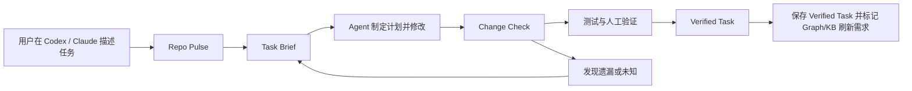
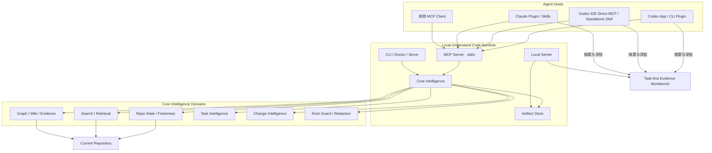
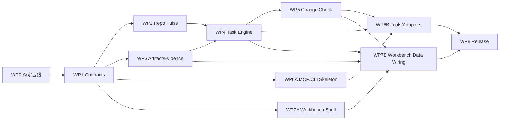

# Understand Code：Agent-native Code Change Intelligence 项目研制计划

> 文档状态：Approved / Contract Frozen v1.2（含 WP4 Decision Amendment D-22～D-23）
>
> 日期：2026-07-27
>
> Contract Freeze：2026-07-28，见 `docs/research/2026-07-28-g0-contract-freeze-record.md`
>
> WP4 Contract Amendment：2026-07-29；`build_task_brief` 的可恢复两阶段编排与可信 Operation Journal 见 D-22，Repo Pulse 不可变历史与原子切换见 D-23
>
> 适用范围：`understand-code` 产品、Core、Agent 插件、MCP、本地服务与 Dashboard
>
> 本文定位：覆盖产品重新定版、现状审计、目标架构、功能范围、分期实施、验收、测试、安全、发布、指标与风险的总研制计划

## 0. 执行摘要

Understand Code 的最终产品形态已经与最初设想发生实质变化。

最初项目解决的是：

> 如何把代码仓库生成知识图谱，并通过前端帮助用户浏览和理解。

现在项目应解决的是：

> 如何让 Codex、Claude Code 等开发 Agent 在修改前获得可信上下文，在修改中保持任务边界，在修改后用证据核对是否改对。

因此最终定位调整为：

> **Understand Code 是面向 Coding Agent 的本地优先代码变更智能与证据层。它不替代 Agent 写代码，而是让 Agent 的代码修改更准确、可解释、可核验。**

产品由两个入口组成：

1. **Agent 内主入口**：Codex、Claude Code 通过统一 MCP 服务调用仓库状态、任务理解、证据、影响和变更检查能力。
2. **本地 Workbench 辅助入口**：用于下钻完整 Task Brief、证据账本、影响链、计划与实际 Diff，以及任务历史。

所有能力围绕同一个持续对象组织：

> **Persistent Task Brief（持久任务理解包）**

P0 不追求一次性增加很多独立功能页，而是先打通一条完整纵向链路：

```text
任务输入
  → 仓库新鲜度检查
  → Task Brief
  → Agent 开发
  → Change Check
  → 验证记录
  → 持久保存 Verified Task，并标记知识刷新需求
```

推荐研制节奏：

- 4–7 周完成一个 Host 的可演示纵向 Alpha。
- 6–9 周完成 Codex/Claude 双 Agent Alpha。
- 12–14 周完成可供真实用户试用的生产级 P0 Beta。
- 单人全职保持完整范围应按 45–55 周评估；30–36 周只适用于单 Host、桌面端和最小 Workbench 的缩减版。

---

## 1. 产品重新定版

### 1.1 产品形态的演进

| 维度 | 第一阶段 | 第二阶段 | 最终定版 |
|---|---|---|---|
| 产品中心 | 代码知识图谱 | Wiki-first Knowledge Console | Agent-native Change Intelligence |
| 首要问题 | “项目由什么组成？” | “应该怎样阅读项目？” | “任务改哪里、影响什么、最终改对了吗？” |
| 主要入口 | 独立 Graph Dashboard | Wiki + Graph 独立前端 | Codex/Claude 主入口，Workbench 辅助 |
| 核心对象 | Repository Graph | Wiki Page / Graph Node | Persistent Task Brief |
| 时间模型 | 一次性仓库快照 | 可反复阅读的仓库知识 | 围绕一次变更持续更新 |
| 用户价值 | 看见关系 | 理解项目 | 降低错改、漏改和不可解释风险 |
| 前端角色 | 产品本体 | 主要阅读界面 | 证据审阅与影响下钻工作台 |
| 最终产物 | Graph JSON | Wiki、Graph、Coverage | Task、Claim、Evidence、Impact、Change Check、Verification |
| 闭环终点 | 图谱生成完成 | 用户读完内容 | 变更得到核验并留下可复用记录 |

### 1.2 哪些内容发生了变化

以下决策需要覆盖早期产品规划：

1. **默认入口变化**
   - 原计划默认进入 Wiki。
   - 新计划默认在 Codex/Claude 中工作；打开前端时默认进入 Tasks。

2. **核心对象变化**
   - 原计划围绕 Repository、Wiki Page 和 Graph Node 组织。
   - 新计划围绕 Task Brief 组织，Repository/Wiki/Graph 成为任务上下文。

3. **MCP 优先级变化**
   - 原先 MCP 可被视为 P1 的外部接入能力。
   - 确认 Agent-native 定位后，MCP 是 P0 的产品分发和运行基础。

4. **前端职责变化**
   - 前端不继续演进成更复杂的“项目浏览网站”。
   - 前端成为 Task-first Evidence Workbench，不重复建设聊天、编辑器、终端和 Coding Agent。

5. **成功标准变化**
   - 不再以图谱节点数、Wiki 文档数或页面浏览量为核心成功标准。
   - 改为任务准备时间、候选修改准确性、证据闭环率和漏改降低程度。

### 1.3 哪些已有投资继续有效

本次不是推倒重来。以下资产应继续作为产品底座：

- Tree-sitter 多语言静态解析。
- 文件、符号、调用、依赖和测试关系图谱。
- 图谱分层、渐进下钻、Quick Jump 和大仓库可达性。
- Wiki V2、源码证据、Claim Trace、Coverage 和 Quality 契约。
- 搜索、语义检索、指纹、增量更新和持久化。
- Wiki 三栏阅读结构、Evidence Rail 和 Graph Details Rail。
- 本地 Token Gate、路径限制和源码预览保护。
- `/understand-*` Skills 作为兼容入口与工作流资产。

### 1.4 对历史规划的处理

早期设计文档继续保留为演进记录，但产品级优先级以本文为准：

- `Visual Guided Workbench`：保留“引导路径”和“证据侧栏”思想，不再以 Graph 为产品中心。
- `Wiki-First Graph Console`：保留 Wiki/Graph 双向链接，不再以 Wiki 为默认产品入口。
- `Wiki/Graph Experience`：保留三栏、搜索、响应式和可访问性能力。
- `Graph Layout Optimization PRD`：作为 Graph 子系统质量计划继续执行，但其目标是服务任务影响视图，而不是单独定义产品。
- 宣传站点 `site/` 不属于本次产品研制范围。

---

## 2. 当前项目基线与审计结论

### 2.1 初始代码与产物基线

截至 2026-07-27：

| 项目 | 当前状态 |
|---|---|
| Git HEAD | `1bd7705` |
| 当前分支 | `main` |
| 知识图谱分析 Commit | 与 HEAD 一致 |
| 知识图谱规模 | 1264 nodes / 2299 edges |
| calls 边 | 614 |
| analyzed files | 436 |
| Core 测试 | 50 files、910 tests 全部通过 |
| Dashboard 测试 | 48 files 中 47 通过；535 tests 中 534 通过 |
| 当前 Dashboard 失败项 | `largeRepositoryAcceptance` 的完整可达性用例超过 5 秒 |
| 当前工作区 | 存在未提交的 Graph/Layout 相关修改 |

以上表格保留 2026-07-27 的问题发现现场。M0 在 2026-07-28 已形成新的可复现 Closeout：

| 项目 | M0 Closeout |
|---|---|
| 基线 Commit | `34da354968a6071d914e4e4a4fca738e6c2d8a29` |
| Graph/Layout | 有界性、全对象可达性和生产 Dagre 输入链路已收口 |
| 大仓性能 | self-host 1,264 nodes / 2,299 edges 与 synthetic 10k / 18,188 edges 基线通过 |
| 根质量 | Root 94、Core 920、Dashboard 558 tests；build/typecheck/test 全绿 |
| 远端 CI | Run `30335147523`，Ubuntu / Node 22 / pnpm 9，成功 |
| Host Contract | Root Binding V1 与 Runtime Rendezvous V1 已冻结；所有发布 Surface 仍按独立 Gate 取证 |
| 当前工作区 | Tracked clean；用户未跟踪 QA/历史 PRD/site 文件明确排除在本分支之外 |
| G0 状态 | Contract Freeze `closed_for_implementation`；Surface Release Gate `open` |

当前图谱已经具备比较完整的代码结构与调用关系，说明底层不是原型级数据。

但当前知识库的 planning artifacts 仍指向旧项目基线：

- project：`understand-anything`
- commit：`a141e570...`
- graph：846 nodes / 985 edges
- calls：0

当前 `diff-overlay.json` 也仍基于 2026-06-29 的旧 Commit。由此可以确认：

> Graph、Knowledge Base、Diff Overlay 可以分别过期，而当前产品没有统一告诉用户哪些信息仍可信。

同时，当前 Knowledge Base 目录没有活动前端所期待的 `wiki-index.json`。Artifact 是否 ready 不能继续用“目录或部分文件存在”判断，必须由 Manifest 和 Schema Validation 决定。

这正是 Repo Pulse 必须成为 P0 的直接证据。

### 2.2 已有能力

#### Core

- 21 类节点、35 类边的统一图谱类型。
- 多语言 Tree-sitter Extractor。
- Calls 解析、Import 解析、Layer、Tour、搜索和 Embedding Search。
- Fingerprint、Staleness、Change Classifier 与增量合并。
- Wiki V2、Evidence、Trace、Coverage、Generation Report。
- Zod 校验与较完整的单元测试。

#### Dashboard

- `wiki | graph` 两个活动 Surface。
- Wiki 三栏结构：导航、正文、证据。
- Graph 三种模式：Architecture、Call、Coverage。
- Wiki 与 Graph 之间的双向跳转。
- 全局搜索、主题、响应式和可访问性基础。
- Token Gate、localhost 绑定、路径规范化、文件白名单、大小和二进制限制。

#### Agent Distribution

- 已有 `.claude-plugin/plugin.json`。
- 已有十个 `/understand-*` Skills。
- 已有 agents 与 hooks。
- 尚无 `.codex-plugin/plugin.json`。
- 尚无 `.mcp.json` 和 MCP Server。
- 根包没有稳定 CLI/bin。
- 当前 Dashboard Skill 仍会在用户环境中执行依赖安装、Core 构建并启动 Vite Dev Server，不是成品运行方式。

### 2.3 必须先修的正确性问题

#### G0-01：新鲜度不包含工作区状态

当前 `getChangedFiles()` 只执行：

```text
git diff <lastCommit>..HEAD --name-only
```

因此无法完整识别：

- staged
- unstaged
- untracked
- rename
- delete
- Git 命令失败和真正“无变化”的区别

当前仓库刚好展示了这个问题：Graph 的 Commit 与 HEAD 相同，但工作区有多处修改；旧实现仍可能认为图谱是最新的。

#### G0-02：内部逻辑变化被归类为 COSMETIC

当前 Fingerprint 将“内容变化但函数/类签名不变”归类为 `COSMETIC`，并写出：

```text
internal logic changed (no structural impact)
```

Change Classifier 对全部 `NONE | COSMETIC` 的变化返回 `SKIP`。

这对“代码变更智能”是不可接受的：函数体行为变化可能是最重要的变化，不能因为签名未变而跳过。

#### G0-03：调用边丢失 Provenance

Call Resolver 已计算：

- confidence
- lineNumber

但 Graph Builder 写入 `calls` 边时只保留 source、target、type、direction、weight。

Evidence Ledger 与影响路径需要知道：

- 关系来自哪个文件和行号。
- 是 exact、same-file 还是 imported-package。
- 是否由静态分析、配置、测试或人确认。

#### G0-04：持久化缺少原子写与并发锁

当前多数 Artifact 通过 `writeFileSync` 直接覆盖：

- 中途失败可能产生截断文件。
- MCP、Watcher 和 Workbench 并发读写时可能互相覆盖。
- 尚无 per-repo / per-task lock。

#### G0-05：敏感文件缺少硬拒绝规则

当前 Ignore 默认规则没有覆盖所有常见敏感类型，例如：

- `.env*`
- `*.pem`
- `*.key`
- credentials
- token/secret 命名文件

且用户 Ignore 规则允许 negation。MCP 对外返回源码 excerpt 前必须增加不可被用户 negation 取消的 hard deny 与内容脱敏。

#### G0-06：旧 Diff Overlay 已形成断链

`understand-diff` Skill 承诺生成 `diff-overlay.json`，但当前活动 Dashboard 没有生产代码消费该 Artifact。新 Change Check 不得继续沿用“写出文件即认为功能完成”的方式，必须通过 Contract、Local API、Workbench View 和 E2E 验证整条链路。

#### G0-07：现有 Worktree 重定向不适合 Agent 任务

现有 Skill 会尝试将临时 Worktree 的分析输出重定向到主 Checkout。它可以避免临时目录结束后产物丢失，却可能造成：

- 当前 Agent 修改的是 Worktree A。
- Graph/Task 被写到主 Checkout B。
- Change Check 最后比较了错误工作区。

新模型必须共享 Repository Cache，但以 `worktreeId + HEAD + worktreeDigest` 隔离 Task 和 Diff。

#### G0-08：发布与质量入口尚未成品化

- 根 `pnpm test` 目前只是输出提示，没有运行 Core/Dashboard 全套测试。
- 仓库没有正式 CI。
- Root/Claude Plugin 使用 `2.7.5`，Core/Dashboard 使用 `0.1.0`。
- 没有 CLI `bin`、发布文件白名单、engines 和统一兼容策略。

这些都必须进入 P0 Release Hardening，而不是发布前临时补齐。

### 2.4 当前前端需要收口而不是继续扩张

当前 `DashboardSurface` 只有 `wiki | graph`，现有组件已经形成可复用的三栏与图谱体系。正确方向不是增加 Incident、Guardrail、Diff、Runtime 等多个顶层菜单，而是：

```text
Tasks（默认） | Knowledge | Graph
```

Incident、Impact、Change Check 和 Verification 都应成为 Task 的章节或视图。

---

## 3. 最终产品定义

### 3.1 产品使命

让任何 Coding Agent 在一次代码变更中做到：

1. 动手前知道应该读什么、为什么。
2. 明确目标、非目标、假设、未知和验收条件。
3. 能看到直接影响、推断影响和静态分析盲区。
4. 修改后对照原计划检查计划外改动和可能遗漏。
5. 用源码、配置、Git 和测试证据解释结论。
6. 仓库变化后自动识别旧结论是否失效。

### 3.2 核心产品承诺

- **Local-first**：默认在用户机器和当前 Workspace 内运行。
- **Evidence-backed**：重要结论必须可追溯或明确标记为推断/未知。
- **Agent-agnostic**：Codex、Claude 共用同一分析引擎和 Artifact。
- **Task-centered**：结果围绕当前开发任务，而不是一次性展示整个仓库。
- **Unknown-aware**：不能静态证明的内容不得包装成确定事实。
- **Deterministic core**：Git 状态、图路径、Artifact 校验和门禁必须由确定性逻辑负责。

### 3.3 目标用户

#### 第一目标用户

使用 Codex、Claude Code 等开发 Agent，并在陌生、中大型或持续变化仓库中工作的工程师。

#### 第二目标用户

- Code Reviewer 和仓库维护者。
- 新加入项目的工程师。
- 事故排查与高风险变更负责人。
- 需要跨会话交接任务的团队。

产品和运营人员仍可消费业务知识文档，但不是 P0 的核心购买与使用人群。

### 3.4 核心 Jobs To Be Done

1. 当我收到陌生需求时，告诉我先读哪里以及依据是什么。
2. 当 Agent 准备修改时，告诉我哪些文件是候选、哪些只是相关。
3. 当我准备改公共接口时，展示完整影响路径和无法判断的边界。
4. 当修改完成时，对照原计划找出计划外改动和漏改。
5. 当知识产物过期时，明确告诉我哪些结论失效，而不是继续展示为“已验证”。
6. 当任务中断或切换 Agent 时，让另一个 Agent 能继续使用同一份任务状态。

### 3.4.1 Task Eligibility 与 Quick Path

不是每个拼写修改都需要完整 Task Brief。

默认建议完整闭环的 Eligible Task：

- 用户显式要求理解、影响分析或变更检查。
- 陌生模块。
- 跨文件或跨 Package。
- 公共 API、Schema、配置、权限、数据或依赖变化。
- 中高风险 Bug。
- Incident、PR Review 或大规模重构。
- Agent 的首轮检索出现多个合理修改候选或 Unknown。

允许 Quick Path：

- 文案、注释和拼写。
- 可明确定位的单文件叶子改动。
- 用户熟悉且风险很低的机械修改。

Quick Path 至少执行轻量 Repo Pulse；用户可以显式升级为完整 Task。高风险条件命中时 Agent 应提示完整 Brief，用户仍可跳过，但必须在结果中保留“未完成完整检查”的说明。

北极星指标的分母使用 **Eligible Tasks**，不强迫所有微小修改承担完整流程成本。

### 3.5 明确非目标

- 不开发另一个 Codex 或 Claude。
- 不建设内置代码编辑器、终端或通用聊天界面。
- 不为不同 Agent 复制多套分析逻辑。
- 不把全量关系图作为首页。
- 不默认把用户源码上传到云端。
- 不自动提交、推送或部署用户代码。
- 不把静态分析结论描述为运行时事实。
- P0 不做 Jira/Kanban、Issue 管理或通用文档协作。
- P0 不依赖任何 Agent 客户端支持复杂内嵌 UI。

---

## 4. 核心闭环与核心对象

### 4.1 产品闭环



### 4.2 Persistent Task Brief

Task Brief 不是一段临时回答，而是 Agent、MCP、Workbench 和人之间共享的任务契约。

P0 状态机已在 D-21 / G0 冻结：

```text
created
  → context_ready
  → planned
  → in_progress
  → check_required
  → verification_required
  → verified

created 至 verification_required 的正常状态可进入：
  blocked / stale / superseded

blocked 只能：
  → resumeStatus / stale / superseded

stale 只能：
  → context_ready / superseded
```

其中：

- `verified` 与 `superseded` 是终态；后续工作必须创建新 Task 并建立 parent/replacement link。
- `blocked` 必须保存 `resumeStatus`；只有依赖解除且上下文仍 fresh 时才能恢复，否则进入 `stale`。
- `stale` 只能通过强类型 `refresh_task_context` 或 `rebase_task` 回到 `context_ready`，不能直接恢复旧 Plan/Check/Verification。
- 每次 Mutation 使用 revision/CAS、idempotency key 和 append-only Event；失败、冲突与重放不产生重复 revision/Event。
- 完整 Guard、幂等与恢复规则以 `docs/research/2026-07-28-g0-contract-freeze-record.md` 第 5 节为准，WP1/WP4 不得自行增加状态或跨阶段跳转。

#### 4.2.1 `build_task_brief` 可恢复两阶段编排

`build_task_brief` 是一个对 Host 暴露的编排操作，不等同于一次底层 Mutation。
公开输入仍使用 `expectedRevision=0`，并由
`(worktreeId, createScope, idempotencyKey)` 稳定映射到同一个 Task ID；内部必须
按以下两阶段持久化：

1. `created@1`：先保存非空 intent、repo/worktree identity、baseline、唯一
   `task_created` Genesis Event，以及对应的 Idempotency Record/Operation
   Receipt。此阶段不伪造 Brief、Claim、Evidence、Impact、Check 或
   Verification。
2. `context_ready@2`：仅在 Repo Pulse 可用、Context 构建成功且所有引用通过
   校验后，原子发布 Brief、Claim、Evidence、Impact 和第二条 Event，并保存
   `build_task_brief` 的完整 Operation Receipt。

每个阶段都严格满足 `revision = previousRevision + 1`，并且恰好追加一条
Event；两阶段编排不能被实现成一次从 revision 0 直接写入 `context_ready@1`
的跨状态捷径。若进程在第一阶段后中断，重试原 idempotency key 必须读取
`created@1` 的可信事实并继续第二阶段，而不是创建第二个 Task；若 Context 仍
不可用，则保留可恢复的 `created@1` 并返回明确 Gate 失败。

`context_ready@2` 是没有中间 Lifecycle 操作时的标准结果。若 Stage 1 后 Agent
合法执行了 `block_task → resume_task`，Task 会恢复为较高 revision 的
`created@N`；此时 Stage 2 必须以当前 revision 做 CAS，并提交
`context_ready@(N+1)`，不得把 revision 硬编码为 2、倒退历史或创建第二个
Task。处于 `blocked`、`stale` 或 `superseded` 时不得直接发布 Context。

该修订解决了“Genesis 必须是 `created@1`”“`created → context_ready` 必须是
独立合法转移”和“每次成功 Mutation 只能 `+1 revision/+1 Event`”与公开
`build_task_brief(expectedRevision=0)` 之间的组合歧义，不改变 Lifecycle V1
的状态集合、允许转移或 Guard。完整修订与验收规则见 D-22 和
`docs/research/2026-07-29-wp4-task-intelligence-matrix.md`。

### 4.3 Task Brief 必备内容

- Task ID、标题、创建时间、更新时间和状态。
- 用户原始意图。
- 目标与非目标。
- 验收条件。
- 当前仓库、分支、基线 Commit、HEAD 和 Worktree Fingerprint。
- Graph、Wiki、Evidence、Diff Artifact 新鲜度。
- 建议阅读文件、符号和调用路径。
- 修改候选、推荐原因和候选级别。
- 上游、下游、跨层和测试影响。
- 假设、风险和未知项。
- 计划修改。
- 实际修改。
- 计划与实际差异。
- 验证计划、执行结果和未执行项。
- 人工确认记录。
- 最终结论和遗留问题。

### 4.4 证据的两个正交状态

证据的“我们如何知道”与“它现在是否仍有效”必须分开。

认知状态 `epistemicStatus`：

| 状态 | 含义 | 允许的表达 |
|---|---|---|
| `observed` | 源码、配置、Git 或测试直接证明 | “代码显示……” |
| `inferred` | 根据结构、调用或命名推断 | “可能影响……” |
| `unknown` | 当前材料不足 | “当前无法确认……” |
| `human_confirmed` | 用户或 Reviewer 明确确认 | “由用户确认……” |

新鲜度 `freshness`：

| 状态 | 含义 |
|---|---|
| `current` | 对当前 Snapshot 仍成立 |
| `changed` | 证据来源按计划发生变化，需要 Change Check |
| `stale` | 依赖基线变化，当前推荐不可继续信任 |
| `invalid` | 文件、行号、Hash 或来源无法再验证 |

基线 Evidence 保持不可变并记录 `observedAtSnapshotId`；后续 Snapshot 通过新鲜度描述变化，不覆盖历史事实。

不得用一个总置信度百分比替代以上状态。

### 4.5 候选修改级别

为了避免 Agent 把“相关”误认为“必须修改”，统一使用：

- `must_inspect`
- `likely_change`
- `possible_change`
- `test_or_verify`
- `context_only`

每个候选都必须带：

- 原因。
- Evidence ID。
- 传播路径。
- 新鲜度。
- 是否存在反证或未知。

---

## 5. 最终系统形态

### 5.1 总体架构



### 5.2 目标包结构

跨 Agent 产品需要稳定、无运行时依赖的共享契约，因此 Contracts、Repository State、Task Engine 和 Artifact Store 应从 P0 起形成清晰包边界；现有解析和知识生产能力继续留在 Core：

```text
understand-code/
├── .claude-plugin/
├── .codex-plugin/
├── skills/
├── packages/
│   ├── contracts/
│   ├── core/
│   ├── repository-state/
│   ├── task-engine/
│   ├── artifact-store/
│   ├── mcp-server/
│   ├── local-server/
│   ├── cli/
│   └── dashboard/
├── integrations/
│   ├── claude/
│   │   ├── mcp-config.template.json
│   │   └── install-fixture/
│   └── codex/
│       ├── plugin/
│       │   ├── mcp-config.template.json
│       │   └── install-fixture/
│       └── ide/
│           ├── config.template.toml
│           ├── standalone-skills/
│           └── install-fixture/
└── dist/
    ├── server/
    ├── dashboard/
    ├── adapters/
    │   └── codex-ide/
    └── plugins/
        ├── claude/
        │   ├── .claude-plugin/
        │   └── .mcp.json
        └── codex/
            ├── .codex-plugin/
            └── .mcp.json
```

说明：

- `contracts` 只包含 Zod Schema、DTO、版本和迁移描述，不依赖 fs/git/React。
- `repository-state` 负责 Git Snapshot、Worktree、Diff Hunk、Freshness 和 Ignore。
- `task-engine` 组合现有 Graph、Search、Wiki、Evidence 和 Diff 能力。
- `artifact-store` 负责 Manifest、原子写、锁、迁移、备份与 Event Log。
- MCP Server 只负责 Tool Schema、Root 绑定、分页、预算和 Handler，不复制分析逻辑。
- Local Server 负责静态前端、只读数据 API，以及严格受限的 Task Mutation API、Token、SSE/轮询和深链。
- CLI 提供 `analyze`、`mcp`、`serve`、`doctor`，用于安装检查、CI 和不支持 MCP 的降级场景。
- 生产包必须包含预编译 Core、MCP 和 Dashboard，不在用户项目中运行 `pnpm install` 或 Vite Dev Server。
- Codex 与 Claude 共享的是 MCP Server 二进制、Tool Schema、Artifact 和 Skills 内容模型，不是假定共用一个 Manifest 或 `.mcp.json`。
- Codex App/CLI 使用 `.codex-plugin/plugin.json` + bundled `.mcp.json`；Codex IDE 当前不支持 Plugin，P0 只使用 trusted project-scoped `.codex/config.toml` 直连同版本 MCP，并把 standalone Skill 安装到该仓库的 `.agents/skills/**`。
- Codex Plugin、Codex IDE Direct MCP、Claude Plugin 三条安装路径都必须有完全空白环境 Fixture，禁止只在源码仓库根目录中验证。

上述依赖边界是 P0 强约束，但不要求第一天就发布七个独立 npm 包：

- `contracts`、`mcp-server`、`local-server/cli` 必须有清晰物理分发边界。
- `repository-state`、`task-engine`、`artifact-store` 可先作为 Core 内的独立模块落地。
- 当 API 和并发模型稳定后再拆包，避免物理重构拖慢纵向 Alpha。

依赖方向必须固定为：

```text
contracts
├──→ core + repository-state
├──→ artifact-store
└──→ dashboard

core + repository-state + artifact-store
  └──→ task-engine

task-engine + artifact-store
  └──→ mcp-server

dashboard build + task-engine + artifact-store
  └──→ local-server

mcp-server + local-server
  └──→ cli/runtime-manager

cli/runtime-manager
  └──→ Codex App/CLI Plugin + Codex IDE Direct MCP + Claude adapters
```

Agent Plugin 不得自行解析 Graph JSON、执行 Git 或写 Task 文件。

### 5.3 模型职责边界

P0 默认不在 MCP Server 内再嵌入一个独立 LLM。

- Core 负责确定性 Git、图谱、搜索、路径、分类、证据和 Artifact 校验。
- Host Agent 负责自然语言意图理解、计划表达和最终编码决策。
- `build_task_brief` 返回结构化 Draft；Skill 允许 Host Agent 补充目标、假设和验收条件。
- Agent 补充的 Claim 必须绑定 Evidence，或标记为 `inferred/unknown/human_confirmed`。

这样可以避免：

- 双模型成本。
- 对某个模型厂商锁定。
- 同一个任务在不同 Agent 中生成互不兼容的底层事实。

### 5.4 项目内 Artifact

```text
<canonical-worktree-root>/.understand-code/
├── repository.json
├── artifact-manifest.json
├── repo-pulse.json
├── snapshots/
│   └── <snapshot-id>.json
├── knowledge-graph.json
├── fingerprints.json
├── knowledge-base/
└── tasks/
    └── <task-ulid>/
        ├── task.json
        ├── task-brief.json
        ├── task-brief.md
        ├── claims.json
        ├── evidence.json
        ├── impact.json
        ├── operation-journal.json
        ├── change-check.json
        ├── verification.json
        └── events.jsonl
```

每个物理 Worktree 有独立 `.understand-code` 状态目录：

- `worktreeId` 由 canonical worktree identity 生成，不包含 HEAD。
- HEAD、Index 和 Worktree Digest 只属于不可变 Snapshot。
- Task 与 Diff 永远按 Worktree 隔离。
- 大型、不可变 Graph Cache 可放到平台用户缓存目录，以 `repositoryId + sourceSnapshotId` 共享。
- 不再把临时 Worktree 的 Task 状态重定向到主 Checkout。
- 跨 Worktree 继续任务必须执行显式 migrate/rebase。

所有新 V1 事实 Artifact JSON：

- 必须有 `schemaVersion`。
- 必须记录 repositoryId、worktreeId、snapshotId、producerVersion。
- 必须支持原子写。
- 必须有校验和。
- 必须可识别 stale/superseded。
- 必须有向前迁移和不兼容时的清晰错误。

例外边界已经在 WP1 冻结：`artifact-manifest.json` 是严格的 Worktree
控制索引，不伪装成第十种 Envelope Artifact；`events.jsonl` 的每一行验证为
`TaskEventV1`，文件本身由 `task_event_log` Descriptor 管理。现有
Graph/Meta/Fingerprint/Wiki/Diff 保持显式 `legacy_raw` 格式，不能在没有迁移
决策的情况下静默套入 V1 Envelope。

---

## 6. 功能总清单与重新排序

### 6.1 P0：可用的 Agent 变更闭环

| 能力 | 重要性 | 当前基础 | P0 目标 |
|---|---:|---|---|
| Correctness Foundation | 必须先做 | 有 staleness/fingerprint/classifier | 工作区完整、逻辑变化不跳过、Artifact 一致 |
| Versioned Task Contracts | 极高 | 无 Task 实体 | Task/Claim/Evidence/Impact/Check/Verification V1 |
| Repo Pulse | 极高 | 仅 commit..HEAD staleness | Commit + staged + unstaged + untracked + Artifact freshness |
| Evidence Ledger | 极高 | Wiki Evidence/Trace 已有 | 认知状态与新鲜度双轴、失效传播、人工确认 |
| Task Brief | 极高 | Chat/Explain/Search 可复用 | 任务目标、路径、候选、影响、未知和验证 |
| Change Check | 极高 | Diff Analyzer/Overlay 可复用 | 计划内、计划外、遗漏、未知和验证状态 |
| MCP Server | 极高 | 无 | 统一跨 Agent 工具层 |
| Host Surface Adapter | 极高 | Claude Plugin + Skills | Codex App/CLI Plugin、Codex IDE Direct MCP、Claude Plugin；共享 MCP/Artifact、薄 Skill |
| Artifact Store | 极高 | `.understand-code` 持久化 | 原子写、锁、迁移、事件日志 |
| Local Server | 高 | Vite middleware | 成品静态服务、Token、Deep Link |
| Task-first Workbench | 高 | Wiki/Graph 双 Surface | Tasks 默认页、Brief、Evidence、Check、Overlay |
| Packaging/Doctor | 高 | 无稳定 CLI/bin | 一次安装、离线启动、健康检查、升级 |

### 6.2 P1：提升任务完成率

- 变更前 What-if Impact Simulation。
- 受控命令执行、自动测试选择与任务级 Runtime Trace；P0 只记录由 Agent 或用户提交的验证结果，不负责执行命令。
- Incident Navigator：日志、堆栈、错误码到代码路径。
- 高级 Task History：跨版本对比、搜索、恢复、跨 Worktree 迁移和正式交接；P0 已包含基础列表、事件历史和跨 Agent 续接。
- 增量 Watcher 与任务完成后知识刷新。
- Hybrid Retrieval：词法、图谱、符号和可选 Embedding。
- Agent Hooks：在高风险修改前后建议调用。
- PR/Review 报告导出。
- 证据冲突检测。
- 可选 Streamable HTTP MCP。
- 客户端支持时的轻量 MCP UI；不得作为通用体验前提。

### 6.3 P2：团队与平台

- 团队共享的已确认 Task Knowledge。
- 多仓库、跨服务影响分析。
- CI/PR Status Check。
- 确定性 Architecture Guardrails。
- 跨仓库 Runtime Trace、日志和 Metrics 与静态图谱的组织级关联。
- 权限、审计、加密和保留策略。
- 企业自托管远程 MCP。
- 更多 Agent/IDE Adapter。
- 组织级架构漂移与风险趋势。

### 6.4 优先级变化说明

相比早期讨论，以下能力发生调整：

- **MCP：P1 → P0 平台基础。**
- **Task Brief：P0 核心对象，不再只是一个页面。**
- **Repo Pulse：P0 前置门禁，而不是状态角标。**
- **Evidence Ledger：P0 横向基础设施，而不是右侧栏装饰。**
- **Change Check：P0 闭环终点，与 Task Brief 同等重要。**
- **Impact Simulation：保留为 P1；P0 先提供基于现有图的直接影响摘要。**
- **Incident：P1；它复用 Task/Evidence/Impact，不单独搭平台。**
- **Guardrails：P2；Runtime 在 P1 只做任务级受控执行与结果采集，P2 再做跨仓库关联和强门禁。**
- **Graph Layout：只作为 G0 时间盒内的遗留稳定任务，不属于 Agent-native 新产品 P0 功能。**
- **任务知识沉淀：P0 持久保存 Verified Task 并标记 Graph/KB 刷新需求；P1 才自动增量刷新和提炼仓库级知识。**

---

## 7. P0 详细功能要求

### 7.1 Correctness Foundation

#### FR-CF-001：Git 状态全覆盖

Repo State 必须区分：

- baseline..HEAD committed changes
- staged
- unstaged
- untracked
- renamed
- deleted
- conflicted
- submodule/worktree 状态
- Git unavailable/error

验收：

- Fixture 覆盖以上全部状态。
- Git 命令失败不得返回“无变化”。
- 路径统一为 repo-relative POSIX 格式。
- rename 同时保存 oldPath/newPath。
- untracked 文件必须进入 Pulse，但只有通过安全过滤后才能进入分析。

#### FR-CF-002：语义变化重新分类

建议替换现有三态：

```text
NONE | COSMETIC | STRUCTURAL
```

改为：

```text
NONE
FORMATTING_OR_COMMENT
BODY_LOGIC
SIGNATURE
DEPENDENCY
TOPOLOGY
UNKNOWN
```

约束：

- `BODY_LOGIC` 不能触发 `SKIP`。
- 没有 Parser 支持时使用 `UNKNOWN`，不得伪装为 cosmetic。
- Change 分类结果必须记录 detector 和依据。
- 同一输入输出必须确定。

#### FR-CF-003：关系 Provenance

Graph Edge VNext 至少支持：

```ts
interface EdgeEvidence {
  sourceFile?: string;
  lineRange?: [number, number];
  resolver?: string;
  confidence?: "exact" | "same-file" | "imported-package" | "heuristic";
  observedAtCommit?: string;
}
```

旧 Graph 继续可读；缺失 provenance 的边显示为 `unknown provenance`。

#### FR-CF-004：Artifact 一致性

新增 `artifact-manifest.json`：

```ts
interface ArtifactManifestV1 {
  schemaVersion: 1;
  repositoryId: string;
  worktreeId: string;
  status: "ready" | "cold" | "error";
  latestSnapshotId?: string;
  producerVersion: string;
  updatedAt: string;
  reasons: string[];
  artifacts: Array<{
    artifactId: string;
    artifactType: string;
    storageFormat: "enveloped_v1" | "legacy_raw" | "jsonl_v1";
    path: string;
    generatedAt: string;
    sourceSnapshotId: string;
    contentDigest: string;
    state: "current" | "historical" | "read_only_recovery" | "corrupt";
    freshness: "fresh" | "partial" | "stale" | "invalid";
    dependencies: Array<{
      artifactId: string;
      relation: "derived_from" | "requires" | "indexes" | "projects";
      requiredDigest?: string;
      requiredSnapshotId?: string;
    }>;
  }>;
}
```

Manifest 本身只描述当前 canonical Worktree；多 Worktree 不共享可变
Manifest。`ready` 必须指向一个 `enveloped_v1 + schemaVersion=1 +
state=current + freshness=fresh|partial` 的 Repository Snapshot Descriptor；
Artifact Store 还必须验证对应文件存在、typed parser 通过且 payload digest
与 Descriptor 一致。`cold/error` 必须给出原因。Artifact 依赖变化时必须传播
失效状态，标记为 fresh 的 Artifact 不能依赖 partial/stale/invalid 上游。

### 7.2 Repo Pulse

#### 输出内容

- Repo root 和 identity。
- branch、baseline、HEAD。
- ahead/behind/merge-base。
- staged、unstaged、untracked、rename、delete、conflict。
- Graph/Wiki/Evidence/Diff/Task Artifact freshness。
- Parser/Call Graph completeness。
- 需要的刷新级别：none/incremental/full。
- 错误与无法判断项。

#### 展示原则

Repo Pulse 不是单个绿点。它需要回答：

- 当前任务基于哪个版本？
- 哪些文件在任务开始后变了？
- 哪些证据仍有效？
- 哪些推荐需要重算？
- 为什么需要刷新？

#### 验收

- changed-file discovery recall 为 100%。
- 相同仓库状态得到相同 fingerprint。
- 当前 HEAD 未变但 Worktree 变化时必须显示 stale/partial。
- Artifact 过期必须能追溯到上游依赖。
- 读取失败和“确实无变化”使用不同状态。

#### 冷启动与缺失 Artifact 状态矩阵

| 状态 | Repo Pulse | Task 行为 | 用户/Agent 动作 |
|---|---|---|---|
| Graph 缺失 | `not_ready` | 不生成伪完整 Brief | 显式授权 `refresh_index` |
| Graph stale、源码可读 | `stale` | 可生成降级 Brief，必须标 partial | 选择增量刷新或接受降级 |
| Wiki 缺失 | `partial` | 使用 Graph + Source + Search | 不阻塞首个 Task |
| Calls 不完整 | `partial` + completeness | 影响路径标 Unknown Boundary | 可继续，但不能声称完整 |
| 不支持的语言 | `partial/unsupported` | Lexical + 文件级 fallback | 显示 Coverage Unknown |
| Git 不可用 | `unknown` | 不进入 Ready | 修复环境或显式使用无 Git 模式 |
| Refresh 进行中 | `rebuilding` | 读取旧 Snapshot 或等待 | 展示进度，允许取消 |
| Refresh 失败 | `unknown/error` | 保留旧 Artifact，不原子切换 | 查看失败原因并重试 |

约束：

- `build_task_brief` 不隐式调用刷新。
- `refresh_index` 必须返回进度、可取消状态和最终 Snapshot ID。
- 失败刷新不能破坏最后一个可用 Snapshot。
- Graph/Wiki/Calls 缺失时必须说明降级范围。

### 7.3 Task Brief Engine

#### 输入

```ts
interface BuildTaskBriefInput {
  task: string;
  expectedRevision: 0;
  idempotencyKey: string;
  actor: string;
  baseRef?: string;
  scope?: string[];
  tokenBudget?: number;
  maxCandidates?: number;
  maxImpactDepth?: number;
}
```

`build_task_brief` 不得隐式触发索引刷新。Skill 必须先读取 Repo Pulse；需要刷新时显式调用单独授权的 `refresh_index`。

#### 输出

- Task ID。
- Goal/Non-goal Draft。
- Repo Pulse 摘要。
- 推荐阅读路径。
- 候选文件/符号及级别。
- 直接影响与推断影响。
- 风险。
- 假设和未知项。
- 验收条件 Draft。
- 验证计划 Draft。
- Evidence IDs。
- truncated 标记和被裁剪类别。

#### 排序策略

P0 使用可解释的混合排序：

```text
score =
  lexical match
  + symbol exact match
  + graph proximity
  + entry point relevance
  + test relation
  + wiki direct relation
  + recent change relevance
  - stale penalty
  - weak provenance penalty
```

不得只依赖 Embedding；P0 在 Embedding Provider 缺失时必须完整工作。

#### 验收

- 每个修改候选都有原因和 Evidence 状态。
- 不存在的文件不能作为有效候选。
- stale Graph 不能静默参与推荐。
- “可能相关”和“建议修改”明确区分。
- 结果严格执行 tokenBudget/maxCandidates/maxDepth。
- 裁剪必须显式返回。
- 同一 repo state 和同一参数下，确定性部分可复现。

### 7.4 Evidence Ledger

#### Claim V1

Claim 是 Task Brief、Evidence、Finding 与 Verification 之间可追踪的最小语义单元，不能只把关键结论保存为 UI 字符串：

```ts
interface ClaimV1 {
  id: string;
  taskId: string;
  kind:
    | "goal"
    | "non_goal"
    | "acceptance"
    | "assumption"
    | "recommendation"
    | "risk"
    | "unknown"
    | "finding"
    | "conclusion";
  statement: string;
  epistemicStatus: "observed" | "inferred" | "unknown" | "human_confirmed";
  lifecycleStatus: "draft" | "supported" | "contested" | "invalidated";
  freshness: "current" | "changed" | "stale" | "invalid";
  sourceSnapshotId: string;
  evidenceIds: string[];
  findingIds: string[];
  verificationRecordIds: string[];
  derivationPath?: Array<
    | { kind: "evidence"; evidenceId: string; description: string }
    | { kind: "graph_relation"; relationId: string; description: string }
    | { kind: "rule"; ruleId: string; description: string }
    | { kind: "assumption"; claimId: string; description: string }
  >;
  confirmationEventId?: string;
  supersedesClaimId?: string;
  createdAt: string;
  updatedAt: string;
}
```

#### Evidence V1

```ts
interface EvidenceV1 {
  id: string;
  epistemicStatus: "observed" | "inferred" | "unknown" | "human_confirmed";
  freshness: "current" | "changed" | "stale" | "invalid";
  kind: "source" | "config" | "test" | "git" | "graph_path" | "document" | "human" | "analysis_boundary";
  claimIds: string[];
  nodeIds: string[];
  filePath?: string;
  lineRange?: [number, number];
  excerpt?: string;
  relationPath?: string[];
  commit?: string;
  contentHash?: string;
  producedBy: string;
  createdAt: string;
  observedAtSnapshotId: string;
  derivationPath?: Array<
    | { kind: "evidence"; evidenceId: string; description: string }
    | { kind: "graph_relation"; relationId: string; description: string }
    | { kind: "rule"; ruleId: string; description: string }
    | { kind: "assumption"; claimId: string; description: string }
  >;
  confirmation?: {
    actor: string;
    input: string;
    confirmedAt: string;
  };
  invalidatedAt?: string;
  invalidationReason?: string;
}
```

#### 规则

- Goal、Non-goal 和 Acceptance 先以 draft Claim 创建，经 `update_task` 确认后成为 `human_confirmed`。
- 每个修改建议、风险、Finding 和最终结论都必须由稳定 Claim ID 表达；UI 文案只是 Claim 的投影。
- `observed`/`inferred` Claim 至少引用一个有效 Evidence；无法获得证据时必须生成 `unknown` Claim，并保存边界原因，不能使用空证据的肯定结论。
- `Evidence.claimIds` 与 `Claim.evidenceIds` 必须双向一致，写入事务在提交前执行引用完整性校验。
- Finding 通过 `claimIds` 说明它支持或质疑哪些 Claim；Verification 通过 `claimIds` 支持验收或结论 Claim。
- Human Confirmation 只表示“人确认了该主张”，不能把静态推断改写成源码或运行时观察事实。
- 摘录必须经过敏感信息过滤。
- 文件和行号必须验证存在。
- 内容 Hash 变化后保留原 Evidence，并将其 freshness 变为 changed/stale/invalid。
- Human Confirmation 必须记录输入内容、时间和 Actor。
- 推断必须保存推断路径，不能只保存结论。

### 7.5 Change Check

#### 输入

```ts
interface CheckChangeInput {
  taskId: string;
  actualSnapshotId?: string; // 省略时使用调用时最新 Snapshot
  includeWorktree: boolean;
  expectedRevision: number;
  idempotencyKey: string;
  actor: string;
  verificationRecordIds?: string[];
}
```

Task 的 baselineSnapshotId 创建后固定。若需要改变基线，必须通过显式 `update_task` rebase Action 生成新 Revision；`check_change` 不接受一个可能与 Task 冲突的任意 baseRef。

#### 输出分类

- `planned_completed`
- `planned_partial`
- `unplanned_change`
- `possible_omission`
- `verification_gap`
- `cannot_determine`

#### 检查维度

- 计划候选与真实变更文件/符号的对应。
- 新增、删除、rename。
- 函数体逻辑变化。
- 签名、依赖和拓扑变化。
- 调用方、测试、配置、Schema 和文档影响。
- 与验收条件的对应关系。
- 测试是否实际执行。
- Task 创建后新出现的未知项。

#### 验收

- Change Check 必须同时比较 Commit 和 Worktree。
- 不得把“未发现”描述成“确定没有”。
- 每项 Finding 可下钻到 Diff、路径和 Evidence。
- 计划外改动可以被用户接受并记录理由。
- 可能遗漏必须说明推断路径和静态盲区。
- 未执行验证不得显示为 passed。

### 7.6 MCP Server

P0 共暴露 11 个 Tool：9 个 Task/数据 Tool，以及 `open_workbench`、`refresh_index` 两个显式生命周期操作：

| Tool | 作用 | 默认副作用 |
|---|---|---|
| `get_repo_pulse` | 获取仓库与 Artifact 新鲜度 | 只读 |
| `build_task_brief` | 创建结构化 Task Brief Draft | 只写 `.understand-code/tasks/**` |
| `get_task_brief` | 分页读取 Task/Section | 只读 |
| `update_task` | 确认目标/计划、推进状态、记录人工确认、接受 Finding | 受限 Task 写入 |
| `search_context` | 搜索符号、文件、Wiki 和图路径 | 只读 |
| `get_evidence` | 批量获取短 Evidence | 只读 |
| `trace_impact` | 查询当前代码事实下的有向影响路径 | 只读 |
| `check_change` | 对照 Task 与真实 Diff | 写 Task Check Artifact |
| `record_verification` | 记录 Agent 已执行的测试或人工验证；不主动执行命令 | 写 Verification Artifact |
| `open_workbench` | 启动或打开指定 Task Deep Link | 启动本地服务 |
| `refresh_index` | 显式执行增量/全量刷新 | 昂贵写操作，单独授权 |

P1 再增加：

- `analyze_incident`
- 为 `trace_impact` 增加 Proposed Change / What-if 模式

设计要求：

- stdio stdout 只能输出 MCP JSON-RPC；日志全部写 stderr。
- 所有返回结构版本化。
- 大结果通过 cursor/pageSize 分页。
- 每次返回 repo commit、worktree fingerprint、freshness 和 truncated。
- 共享 Server 必须收到显式 `--root <path>`，缺失时 fail closed；它不直接读取 Host 环境变量，也不把通用 cwd/Roots 当 fallback。
- Root 在启动时绑定；Handler 不接受任意绝对路径。
- 只暴露面向任务的稳定工具，不把所有内部函数直接映射为 MCP Tool。

所有 Task 范围内的创建或写操作必须携带：

```ts
interface MutationControl {
  expectedRevision: number;
  idempotencyKey: string;
  actor: string;
}
```

创建新 Task 时 `expectedRevision` 固定为 `0`；更新、检查和记录验证时必须传调用方已读取的当前 revision。`refresh_index` 不修改 Task，使用独立 `OperationControl { expectedSourceSnapshotId?, idempotencyKey, actor }`；`open_workbench` 只管理本地服务和短期 Session，不写 Task Artifact。

`update_task` 只接受强类型 Action：

```text
confirm_goal
confirm_acceptance_criteria
confirm_plan
record_assumption
confirm_unknown
transition_status
accept_finding
accept_verification_skip
block_task
resume_task
refresh_task_context
rebase_task
supersede_task
```

它不接受任意 JSON Patch。`transition_status` 只允许 Lifecycle V1 表内的普通阶段转移；`blocked`、恢复、Context refresh/rebase 与 supersede 必须使用对应强类型 Action。`refresh_task_context` 在同一 baseline 上重建 Pulse/Brief 引用；`rebase_task` 改变 baseline，两者成功后都进入 `context_ready` 并显式失效旧 Plan/Check/Verification。每次成功更新都增加 revision 并追加 Event；revision 冲突返回可恢复的 conflict，不允许 last-write-wins。

可选 Resources：

```text
understand://repo/pulse
understand://tasks/{taskId}/brief
understand://tasks/{taskId}/evidence/{evidenceId}
understand://tasks/{taskId}/check
```

### 7.7 Codex 与 Claude Adapter

#### 共同原则

- 分析逻辑全部在 Core/MCP。
- Skill 只定义何时调用、调用顺序和怎样向用户表达。
- 两个 Agent 输出同一 Artifact Schema。
- Agent 不支持富 UI 时使用 Markdown 摘要和文本 URL。
- 共用的是 MCP Runtime、Tool Schema、Error Envelope、Artifact 与 Skill 内容模型，不是安装外壳。
- Host Adapter 只从当前 Surface 已验证的权威信号生成显式 `--root`；信号缺失、无效或未验证时进入 `binding_error`，所有 Repository/Task/Workbench Tool 以稳定 `workspace_binding_required` Envelope fail closed。

#### Codex App / CLI Plugin

- 新增 `.codex-plugin/plugin.json`。
- Codex 分发根生成专用 `.mcp.json`，指向随 Plugin 发布的本地 stdio Server。
- 打包共享 Skills。
- Codex Desktop App 与 CLI 分别通过 clean-install E2E 后才能声明支持。
- 当前 App Server 中“stdio 进程 cwd 跟随 thread cwd”只属于固定版本、固定路径的 `provisional observed` 证据，不得推广为 CLI 或 Desktop 契约。
- 在某个 Surface 不能产生可验证显式 Root 时保持 `pending-e2e`，不得静默猜测。

#### Codex IDE Direct MCP

- Codex IDE 当前不支持 Codex Plugin，不读取 `.codex-plugin`、Plugin cache 或 bundled `.mcp.json`。
- P0 只通过 trusted project-scoped `.codex/config.toml` 注册同版本 stdio executable；不生成带固定项目 Root 的 user-scoped `~/.codex/config.toml`。
- project config generator 在安装时把已归一化项目目录写成显式 `--root`，并把 `understand-task`、`understand-check` 安装到该仓库 `.agents/skills/**`；继承的任意 process cwd 非权威。
- Installer/Doctor 必须验证项目已受 Codex 信任、配置与 Skill 的 scope 一致，且 remove 只删除本产品拥有且内容未被用户修改的条目。
- IDE 配置模板、Doctor、reload、upgrade 和 remove 使用独立 Fixture。
- App/CLI Plugin 仍是一键安装主路径；Direct MCP 是三端兼容基线，不等于删除 Plugin。

#### Claude Code

- 保留 `.claude-plugin/plugin.json`。
- Claude 分发根增加符合 Claude Plugin 约定的 bundled `.mcp.json`。
- 使用 `${CLAUDE_PROJECT_DIR}` 生成显式 `--root`；process cwd 只做诊断，即使不同也不重选 Root 或报冲突。
- 现有 Skills 改为调用 MCP，不再让 Agent 自己 grep 大 JSON。
- `roots/list` 只校验显式 canonical root 仍在 Host 允许集合中，不参与 Root 选择，也不扩大分析边界。

Codex Plugin `.mcp.json`、Codex IDE `config.toml` 与 Claude `.mcp.json` 由独立 Adapter Template 生成并分别做 Schema/启动测试；它们可以指向同一版本 Server，但不能互相复制配置外层结构或把源码仓库根配置当成发布物。

#### P0 Skills

1. `understand-task`
   - 适用：陌生任务、跨模块、高风险变更。
   - 顺序：Pulse → 必要时显式刷新 → Brief Draft → 必要 Evidence → `update_task` 确认计划 → 输出摘要。

2. `understand-check`
   - 适用：Agent 声称修改完成前。
   - 顺序：Pulse → 记录已执行验证 → Change Check → Verification Gap → 输出结论。

旧 Skills 保留兼容，但在文档中标记新的推荐入口。

#### Workspace Binding 与进程生命周期

P0 采用“一 MCP 进程绑定一个 immutable canonical Worktree Root”。共享 Server 必须收到显式 `--root`；缺失或校验失败时不得读取 Repository、Artifact 或 Task 数据，但仍完成 MCP initialize 和 `tools/list`，进入只允许返回诊断的 `binding_error` 状态：

1. Adapter 只从当前 Surface 已验证的权威信号生成 `--root`：
   - Claude：`${CLAUDE_PROJECT_DIR}`。
   - Codex IDE：trusted project-scoped `.codex/config.toml` 在安装时声明的 project binding。
   - Codex Desktop App/CLI：分别由对应 Surface E2E 验证；App Server startup cwd 仅为当前版本 provisional candidate。
2. 显式 Root 依次执行存在性、目录、`realpath` 和 Git worktree top-level 归一化；linked worktree 必须绑定自身 top-level，不得跳到 common dir 或主 checkout。
3. 通用 process cwd 不是共享 Server fallback。Claude cwd 永远非权威；Codex cwd 只有在固定版本、已通过该 Surface Fixture 的 Adapter 内才能使用。
4. MCP Roots 不是 selector。若 Client 支持 Roots，每个 `file:` URI 只执行 decode、目录校验和 `realpath`，**不得**向上提升到 Git top-level；只有显式 Root 可以按第 2 条归一化为 worktree top-level。
5. membership 使用路径组件感知的 containment：canonical worktree root 必须等于某个 advertised Root，或完整位于其目录范围内。若 Host 只 advertise worktree 的子目录，不得借 Git 归一化扩大到整个 worktree，必须返回 `root_not_allowed`。
6. Client 不支持 Roots 时，有效显式 Root 可继续；支持 Roots 但成功返回的集合为空或不再包含 canonical root 时，后续仓库 Tool fail closed。Client 已 advertise Roots 但 `roots/list` 调用失败时使用 `root_unavailable`。
7. 多个 Roots 本身合法。additional roots 只表示 Host scope/membership，不进入索引、Artifact、源码读取或 Root Guard allowlist，也不能视作操作系统级权限证明。
8. `roots/list_changed` 新增 Root 只更新诊断；移除覆盖 canonical root 的 Root 时进入 `binding_error`，不重绑。
9. 绑定后同一进程不可重绑；分析第二个仓库必须使用独立 Agent session、MCP 进程、Store identity 与 Workbench Runtime。
10. cwd、additional roots、Plugin 目录和 sibling checkout 均不得覆盖显式 canonical root。

一旦进入 `binding_error`，同一 MCP 进程不得因 cwd、Roots 或文件系统状态随后恢复而解封；修复配置并重启独立 MCP 进程是唯一恢复方式。

绑定错误统一通过 MCP `tools/call` 的 Tool Error 返回，而不是把业务错误伪装成 JSON-RPC 协议错误：

```json
{
  "isError": true,
  "content": [
    {
      "type": "text",
      "text": "Workspace binding is required."
    }
  ],
  "structuredContent": {
    "error": {
      "schemaVersion": 1,
      "code": "workspace_binding_required",
      "details": {
        "reason": "root_missing | root_not_directory | root_not_allowed | root_unavailable | root_conflict | secondary_session_required"
      }
    }
  }
}
```

`structuredContent.error` 是唯一机器可读 Error Envelope；P0 不暴露容易误导的统一 `retryable` 布尔值，调用方按 `reason` 给出修复动作。`code` 与 `reason` 是跨 Host 稳定字段；`text` 可以本地化，但不得包含绝对路径。六个 `reason` 按下表自上而下判定，命中即停止，因此触发条件互斥：

| reason | 唯一触发条件 |
|---|---|
| `root_conflict` | Adapter 同一次启动取得两个及以上已验证权威 Root 候选，且各自 canonicalize 后不相同；process cwd 差异不属于 conflict，Adapter 不得择一 |
| `root_missing` | Adapter 没有任何权威 Root 候选、未提供 `--root`，或参数为空 |
| `root_not_directory` | 显式 Root 可成功 `stat`，但对象不是目录 |
| `root_unavailable` | 显式 Root 不存在、不可读、为 broken symlink，或 `stat`/`realpath` 失败；或 Client 已 advertise Roots 但 `roots/list` 请求失败/暂不可用 |
| `root_not_allowed` | 显式 Root 已成功 canonicalize，但成功返回的 advertised Roots 为空、没有任何一项覆盖 canonical root，或运行中失去该 membership |
| `secondary_session_required` | 进程已经成功绑定后，请求引用另一个 worktree/repository 的 Task、Artifact 或 additional Root |

Task Mutation 额外冻结三个互不混用的稳定错误码：
`task_transition_rejected` 表示状态机不允许该迁移，
`task_gate_unsatisfied` 表示迁移合法但当前 Guard 未满足，
`action_not_authorized` 表示 Actor 无权执行该动作。Schema 校验、CAS 冲突、
状态机、Guard 与权限错误不得折叠成 `invalid_arguments` 或
`internal_error`；`details` 应分别给出当前状态、失败 Guard、允许动作或不含敏感信息的
授权原因。所有公开 `text` 和 `details` 字符串都必须经过统一路径脱敏，并用带引号的
POSIX 路径、Windows Drive Path、UNC Path 与 `file:` URI 对抗样例验证。

只有 malformed JSON-RPC、未知方法等协议问题使用 JSON-RPC error。`binding_error` 下 `initialize`、`tools/list` 和无源码诊断可成功，所有 Repository/Task/`open_workbench`/`refresh_index` 调用返回上述 Tool Error，且不得创建 Artifact。CLI 参数解析本身无法启动 stdio 时只允许输出不含路径的 stderr 诊断并非 MCP Envelope，该情况不能计作 Tool Error E2E 通过。

M0 必须分别记录 Codex App/CLI Plugin、Codex IDE Direct MCP 与 Claude Plugin 的证据等级；`provisional observed` 不能替代另一个 Surface 的 E2E，也不能出现在“已支持”文案中。

`open_workbench` 生命周期：

- `runtimeIdentity = productVersion + worktreeId`；MCP 输出以
  `{ productVersion, worktreeId }` 强类型对象表达，返回的 `worktreeId` 必须与
  Success Meta 完全一致。rendezvous、startup lock、owner lock 和 control
  channel 位于 OS 用户级私有 runtime 目录，不写目标仓库或 Host Plugin
  cache。目录权限必须仅当前 OS 用户可访问。
- rendezvous 记录 protocol/product version、worktree ID、root digest、PID、loopback port、control endpoint、control capability digest、instance nonce 和 ready time，不记录源码、Task 正文、Browser Session 或长期 Token。实际 control capability 是 Runtime 生命周期内的 256-bit 随机值，单独保存在当前用户独占的文件/命名管道凭据中。
- `open_workbench` 先验证 rendezvous 所有权与权限，再通过 control channel 完成 identity + nonce + capability handshake；不能只根据 PID/port 复用。
- control channel 只接受 `health`、`mint_launch_token` 和 `stop` 三类强类型操作。复用已有 Runtime 时，新 MCP 必须请求 Runtime 为目标 task/view/section 签发新的 Launch Token，不能自行生成、复用旧 Token，Browser HTTP API 也不能暴露 mint 能力。
- startup lock 只保护选主和 ready publication；新 Runtime 在启动后取得并持有 owner lock 直到退出。Local Server ready 后以临时文件、file fsync、原子 rename 和目录 fsync 发布 rendezvous，再释放 startup lock。
- startup lock 单次取得最多等待 2 秒，health/control 单次超时 1 秒，Runtime ready 超时 15 秒，单次 `open_workbench` 总等待上限 20 秒；竞争者使用 50–200 ms jitter 轮询 ready record。每次调用最多进行一次 stale recovery 和一次新 Runtime election，所有分支均受 20 秒总预算约束，不得无限等待。锁竞争耗尽返回 `workbench_busy`，Runtime 未 ready 返回 `workbench_start_timeout`，control channel 失败返回 `workbench_control_unavailable`，identity/nonce/capability 不匹配返回 `workbench_identity_mismatch`。
- 只有在取得 startup lock、确认 health 失败且 owner lock 可取得后，才可 compare-and-delete nonce 仍匹配的 stale record。owner lock 仍被持有、PID reuse、陌生端口或 nonce/capability 不一致均视为 foreign/unknown process，不得 kill 或覆盖记录。
- ready 前崩溃释放 OS owner lock，后续调用可重新竞选，本次调用仍不得超过一次 election；ready 后崩溃使旧 Browser Session fail closed。恢复相同 task/view 路由必须再次调用 `open_workbench` 获取新 Token/新 deep link，原链接永不重新生效。
- Launch Token 一次性、60 秒 TTL，通过 URL fragment 传输，兑换后立即清除。
- Browser Session 绝对 TTL 8 小时、空闲 TTL 30 分钟；Runtime 无有效 Session、无活动请求 5 分钟后退出。
- explicit stop 只通过认证后的 control channel 请求 identity + nonce 验证通过的实例自行撤销 Session 并退出；Runtime 正常退出只 compare-and-delete nonce 匹配的自身 rendezvous，然后释放 owner lock。
- MCP 退出不强制杀死仍有活动 Browser Session 的 Workbench。

### 7.8 Local Server

目标是替换“运行 Vite Dev Server”的成品体验：

- 静态提供预编译 Dashboard。
- 提供只读 Task/Graph/Wiki/Evidence API。
- 提供严格受限的 Task Mutation API，只允许调用 Task Engine 的强类型 Action。
- 只绑定 `127.0.0.1`。
- 启动生成短期 Token。
- 浏览器兑换后从地址栏移除 Token。
- Mutation 请求要求 Session、CSRF Token、expectedRevision 和 idempotencyKey。
- 前端不得直接写 JSON，也不得修改源码。
- 文件访问执行 realpath、root guard、白名单、大小和二进制检查。
- 支持按 taskId/view/focus/finding 深链。
- P0 可使用短轮询；P1 再引入 SSE。

### 7.9 Packaging、CLI 与 Doctor

推荐命令：

```text
understand-code doctor
understand-code analyze
understand-code mcp --stdio --root <repo>
understand-code serve --root <repo>
understand-code task list
understand-code task show <task-id>
```

验收：

- 安装后不需要仓库源码中的 `node_modules`。
- 无需在目标仓库执行构建。
- `doctor` 检查 Node 版本、Git、包完整性、Root、Artifact Schema 和端口。
- Server 与 Dashboard 版本不兼容时明确失败，不允许白屏。
- 支持离线工作；可选语义 Provider 不可用时自动降级。

---

## 8. Task-first Workbench 研制要求

### 8.1 信息架构

最终只保留三个顶级 Surface：

```text
Tasks（默认） | Knowledge | Graph
```

不新增以下顶级入口：

- Incident
- Diff
- Impact
- Guardrail
- Runtime
- Verification

这些都是 Task 的章节、视图或 Overlay。

### 8.2 Agent 与 Workbench 的职责分工

| 场景 | Agent 内 | Workbench |
|---|---|---|
| 创建任务 | 主入口 | 只显示已创建 Task |
| 查看 Pulse 摘要 | 是 | 是，展示完整详情 |
| 阅读候选文件 | 摘要 | 完整理由、证据、路径 |
| 编写代码 | 是 | 否 |
| 影响分析 | 摘要 | 图谱 Overlay 和完整路径 |
| Change Check | 摘要 | Finding、Diff、Evidence 下钻 |
| 验证 | Agent 执行/记录 | 查看状态和剩余 Gap |
| 任务历史 | 最近任务摘要 | 完整列表、版本与事件 |

Workbench 不建设聊天框。无任务首页应提示：

- 当前仓库和 Repo Pulse。
- 最近任务。
- 如何从 Codex/Claude 启动任务。
- CLI 降级命令。

### 8.3 全局 Header

新增：

- project/repository
- branch/worktree
- freshness badge
- active task selector
- Tasks / Knowledge / Graph
- global search
- theme

Freshness 必须表达：

- fresh
- worktree changed
- artifacts stale
- refresh needed
- refresh running
- unknown/error

### 8.4 Task Home

内容：

- 当前 Repo Pulse 摘要。
- 进行中、待检查、待验证、已阻塞和最近完成任务。
- 每个 Task 显示风险、未知项数、基线和更新时间。
- 空状态引导用户回到 Agent 创建任务。

它不是 Kanban：

- 不提供 Sprint、Assignee、Story Point。
- 不替代 Issue Tracker。
- 只保存与代码理解和变更证据有关的 Task。

### 8.5 Task Brief View

桌面端延续现有三栏：

```text
┌────────────────┬────────────────────────────────┬──────────────────┐
│ Task Navigation│ Task Brief / Change Check      │ Evidence Ledger  │
├────────────────┼────────────────────────────────┼──────────────────┤
│ Overview       │ Goal / Non-goal                │ Observed         │
│ Reading Path   │ Acceptance Criteria            │ Inferred         │
│ Change Plan    │ Recommended Change Candidates  │ Unknown          │
│ Impact         │ Impact Paths                   │ Human Confirmed  │
│ Verification   │ Plan vs Actual                 │ Freshness Badge  │
│ Change Check   │ Verification Result            │ Source Anchor    │
│ History        │ Remaining Risks                │                  │
└────────────────┴────────────────────────────────┴──────────────────┘
```

交互：

- 点击 Claim，右栏定位 Evidence。
- 点击 Evidence，打开源码位置。
- 点击路径，进入带任务上下文的 Graph。
- 用户确认假设时生成 Human Confirmation Event。
- Evidence 的认知状态保持历史语义；freshness 为 stale/invalid 时不能继续显示为当前事实。

### 8.6 Change Check View

顶层摘要：

```text
计划内完成 | 计划内未完成 | 计划外改动 | 可能遗漏 | 验证缺口 | 无法判断
```

每条 Finding 必须展示：

- 任务计划。
- 实际 Diff。
- 相关符号。
- 传播路径。
- Evidence。
- 风险。
- 用户可执行操作：接受、补改、验证、标记未知。

不能只显示一个总风险分。

### 8.7 Task-aware Graph

Overlay 语义：

| 状态 | 表达 |
|---|---|
| planned | 计划修改 |
| actual | 实际修改 |
| impacted_observed | 已观察影响 |
| impacted_inferred | 推断影响 |
| verified | 已验证路径 |
| unknown_boundary | 静态分析边界 |
| stale | 失效关系 |

要求：

- 默认只展示当前 Task 的相关子图。
- 支持完整传播路径，而不只是“一跳相关”。
- 支持深度、边类型和最大节点预算。
- 循环依赖不会无限展开。
- 被截断部分显示数量和原因。
- 当前正在优化的有界展开、可达性和布局工作继续作为前置基础。

### 8.8 Knowledge Surface

Knowledge 不删除，但职责调整为：

- 展示当前 Task 相关文档。
- 提供 Repository 级知识查询。
- 展示 Evidence、Coverage 和 Stale 状态。
- 从 Wiki Page 返回相关 Task。

默认首页不再以“生成了多少文档”为中心。

### 8.9 Deep Link

概念路由：

```text
/tasks/{taskId}/brief?section=impact
/tasks/{taskId}/check?finding={findingId}
/tasks/{taskId}/evidence/{evidenceId}
/graph?task={taskId}&focus={nodeId}&overlay=planned
/knowledge/{pageId}?task={taskId}
```

要求：

- Agent 返回的是短期 Token 深链或由 `open_workbench` 打开。
- 任务、Finding、Evidence 和 Node 都有稳定 ID。
- 无效或 stale 深链显示可恢复的错误页。
- 深链不得泄露绝对路径、源码内容或长期 Token。

### 8.10 现有组件复用映射

| 现有资产 | 新用途 |
|---|---|
| `DashboardHeader` | 增加 repo、branch、Pulse、Task Surface |
| `KnowledgeConsole` | 保留 Knowledge Surface；三栏壳可抽象给 Task |
| `WikiEvidenceRail` | 泛化为通用 `EvidenceLedger` |
| `GraphExplorer` | 接入 Task Overlay |
| `GraphDetailsRail` | 显示 Finding、Path、Evidence |
| `GlobalWikiSearch` | 扩展为 Task/Knowledge/Symbol 全局搜索 |
| `AppRoutingController` | 扩展稳定 Deep Link |
| `TokenGate` | 迁移到 Local Server Session |

### 8.11 Source 与 Diff 只读查看规格

Workbench 必须支持证据闭环所需的源码/Diff 下钻，但不演变成编辑器：

- 中栏可在 Summary、Source、Diff 三种只读模式切换，保留当前 Task/Finding/Claim 上下文。
- Diff 支持 unified/split、文件列表、Hunk、rename/delete/untracked、行号和 planned/actual/unplanned 标记。
- 点击 Claim/Evidence/Finding 必须定位到对应 Snapshot、文件和行；当前内容与 Evidence Hash 不一致时先显示 stale 提示，不能悄悄跳到新行。
- Source 显示语法高亮、行锚点、Evidence 高亮、Snapshot/Commit 和截断说明。
- 大文件超过预算时按 Hunk/Range 请求；二进制、生成文件、超限文件展示 Metadata 和不可预览原因。
- 可提供“复制位置”和“回到 Host Agent 打开”的动作；不得在 Workbench 内直接修改源码或执行任意命令。
- 文件访问继续经过 Local Server 的 realpath、Root Guard、大小和敏感信息过滤。

验收：

- Finding → Diff Hunk → Claim → Evidence → Source Line 可在同一 Task 中往返，URL 可恢复当前位置。
- baseline/current 切换不会混淆行号或把旧 Evidence 表示为 current。
- Diff 数据缺失、文件删除、rename 和大文件截断都有明确状态。

### 8.12 响应式与可访问性

- `≥1280px`：稳定三栏；左栏 240–320px，中栏弹性且不小于 640px，右栏 300–380px。
- `768–1279px`：中栏为主，Task Navigation 与 Evidence Rail 作为可固定 Drawer。
- `<768px`：单栏顺序阅读；Task Navigation、Evidence 和 Finding Detail 使用全高 Sheet；Graph 默认先显示路径列表，再按用户操作加载 Canvas。
- Deep Link 在断点变化后保留 task/section/finding/evidence/focus，不因折叠丢失上下文。
- 键盘可完成 Surface 切换、Claim/Evidence 跳转、Drawer 关闭和 Finding 遍历；焦点返回触发元素。
- 风险、新鲜度和 Evidence 状态不能只用颜色表达；状态文本和图标语义同时存在。

### 8.13 页面状态流与逐页验收

所有核心页面统一实现以下状态，不允许用空白页或无限 Spinner 代替：

| 状态 | 必须展示 | 可执行恢复 |
|---|---|---|
| Initial loading | 页面骨架、当前 Repo/Task 身份（已知时） | 超时后进入可诊断错误 |
| Empty repository/task | 缺少的对象与创建入口 | 回到 Agent、CLI 降级命令 |
| `not_ready` | Graph/Wiki/Calls 缺失范围 | 显式启动 `refresh_index` |
| Refresh running | 阶段、已处理数量、是否使用旧 Snapshot | 取消、后台继续、读取最后可用版本 |
| Refresh failed | 失败阶段、错误 ID、最后可用 Snapshot | 重试、降级继续、查看诊断 |
| Stale/changed | 变化来源、受影响 Claim/Evidence | 刷新、重建 Brief、接受降级 |
| Revision conflict | 本地操作、服务端最新 Revision 和冲突字段 | 重新加载并重放 Action；禁止覆盖写 |
| Token/session expired | 不暴露 Task 数据的登录失效页 | 由 Agent 重新 `open_workbench` |
| Schema/version mismatch | Client/Server/Artifact 版本和兼容结论 | Doctor、只读恢复或升级 |
| Not found/deleted | 缺失的稳定 ID 与所属 Task | 返回 Task Home 或最新 Revision |

四个新增核心页面的 P0 验收：

| 页面 | 首要问题 | 必须完成的路径 | 关键验收 |
|---|---|---|---|
| Task Home | “当前有哪些任务需要我处理？” | Pulse → Task 列表 → 指定 Section | 空状态、状态筛选、最近 Task、refresh/stale 均可恢复 |
| Task Brief | “为什么建议读/改这些位置？” | Goal/Acceptance → Claim → Evidence/Impact | Draft 与 Confirmed 可区分；每个建议可追证；revision 冲突不丢操作 |
| Change Check | “实际修改是否偏离计划？” | Summary → Finding → Diff → 接受/补改/验证 | 六类 Finding 完整；planned/unplanned/omission 不混淆；未验证不显示通过 |
| Evidence Detail | “这条结论依据什么、现在还有效吗？” | Claim → Evidence → Source/Graph → 返回原位置 | Snapshot、Hash、认知状态、新鲜度和 Unknown Boundary 同屏可见 |

Knowledge 与 Graph 继续使用现有页面，但必须继承相同的 loading/empty/error/stale、Token 和 Deep Link 规则。WP7 的视觉验收以现有 `KnowledgeConsole` 三栏、Graph 交互和 Design Token 为基线，不另造一套视觉系统。

---

## 9. 核心数据契约

### 9.0 顶层 Artifact Envelope

所有新的 V1 事实 JSON 使用统一 Envelope，不允许只把 Item Array 直接写入
文件。Manifest、Task Event JSONL 与显式 Legacy Raw 的边界按第 5.4 节处理：

```ts
interface ArtifactEnvelopeV1<T> {
  schemaVersion: 1;
  artifactType:
    | "repository_snapshot"
    | "repo_pulse"
    | "task_manifest"
    | "task_brief"
    | "claim_ledger"
    | "evidence_ledger"
    | "impact"
    | "task_operation_journal"
    | "change_check"
    | "verification";
  artifactId: string;
  repositoryId: string;
  worktreeId: string;
  sourceSnapshotId: string;
  taskId?: string;
  revision: number;
  producerVersion: string;
  createdAt: string;
  contentDigest: string;
  payload: T;
}
```

`task-brief.md` 是 `TaskBriefV1` 的确定性阅读投影，不是事实源；JSON 与 Markdown 必须来自同一 revision。

核心 Task 结构至少包括：

```ts
interface TaskBriefV1 {
  originalIntent: string;
  goalClaimId: string;
  nonGoalClaimIds: string[];
  acceptanceClaimIds: string[];
  readingPath: Array<{
    id: string;
    order: number;
    kind: "file" | "symbol" | "impact_path";
    filePath?: string;
    symbolId?: string;
    impactPathId?: string;
    claimIds: string[];
    evidenceIds: string[];
  }>;
  plannedChanges: PlannedChangeV1[];
  assumptionClaimIds: string[];
  riskClaimIds: string[];
  unknownClaimIds: string[];
  verificationPlan: Array<{
    id: string;
    acceptanceClaimIds: string[];
    method: "test" | "build" | "lint" | "manual" | "runtime";
    description: string;
  }>;
}

interface PlannedChangeV1 {
  id: string;
  candidateLevel:
    | "must_inspect"
    | "likely_change"
    | "possible_change"
    | "test_or_verify"
    | "context_only";
  filePath: string;
  symbolId?: string;
  intent: string;
  claimIds: string[];
  impactPathIds: string[];
}
```

集合 Artifact 采用：

```ts
type ClaimLedgerArtifactV1 = ArtifactEnvelopeV1<{ claims: ClaimV1[] }>;
type EvidenceLedgerArtifactV1 = ArtifactEnvelopeV1<{ evidence: EvidenceV1[] }>;
type ImpactArtifactV1 = ArtifactEnvelopeV1<{ paths: ImpactPathV1[] }>;
type VerificationArtifactV1 = ArtifactEnvelopeV1<{ records: VerificationRecordV1[] }>;
```

`TaskBriefV1` 中涉及目标、验收、建议、风险和未知的字段只保存 Claim ID；Markdown 与 UI 再解析 `statement`。Artifact Store 必须拒绝 dangling Claim/Evidence/Finding/Verification 引用。`repository_snapshot` 是自描述 Artifact，其 Envelope `sourceSnapshotId` 必须等于 payload `snapshotId`。

`task_operation_journal` 是 Task Mutation 的可信持久化事实，不是可丢弃的性能
缓存。它必须保存从 Genesis 开始的完整 `IdempotencyRecordV1[]` 与
`TaskOperationReceiptV1[]`，二者按 Event 一一对应；每个 Receipt 保存首次提交
时的完整结构化结果及其 canonical digest。可信读取必须校验 Envelope、Task
identity、Event identity、result revision、Record/Receipt 双向映射与结果
digest。内存映射、只保留最近结果的缓存、`.idempotency.json` 或调用方拼接的
单文件不能替代该 Journal。

因此，同 key、同 Actor、同 request digest 的历史重试，即使 Task 已前进到更高
revision，也必须从 Journal 返回首次持久化结果并标记 replay，不新增
revision/Event；同 key 不同 payload 或 Actor 必须返回
`idempotency_conflict`。Journal、Task Artifact、Event 与 Manifest 由同一
revision CAS 原子提交；任何一个无法验证时，整个 Task Bundle fail closed。
`change_check` 与 `verification` 是后续 Lifecycle Artifact，
`context_ready@2` 不得为了满足 Store 读取而伪造空 Check/Verification。

### 9.1 RepositorySnapshot V1

```ts
interface RepositorySnapshotV1 {
  schemaVersion: 1;
  snapshotId: string;
  repositoryId: string;
  worktreeId: string;
  rootIdentity: string;
  branch?: string;
  headCommit?: string;
  baseCommit?: string;
  mergeBase?: string;
  indexDigest: string;
  worktreeDigest: string;
  untrackedDigest: string;
  ignoreDigest: string;
  createdAt: string;
  captureStatus: "complete" | "partial" | "error";
  limitations: string[];
  changes: RepositoryChangeV1[];
}
```

`headCommit` 在 `captureStatus=complete|partial` 时必填；Git 完全不可用且
`captureStatus=error` 时可以缺失，但必须记录 limitation，不能伪造 Commit。

Snapshot 是某次采集的不可变事实，不保存相对于“现在”的 fresh/stale。相对新鲜度只存在于 Repo Pulse 或 Artifact Manifest：

```ts
interface RepoPulseV1 {
  evaluatedSnapshotId: string;
  baselineSnapshotId?: string;
  status: "not_ready" | "fresh" | "partial" | "stale" | "unknown" | "rebuilding" | "error";
  artifactFreshness: Record<
    "graph" | "wiki" | "evidence" | "diff" | "task",
    "fresh" | "partial" | "stale" | "missing" | "error"
  >;
  repositoryState?: {
    rootIdentity: string;
    branch?: string;
    baselineCommit?: string;
    headCommit?: string;
    mergeBase?: string;
    ahead?: number;
    behind?: number;
    captureStatus: "complete" | "partial" | "error";
    limitations: string[];
  };
  changeSummary?: {
    total: number;
    bySource: Record<"committed" | "staged" | "unstaged" | "untracked" | "conflict", number>;
    byKind: Record<"added" | "modified" | "deleted" | "renamed" | "copied" | "type_changed", number>;
  };
  completeness?: {
    parser: { status: "complete" | "partial" | "unknown" | "unsupported"; coverage?: number; reasons: string[] };
    callGraph: { status: "complete" | "partial" | "unknown" | "unsupported"; coverage?: number; reasons: string[] };
  };
  recommendedRefresh?: "none" | "incremental" | "full";
  errors?: Array<{ code: string; scope: string; message: string }>;
  unknowns?: Array<{ code: string; scope: string; message: string }>;
  reasons: string[];
  evaluatedAt: string;
}
```

`fresh` 必须携带上述六组结构化字段，并显式上报
Graph/Wiki/Evidence/Diff/Task 五类 Artifact；五类均为 fresh、Repository
capture 与 Parser/Call Graph completeness 为 complete、刷新建议为 none，并且
errors/unknowns/reasons 均为空。缺失 Artifact 只能显式标为 `missing`，不能通过
省略 Key 伪装为 fresh。降级状态可以省略无法可靠计算的分组，但必须在 reasons
或结构化 diagnostic 中说明边界。

```ts
interface RepositoryChangeV1 {
  id: string;
  path: string;
  oldPath?: string;
  source: "committed" | "staged" | "unstaged" | "untracked" | "conflict";
  kind: "added" | "modified" | "deleted" | "renamed" | "copied" | "type_changed";
  contentDigest?: string;
  previousContentDigest?: string;
}
```

### 9.2 Task Manifest V1

```ts
type TaskNormalStatusV1 =
  | "created"
  | "context_ready"
  | "planned"
  | "in_progress"
  | "check_required"
  | "verification_required";

interface TaskManifestV1 {
  schemaVersion: 1;
  taskId: string;
  title: string;
  originalIntent: string;
  status:
    | TaskNormalStatusV1
    | "verified"
    | "blocked"
    | "stale"
    | "superseded";
  parentTaskId?: string;
  repositoryId: string;
  worktreeId: string;
  baselineSnapshotId: string;
  latestSnapshotId: string;
  currentChangeCheckId?: string;
  currentChangeCheckRevision?: number;
  blockedState?: {
    resumeStatus: TaskNormalStatusV1;
    reasonCode: string;
    message: string;
    actor: string;
    blockedAt: string;
  };
  staleState?: {
    staleFromStatus: TaskNormalStatusV1 | "blocked";
    reasonCodes: string[];
    detectedAtSnapshotId: string;
    detectedAt: string;
  };
  supersession?: {
    supersededFromStatus: TaskNormalStatusV1 | "blocked" | "stale";
    reason: string;
    replacementTaskId?: string;
    actor: string;
    supersededAt: string;
  };
  createdAt: string;
  updatedAt: string;
  producerVersion: string;
  revision: number;
}
```

`originalIntent` 必须非空。`blockedState`、`staleState`、`supersession` 分别在
对应状态下必填且互斥；恢复后当前 Manifest 移除异常态字段，历史原因保留在
append-only Event。Schema 必须拒绝缺少 `resumeStatus` 的 blocked Task、缺少
失效 Snapshot 的 stale Task，以及 replacement self-loop。
`verification_required/verified` 必须同时保存 canonical
`currentChangeCheckId/currentChangeCheckRevision`；其他状态不得把旧 Check
冒充 current。Context 尚未成功构建的 `created` Task 使用最小 recovery
bundle，不伪造 Brief/Claim/Evidence。

Append-only `TaskEventV1` 除 revision/digest chain 外必须记录
`previousStatus?: TaskStatusV1` 与 `resultingStatus: TaskStatusV1`。第一条
且唯一一条 `task_created` 必须是 revision=1/previousRevision=0、无
previousStatus/previousEventDigest，并进入 created；后续 Event 的
previousStatus 必须等于前一条 resultingStatus。普通 transition 必须逐步回放
冻结表，block/resume/refresh/rebase/supersede 使用各自强类型 Action，自动失效
使用 `task_context_staled`。最终 Event 的 revision/status 必须与 Manifest
一致，verified/superseded 后不得再追加 Event。结构解析不能替代完整性验证：
可信读取必须以“移除当前 `eventDigest` 后的 canonical Event JSON”为输入，
通过 Host 注入的 SHA-256 重算每条 Digest，并验证 `previousEventDigest`
链；篡改正文或截断 Genesis 必须 fail closed。

### 9.3 Impact Path V1

```ts
interface ImpactPathV1 {
  id: string;
  sourceNodeId: string;
  targetNodeId: string;
  classification: "observed" | "inferred" | "unknown_boundary";
  claimIds: string[];
  steps: Array<{
    source: string;
    edgeType: string;
    target: string;
    direction: "upstream" | "downstream";
    evidenceId?: string;
    confidence?: string;
  }>;
  truncatedAt?: {
    reason: "depth" | "node_budget" | "unsupported_dynamic_edge";
    hiddenCount?: number;
  };
}
```

`classification=observed` 的每一条边都必须绑定 `freshness=current` 且
`epistemicStatus=observed` 的 Evidence；推断或陈旧证据不能伪装成观察事实。

### 9.4 Change Check V1

```ts
interface ChangeCheckV1 {
  schemaVersion: 1;
  id: string;
  taskId: string;
  taskRevision: number;
  baselineSnapshotId: string;
  actualSnapshotId: string;
  findings: Array<{
    id: string;
    type:
      | "planned_completed"
      | "planned_partial"
      | "unplanned_change"
      | "possible_omission"
      | "verification_gap"
      | "cannot_determine";
    severity: "info" | "warning" | "error" | "critical";
    blocking: boolean;
    summary: string;
    claimIds: [string, ...string[]];
    plannedChangeIds: string[];
    actualChangeIds: string[];
    evidenceIds: string[];
    impactPathIds: string[];
    resolution?:
      | { kind: "fixed"; resolvedAt: string; snapshotId: string; evidenceIds: string[] }
      | { kind: "accepted"; actor: string; reason: string; at: string; eventId: string };
  }>;
  generatedAt: string;
}
```

每个 Finding 至少链接一个 `kind=finding` 的稳定 Claim。进入
`verification_required/verified` 时，Task 指向的 canonical Check 必须绑定当前
Snapshot 与记录它的 Task revision；blocking Finding 必须已在当前 Snapshot
修复，或由授权 Actor 通过强类型 `accept_finding` Event 接受。

### 9.5 Verification V1

P0 只定义契约并支持记录，不主动执行任意命令：

```ts
interface VerificationRecordV1 {
  id: string;
  taskId: string;
  verificationPlanEntryId: string;
  attempt: number;
  supersedesVerificationRecordId?: string;
  kind: "test" | "build" | "lint" | "manual" | "runtime";
  status: "passed" | "failed" | "skipped" | "blocked" | "flaky";
  command?: string;
  exitCode?: number;
  durationMs?: number;
  outputDigest?: string;
  summary: string;
  claimIds: string[];
  snapshotId: string;
  recordedAt: string;
  actor: string;
  skipAcceptance?: {
    actor: string;
    reason: string;
    acceptedAt: string;
    eventId: string;
  };
}
```

```ts
interface RecordVerificationInput {
  taskId: string;
  record: Omit<
    VerificationRecordV1,
    "id" | "taskId" | "attempt" | "recordedAt" | "actor" | "skipAcceptance"
  >;
  expectedRevision: number;
  idempotencyKey: string;
  actor: string;
}
```

P1 才增加受权限控制的命令执行和 Runtime Trace。

`status=skipped` 可以先作为未接受记录写入；它不能让 Task 进入 `verified`。
授权 Actor 必须随后使用 `accept_verification_skip` 强类型 Action 写入
`skipAcceptance`，Verified Gate 才能把该记录视为满足对应验收项。
每条 Verification 绑定一个 `verificationPlanEntryId`；同 Snapshot 重跑时由
Task Engine 递增 attempt 并记录被替代 Record。Gate 只读取每个 Plan Entry
的最新 attempt，历史失败不会永久污染已经成功的重跑。

### 9.6 Worktree 与 Cache 模型

Coding Agent 经常在 Git Worktree 中运行。不得把 Worktree 输出简单重定向到主 Checkout。

建议：

- `repositoryId` 使用 Git Common Dir + remote identity。
- `worktreeId` 只使用 canonical worktree root 与 Git worktree identity；HEAD 变化不得改变 worktreeId。
- HEAD、Index Digest、Worktree Digest 和 Untracked Digest 只存在于不可变 Snapshot。
- Graph 基线 Cache 可按 `repositoryId + sourceSnapshotId` 在同一 Repository 共享。
- Task、Worktree Diff 和 Verification 必须按 worktree 隔离。
- 每个 Worktree 保存自己的 Manifest、Pulse 和 `snapshots/<snapshotId>.json`。
- Task 移动到另一个 Worktree 时生成显式 rebase/migrate event。

---

## 10. P1/P2 能力设计边界

### 10.1 Impact Simulation

P1 将 P0 的影响摘要升级为 What-if：

- 输入计划修改的 symbol/signature/schema/config。
- 返回 upstream/downstream 完整路径。
- Observed 和 Inferred 分离。
- 标记动态调用、反射、外部消费者等 Unknown Boundary。
- 只描述“可能影响”，不能声称“一定会坏”。

### 10.2 Incident Navigator

- 输入日志、堆栈、错误码或失败测试。
- 先进行 secret/token/cookie 脱敏。
- 将可映射帧绑定到 Graph Node。
- 每个候选原因同时给出支持证据和排除方法。
- 没有运行验证时只能称“候选原因”。

### 10.3 Verification

按两步演进：

1. P0：验证计划、基于静态关系推荐测试候选，以及外部执行结果记录。
2. P1/P2：自动选择具体命令、受权限控制地执行、采集 Trace 和真实路径覆盖。

约束：

- 未执行不得显示通过。
- 失败、跳过、阻塞和 Flaky 分开。
- 实际 Runtime Path 只有真实观察到时才能展示。

### 10.4 Guardrails

P2 的阻断规则必须确定性执行：

- LLM 可以解释规则和生成修复建议。
- LLM 不得决定 CI 是否失败。
- 默认只阻断新增违规。
- 豁免包含理由、Owner 和过期时间。

### 10.5 Team / Remote

远程与团队版建立在本地版成熟之后：

- 本地模式必须长期保留。
- Remote MCP 默认不接收完整源码。
- 企业模式要求 OAuth、Tenant Isolation、Audit 和 Retention。
- 多仓库影响必须能说明数据来源和版本。

---

## 11. P0 工程工作分解（WBS）

排期采用“纵向薄切片 + 后续加固”，而不是等待每个工作包完全结束后再开始下一个：

- Alpha Slice 只实现固定 Schema、单 Worktree、最小 Store、一个真实 Task 和一个 Host。
- Beta Hardening 再完成多 Worktree、并发恢复、迁移、安全、完整 Workbench 和双 Agent。
- 接口可以按 Fixture 并行开发，但阶段门前必须切换到正式实现并通过集成测试。

### WP0：当前分支稳定与产品契约冻结

**目标**：在新主轴开发前，结束当前 Graph/Layout 未完成状态，建立可信基线。

状态：**Completed on 2026-07-28**。版本化结果见 `docs/research/2026-07-28-g0-contract-freeze-record.md`；Surface Release Gate 仍保持开放。

Graph/Layout 属于 G0 遗留稳定任务，严格时间盒在 WP0 内；除修复现有回归、可达性和性能门禁外，不在本阶段继续扩展新的布局能力。

WP0 只关闭 **Contract Freeze Gate**：冻结产品范围、Root/Error/Rendezvous 语义和各 Surface 的证据状态。正式发布支持使用独立的 **Surface Release Gate**，由 WP6 的 Surface E2E 与 WP8 的 RC 验证关闭。`pending-e2e` 可以带着明确 Owner 进入 WP1，但不能被写成 supported；Surface Release Gate 未关闭不反向阻塞 WP1。

任务：

- 完成或明确拆出当前 Graph/Layout 修改。
- 修复 `largeRepositoryAcceptance` 当前 5 秒超时，不以单纯放宽超时作为最终方案。
- 确认当前有界展开和全对象可达性。
- 冻结本文中的 Product Mission、P0 Scope 和 Non-goals。
- 分开完成 Codex App/CLI Plugin、Codex IDE trusted project-scoped Direct MCP、Claude Plugin 的 Workspace Root / MCP 启动技术 Spike。
- 将 Codex App Server cwd 记录为 `provisional observed`，不视作 CLI/Desktop/IDE 的跨 Surface 契约。
- 冻结 explicit-root、`binding_error` Tool Envelope、advertised Roots 不上提、membership-only 与 additional roots 不扩权规则。
- 冻结 Workbench runtime identity、用户级 rendezvous、control channel、startup/owner lock、原子 ready publication、health handshake、stale recovery、确定性 timeout、Token/Session TTL 和进程退出契约。
- 建立真实根级质量命令，替换当前只输出提示的根 `pnpm test`。
- 增加 CI 基线。

交付物：

- Clean baseline commit。
- Core/Dashboard 全绿测试。
- 大仓库性能报告。
- Host Binding Spike 报告。
- Host Distribution / Root Evidence Matrix。
- Root Binding Contract V1。
- Workbench Runtime Rendezvous Contract V1。
- P0 Decision Log。
- G0 Contract Freeze Record、Owner Matrix 与 Quality Closeout。

退出条件：

- 当前用户工作区改动已由 Owner 明确处理。
- 没有已启用的 P0 能力带着已知回归进入新分支；尚未实现的 G0 capability gap 有 Owner、关闭 Gate 和“不得提前声明支持”的 capability lock。
- 根目录一条命令可执行 build、typecheck 和 test。
- 每个 Surface 的分发方式、权威 Root 来源、证据等级和 WP6 Gate 唯一；不存在“一个 Codex Plugin 覆盖 IDE”的描述。
- `binding_error` 的 MCP 传输方式与六个 reason 触发表唯一；advertised Root 不会通过 Git top-level 归一化扩大。
- Runtime 的 control channel、startup/owner lock、Token mint、timeout、崩溃恢复和原子清理状态机无未决语义。
- Contract Freeze Gate 已关闭；Surface Release Gate 的 mandatory/conditional 清单、Owner 和 WP6/WP8 证据任务明确，`pending-e2e` 未被产品文案称为“受支持”。

估算：1–1.5 周，2–3 person-weeks。

### WP1：Contracts 与 Artifact Manifest

**目标**：先冻结数据契约，防止 MCP、前端和 Agent 各自发明类型。

任务：

- 新建 `packages/contracts`。
- 定义 Repository Snapshot、Repo Pulse、Task、Claim、Evidence、Impact、Change Check、Verification。
- 定义 MCP DTO 和 Error Envelope。
- 为现有 Graph、Meta、Fingerprint、Wiki、Diff 建 Artifact Descriptor。
- 定义 V1 migration 和 compatibility policy。
- 建立 JSON Schema/Zod round-trip tests。
- 建立 Typed Artifact Dispatcher、Host 注入式 Digest Verifier 与浏览器可移植
  Runtime Boundary。
- 用真实 tarball 冷安装验证根入口、全部子路径、Schema/Fixture 静态资产、
  TypeScript declarations 与 Browser Bundle。

交付物：

- `@understand-code/contracts`。
- Schema 文档。
- Fixture Artifacts。
- Migration Harness。
- Contract Matrix、版本策略与 clean-checkout distribution smoke。

退出条件：

- 所有公开 Schema 有结构正例和 unknown-field 反例，跨记录语义由 Zod
  Fixture 覆盖。
- 相同 tracked reference Artifact 能被 Core、MCP DTO 和 Dashboard 同时解析；
  错版本、悬空引用与 Digest mismatch 在消费者侧 fail closed。
- 9 个注册 Legacy Descriptor 都有精确 Fixture；旧 Graph/Wiki 能被真实 Core
  Reader 兼容读取或明确标记不兼容。
- Task Event 可重放至最终状态；当前 Change Check、blocking Finding、Evidence
  强度、Verification latest-attempt/retry 语义不可绕过。
- Contracts 包能从无 `dist` 的干净副本完成 pack、冷安装、声明编译和浏览器打包。

依赖：WP0。
估算：1.5 周，3 person-weeks。

### WP2：Repository State 与 Repo Pulse

**目标**：建立任务可信度的地基。

任务：

- 新建 `packages/repository-state`。
- 实现 Commit/Index/Worktree/Untracked Snapshot。
- 区分 Git Error 和 Clean。
- 支持 rename/delete/conflict/detached HEAD/worktree。
- 重构 Fingerprint Change Taxonomy。
- 分离 `GraphRefreshDecision` 与 `ChangeRiskAssessment`。
- 生成 Artifact Freshness DAG。
- 为现有 Graph/KB/Diff 的错配建立检测器。

交付物：

- `getRepositorySnapshot()`。
- `buildRepoPulse()`。
- `repo-pulse.json`。
- Git State Fixtures。

退出条件：

- 所有 Git 状态 Fixture 通过。
- 当前仓库 Worktree 修改能使 Pulse 正确变化。
- 旧 KB 和旧 Diff Overlay 能被准确标为 stale。
- Git 失败显示 unknown。
- BODY_LOGIC 不会被 SKIP。

依赖：WP1。
估算：2 周，4 person-weeks。

### WP3：Artifact Store 与 Evidence Ledger

**目标**：提供安全、可迁移、支持并发的任务持久化。

任务：

- 新建 `packages/artifact-store`。
- 实现 temp file + fsync + atomic rename。
- 实现 repo/task lock、revision 和 compare-and-swap。
- 实现 backup/recovery。
- 将 Wiki V2 Evidence/Claim Trace 适配到 ClaimV1 + EvidenceV1。
- 实现 Claim/Evidence/Finding/Verification 双向引用完整性与 dangling-reference 拒绝。
- 实现 Evidence content digest 和 invalidation。
- 实现 `events.jsonl`。
- 修复 realpath/symlink/root prefix 边界。

交付物：

- Artifact Store API。
- Evidence Adapter。
- Task Directory Layout。
- Corrupt Recovery Fixtures。

退出条件：

- 进程中断不会留下可被误读为完整的 Artifact。
- 两个并发 Writer 不会静默覆盖。
- Evidence 源文件变化后自动 stale。
- Workspace 外 symlink 无法被读取。

依赖：WP1；可与 WP2 并行开发，结束前接入 Repository Snapshot。
估算：2 周，4–5 person-weeks。

### WP4：Task Intelligence

**目标**：生成第一个真正有用的 Persistent Task Brief。

任务：

- 新建 `packages/task-engine`。
- 组合 Search、Graph、Wiki、Evidence、Repo Pulse。
- 实现可解释的 Candidate Ranking。
- 实现建议阅读路径。
- 实现有方向、带预算的影响遍历。
- 生成风险、假设、Unknown 和验证计划 Draft。
- 将 Goal/Acceptance/Recommendation/Risk/Unknown 生成稳定 Claim，并支持强类型确认 Action。
- 实现 tokenBudget、cursor、maxDepth、maxCandidates。
- 增加任务状态机。
- 将 `buildTaskBrief()` 实现为可恢复的
  `created@1 → context_ready@2` 标准两阶段编排，每阶段严格
  `+1 revision/+1 Event`；若阶段间发生合法 Lifecycle 操作，Stage 2 从当前
  `created@N` 推进到 `context_ready@(N+1)`。
- 持久化完整 `task_operation_journal` 与 Operation Receipt；历史重试从可信
  Journal 回放首次结果，不依赖进程内缓存。
- 将旧 Repo Pulse 归档为不可变、可寻址历史版本，并以 Manifest 为 commit
  point 原子切换新的 canonical Pulse，保证存量与终态 Task 的精确 Pin 可验证。

交付物：

- `buildTaskBrief()`。
- `getTaskBrief()`。
- `traceImpact()` 内部 API。
- Markdown Renderer。
- Task Benchmark Dataset。

退出条件：

- 真实任务可返回存在的候选文件和符号。
- 所有候选有理由和 Evidence 状态。
- 影响路径有方向、原因、截断说明。
- stale 数据不会静默参与。
- 无 Embedding 时仍完整工作。
- Context 构建失败或阶段间崩溃后保留可恢复的 `created@1`；原 key 重试只产生
  一个 Task，并在无中间操作时继续到 `context_ready@2`；阶段间
  block/resume 后从当前 revision 严格 `+1`。
- `context_ready@2` 的可信 Bundle 不要求伪造 Change Check/Verification；
  Journal、Artifact、Manifest 与两条 Event 必须通过完整性校验。
- 同 key 同请求在任意后续 revision 都重放首次结果；同 key 不同
  payload/Actor 拒绝；20 路并发创建不产生重复 Task、revision 或 Event。
- 新 Snapshot/Pulse 可在已有 Task 后持续发布；新旧 Task 分别解析到其精确
  Pulse 版本，故障恢复只标坏实际损坏的 canonical 版本。

依赖：WP1 与 WP2/WP3 的最小可用接口；Week 3 可先基于 Fixture/In-memory Store 开发，Alpha 前切换正式实现。
估算：2.5 周，5–6 person-weeks。

### WP5：Change Intelligence

**目标**：把任务计划与真实修改闭环。

任务：

- 建立 Diff Hunk → Symbol 映射。
- 支持 Commit、Index、Worktree 和 Untracked。
- 实现 Planned vs Actual Matching。
- 实现 Unplanned、Omission、Verification Gap、Unknown。
- 加入 Signature、Dependency、Topology、Config、Schema 和 Test 风险。
- 不再依赖旧 `diff-overlay.json` 断链。
- 输出 Change Check JSON/Markdown。

交付物：

- `checkChanges()`。
- `change-check.json`。
- Finding Renderer。
- Change Scenario Fixtures。

退出条件：

- 函数体逻辑变化被识别。
- 计划外文件可以被发现。
- 计划候选未修改时能生成 possible omission。
- 每个 Finding 有 Diff/Evidence/Impact 下钻。
- 不确定结果不会被包装成安全结论。

依赖：WP2 与 WP4 Draft；Diff→Symbol 和 Matching 可在 Week 4 并行，写入正式 Store 前接入 WP3。
估算：2.5 周，5–6 person-weeks。

### WP6：MCP Server 与 Host Surface Adapter

**目标**：让同一能力经 Codex App/CLI Plugin、Codex IDE Direct MCP 和 Claude Plugin 成立。

P0 Beta 的 mandatory Surface 固定为 **Codex CLI Plugin** 与 **Claude Code CLI Plugin**，它们共同构成“双 Agent”发布承诺。Codex Desktop App、Codex IDE Extension、Claude VS Code 和 Claude Desktop local 是 conditional Surface：可以并行实现和取证，但只有各自 Surface Release Gate 通过后才进入 supported 列表；未通过不阻塞 P0 Beta，也不得借用 CLI 结果宣传支持。

任务：

- Week 2 在 Contracts 冻结后先新建 `packages/mcp-server` 和最小 CLI/bin scaffold。
- 先完成 initialize、`binding_error`、Tool Error Envelope 和 Mock Tool，随后逐步接入 Task/Change Handler。
- 实现 P0 Tools、Resources、Pagination 和 Error Envelope。
- 共享 Server 强制显式 `--root`；绑定失败时只允许 initialize、tool list 和无源码诊断，所有仓库 Tool 返回稳定 Envelope。实现 Root Guard、Secret Redaction、stdout 纯协议与 stderr logging。
- 生成 Codex App/CLI Plugin Root 与 Host-specific `.mcp.json`。
- 实现 Codex IDE trusted project-scoped `.codex/config.toml` generator、repo-scoped `.agents/skills/**`、Doctor 与独立 remove；P0 不生成带固定 Root 的 user config。
- 重构 Claude Plugin 使用同版本 MCP Server，并生成独立 Claude `.mcp.json`。
- 建 Codex Plugin、Codex IDE Direct MCP、Claude Plugin 三套干净安装 Fixture，验证配置格式、路径展开、Root 绑定和卸载残留。
- 新增 `understand-task`、`understand-check`。
- 现有 Skills 逐步改为薄 Adapter。
- Codex Desktop App、CLI、IDE 和 Claude CLI、VS Code、Desktop local 分别维护证据状态，不能用一个 Surface 的结果替代另一个。
- Root E2E 覆盖 repo root、子目录、symlink、linked worktree、含空格/中文路径、显式 Root 缺失、六种 binding reason、Roots membership 变化、advertised 子目录不向上扩权和 additional root 不扩权。
- Claude Fixture 故意让 process cwd 与 `${CLAUDE_PROJECT_DIR}` 不同，并断言始终绑定后者。
- `roots/list_changed` Surface E2E 只对 advertise `roots.listChanged=true` 的 Client 执行；Claude 动态 additional roots Fixture 使用 `>=2.1.203`。未 advertise Roots 的 Surface 记录 `N/A`，其通用状态机由 Mock Client Contract Test 覆盖。
- 建 Host Surface Contract E2E：handshake、tool list、`get_repo_pulse`、真实只读 Tool Call、upgrade/reload/remove。

交付物：

- `understand-code mcp --stdio`。
- Codex App/CLI Plugin。
- Codex IDE MCP Config Adapter。
- Claude Plugin。
- Agent Interaction Samples。
- Host Surface Contract E2E Report。

退出条件：

- 两个 Agent 对同一请求得到兼容结构化结果。
- Agent 不再自行 grep 整个 Graph JSON。
- MCP 无法越过 Root。
- MCP 不写用户源码、不运行任意 Shell。
- 大结果正确分页并返回 truncated。
- IDE Fixture 不读取 `.codex-plugin`、Plugin cache 或 Codex Plugin `.mcp.json`。
- Claude cwd 改变不影响 canonical root；multiple/additional roots 不重绑、不扩权。
- 两个 mandatory CLI Surface 都有独立 clean-install、真实 Tool Call、Root/Error、upgrade/reload/remove 与清理证据，双 Agent Artifact 兼容通过。
- 每个 conditional Surface 保持独立 evidence 状态；只有同等级证据齐备时才可 promoted 为 supported，未 promoted 不阻塞 WP6 的 mandatory Alpha/Beta 路径。

依赖：WP1 启动 MCP/CLI Skeleton；业务 Handler 分别依赖 WP2–WP5。
估算：2 周，4 person-weeks。

### WP7：Local Server 与 Task-first Workbench

**目标**：完成证据下钻和 Agent→Workbench 跳转。

任务：

- 新建 `packages/local-server`。
- 实现 Runtime Manager：用户级 rendezvous、认证 control channel、分离的 startup/owner lock、nonce/capability health handshake、原子 ready publication、stale recovery、20 秒总启动上限和 Token/Session TTL。
- Week 3 可在 Contracts 与 Fixture 上先实现 Task 页面壳和 Deep Link，正式数据写入依赖 Task Engine/Store。
- 使用 Product Design 流程先审计现有 Dashboard 设计系统与交互，再完成 Task-first Workbench 视觉目标；实现不得另起不一致的颜色、间距、字体或组件体系。
- 静态提供预编译 Dashboard。
- Dashboard Surface 扩展为 `tasks | knowledge | graph`。
- 新增 Task Home、Task Brief、Change Check、Evidence Ledger。
- 实现只读 Source/Diff Viewer、Hunk/行锚点和 baseline/current 切换。
- Graph 接入 Task Overlay。
- Header 接入 Repo Pulse 和 Active Task。
- 实现 Task/Finding/Evidence/Node Deep Link。
- 完成 desktop/tablet/mobile 折叠规则，以及 loading/empty/error/stale/refresh/revision-conflict 状态。
- 移除对 Vite Dev Middleware 的生产依赖。

交付物：

- 可安装 Local Server。
- Task-first Workbench。
- 四个核心页面。
- Deep Link Contract。

退出条件：

- Agent 可打开指定 Task Section。
- Claim→Evidence→Source→Graph 路径可用。
- 四个新增页面逐页通过 8.13 的核心路径与恢复状态验收。
- Diff rename/delete/untracked/large/binary 场景可诊断，移动端不丢 Deep Link 上下文。
- Knowledge/Graph 现有核心能力不回归。
- Workbench 不含重复 Chat/Editor/Terminal。
- Server 与 Dashboard 版本错误可诊断。
- 复用 Runtime 时通过 control channel 签发新的单次 Launch Token；旧 deep link 在兑换、过期或 Runtime 崩溃后永不复活，相同 task/view 通过再次 `open_workbench` 恢复。
- 20 路并发 `open_workbench` 对同 identity 只产生一个健康 Runtime；owner lock、PID reuse、foreign port/nonce/capability、ready 前后崩溃和 timeout 均可安全恢复且不误杀进程。

依赖：WP1 可启动 UI/Router；正式数据与 Mutation 依赖 WP3–WP5；可与 WP6 后半并行。
估算：3 周，6–7 person-weeks。

### WP8：Packaging、Doctor 与 Release Hardening

**目标**：从开发仓库变成可安装产品。

任务：

- 在 WP6 最小 CLI/bin 基础上补齐 Doctor、Serve 管理和发布命令。
- 预编译和打包 Server/Dashboard。
- 建立版本联动。
- 增加 package file allowlist、engines、SBOM、构建 provenance/attestation。
- 为发布的平台二进制建立签名策略；macOS 发布物完成 code signing/notarization，Linux 发布物提供可验证签名与 checksum。
- 实现 install/upgrade/uninstall/doctor。
- 建立 CI、release candidate、rollback。
- 执行安全、性能、跨 Agent、迁移和故障注入测试。
- 关闭 mandatory Codex CLI 与 Claude Code CLI 的 Surface Release Gate；conditional Surface 只有在本 RC 中通过各自完整矩阵后才 promoted。

交付物：

- 可安装 RC 包。
- Installation Guide。
- Doctor Report。
- Release Checklist。
- Rollback Guide。

退出条件：

- 冷安装无需目标仓库 `pnpm install/build`。
- 所有包和 Plugin 版本可追溯。
- Release Artifact 的 checksum、SBOM、provenance 与平台签名可验证。
- Clean/Dirty/Worktree/Corrupt Artifact 场景通过。
- P0 Quality Gate 全部通过。
- mandatory Surface Release Gate 全部关闭；每个 conditional Surface 要么有完整 supported 证据，要么明确保持 `pending-e2e` 且不出现在支持文案中。

依赖：WP0–WP7。
估算：2 周，4–5 person-weeks。

---

## 12. 里程碑与阶段门

阶段门使用一个在 M1 结束前冻结的 **Alpha Gold Set（24 个 Task）**：

- `ALPHA-A` TypeScript self-host / TS stratum 共 18 个，`ALPHA-B` 大型 Go stratum 6 个；二者使用 G0 固定 Commit 的 clean、commit-only Snapshot。
- `ALPHA-A` 的 self-host 与 TypeScript stratum 来自同一仓库，不把它宣传为独立 TypeScript 仓库多样性；Beta Corpus 仍须扩展仓库形态。
- `ALPHA-B` 在仓库 Owner 明确授权前只作为 local-only candidate，不复制源码或私有 Evidence，不阻塞 WP1/WP2 的 Fixture 实现。
- 至少 8 个跨文件、6 个包含测试影响、4 个包含计划外修改、4 个包含已知 Unknown Boundary；类别可以重叠。
- 每个 Task 双人复核 reading path、Top candidates、Evidence anchors、关键影响路径和期望 Finding。
- M2 至少跑通其中 12 个；M3 在 Codex 与 Claude 上跑完全部 24 个。

### M0：重新定版与稳定基线

时间：Week 1–2。

成果：

- 本研制计划评审通过。
- 当前 Graph/Layout 改动收口。
- 全量测试基线稳定。
- Product Mission、P0 Scope 与 Contract RFC 目录/原则冻结；完整 V1 Schema、Fixture 和迁移契约在 M1/WP1 冻结。
- Host Distribution / Root Evidence Matrix 完成，Root Binding Contract V1 与 Workbench Runtime Rendezvous Contract V1 通过评审。
- Contract Freeze Gate 与 Surface Release Gate 分离；后者保留给 WP6/WP8，不阻塞 WP1。

阶段门 G0：

- Mission、P0、Non-goals 无冲突。
- 当前已知回归有 Owner 和处理结果。
- 根目录 build、typecheck、test 一条命令全绿，大仓库性能基线有可复现报告。
- explicit root、`binding_error` Tool Envelope、Roots membership 和 Workbench control/lock/timeout 语义没有未决分支。
- 每个 Host Surface 均有 evidence level、mandatory/conditional 状态、后续 Gate 与 Owner；没有把 `pending-e2e` 写成 supported。

G0 结果：`closed_for_implementation`。关闭记录为 `docs/research/2026-07-28-g0-contract-freeze-record.md`；该结果允许进入 M1/WP1，不代表任一 Host Surface 已通过发布门。

### M1：Trustworthy Repository Foundation

时间：Week 2–5。

成果：

- Contracts。
- Repository Snapshot。
- Repo Pulse。
- Artifact Manifest。
- BODY_LOGIC 正确分类。

阶段门 G1：

- 工作区任意变化不会被误报为 fresh。
- 旧知识产物可被识别为 stale。

### M2：Agent Vertical Alpha

时间：Week 4–7。

成果：

- Artifact Store。
- Evidence Ledger。
- Task Brief。
- 最小 MCP Server。
- 一个 Host 可运行最小 Task→Check。

阶段门 G2：

- Alpha Gold Set 中至少 12 个 Task 完成单 Host `Pulse → Brief → Check → record_verification` E2E。
- Git changed-file discovery recall = 100%，Evidence 文件/行号可解析率 ≥95%。
- Top-5 candidate recall ≥70%、precision ≥50%；计划外修改 recall ≥70%。
- 相同 Snapshot/输入重复运行时，确定性 Artifact payload digest 和 revision 结果一致率 = 100%。
- 通过第 22 章场景 C、D、E；Root/`binding_error` 六 reason 使用 Mock Client 完成 Contract Test。G2 不要求 Workbench、Surface 安装生命周期或场景 F/G。
- 任何 Unknown 不得被显示成已验证事实。

### M3：Dual-Agent + Workbench Alpha

时间：Week 6–9。

成果：

- mandatory Codex CLI / Claude Code CLI 双 Adapter。
- Task Home。
- Task Brief View。
- Change Check View。
- Task Graph Overlay。
- Deep Link。

阶段门 G3：

- Codex 与 Claude 跑完全部 24 个 Alpha Gold Task，并读取同一版本的 Server/Schema。
- 排除 Host 展示文案后，同 Task/Snapshot 的 Artifact payload digest、Task ID 和 revision 一致率 = 100%。
- Agent 与 Workbench 的 Claim → Evidence → Source → Graph Deep Link 成功率 ≥95%。
- 四个新增页面通过 desktop/tablet/mobile 核心路径，以及 refresh、stale、revision conflict、token expired E2E。
- 通过第 22 章场景 A–E。
- 通过场景 F 的 Alpha 子集：仅 mandatory CLI Surface 的构建产物安装、initialize、tool list、Root Binding 和真实只读 Tool；不要求 conditional UI Surface、upgrade/downgrade/uninstall。
- 通过场景 G 的 Alpha 子集：单 Runtime 启动/复用、control channel 新 Token、一次性 deep link、Session 过期和 revision conflict；20 路竞争与完整崩溃矩阵保留给 G4。
- 跨 Agent 续接不丢 Task Event；conditional Surface 未通过不得出现在 Alpha 支持声明中。

### M4：P0 Beta

时间：Week 10–14。

成果：

- Local Server。
- CLI/Doctor。
- 安装和升级。
- 安全、性能、迁移和 E2E 门禁。
- mandatory Surface Release Gate 关闭；conditional Surface 按独立证据决定是否 promoted。
- 真实用户 Beta。

阶段门 G4：

- 冷安装成功。
- 核心准确性、可靠性和安全指标达标。
- 第 22 章场景 F、G 完整矩阵通过 mandatory Surface；所有被 promoted 的 conditional Surface 也分别通过完整 F/G，不共享证据。
- mandatory Codex CLI 与 Claude Code CLI install/upgrade/downgrade/reload/remove 均只依赖发布物；conditional Surface 未 promoted 时明确保持 `pending-e2e`。
- 没有 P0/P1 级未处理缺陷。

### M5：P1 决策

Beta 数据达到门槛后再决定：

- Impact Simulation。
- Incident。
- Verification Execution。
- Watcher。
- Remote/Team。

不得在 P0 尚未形成任务闭环时提前并行铺开所有 P1。

---

## 13. 排期与资源模型

### 13.1 推荐团队

| 角色 | 建议投入 | 主要职责 |
|---|---:|---|
| Tech Lead / Core Engineer | 1.0 | Contracts、Repo State、Task/Change Engine |
| Platform / Integration Engineer | 1.0 | MCP、CLI、Plugins、Local Server、安全 |
| Frontend Engineer | 1.0 | Task Workbench、Graph Overlay、Deep Link |
| Product/QA Engineer | 0.5–1.0 | Benchmark、E2E、验收、Beta、文档 |
| Designer | 0.25 | 基于现有系统完成关键页面交互定稿 |

### 13.2 估算

WP0–WP8 的工程明细合计为 **37–43 person-weeks**。另单列：

- Alpha/Beta Gold Task 设计、双人标注和争议复核：4–6 person-weeks。
- 发布整合、跨 Host 缺陷缓冲：按基础工作量约 10% 预留，不作为新增功能预算。

因此 P0 基础工作量为 **41–49 person-weeks**，项目容量计划按 **45–54 person-weeks** 准备。后一个区间是容量缓冲，不应被转化为临时加需求。

- 推荐团队平均 3.4–3.9 FTE：12–14 calendar weeks。
- 2 人全职且保持完整范围：24–30 calendar weeks。
- 1 人全职保持完整范围：45–55 calendar weeks。
- 1 人若只做单 Host、桌面端和最小 Workbench，可压缩到 30–36 周，但这不是本文定义的完整 P0 Beta。

4–7 周可完成的是单 Host “纵向 Alpha”，6–9 周才是双 Agent Alpha；二者都不是生产级完整产品。

### 13.3 资源加载与所有权

| 阶段 | 时间 | 平均有效 FTE | 主投入 | 预计容量 |
|---|---:|---:|---|---:|
| G0 / Contracts Spike | W1–2 | 2.5–3.0 | Tech Lead、Platform、QA，Frontend/Design 参与契约 | 5–6 pw |
| Foundation / Vertical Slice | W3–5 | 3.5–4.0 | Core + Platform 全量，Frontend 基于 Fixture 并行 | 10.5–12 pw |
| Dual-Agent / Workbench | W6–9 | 3.5–4.0 | Platform + Frontend 全量，Core 集成，QA 建 Alpha Set | 14–16 pw |
| Beta Hardening | W10–14 | 3.0–3.5 | QA/E2E、迁移、安全、性能、安装，Design 收口 | 15–17.5 pw |

总容量约 44.5–51.5 pw；超出基础工作量的部分用于集成波动。关键所有权拆分：

- Tech Lead 负责 Contracts、Task Engine 和 Change 语义，目标负载 13–15 pw。
- Platform Engineer 共同承担 Repo State、Artifact Store、Diff Matching、MCP/CLI/Local Server，目标负载 11–13 pw；不能把 WP1/2/4/5 全压给一个 Core Engineer。
- Frontend Engineer 负责 Workbench、只读 Source/Diff、Graph Overlay 和 Deep Link，目标负载 9–11 pw。
- Product/QA 负责 24 个 Alpha 与 100 个 Beta Gold Task、E2E、门禁和 Beta 运营，目标负载 8–10 pw。
- Designer 只在现有系统上完成交互定稿与关键状态验收，目标负载 1–2 pw。

### 13.4 并行关系



可并行：

- WP6 的 Plugin 包装可与 WP7 前端后半并行。
- Workbench 的静态组件可在 Task Contract 冻结后提前搭建。
- QA 从 WP1 起同步编写 Fixture 和 E2E，不在最后集中补测试。

不可并行跳过：

- 未完成 Contracts 前，不写前端临时 Task 类型。
- 未完成 Repo Pulse 前，不宣称 Task Brief 可信。
- 未完成 Artifact Store 前，不开放多 Agent 写任务。
- 未完成 Change Check 前，不宣称产品已有“变更闭环”。

---

## 14. 质量保障与测试计划

### 14.1 测试层级

| 层级 | 重点 |
|---|---|
| Contract | Schema、round-trip、migration、unknown field、backward compatibility |
| Unit | Git parser、fingerprint、ranking、path traversal、matching、redaction |
| Property | 确定性、路径顺序无关、图循环、预算、原子写 |
| Integration | Repo State → Brief → Check → Artifact |
| MCP Contract | Tool Schema、分页、错误、root、并发 |
| Agent E2E | Codex/Claude 同任务、同 Artifact、Markdown fallback |
| Workbench E2E | Deep Link、Task、Evidence、Graph、Check |
| Security | traversal、symlink、secret、origin、token、malformed input |
| Performance | 大仓库 Pulse、Brief、Impact、Graph、Artifact |
| Migration | Graph/Wiki/Task 旧版本、损坏、部分生成、回滚 |
| UX/A11y | 键盘、焦点、读屏、窄屏、错误和空状态 |

### 14.2 必备 Git Fixture

- Clean repository。
- HEAD ahead/behind。
- staged only。
- unstaged only。
- staged + unstaged 同文件。
- untracked。
- rename。
- delete。
- merge conflict。
- detached HEAD。
- shallow clone。
- no Git。
- multiple worktrees。
- submodule。
- non-UTF8 path。

### 14.3 必备 Change Fixture

- 仅格式化/注释。
- 函数体条件逻辑变化。
- 返回值行为变化但签名不变。
- 函数签名变化。
- import/dependency 变化。
- schema/config 变化。
- 新增/删除/rename 文件。
- 测试变更但生产代码未变。
- 生产代码变更但测试未变。
- 动态调用无法解析。
- Call Resolver 弱置信关系。
- Task 计划外文件。
- Task 候选遗漏。

### 14.4 Benchmark Corpus

至少包含：

1. **自举仓库**：Understand Code 本身。
2. **真实 Go 服务仓库**：验证 Go 调用、配置和多包结构。
3. **React/TypeScript 应用**：验证组件、状态、测试和前端深链。
4. **小型多语言 Fixtures**：Java、Python、Rust、C#、C++、Ruby、PHP。
5. **10k Node Synthetic Graph**：性能和截断。

每个真实任务人工维护 Gold Set：

- 应阅读文件。
- Top change candidates。
- 关键影响路径。
- 已知 Unknown。
- 期望 Change Check Finding。

### 14.5 P0 准确性门禁

| 指标 | P0 Beta 门槛 |
|---|---:|
| Git changed-file discovery recall | 100% |
| BODY_LOGIC 被错误跳过 | 0 |
| Evidence 文件/行号可解析率 | ≥99% |
| Top-5 change candidate recall | ≥80% |
| Top-5 change candidate precision | ≥60% |
| 计划外修改 recall | ≥85% |
| 计划外修改 precision | ≥85% |
| 已知遗漏提示 recall | ≥80% |
| 已知遗漏提示 precision | ≥70% |
| 同状态确定性结果一致率 | 100% |
| 受支持 Schema 的 Codex/Claude Artifact 兼容率 | 100% |
| 受支持 Migration Fixture 成功率 | 100% |

候选与遗漏准确率必须在固定 Gold Set 上测量，不能用主观 Demo 判断。

Beta 前 Gold Set 至少包含 100 个已人工标注 Task，并覆盖不少于 4 种仓库形态；Stable 前扩大到至少 300 个 Task。99% 级运行可靠性指标来自持续 E2E/真实调用样本，不从 20–30 个 Task 推导。

受支持迁移必须 100% 成功且无静默数据丢失；损坏或不支持输入必须明确拒绝并进入只读恢复，不计作“允许失败”。

### 14.6 性能预算

初始 P0 预算，Beta 前根据真实基准校准：

| 操作 | 中型仓库 warm p95 | 10k node graph p95 |
|---|---:|---:|
| Repo Pulse | ≤500 ms | ≤1.5 s |
| `get_task_brief` | ≤200 ms | ≤500 ms |
| Search Context | ≤1 s | ≤2 s |
| Build Task Brief Draft | ≤5 s | ≤12 s |
| Change Check | ≤5 s | ≤15 s |
| Workbench First Meaningful Render | ≤1.5 s | ≤2.5 s |
| Task Graph initial overlay | ≤2 s | ≤4 s |

规则：

- “中型仓库”固定为 1k–5k Graph Nodes，“大型仓库”固定为 10k Nodes 基准集。
- 发布基准记录 CPU、内存、Node 版本、操作系统、数据集 Commit 和产品版本。
- cold 与 warm 分开测量；warm 每项先预热 5 次，再执行至少 30 次并报告 p50/p95。
- 超预算时优先截断并说明，不无限等待。
- 不通过单纯增加测试超时掩盖性能退化。
- 每个 Tool 返回 duration、cache hit 和 truncated。

### 14.7 故障注入

- Git 命令失败。
- Artifact 写到一半进程退出。
- JSON 截断。
- Schema 版本过新。
- Graph 存在 dangling edge。
- Wiki 缺失。
- Evidence 行号失效。
- MCP 客户端取消。
- Roots 集合变化、multiple/additional roots 和 canonical root membership 丢失。
- Claude process cwd 与 `${CLAUDE_PROJECT_DIR}` 指向不同目录。
- 两个 Agent 同时写同一 Task。
- Local Server 端口冲突。
- 20 个 MCP 进程并发启动同一 Workbench Runtime。
- Runtime ready 前/后崩溃、stale rendezvous、PID reuse、foreign port 和 instance nonce 不一致。
- Browser Token 过期。
- Workspace symlink 指向外部。

### 14.8 Definition of Done

任何 P0 功能只有同时满足以下条件才算完成：

- Contract 和 migration 已定义。
- 单元、集成和至少一个 E2E 测试通过。
- Error、Unknown、Stale 和 Empty State 已实现。
- 性能预算有测量。
- 安全边界经过测试。
- Agent 摘要和 Workbench 下钻一致。
- 文档和示例已更新。
- 没有把推断描述成确定事实。

---

## 15. 安全、隐私与权限计划

### 15.1 默认安全模型

- MCP 默认只读源码。
- 允许写入的唯一默认区域为 `.understand-code/**`。
- 不运行任意 Shell。
- 不修改、暂存、提交或推送代码。
- 不访问网络。
- 不读取 Workspace Root 外文件。
- 昂贵刷新和未来命令执行单独建 Tool/权限。

### 15.2 Root Boundary

所有路径：

1. 拒绝 NUL。
2. 拒绝任意绝对输入。
3. normalize。
4. resolve。
5. realpath。
6. 检查 realpath 位于允许 Root 内。
7. 拒绝 symlink escape。

不得使用字符串 `startsWith(projectRoot)` 判断目录归属。

Root Guard 唯一源码允许边界是当前进程绑定的 canonical root；MCP advertised roots、additional roots、cwd、Plugin 目录和 sibling checkout 都不得加入源码访问 allowlist。

### 15.3 Secret Protection

Hard Deny 不允许用户 Ignore Negation 覆盖：

```text
**/.env
**/.env.*
**/*.pem
**/*.key
**/*.p12
**/*.pfx
**/id_rsa
**/id_rsa.*
**/id_ed25519
**/id_ed25519.*
**/.npmrc
**/.netrc
**/.pypirc
**/.aws/credentials
**/application_default_credentials.json
```

`tokenizer.ts`、`TokenGate.tsx`、`credentials.go` 等名称可能是正常源码，不能因包含 token/secret/credentials 字样被 Hard Deny。模糊文件名只触发内容扫描和风险标记。

此外对 excerpt 运行：

- API key pattern redaction。
- Bearer/Cookie redaction。
- Private key block redaction。
- 高熵 Token 检测。

发现 Secret：

- 不返回原文。
- 记录 redacted Evidence。
- 不把内容写入 Task Artifact。

### 15.4 Local Server

- 只监听 `127.0.0.1`。
- 校验 Host 和 Origin。
- 使用短期 Session Token。
- Token 可撤销并有明确过期时间。
- 浏览器兑换后从 URL 移除。
- 设置 CSP、`no-store` 和安全响应头。
- 不把 Token 永久保存在 localStorage。

### 15.5 日志

日志不得包含：

- 源码全文。
- Secret。
- 长期 Token。
- 用户绝对路径。
- 完整任务敏感描述，除非本地 debug 明确开启。

默认记录：

- Tool 名。
- duration。
- status。
- result counts。
- truncated。
- error code。

### 15.6 Threat Model 必测项

- Path traversal。
- Symlink escape。
- Malicious repository filenames。
- Prompt content 诱导读取 Root 外文件。
- Poisoned Artifact。
- MCP Tool argument injection。
- Git argument injection。
- Local HTTP CSRF。
- Token replay。
- Multi-Agent race。

---

## 16. 发布、升级与兼容计划

### 16.1 版本策略

当前 Root/Claude Plugin 为 `2.7.5`，Core/Dashboard 为 `0.1.0`，需要统一可追踪版本。

G0 已冻结：

- 产品 Release 使用一个 `productVersion`。
- Agent-native 产品从 `3.0.0-alpha.1` 开始统一发布列车；当前 `2.7.5` 只作为兼容包装版本。
- 每个 Artifact 额外记录 `schemaVersion`。
- Plugin Manifest、MCP Server、Local Server 和 Dashboard 在 RC/GA 中版本联动。
- Schema 独立演进，不与 npm patch 版本等价。

### 16.2 发布通道

- `dev`：内部开发。
- `alpha`：固定 Benchmark 和 Dogfood。
- `beta`：真实用户，允许 Schema 迁移但必须可回滚。
- `stable`：兼容策略冻结。

Canonical slug、CLI command 与两端 Plugin name 均为 `understand-code`；目标 CLI 包为 `@understand-code/cli`。外部 Registry 名称当前未被证明已保留，namespace control 属于 WP8 发布 Gate，不改变内部逻辑标识。

### 16.3 安装验证

Host Surface 分发矩阵：

| Surface | P0 状态 | 分发/注册方式 | 权威 Root 来源 | cwd / Roots 语义 | 发布门禁 | Contract / Delivery / Evidence Owner |
|---|---|---|---|---|---|---|
| Codex CLI | Mandatory | Codex Plugin + bundled MCP | CLI Adapter 经该 Surface E2E 验证的信号 → `--root` | 不继承 App Server 结论；不假定 Roots | CLI clean-install、真实 Tool、子目录/worktree、upgrade/downgrade/reload/uninstall | Tech Lead / Platform / QA |
| Claude Code CLI | Mandatory | Claude Plugin + bundled MCP | `${CLAUDE_PROJECT_DIR}` → `--root` | cwd 非权威；Roots 仅做 scope/membership；dynamic Roots 测试版本 `>=2.1.203` | authenticated Tool E2E、cwd divergence、advertised subdir、additional root | Tech Lead / Platform / QA |
| Codex Desktop App | Conditional | Codex Plugin + bundled MCP | Desktop Adapter 经该 Surface UI E2E 验证的信号 → `--root` | App Server cwd 仅 provisional；不假定 Roots | Desktop clean-install、真实 Tool、Root Fixture、完整安装生命周期 | Tech Lead / Platform + Frontend / QA |
| Codex IDE Extension | Conditional | trusted project-scoped `.codex/config.toml` + repo `.agents/skills/**` | 安装时声明的 project binding → `--root` | inherited cwd 非权威；IDE 不支持 Plugin；P0 无固定 Root user config | 独立 config/Skill install、Doctor、reload、upgrade、remove | Tech Lead / Platform / QA |
| Claude VS Code | Conditional | VS Code 官方 Plugin 安装流 + bundled MCP | `${CLAUDE_PROJECT_DIR}` → `--root` | cwd 非权威；Roots 仅做 scope/membership | VS Code UI clean-install、真实 Tool、Root Fixture、remove | Tech Lead / Platform + Frontend / QA |
| Claude Desktop local | Conditional | Desktop 官方 Plugin 安装流 + bundled MCP | `${CLAUDE_PROJECT_DIR}` → `--root` | cwd 非权威；Roots 仅做 scope/membership | Desktop UI clean-install、真实 Tool、Root Fixture、remove | Tech Lead / Platform + Frontend / QA |

Mandatory 两行全部通过才关闭 P0 Beta 的 Surface Release Gate。Conditional 行逐行独立 promoted；未通过只保持 `pending-e2e`，不阻塞 P0 Beta。`provisional observed` 只证明某版本某路径的行为，不能自动升级为另一 Surface 的支持声明。每个 promoted Surface 必须独立完成对应 install、Root、Tool、upgrade/reload/remove 验证；一行结果不得代替另一行。

干净安装 Fixture 必须只包含发布产物和一个测试仓库，不能访问本源码仓库的 `node_modules`、根 `.mcp.json` 或未打包文件。Codex Plugin、Codex IDE Direct MCP、Claude Plugin 使用独立包装 Fixture；上表六个 Surface 再各自使用独立 Host Harness。Host-specific 配置只负责启动和 Root 传递，不承载业务规则。

每个 Release Candidate 在干净环境验证：

- Mandatory Codex CLI Plugin install/upgrade/downgrade/reload/uninstall。
- Mandatory Claude Code CLI Plugin install/upgrade/downgrade/reload/uninstall。
- 每个准备 promoted 或已 supported 的 Conditional Surface 完整重跑其独立 UI/config 生命周期；未 promoted 的 Surface 不进入支持文案。
- 无全局 pnpm。
- 无仓库 node_modules。
- Offline。
- macOS/Linux；Windows 在 GA 前决定支持范围。

### 16.4 Artifact Migration

流程：

1. 读取 Manifest。
2. 校验 producer/schema。
3. 创建备份。
4. 迁移到临时目录。
5. 完整校验。
6. 原子切换。
7. 失败回滚。

不得直接在原文件上就地修改。

### 16.5 Rollback

- 二进制和 Dashboard 版本一起回滚。
- 不删除新版本 Artifact。
- 旧版本无法读取时进入 read-only recovery。
- Task events 保留。
- 回滚操作写本地 Audit Event。

### 16.6 兼容政策

P0 Beta：

- 当前 Graph V1 可读。
- Wiki V2 可读。
- 旧 Diff Overlay 仅作为历史输入，不再作为活动 UI 数据源。
- 旧 Skills 保持调用入口，但内部转向 MCP。

Stable 后：

- 至少支持当前和前一个 Artifact Schema。
- Schema Removal 提前一个 Minor Release 警告。

---

## 17. 产品指标与评测

### 17.1 北极星指标

**Evidence-closed Task Rate（证据闭环任务率）**

在 Eligibility Policy 判定为需要完整闭环的 Task 中，满足以下条件的占比：

- 使用有效 Repo Snapshot。
- 修改前有 Task Brief。
- 修改后有 Change Check。
- 高风险 Unknown 已解决或明确接受。
- Verification 状态已记录。

目标：

- Internal Alpha：≥50%。
- Beta：≥65%。
- Stable：≥80%。

### 17.2 激活指标

- 安装后 MCP Doctor 成功率 ≥95%。
- 中型仓库从安装到首个有效 Task Brief ≤10 分钟。
- Agent 创建 Task 后成功读取同一 Task 的比例 ≥99%。
- Agent Deep Link 成功率 ≥99%。

### 17.3 效率指标

与 Agent 原生搜索基线对比：

- Time-to-first-relevant-file 降低 ≥30%。
- 首次正确修改所需上下文 Token 降低 ≥25%。
- Reviewer 追问“为什么改这里”的次数降低 ≥30%。
- 因漏关联文件导致的二次修复率降低 ≥20%。

### 17.4 不作为北极星的指标

- Graph Node 数。
- Wiki 文档数。
- 页面浏览量。
- 用户打开 Graph 的次数。
- LLM 输出字数。

这些指标只反映“生成了更多东西”，不代表变更更可信。

### 17.5 Beta 评测方法

每个 Beta 用户选择 3 类任务：

1. 熟悉模块的小改动。
2. 陌生模块跨文件改动。
3. 高风险公共接口/配置改动。

对比：

- 无 Understand Code。
- 仅现有 Wiki/Graph。
- Agent + Task Brief + Change Check。

记录时间、Token、候选准确性、遗漏、返工和主观信任度。

---

## 18. 风险登记

| ID | 风险 | 概率 | 影响 | 预防/缓解 | 触发后的处理 |
|---|---|---:|---:|---|---|
| R-01 | 产品再次退回“增加页面和功能” | 中 | 高 | 所有能力必须挂到 Task 闭环 | 拒绝无 Task 场景的顶级菜单 |
| R-02 | Graph/Call 数据不完整导致错误影响结论 | 高 | 高 | completeness + unknown boundary | 降级为 Unknown，不给确定结论 |
| R-03 | Repo Pulse 漏掉 Worktree 变化 | 中 | 极高 | 完整 Git Fixture + Snapshot Digest | 阻断 Task Ready |
| R-04 | LLM 非确定性污染事实 | 高 | 高 | 事实由 Core 生成，LLM Claim 标 inferred | 重新生成并显示来源版本 |
| R-05 | Artifact Schema 快速失控 | 中 | 高 | Contracts 包、Migration、Manifest | Read-only recovery + rollback |
| R-06 | 多 Agent 并发覆盖 Task | 中 | 高 | Lock、Revision、CAS、Event Log | 冲突版本并存并要求合并 |
| R-07 | Worktree 之间状态串扰 | 中 | 高 | repositoryId/worktreeId 分离 | Task 显式 migrate/rebase |
| R-08 | MCP 暴露敏感文件 | 低–中 | 极高 | Root Guard、Hard Deny、Redaction | 停止 Tool、清理 Artifact、审计 |
| R-09 | Agent 客户端 UI 能力不一致 | 高 | 中 | MCP + Markdown + URL 为共同基线 | 关闭富 UI，保留 Workbench |
| R-10 | 大仓库影响遍历超时 | 高 | 高 | Depth/Node Budget、Cache、Truncation | 返回部分结果和边界 |
| R-11 | 过早建设远程/团队版 | 中 | 高 | P0 local-only gate | 冻结 Remote 工作 |
| R-12 | 当前 Graph 优化长期阻塞主线 | 中 | 中 | WP0 时间盒和明确退出门 | 拆分已知限制，不无限优化 |
| R-13 | Skill、CLI、Core 重复实现 | 高 | 高 | 所有确定性逻辑下沉 Core | 删除重复脚本并加边界测试 |
| R-14 | Beta 准确性没有客观数据 | 中 | 高 | Gold Set 与对照评测 | 暂停 GA，扩大样本 |
| R-15 | 打包后与开发仓库行为不同 | 中 | 高 | RC 在干净环境安装测试 | 阻断发布 |
| R-16 | 把一个 Host/Surface 的 Root 行为推广到另一 Surface | 高 | 极高 | Surface Evidence Matrix、显式 Root、pending-e2e gate | 关闭支持声明，回退 Direct MCP/CLI |
| R-17 | 并发启动或 stale rendezvous 复用错误 Workbench Runtime | 中 | 极高 | identity lock、nonce health、原子 ready、stale recovery | 撤销 Session，不 kill foreign process，重建 Runtime |

### 18.1 最高优先风险

发布前必须关闭：

- R-03 Repo State 假新鲜。
- R-06 并发覆盖。
- R-08 敏感文件暴露。
- R-15 成品安装不可复现。
- R-16 Surface Root 误绑定。
- R-17 Runtime 错误复用。

### 18.2 静态分析的诚实边界

以下情况默认产生 Unknown：

- 反射。
- 动态路由。
- 运行时依赖注入。
- 生成代码未纳入分析。
- 仓库外消费者。
- 动态配置中心。
- 数据库实际状态。
- 线上流量和真实 Trace。

Unknown 是产品能力，不是失败状态。

---

## 19. 研制决策记录

### D-01：Agent 是主入口

状态：Accepted。

原因：

- 用户已经在 Codex/Claude 中完成开发。
- 新建聊天入口会增加上下文切换。
- MCP 能让同一分析能力服务多个 Agent。

### D-02：Workbench 不做聊天和编辑器

状态：Accepted。

原因：

- 避免与 Agent 重复竞争。
- 前端应专注 Agent 内难以表达的证据、图路径和历史。

### D-03：Task Brief 是核心对象

状态：Accepted。

原因：

- 能连接修改前、修改中和修改后。
- 可跨会话、跨 Agent 和人机共享。
- 能承载 Evidence、Impact、Check 和 Verification。

### D-04：MCP 进入 P0

状态：Accepted。

原因：

- Agent-native 定位没有 MCP 就无法形成稳定产品。
- Skill-only 编排不可测试且跨客户端脆弱。

### D-05：Local-first

状态：Accepted。

原因：

- 源码隐私。
- 低延迟。
- 无网络场景。
- 便于以当前 Worktree 为事实来源。

### D-06：不依赖跨 Agent 富 UI

状态：Accepted。

原因：

- Codex 和 Claude 的共同稳定能力是 MCP Tool/Resource。
- 客户端对自定义 UI 的支持并不一致。
- 完整复杂交互由本地 Workbench 提供。

### D-07：Graph/Wiki 不删除

状态：Accepted。

原因：

- 它们已经是 Task Intelligence 的事实与下钻底座。
- 新定位改变入口与组织方式，不否定原有能力。

### D-08：P0 不默认内置第二个 LLM

状态：Accepted。

原因：

- 避免双模型成本和供应商锁定。
- Host Agent 已具备任务理解能力。
- Core 必须保持事实层可复现。

### D-09：P0 Verification 只记录，不执行

状态：Accepted。

原因：

- P0 的可信闭环只要求区分已执行、未执行、失败和人工确认。
- 命令执行引入权限、Shell、超时和跨平台边界，应作为 P1 的独立受控能力。
- `record_verification` 只接收结构化记录和输出摘要，不在 Server 内执行传入命令。

### D-10：Host 分发按 Surface 拆分

状态：Accepted。

原因：

- Codex Desktop/CLI 使用 Plugin；Codex IDE 当前不支持 Plugin，P0 只使用 trusted project-scoped Direct MCP + repo-scoped `.agents/skills/**`。
- Claude Code 使用 Claude Plugin + bundled MCP。
- 共用的是 Server、Schema、Artifact 和 Skill 内容模型，不是安装外壳。
- P0 Beta mandatory Surface 是 Codex CLI 与 Claude Code CLI；Desktop/IDE Surface 均为 conditional。
- 每个 Surface 独立通过 clean-install E2E 后才能声明支持；conditional 结果不阻塞 mandatory Beta，也不能借用 CLI 证据。

### D-11：Root 必须显式、单一且 fail closed

状态：Accepted；Codex 各 Surface 的具体 Root 载体是 verification gate，不是开放产品决策。

原因：

- 共享 Server 只接受显式 `--root`；Host 环境变量、cwd 和 Roots 不在共享层做隐式 fallback。绑定失败时进入 `binding_error`，只允许协议握手和无源码诊断。
- Claude `${CLAUDE_PROJECT_DIR}` 权威，process cwd 非权威；Codex App Server cwd 只属于 provisional observed。
- Advertised Roots 只做 scope/membership 诊断，不向上归一化到 Git top-level；multiple/additional roots 不扩大事实或安全边界。
- 一个进程只绑定一个 immutable canonical worktree，失去 membership 后 fail closed 且不重绑。

### D-12：Workbench 使用可恢复的用户级 Runtime Singleton

状态：Accepted。

原因：

- Runtime identity 为 `productVersion + worktreeId`。
- 用户级 rendezvous、认证 control channel、分离的 startup/owner lock、原子 ready publication 和 nonce/capability health validation 可以跨 MCP 进程安全复用。
- PID/port 本身不足以复用或终止进程；stale 状态可恢复且不误杀 foreign process。
- MCP 生命周期与有效 Browser Session 解耦；每次 `open_workbench` 都由 Runtime 签发新 Launch Token，旧 deep link 不复活。
- startup lock 2 秒、health/control 1 秒、ready 15 秒、单次 open 总计 20 秒以及 Launch Token、Session、idle TTL 使用冻结 Alpha 默认值。

### D-13：P0 平台为 macOS 与 Linux

状态：Accepted。

- Windows Native、Windows named pipe 与 WSL 不进入 P0 Beta。
- 最低 OS、发行版、架构与 libc 组合由 WP8 RC Evidence 冻结。

### D-14：统一产品与发布逻辑标识

状态：Accepted。

- Product slug、CLI command、Codex/Claude Plugin name 均为 `understand-code`。
- 目标 CLI Package 为 `@understand-code/cli`，Agent-native release train 从 `3.0.0-alpha.1` 开始。
- `@understand-code/skill@2.7.5` 保留为兼容包装，不再代表最终安装合同。
- npm Scope 与 Marketplace 名称未被声称已保留；namespace control、License、Release Repository 与公开渠道由 WP8 关闭。

### D-15：Task Artifact 默认本地私有

状态：Accepted。

- `.understand-code/tasks/**` 默认被忽略，不自动提交完整 Task、Evidence 或源码摘录。
- 工具不得静默改写用户 `.gitignore`。
- 只有显式 export 且完成路径、源码、凭据和主机元数据脱敏的 Artifact 才可进入版本控制。

### D-16：Canonical Task ID 使用 ULID

状态：Accepted。

- ULID 是持久化主键；本地递增 ID 不进入 Contract。
- `UC-xxxxxx` 仅可作为 UI 短显示。

### D-17：P0 不发布 Embedding Provider

状态：Accepted。

- lexical、symbol、graph 与 deterministic evidence 必须独立完成 P0 闭环。
- Embedding 属于 P1，并需单独的数据外发与 Provider 权限评审。

### D-18：P0 不允许手工空 Task

状态：Accepted。

- `created` 已包含非空 `originalIntent`、repo/worktree identity 和 baseline。
- Task 只通过 `build_task_brief` 或受支持的 resume/migrate/rebase Action 创建与续接。

### D-19：Alpha Pilot 使用两个固定 Commit Corpus

状态：Accepted；Activation Gate Open。

- `ALPHA-A` 为 TypeScript self-host / TS stratum，18 个 Task。
- `ALPHA-B` 为大型 Go domain stratum，6 个 Task。
- 两者都只从固定 Commit 构造 clean、commit-only Snapshot，不包含当前 index/worktree/untracked。
- `ALPHA-B` 在仓库 Owner 授权前是 local-only candidate，不对外复制源码或私有 Evidence。
- 具体 Pin、限制与数据策略见 G0 Contract Freeze Record。

### D-20：Host 最低版本延后到 Surface Release Gate

状态：Deferred to WP6/WP8。

- 每个 Surface 根据独立 clean-install E2E 确定最低版本。
- 当前本机版本不自动成为支持下限。
- Claude dynamic Roots 若进入支持承诺，最低版本不得低于 `2.1.203`。

### D-21：Task Lifecycle V1

状态：Accepted。

- 状态固定为 `created / context_ready / planned / in_progress / check_required / verification_required / verified / blocked / stale / superseded`。
- `verified`、`superseded` 是终态；`blocked` 保存 `resumeStatus`；`stale` 必须通过强类型 Context refresh/rebase 恢复。
- 所有 Mutation 受 revision/CAS、idempotency key、状态 Guard 与 append-only Event 约束。
- 完整允许转移、Guard、重试和恢复规则见 G0 Contract Freeze Record 第 5 节。

### D-22：`build_task_brief` 使用可恢复两阶段编排与可信 Operation Journal

状态：Accepted（2026-07-29 Contract Amendment）。

- `build_task_brief(expectedRevision=0)` 是公开编排入口，不把两次底层状态提交
  伪装成一次 Mutation。
- 第一阶段原子持久化最小 recovery bundle：`created@1`、唯一
  `task_created` Genesis Event、内部创建 Receipt 和完整 Idempotency Record。
- 第二阶段在 Pulse/Context/引用全部可用后原子持久化完整 Context bundle：
  `context_ready@2`、第二条 Event 与公开 `build_task_brief` Receipt。
- 每个阶段分别且只增加一次 revision、追加一次 Event；失败阶段不预发布后续
  Artifact，不跨过 `created → context_ready`。
- `task_operation_journal` 保存所有 Idempotency Record 与完整历史 Receipt，是
  跨进程恢复和历史 replay 的可信事实；最近结果缓存不具备该地位。
- 同 key 重试必须稳定命中同一 Task。若只完成第一阶段，则继续第二阶段；若已
  完成第二阶段，则返回首次结果；payload/Actor 不同则 fail closed。
- `context_ready@2` 是标准无中间操作路径；Stage 1 后若发生合法
  `block_task → resume_task`，第二阶段从恢复后的 `created@N` 以 CAS 提交
  `context_ready@(N+1)`，不得硬编码 revision 2。
- 新 live writer 必须随每次 Task revision 提交完整 Journal；只有显式 legacy
  history import/migration 可接受无 Journal 历史。Receipt 除 result digest
  外还必须与对应 Event 的 action、resultingStatus、Snapshot、repo/worktree
  和 immutable Task identity 交叉一致。
- 本修订不改变 D-21 的状态集合、允许转移和 Guard，只明确公开编排与底层
  Mutation 的边界。旧的无 Journal Task 只能通过显式兼容读取/迁移处理，不能
  被新 writer 静默提升为具备历史 replay 保证。

修订原因：

- `TaskEventV1` 已要求唯一 Genesis 为 `created@1`。
- Lifecycle 已要求 `created → context_ready` 是独立合法转移。
- Revision Contract 已要求每次成功 Mutation 恰好 `+1 revision/+1 Event`。
- 因此直接把公开 `expectedRevision=0` 写成 `context_ready@1`，或让一次 Event
  同时代表创建与 Context 就绪，都会违反已冻结契约。

验收证据以
`docs/research/2026-07-29-wp4-task-intelligence-matrix.md` 为准；至少覆盖阶段间
崩溃恢复、旧 key 历史 replay、payload/Actor 冲突、20 路并发、进程重启可信
读取以及非法 `resume_task` 状态恢复拒绝。

### D-23：Repo Pulse 使用不可变历史版本与原子 canonical 切换

状态：Accepted（2026-07-29 Contract Amendment）。

- `.understand-code/repo-pulse.json` 只保存当前 canonical Pulse；每次生产写入
  替换它之前，旧 envelope 必须按内容身份归档到
  `.understand-code/pulses/<version-key>.json`，旧 descriptor 改为
  `historical/stale`。
- 已发布 Task 对 Pulse 的 `artifactId + contentDigest + sourceSnapshotId` 精确
  Pin 永久保持可寻址；新 Pulse 不得删除、改写或复用旧身份。调用方复用旧逻辑
  ID 时，Store 为新 current Pulse 确定性派生版本身份，并让返回值、descriptor
  与幂等记录使用同一身份。
- Pulse 切换使用 durable transaction marker，写入顺序为
  `marker → history → canonical → Manifest`；Manifest 是 commit point。所有
  可能修改 Manifest 的入口必须先恢复 Pulse/Task marker，marker 目录即使为空
  也必须完成 fsync 后才能继续。
- 旧 Pulse 变为 historical 后，依赖它的 Task/Artifact 递归变为 stale，但仍
  可验证和读取；损坏或恢复失败只允许精确标坏实际 canonical descriptor，不得
  污染完整的历史版本。
- 本修订不新增 Artifact Type，也不改变 D-21 Lifecycle。显式 `migrateJson`
  尚未统一到历史事务，WP8 Migration Gate 关闭前不得用它替换已有 Task Pin 的
  Repo Pulse。

修订原因：Task descriptor 必须精确 Pin 构建 Context 时使用的 Pulse。若只保留
单一 canonical descriptor，任一存量或终态 Task 都会使后续 Pulse 发布永久
冲突；若覆盖旧身份，则历史 Task 又无法验证。不可变历史版本是同时满足持续发布
和历史可验证性的最小存储语义。

---

## 20. M0 冻结结果与延后决策

原 M0 第 1–7 项已经分别由 D-13～D-19 冻结；Task Lifecycle 与 WP4 持久化修订由 D-21～D-23 冻结。完整证据、Owner、试点 Pin 和 capability lock 见 `docs/research/2026-07-28-g0-contract-freeze-record.md`。

当前唯一按设计延后的 M0 决策是 D-20：

1. Codex/Claude 每个声明支持 Surface 的最低版本由 WP6/WP8 的独立 Evidence 决定。
2. Claude Surface 若声明 dynamic Roots 支持，最低版本不得低于 `2.1.203`。
3. 未完成 clean-install、Root/Error、真实 Tool、升级与清理矩阵的 Surface 保持 `pending-e2e`。

另外，npm Scope 所有权、公开 License/归属、Marketplace 坐标和 Release Repository 是发布 Gate，不是重新打开 Product Contract 的理由；外部名称冲突只允许调整分发坐标。

决策原则：

- 不改变 Agent 主入口。
- 不扩大源码外发范围。
- 不绕过 Evidence/Unknown。
- 不提前引入团队协作复杂度。

---

## 21. 首两周启动清单

### Week 1：稳定与定版

1. 处理当前未提交的 Graph/Layout 工作。
2. 定位并修复大仓库 Acceptance 超时。
3. 建立根级 `quality` 命令和最小 CI。
4. 将本文标为产品总计划。
5. 冻结 P0 Scope、Non-goals、Task 生命周期。
6. 建立 `packages/contracts`。
7. 写 RepositorySnapshot/RepoPulse/Task/Claim/Evidence 的第一批 Schema Tests。

### Week 2：可信基础

1. 新建 `packages/repository-state`。
2. 建立 Git State Fixture Harness。
3. 实现 staged/unstaged/untracked/rename/delete。
4. 将 Git Error 从 clean/fresh 中分离。
5. 重构 Change Taxonomy。
6. 分离 Graph Refresh 与 Behavior Risk。
7. 实现 Artifact Manifest Draft。
8. 在本仓库验证：
   - Graph 当前。
   - Worktree 已变化。
   - KB/Diff 过期。
   - Repo Pulse 能同时表达三者。

两周验收演示：

```text
understand-code repo-pulse

Repository: understand-code
HEAD: 1bd7705
Worktree: changed
Graph: fresh at HEAD, partial for worktree
Knowledge Base: stale
Diff Overlay: stale
Required action: incremental refresh before task analysis
```

---

## 22. P0 最终验收场景

### 场景 A：Codex 创建任务

1. 干净环境安装 Codex Plugin。
2. 打开受支持仓库。
3. 用户描述跨文件需求。
4. Agent 自动获取 Pulse 并创建 Task。
5. 返回候选、Evidence、Unknown 和 Workbench Link。

通过标准：

- 不需要用户手工运行分析脚本。
- 不需要目标仓库安装依赖。
- 所有候选有 Evidence 状态。

### 场景 B：Claude 继续同一任务

1. Claude Code 打开同一 Worktree。
2. 读取相同 taskId。
3. 获得相同事实 Artifact。
4. 继续开发而不重新扫描整个项目。

通过标准：

- Task 状态不丢失。
- Host 文案可以不同，底层事实一致。

### 场景 C：修改后 Change Check

1. 修改计划内文件。
2. 额外修改计划外文件。
3. 漏掉一个测试候选。
4. 运行 Check。

通过标准：

- 正确列出计划内、计划外和可能遗漏。
- 函数体逻辑变化不被跳过。
- Finding 能跳转到 Diff/Evidence/Graph。

### 场景 D：仓库变化使证据失效

1. Task Brief 创建后，先按计划修改证据所在文件，再模拟一次计划之外的基线漂移。
2. 重新读取 Task。

通过标准：

- Repo Pulse 显示 Worktree 变化。
- Evidence 的 `epistemicStatus=observed` 保留，`freshness` 变为 changed/stale。
- 计划内修改使 Task 进入 `check_required`；意外基线漂移、外部修改或无法归因的 Snapshot 变化才使 Task 进入 `stale`。
- Agent 不继续引用旧证据为当前事实。

### 场景 E：安全边界

1. Repo 内建立 symlink 指向外部 Secret。
2. 任务文本诱导 Agent/MCP 读取它。

通过标准：

- Tool 拒绝。
- 返回稳定安全错误。
- 日志和 Artifact 不出现 Secret。

### 场景 F：Host Surface 分发与 Root Binding

完整场景 F 属于 G4。G3 只执行 mandatory CLI Surface 的 Alpha 子集，不以 Alpha 结果替代发布生命周期：

1. 从发布物安装 mandatory Codex CLI Plugin 与 Claude Code CLI Plugin；对每个准备 promoted 的 conditional Surface 另建独立安装 Session。
2. Codex IDE 只安装 trusted project-scoped `.codex/config.toml` 与 repo-scoped `.agents/skills/**`，确认 Fixture 不存在固定 Root user config，也不读取 Codex Plugin Root。
3. 每个目标 Surface 完成 initialize、tool list、`get_repo_pulse` 和一次真实只读 Tool Call。
4. 分别从 repo root、子目录、symlink、linked worktree、含空格/中文路径启动。
5. 对 `root_missing`、`root_not_directory`、`root_unavailable`、`root_not_allowed`、`root_conflict`、`secondary_session_required` 逐项触发并核对 Tool Error Envelope。
6. Claude Fixture 将 process cwd 设为与 `${CLAUDE_PROJECT_DIR}` 不同。
7. 对 advertise `roots.listChanged=true` 的 Host 添加第二个 additional root 并触发 `roots/list_changed`；Claude 使用 `>=2.1.203`。不支持 Roots 的 Surface 明确记录 `N/A`。
8. Advertise worktree 子目录而显式 Root canonicalize 到 worktree top-level，断言返回 `root_not_allowed`，不能把 advertised Root 向上扩大。
9. 执行 upgrade、downgrade、reload 和 uninstall/remove；Direct MCP 使用 config/Skill 对应生命周期。

通过标准：

- 每个 Surface 只读取自己的配置和发布物；IDE 不读取 `.codex-plugin`、Plugin cache 或 bundled `.mcp.json`。
- Mandatory Codex CLI 与 Claude Code CLI 全部通过才关闭 P0 Beta Surface Release Gate；conditional Surface 逐项 promoted，失败或未测不阻塞 mandatory Beta，也不进入支持文案。
- Claude 始终绑定 `${CLAUDE_PROJECT_DIR}` 对应的 canonical worktree；cwd 不影响结果。
- Codex App Server cwd 证据不用于推导 CLI、Desktop 或 IDE。
- multiple Roots 不报“多工作区错误”，additional root 不进入分析、搜索、Evidence、Artifact 或 Root Guard；advertised 子目录不能扩权到 Git top-level。
- Root 丢失或失去 membership 时进入 `binding_error`，后续仓库 Tool 返回稳定 `workspace_binding_required`，不静默重绑、不创建 Artifact。
- 同 Server/Schema 对相同输入生成相同确定性 Artifact digest。
- 安装/卸载不依赖源码路径，不遗留配置、进程或长期 Token。

### 场景 G：Workbench Rendezvous、恢复与并发

完整场景 G 属于 G4；G3 先完成单实例、Token 和 revision 的 Alpha 子集：

1. 两个 Agent/MCP 进程同时对相同 `productVersion + worktreeId` 发起至少 20 次 `open_workbench`。
2. 验证 startup lock 只覆盖选主/ready publication，Runtime 在全生命周期持有 owner lock；分别模拟 ready 前和 ready 后崩溃。
3. 通过认证 control channel 执行 `health`、`mint_launch_token`、`stop`，并注入错误 nonce、错误 capability、权限不安全的 rendezvous/control credential。
4. 写入 stale rendezvous，并覆盖 PID reuse、陌生进程占用旧端口、nonce/capability 不一致和 owner lock 仍被占用。
5. 同时请求不同 productVersion 和不同 worktreeId。
6. MCP 退出但保留活动 Browser Session。
7. 测试 Launch Token 重放/过期、Browser Session idle/absolute TTL；对相同 task/view 再次调用 `open_workbench`。
8. 使用可控时钟验证 startup lock 2 秒、health/control 1 秒、ready 15 秒、总 open 20 秒、50–200 ms jitter 与最多一次 stale recovery/election。
9. 启动一次可取消刷新，同时在另一个 Agent 更新 Task，再提交旧 revision Action。

通过标准：

- 相同 identity 最终只有一个健康 Runtime，所有成功调用返回相同 instance identity；不同版本/worktree 不复用。
- 每次成功 `open_workbench` 都由获胜 Runtime 经 control channel 签发不同的一次性 Token；Browser HTTP API 无 mint 能力。
- stale/竞争状态在冻结 timeout 内恢复，否则严格按第 7.7 节映射错误：startup lock 竞争耗尽为 `workbench_busy`，Runtime 未 ready 为 `workbench_start_timeout`，control channel 失败为 `workbench_control_unavailable`，identity/nonce/capability 不匹配为 `workbench_identity_mismatch`；不得用单一错误吞并分支，也不 kill 未经 identity + nonce + capability health 验证的进程。
- ready 前崩溃不留下永久 owner/startup lock；ready 后崩溃使旧 Session 与旧 deep link 永久 fail closed。恢复同一 task/view 必须再次调用 `open_workbench`，获得新 Token 和新 deep link。
- MCP 退出不终止活动 Browser Session；空闲 Runtime 按 5 分钟规则退出。
- Launch Token 只可兑换一次，过期/重放不泄露 Task 数据。
- 旧 revision 写入返回 conflict，本地意图可重放但不覆盖最新状态。
- 刷新进度、取消和最后可用 Snapshot 清晰可见；响应式折叠不丢 deep-link context。
- 正常退出只 compare-and-delete nonce 匹配的自身 rendezvous，再释放 owner lock；记录不含源码、Task 正文、Browser Session 或长期 Token，control credential 仅当前 OS 用户可读。

---

## 23. 代码落点索引

### 当前可复用

- Core 总出口：`packages/core/src/index.ts`
- Graph 类型：`packages/core/src/types.ts`
- Call Resolver：`packages/core/src/analyzer/call-resolver.ts`
- Graph Builder：`packages/core/src/analyzer/graph-builder.ts`
- Search：`packages/core/src/search.ts`
- Semantic Search：`packages/core/src/embedding-search.ts`
- Wiki V2 Contract：`packages/core/src/knowledge-base/wiki-contract.ts`
- Persistence：`packages/core/src/persistence/index.ts`
- Wiki 三栏：`packages/dashboard/src/components/wiki/KnowledgeConsole.tsx`
- Wiki Evidence：`packages/dashboard/src/components/wiki/WikiEvidenceRail.tsx`
- Graph Explorer：`packages/dashboard/src/components/graphExplorer/GraphExplorer.tsx`
- Graph Details：`packages/dashboard/src/components/graphExplorer/GraphDetailsRail.tsx`
- Global Header：`packages/dashboard/src/components/DashboardHeader.tsx`
- Router：`packages/dashboard/src/App.tsx`
- Surface Store：`packages/dashboard/src/store.ts`
- Local Token/Path Guard 起点：`packages/dashboard/vite.config.ts`
- Claude Plugin：`.claude-plugin/plugin.json`

### 必须重构

- Staleness：`packages/core/src/staleness.ts`
- Fingerprint：`packages/core/src/fingerprint.ts`
- Change Classifier：`packages/core/src/change-classifier.ts`
- Diff Analyzer：`src/diff-analyzer.ts`
- Dashboard Skill：`skills/understand-dashboard/SKILL.md`
- Understand Skill：`skills/understand/SKILL.md`
- Diff Skill：`skills/understand-diff/SKILL.md`
- Root Package/Version/Scripts：`package.json`

### 建议新增

- `packages/contracts/**`
- `packages/repository-state/**`
- `packages/task-engine/**`
- `packages/artifact-store/**`
- `packages/mcp-server/**`
- `packages/local-server/**`
- `packages/cli/**`
- `packages/dashboard/src/components/tasks/**`
- `integrations/codex/plugin/**`
- `integrations/codex/ide/**`
- `integrations/claude/**`

---

## 24. 外部能力依据

截至本文日期：

- OpenAI Plugin 可以将 Skills、MCP Server 连接和相关资源打包到 `.codex-plugin/plugin.json` 中：
  <https://developers.openai.com/plugins/build/plugins>
- OpenAI 当前 Plugin Surface 包括 Codex Desktop 与 CLI，但不包括 IDE extension：
  <https://learn.chatgpt.com/docs/plugins>
- Codex Desktop、CLI 与 IDE 可通过共享 `config.toml` 直连同一 MCP；IDE 的 P0 安装基线采用该路径：
  <https://learn.chatgpt.com/docs/extend/mcp>
- Codex 可从仓库级 `.agents/skills` 发现 standalone Skill，IDE 也支持 Skills：
  <https://learn.chatgpt.com/docs/build-skills>
- OpenAI Plugin Architecture 将 MCP 作为工具和结构化数据层，UI 是可选能力：
  <https://developers.openai.com/plugins/concepts/plugins>
- Claude Code Plugin 支持 Skills、Agents、Hooks 和 MCP：
  <https://code.claude.com/docs/en/plugins>
- Claude Code 可连接本地 stdio 和远程 MCP：
  <https://code.claude.com/docs/en/mcp>

因此跨 Agent 的共同产品基线应是：

```text
MCP Tools + Versioned Artifacts + Markdown/Deep Link
```

而不是假设每个客户端都能嵌入同一套复杂前端。

---

## 25. 最终结论

Understand Code 的最终产品主旨应正式冻结为：

> **面向 Coding Agent 的本地代码变更智能基础设施：让 Agent 在动手前理解得更准，在修改中保持边界，在修改后用证据证明改得是否正确。**

本项目今后的功能判断标准只有一个：

> 它是否让一次真实代码变更更快、更准、更可解释、更容易验证？

如果一个功能只是让页面更丰富、图谱更炫或生成更多文档，却没有增强 Task Brief、Evidence、Impact、Change Check 或 Verification，就不应进入近期主线。

P0 的成功不是“又增加了一批能力”，而是用户在 Codex 或 Claude 中完成一个真实任务时，能够得到同一份持续更新、证据闭环、可在 Workbench 深入审阅的修改决策包。
